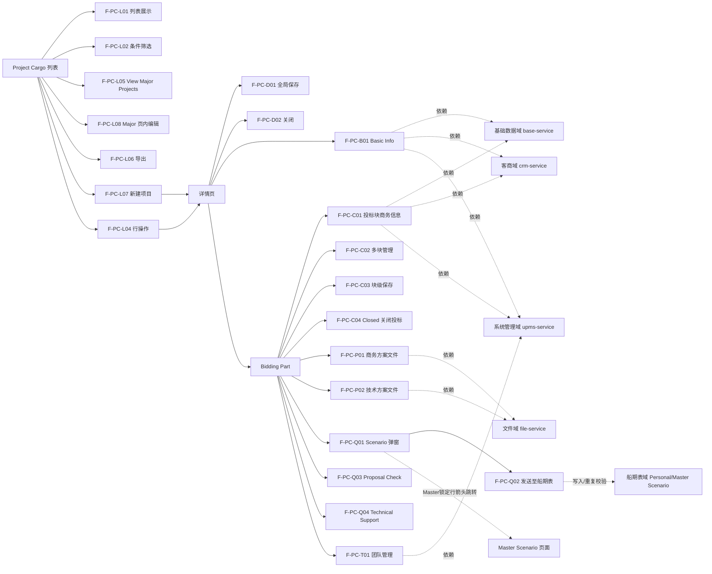

# Project Cargo 功能清单

## 文档信息

| 项目   | 内容                                                                  |
| ---- | ------------------------------------------------------------------- |
| 文档名称 | Project Cargo 功能清单                                                  |
| 版本   | v1.2.9                                                              |
| 创建日期 | 2026-06-04                                                          |
| 更新日期 | 2026-10-10                                                          |
| 依据文档 | Project Cargo-需求分析.md v1.15（2026-05-31）；Project Cargo-需求变更清单 v1.1.0 |
| BA   | 邵艺晨                                                                 |
| 评审人  | —                                                                   |

> **改造说明**：本文档描述 Project Cargo 页面整体重构后的目标功能。旧版本的批次信息、浆厂/COA 货量、竞争对手、项目阶段、Note/Report/Attachment 模块，以及 RFQ、Deliverables、Attachment Tab 全部移除；Proposal/BAFO Review 为全新文件管理方式；页面整体由原多 Tab 结构改为「列表页 + 详情页（Basic Info + Bidding Part）」两层结构。

---

## 一、功能模块清单

### 1.1 列表页面

| 功能编号     | 功能名称                   | 功能描述                                                                                                                                                                                                                                                                                                                                                                                                                                                                                                                                                                                                                                                                                                                                                                                                                                                                                                                                                   | 优先级 | 状态  |
| -------- | ---------------------- | ------------------------------------------------------------------------------------------------------------------------------------------------------------------------------------------------------------------------------------------------------------------------------------------------------------------------------------------------------------------------------------------------------------------------------------------------------------------------------------------------------------------------------------------------------------------------------------------------------------------------------------------------------------------------------------------------------------------------------------------------------------------------------------------------------------------------------------------------------------------------------------------------------------------------------------------------------ | --- | --- |
| F-PC-L01 | 项目列表展示                 | 以分页表格展示当前用户有查看权限范围内的项目记录。**行粒度**：默认一行对应一个项目；**仅当该项目下存在多个不同 Direct Client 时**，按 Direct Client 拆分为多行，项目级信息在拆分行上完整重复展示（不合并单元格）。标准列表列包括：No.、Priority、Project Market、Project Type（多值以分号分隔）、Project Name、Project Status、End Client、Direct Client、Project Period、Project Location、PID、Status、Primary Person(s) in Charge、Last Updated、Operate（规则见 F-PC-L04）。**字段取值**：未拆行时，Direct Client 展示该项目唯一直接客户；PID、Status、Primary Person(s) in Charge 取该项目所有投标块的数据。拆行时，每行展示一个 Direct Client；PID、Status、Primary Person(s) in Charge 仅取该 Direct Client 下关联投标块的数据；项目级列各行重复展示相同值。**多投标块展示**：当同一可见行包含多个投标块时，PID 与 Status 在各自单元格内按投标块顺序分行展示并一一对齐，每个 Status 对应同一内部行的 PID；PIC 仍按人员去重后以分号分隔。每列支持三态排序（初始/升序/降序循环切换），Status 列除外。无外部依赖。 | P0  | 待开发 |
| F-PC-L02 | 列表条件筛选                 | 列表筛选作用于项目记录，展示行数由 F-PC-L01 拆行规则决定；在标准列表与 View Major Projects 视图下均生效（仅列结构不同，数据范围相同）。**【快捷筛选】** 列表页提供 Float-over Only 快捷筛选按钮：点击后追加条件「项目 Project Type 集合包含 Float-over」，可与筛选面板其他条件 AND 叠加；再次点击取消该快捷条件；按钮激活态与条件保持同步；Reset 时一并清除。**【筛选面板】** 筛选器默认收起，点击筛选按钮展开；支持按 Priority、Project Market、Project Type、Project Name（模糊）、Project Status、End Client、Direct Client、Project Period（年月区间）、Project Location（模糊）、PID、Primary Person(s) in Charge（**表格单选**）、Last Updated（**年月日选择器**）组合筛选。Direct Client 筛选：项目下任一投标块的 Direct Client 与所选值一致即命中；若该项目因多 Direct Client 拆行，仅展示命中客户的拆分行。PID 筛选：项目下任一投标块 PID 命中即纳入该项目（支持多个 PID 以分号分隔输入，任一匹配即可）；拆行展示时仅保留含命中 PID 的拆分行。Primary Person(s) in Charge 筛选：项目下任一投标块 PIC 与所选用户一致即纳入该项目；拆行展示时仅保留含命中 PIC 的拆分行。提供 Search 执行检索、Reset 清空全部条件；Reset 后仍停留在筛选面板可继续修改。依赖基础数据域提供市场类型字典、客商域提供终端客户/直接客户选项、系统管理域提供用户选项。                                                                                                                              | P0  | 待开发 |
| F-PC-L03 | 列表分页与密度                | 支持每页 10/20/50/100 条切换，支持页码跳转；序号（No.）按列表可见行连续编排；筛选或排序后序号从 1 重新排列。无外部依赖。                                                                                                                                                                                                                                                                                                                                                                                                                                                                                                                                                                                                                                                                                                                                                                                                                                                                                 | P0  | 待开发 |
| F-PC-L04 | 行操作：查看 / 编辑 / 置顶       | 列表行默认对应项目；仅多 Direct Client 拆行时，每行对应一个 Direct Client 维度。每行操作列提供查看、编辑（仅有编辑权限时显示）、置顶三个入口。点击查看或编辑：未拆行项目进入详情页，默认打开首个投标块；拆行项目进入详情页，默认定位到与该行 Direct Client 关联的投标块（该客户下有多块时默认第一块）。置顶按列表可见行粒度，为当前用户私有，持久化保存（含重新登录后保留），用户主动取消前始终有效；单用户置顶上限 50 条，超限时提示「Pin limit reached (50).」并取消本次操作；无编辑权限的用户进入详情后为全局只读锁定态。无外部依赖。                                                                                                                                                                                                                                                                                                                                                                                                                                                                                                                                                                                                                                               | P0  | 待开发 |
| F-PC-L05 | View Major Projects 视图 | 列表页提供 **「View Major Projects」** 按钮。点击后在**不改变当前筛选条件及置顶结果**的前提下，将列表切换为 **Major Project Tracker** 展示模式；再次点击退出，恢复标准列表视图，按钮恢复未激活态。**【工具栏】** 视图切换不改变页面框架，筛选面板、Float-over Only 快捷筛选、New Project 等按钮**始终保留**；仅列表表格区域切换列结构与展示规则。View Major Projects 按钮在 Major 视图下呈激活/选中态。**【列结构（23 列，A–W）】** A-Project Name（项目级）、B-Priority（项目级）、C-Market（项目级）、D-Project Type（项目级，多值分号分隔）、E-Project Location（项目级）、F-Project Description（项目级）、G-Project Period（项目级）、H-End Client（项目级）、I-Project Status（项目级）、J-PID（投标块级）、K-Direct Client（投标块级）、L-Cargo/Scope（投标块级）、M-Vessel(s)（投标块级）、N-Laycan（投标块级）、O-POL（投标块级）、P-POD（投标块级）、Q-Project Developments（投标块级）、R-Likelihood to Award（投标块级）、S-Status（投标块级）、T-Commercial Remark（Freight/Dayrate）（投标块级）、U-Technical Remark（Challenge/Restrictions）（投标块级）、V-Expected Time to Award（投标块级）、W-PIC（投标块级）。**【展示规则】** 同一项目多个投标块时，A–I 列纵向合并（项目级字段只显示一次）；J–W 列按投标块分行；No./查看/编辑/置顶按投标块粒度，点击进入详情时默认定位对应投标块。页内编辑规则见 F-PC-L08；导出按钮切换规则见 F-PC-L06。无外部依赖。 | P1  | 待开发 |
| F-PC-L06 | 导出项目清单                 | 列表页右上角提供**同一导出按钮位** **「Export Project List」**（标准列表与 View Major Projects 视图下按钮名与交互一致，均保留下拉箭头），不并列展示两个导出按钮。点击后以下拉菜单提供两种导出：①「Export filtered records / 导出当前筛选结果」（原 Export filtered & Pinned records）——直接导出 xlsx，**仅含当前筛选命中记录**，**不再额外汇出置顶记录**（置顶行若同时命中筛选，仍随筛选结果导出）；②「选择导出」——No. 列切换为勾选框，默认全选，用户勾选待导出行后导出 xlsx。**【标准列表视图】** 导出列与标准列表一致，包含 PID 后的投标块 Status 列；同一可见行含多个投标块时，导出结果中 PID 与 Status 按相同顺序一一对应（含多 Direct Client 拆行规则，见 F-PC-L01）。**【View Major Projects 视图】** 下拉两项交互与标准视图相同；导出列结构与合并规则与 Major 视图一致；方式一数据范围同为当前筛选结果（不含因置顶追加的未命中记录）；生成文件名 `Major Project Tracker_YYYYMMDD_HHmmss.xlsx`，文件顶部显示 `Last updated - YYYYMMDD`。无外部依赖。 | P1  | 待开发 |
| F-PC-L07 | 新建项目                   | 点击「New Project」按钮，跳转至详情页新建模式，页面标题为「New Project」。无外部依赖。                                                                                                                                                                                                                                                                                                                                                                                                                                                                                                                                                                                                                                                                                                                                                                                                                                                                                                 | P0  | 待开发 |
| F-PC-L08 | Major 视图页内编辑           | 在 **View Major Projects** 视图下，具备编辑权限的用户可在列表页面对指定字段**直接编辑并保存**，无需进入详情页；无编辑权限用户上述列只读。**可编辑字段（5 项，均为投标块级）**：① **S-Status**（投标块 Status，下拉，选项 Open/Budgetary/Firm/Fixed/Closed/Lost，不含 Booked，与 F-PC-C01 一致）；② **Q-Project Developments**；③ **V-Expected Time to Award**（年月选择器，非必填，可清空）；④ **T-Commercial Remark（Freight/Dayrate）**（文本框）；⑤ **U-Technical Remark（Challenge/Restrictions）**（文本框）。**说明**：I-Project Status（项目级）在 Major 视图中不支持页内编辑；F-PC-L09 的 Project Status 快捷编辑仅适用于标准列表视图。**交互**：可编辑列以浅色内嵌控件（文本框/下拉/年月选择器）**常驻展示**，无需点击单元格再进入编辑态；控件样式与表格协调、不过分突兀；编辑完成（失焦或控件确认）后自动保存；保存成功后列表即时刷新展示最新值；A–I 合并单元格垂直居中对齐。**数据与规则**：与详情页共用同一数据源，各字段对应当前投标块独立存储；投标块 Status 为 Booked、Closed 或 Lost 时，除 S-Status 外该投标块行的 Q/V/T/U 只读（与 F-PC-C04 一致）。无外部依赖。 | P1  | 待开发 |
| F-PC-L09 | 标准列表状态快捷编辑             | 在**标准列表视图**下，具备编辑权限的用户可通过常驻下拉框快捷修改 **Project Status** 和投标块 **Status**，无需进入详情页；无编辑权限用户只读展示。Project Status 为项目级字段，下拉选项为 Budgetary/Firm/Proceed/Closed；同一项目因多个 Direct Client 拆成多行时，在任一拆分行修改均更新该项目，其他拆分行同步刷新。Status 为投标块级字段，下拉选项为 Open/Budgetary/Firm/Fixed/Closed/Lost，不提供手工选择 Booked；当前值为 Booked 时仍展示该系统状态。单行仅一个 PID 时展示一个 Status 下拉；单行包含多个 PID 时，每个 PID 对应一个独立 Status 下拉，二者按投标块顺序分行对齐，修改仅作用于对应 PID 的投标块。用户确认选项后自动保存；保存成功后列表、详情页及其他视图同步最新值，并更新 Last Updated；保存失败时提示失败原因并恢复原值。投标块 Status 为 Booked、Closed 或 Lost 时，Status 字段本身仍按既有状态规则处理，其他字段锁定规则见 F-PC-C04。无外部依赖。 | P0  | 待开发 |

---

### 1.2 详情页全局操作

| 功能编号     | 功能名称  | 功能描述                                                                                                                                     | 优先级 | 状态  |
| -------- | ----- | ---------------------------------------------------------------------------------------------------------------------------------------- | --- | --- |
| F-PC-D01 | 全局保存  | 详情页右上角「Save」按钮，一次性保存 Basic Info 和所有投标块的全部内容，并为每个尚未生成编号的投标块自动分配唯一项目编号（PID）；保存成功后**不自动退出**详情页，可继续编辑。无外部依赖。                                 | P0  | 待开发 |
| F-PC-D02 | 关闭详情页 | 点击「Close」返回列表；若存在未保存修改，弹出确认弹窗提示「You have unsaved changes. Do you want to save?」，提供 Cancel（留在当前页）、No（直接返回列表放弃修改）、Yes（先保存再返回列表）三个选项。无外部依赖。 | P0  | 待开发 |

---

### 1.3 Basic Info

| 功能编号     | 功能名称     | 功能描述                                                                                                                                                                                                                                                                                                                                                                                                                                                                                                                                                                                                                                                 | 优先级 | 状态  |
| -------- | -------- | ---------------------------------------------------------------------------------------------------------------------------------------------------------------------------------------------------------------------------------------------------------------------------------------------------------------------------------------------------------------------------------------------------------------------------------------------------------------------------------------------------------------------------------------------------------------------------------------------------------------------------------------------------- | --- | --- |
| F-PC-B01 | 维护项目基本信息 | 维护项目级基础信息，包括：Project Name（必填）、Priority（必填，Normal/High）、Project Status（必填，Budgetary 默认/Firm/Proceed/Closed，用户手工选择并保存，列表 Project Status 列展示该值，带 i 图标提示：About how likely this project will process as a firm）、Project Market（必填，表格选择）、End Client（非必填，表格选择，支持临时新增客户）、Project Type（必填，**标签式多选**，可选值：Float-over / Time / Voyage / Multiple Voy，至少选一项；下拉点选后以标签保留在输入框内，可继续追加、可逐条 × 移除；列表展示时多值以分号分隔）、Project Period（必填，起止年月各一个年月选择器）、Project Location（必填，文本）、Creator（必填，项目创建人，**不可修改**；新建时自动填充为当前登录用户，即创建该 Project 的用户；已保存项目再次打开时展示已保存值，仍不可修改；不提供 Select User 弹窗改人）、Project Description（必填，文本框，自动调整高度展示全量文本）。依赖基础数据域提供市场类型字典，依赖客商域提供终端客户选项；Creator 由登录用户自动写入，不依赖选人弹窗。 | P0  | 待开发 |

---

### 1.4 Bidding Part — 投标块管理

| 功能编号     | 功能名称             | 功能描述                                                                                                                                                                                                                                                                                                                                                                                                                                                                                                                                                                                                                                                                                                                                                                                                                                                                                                                                                                                                                                                                                                                                                                         | 优先级 | 状态  |
| -------- | ---------------- | ---------------------------------------------------------------------------------------------------------------------------------------------------------------------------------------------------------------------------------------------------------------------------------------------------------------------------------------------------------------------------------------------------------------------------------------------------------------------------------------------------------------------------------------------------------------------------------------------------------------------------------------------------------------------------------------------------------------------------------------------------------------------------------------------------------------------------------------------------------------------------------------------------------------------------------------------------------------------------------------------------------------------------------------------------------------------------------------------------------------------------------------------------------------------------- | --- | --- |
| F-PC-C01 | 维护投标块商务信息        | 每个投标块维护单次投标的核心商务信息，包括：Charterer/Direct Client（必填，表格选择）、Likelihood to Award（必填，High/Medium/Low；带 i 提示：How likely this will be awarded to us; select from the following options: Low, Medium, High）、PID（系统保存后自动生成，不可手工填写）、Status（必填，Open/Budgetary/Firm/Fixed/Closed/Lost，不含 Booked；存在合同关联该编号时系统自动设为 Booked）、PIC（必填，默认为当前投标块创建人，可通过弹窗选人修改）、POL（必填，港口多选）、POD（必填，港口多选）、Planned Laycan（必填，年月区间，可勾选「Same as Basic Info」与 Basic Info Project Period 同步）、Cargo / Scope / Updates（必填，文本）、Project Development（非必填，文本框，自动调整高度，位于本投标块 Cargo/Scope/Updates 与 Team 之间）、Proposed Vessel(s) / Shipments（必填，通过「Proposed Vessel(s)」弹窗多选，支持搜索；表格字段为 Vessel No.、Vessel Name、Vessel Type；选船并 **Save** 后驱动 Firm/Send to Scenario 弹窗船期列表按 F-PC-Q01 规则同步）、Expected Time to Award（非必填，年月选择器，预计授标时间；用户可留空不填；对应 Major Project Tracker 列 V）、Commercial Remark（Freight/Dayrate）、Technical Remark（Challenge/Restrictions）、Team（默认含创建该块的用户）、Shared Workspace（非必填，文本框）。投标块操作区提供 Firm/Send to Scenario、Proposal Check、Technical Support、Save 按钮，**始终展示**。**状态锁定**：当 Status 为 Booked、Closed 或 Lost 且**已保存**后，除 Status 外其余字段只读；仅变更 Status 下拉、尚未 Save 时其余字段仍可编辑。依赖基础数据域提供港口主数据和船舶主数据，客商域提供直接客户选项，系统管理域提供负责人弹窗选人。 | P0  | 待开发 |
| F-PC-C02 | 多投标块管理（新增/删除）    | 详情页 Bidding Part 区域提供加号（+）新增投标块；每个新块与其他块结构相同；尚未保存且未生成项目编号（PID）的块，标题旁显示「×」可删除（删除前需确认）；一旦已保存生成 PID 后不可删除该投标块；通过将投标块状态设为 Closed 并保存来关闭投标，无独立「Close」按钮。无外部依赖。                                                                                                                                                                                                                                                                                                                                                                                                                                                                                                                                                                                                                                                                                                                                                                                                                                                                                                                                                                                                                    | P0  | 待开发 |
| F-PC-C03 | 投标块级保存           | 每个投标块提供独立的「Save」按钮，仅保存本投标块内容并为该块生成项目编号（PID），不影响其他块和 Basic Info 的保存状态。无外部依赖。                                                                                                                                                                                                                                                                                                                                                                                                                                                                                                                                                                                                                                                                                                                                                                                                                                                                                                                                                                                                                                                                                                  | P0  | 待开发 |
| F-PC-C04 | 状态设为 Closed 关闭投标 | 将投标块状态字段设为「Closed」并**点击 Save 保存后**，即完成关闭操作；保存后该块除 Status 字段外其余字段均变为只读；状态为 Booked 或 Lost 时在保存后同样进入只读锁定（除 Status 外）。**仅变更状态下拉值、尚未保存时**，其余字段仍可编辑；Firm/Send to Scenario、Proposal Check、Technical Support 等操作按钮**始终展示**，不因状态值变化而隐藏。无外部依赖。                                                                                                                                                                                                                                                                                                                                                                                                                                                                                                                                                                                                                                                                                                                                                                                                                                                                                                                                         | P0  | 待开发 |

---

### 1.5 Proposal / BAFO Review — 文件管理

| 功能编号     | 功能名称     | 功能描述                                                                                                                                                                                                                                                                                                         | 优先级 | 状态  |
| -------- | -------- | ------------------------------------------------------------------------------------------------------------------------------------------------------------------------------------------------------------------------------------------------------------------------------------------------------------ | --- | --- |
| F-PC-P01 | 商务方案文件管理 | 每个投标块内包含「Upload Commercial Proposal（Freight & Precal）」文件上传区；点击「Upload」按钮打开本地文件选择器（支持多选），上传成功后文件写入该区下方表格，展示 No.、File Name、Uploaded by、Upload time 及 Operate；Operate 列提供预览、下载、删除三个图标按钮；删除前二次确认；支持多次上传追加，不限单文件。Proposal Check 弹窗（F-PC-Q03）中对应字段标题展示为 **Commercial Remark（Freight/Dayrate）**。依赖文件域提供文件存储和在线预览能力。 | P1  | 待开发 |
| F-PC-P02 | 技术方案文件管理 | 每个投标块内包含「Upload Technical Proposal（Stowage Plan）」文件上传区；结构和规则与商务方案文件管理完全一致，二者各自独立互不影响；支持多文件上传。Proposal Check 弹窗（F-PC-Q03）中对应字段标题展示为 **Technical Remark（Challenge/Restrictions）**。依赖文件域提供文件存储和在线预览能力。                                                                                                          | P1  | 待开发 |

---

### 1.6 投标块快捷操作

| 功能编号     | 功能名称                       | 功能描述                                                                                                                                                                                                                                                                                                                                                                                                                                                                                                                                                                                                                                                                                                                                                                                                                                                                                                                                                                                                                                                                                                                                                                                                                       | 优先级 | 状态  |
| -------- | -------------------------- | -------------------------------------------------------------------------------------------------------------------------------------------------------------------------------------------------------------------------------------------------------------------------------------------------------------------------------------------------------------------------------------------------------------------------------------------------------------------------------------------------------------------------------------------------------------------------------------------------------------------------------------------------------------------------------------------------------------------------------------------------------------------------------------------------------------------------------------------------------------------------------------------------------------------------------------------------------------------------------------------------------------------------------------------------------------------------------------------------------------------------------------------------------------------------------------------------------------------------- | --- | --- |
| F-PC-Q01 | Scenario 弹窗 — Shipment 管理  | 点击投标块的「Firm/Send to Scenario」按钮弹出 Scenario 弹窗；弹窗维护 Shipment 表（每行代表一条拟议航次方案）。**【与 Proposed Vessel 联动】** 在投标块 Proposed Vessel(s)/Shipments 中选择船舶并 **Save** 后，所选船舶自动填充到本弹窗船期列表（多船多行）；再次修改 Proposed Vessel 并 Save 时：已成功 Send to Master Scenario 的船期行**保留**；船舶已不在当前 Proposed Vessel 中且尚未 Master 锁定的船期行由系统**自动移除**；新增 Proposed Vessel 自动补行。**【Vessel 可选范围】** 修改 Vessel 或 + ADD 新增行时，可选船舶**仅限于**当前 Proposed Vessel(s) 已选船舶。打开弹窗或点击「ADD」时系统自动填充：PID、Project Name、Vessel、Start/End time（日期默认取当月 1 日）、Start Port、End Port、Status 默认为 Firm、PIC；未锁定行各字段可在弹窗内修改；Days、Start time、End time 三者可相互推算；Window span(day) 通过弹窗选择（沿用现有逻辑）；**弹窗不提供行级删除按钮**，船期行减少仅通过 Proposed Vessel 变更同步自动移除未锁定行，或由 Master Scenario 侧删改回传；**Master 置灰锁定行不可编辑**。同步仅影响弹窗内船期行；**已写入 Master Scenario / 船期表的正式记录本身不受 Proposed Vessel 变更影响**。无外部依赖（船舶选项来自本投标块已保存的 Proposed Vessel）。                                                                                                                                                                                                                                                                                                                                                                                     | P0  | 待开发 |
| F-PC-Q02 | 发送至船期表                     | 在 Scenario 弹窗中勾选 Shipment 行后，提供两个独立发送按钮：**Send to Personal Scenario**、**Send to Master Scenario**。**【Send to Personal Scenario】** 向当前用户的 Personal Scenario 写入对应船期记录，命名格式为「PID-Project Name-Shipment#n」（n 依序递增）；发送成功后弹窗内该行**不锁定**，仍可继续编辑及再次发送；Personal Scenario 侧对该记录的修改**不回传**至弹窗对应行。**【Send to Master Scenario】** 向 Master Scenario 写入对应船期记录，命名规则同上；发送成功后弹窗内该行**置灰锁定**，禁止再次 **Send to Master Scenario** 及行内字段**编辑**（后续编辑或删除须在 Master Scenario 操作；弹窗本身无行级删除按钮）；锁定行右侧出现**向右箭头**，点击可跳转至 Master Scenario 页面；已 Master 锁定的行**仍可勾选**并执行 **Send to Personal Scenario**；弹窗行与 Master Scenario 记录建立绑定，Master Scenario 侧对该记录的删改**同步回传**至弹窗对应行。**【重复发送校验（点击时批量校验）】** 点击任一发送按钮时，对当前已勾选的全部行调用船期表域接口：Personal 按钮校验 Personal Scenario 中是否已存在与该 Shipment 待发送内容**完全相同**的记录（存在则该行不可发）；Master 按钮对已 Master 锁定行视为已存在；任一勾选行不通过则**整批发送失败**、不写入任何记录，不满足校验的行其重复判定字段（Vessel、Start/End Time、Days、Start/End Port、Window span、Status、PIC）**标红**；发送按钮不因重复预判置灰，修正字段或调整勾选后可重试。**【通用规则】** 发送动作为后台数据同步，成功后提示成功，**发送本身不跳转**船期表菜单（Master 锁定行的箭头跳转除外）；**已成功写入Master船期表的记录**不受后续投标块字段修改影响，须在Master Scenario 侧独立操作；**例外**：修改 Proposed Vessel 并 Save 时按 F-PC-Q01 增删弹窗内未锁定行，已 Master 锁定行保留，不改写已写入船期表的正式记录。依赖船期表域提供 Personal/Master Scenario 写入、重复判定及 Master 侧变更回传能力。 | P1  | 待开发 |
| F-PC-Q03 | Proposal Check — 方案审阅与团队邮件 | 点击「Proposal Check」按钮弹出审阅弹窗；弹窗展示可编辑的邮件开头文本区域，支持「Set as Template」保存为个人模板（下次打开自动载入）；弹窗内可编辑的字段标题与投标块保持一致：Commercial Remark（Freight/Dayrate）、Technical Remark（Challenge/Restrictions）、Team、Shared Workspace；点击「Request Team Review」向当前投标块团队成员发送审核邮件，邮件包含用户编辑后的开头文本、项目基本信息，并附上两类上传区当前仍存在的全部文件（已删除文件不含）；发送失败时弹窗提示，用户可选择重新发送或取消；点击「Cancel」关闭弹窗。无外部依赖（邮件发送依赖基础设施域）。                                                                                                                                                                                                                                                                                                                                                                                                                                                                                                                                                                                                                                                                                                                                                                                                                                                                 | P1  | 待开发 |
| F-PC-Q04 | Technical Support（配载申请）    | 点击「Technical Support」按钮，交互逻辑与原有 Stowage Apply 一致，向相关技术团队发起配载支持申请。无外部依赖。                                                                                                                                                                                                                                                                                                                                                                                                                                                                                                                                                                                                                                                                                                                                                                                                                                                                                                                                                                                                                                                                                                                                                    | P1  | 待开发 |

---

### 1.7 团队与客户管理

| 功能编号     | 功能名称     | 功能描述                                                                                                                                                       | 优先级 | 状态  |
| -------- | -------- | ---------------------------------------------------------------------------------------------------------------------------------------------------------- | --- | --- |
| F-PC-T01 | 项目团队管理   | 在 Commercial Bid 区域点击「Team」打开团队管理弹窗；弹窗功能与现有 Teams 页面能力完全一致（字段、角色类型、增删成员等），改造仅将呈现方式从独立 Tab 改为弹窗形式；团队成员默认包含创建该投标块的用户。依赖系统管理域提供角色和用户数据。                       | P0  | 待开发 |
| F-PC-T02 | 客户信息临时新增 | 终端客户（End Client）和直接客户（Charterer/Direct Client）选择器上提供「增加」入口；点击后弹出客户信息管理弹窗，临时新增的客户可先被当前项目字段引用以满足必填要求；提交审批通过后方写入全局客户主数据，审批前仅本项目可用。依赖客商域提供客户创建功能、工作流域处理客户审批流程。 | P2  | 待开发 |

---

## 二、优先级说明

| 优先级 | 说明        |
| --- | --------- |
| P0  | 核心功能，必须实现 |
| P1  | 重要功能，应该实现 |
| P2  | 次要功能，可以延后 |

---

## 三、功能依赖关系

---

## 四、待确认事项

| 序号  | 问题                                                               | 影响功能                                  |
| --- | ---------------------------------------------------------------- | ------------------------------------- |
| 1   | 权限矩阵待业务提供：哪些角色可以查看/编辑/新建/导出/发送 Scenario 等，以及数据范围划分维度（团队/角色/负责人等） | F-PC-L01、F-PC-L04、F-PC-D01、F-PC-L08 等 |
| 2   | 新建客户临时新增后的审批流程（F-PC-T02）：审批链路、审批角色待业务提供                          | F-PC-T02                              |

---

## 五、变更记录

| 版本     | 日期         | 变更内容                                                                                                                                                                                                                                                                                                   | 变更人 |
| ------ | ---------- | ------------------------------------------------------------------------------------------------------------------------------------------------------------------------------------------------------------------------------------------------------------------------------------------------------ | --- |
| v1.0.0 | 2026-06-04 | 基于反向生成功能清单与需求分析文档生成                                                                                                                                                                                                                                                                                    | 邵艺晨 |
| v1.1.0 | 2026-06-08 | 根据需求变更清单 v1.1.0 更新：Float-over Only 快捷筛选、列表多 Direct Client 拆行、导出按钮更名、View Major Projects 视图重构（含 23 列定义及导出）、Project Type 改多选、Project Development 移至投标 Tab、新增 Expected Time to Award、Commercial/Technical Remark 补副标题；修订 L01/L02/L04 行粒度表述（默认一行一项目，仅多 Direct Client 时拆行）；明确 L05/L06 工具栏保留、导出按钮随视图切换（方案 A） | 邵艺晨 |
| v1.1.1 | 2026-06-08 | F-PC-C01：Expected Time to Award 改为非必填年月选择器；修正 Project Development 字段描述                                                                                                                                                                                                                                 | 邵艺晨 |
| v1.2.0 | 2026-06-08 | 新增 F-PC-L08：Major 视图页内编辑（投标块 Status、Project Development、Expected Time to Award、Commercial/Technical Remark）                                                                                                                                                                                            | 邵艺晨 |
| v1.2.1 | 2026-06-08 | F-PC-L08 修正：Status 指投标块 Status（列 S），非 Project Status（列 I）                                                                                                                                                                                                                                              | 邵艺晨 |
| v1.2.2 | 2026-06-08 | F-PC-C01/L05/L08：Project Development 修正为投标块级（各块独立），非 Tab 级共享                                                                                                                                                                                                                                           | 邵艺晨 |
| v1.2.3 | 2026-06-09 | 对齐原型确认：L02 Project Type 标签式多选、PIC 表格单选、Last Updated 年月日选择器；L04 置顶上限提示改为 Pin limit reached (50).；L06 导出按钮 Major 视图下保持 Export Project List 双选项下拉，仅文件名/模板区分；L08 Major 页内编辑改为常驻浅色控件；B01 Project Type 标签式多选；C04 状态锁定须 Save 后生效、操作按钮始终展示                                                                     | 邵艺晨 |
| v1.2.4 | 2026-06-09 | F-PC-Q02 澄清：Personal/Master 发送行为分离——Personal 发送不锁定、不回传；Master 发送后锁定并回传 Master 侧变更；Personal 发送前对接船期表域校验重复记录，已存在完全相同记录时按钮置灰；Master 不做重复校验，以发送后行锁定作为已发送反馈                                                                                                                                                 | 邵艺晨 |
| v1.2.5 | 2026-06-11 | F-PC-Q02 修订：Master 锁定行仍可勾选 Send to Personal；重复校验改为点击 Personal/Master 发送时批量执行，失败则整批不发送并对重复判定字段标红，取消发送前按钮置灰                                                                                                                                                                                              | 邵艺晨 |
| v1.2.6 | 2026-08-07 | 船期联动修订：F-PC-C01 Proposed Vessel 改为弹窗多选（Vessel No./Name/Type）并 Save 驱动 Scenario；F-PC-Q01 Vessel 仅限 Proposed Vessel、增删同步与 Master 锁定行保留；F-PC-Q02 Master 锁定禁删+箭头跳转、区分发送不跳转与箭头跳转、澄清已发船期表记录不受投标块改动影响（未锁定行除外）                                                                                                 | 邵艺晨 |
| v1.2.7 | 2026-08-07 | F-PC-L06：Export filtered & Pinned records 改为仅导出当前筛选结果（不再额外汇出置顶）；F-PC-B01：Creator 创建时自动填充且全程不可修改，取消 Select User 改人                                                                                                                                                                                      | 邵艺晨 |
| v1.2.8 | 2026-08-07 | F-PC-Q01/Q02：明确 Scenario 弹窗不提供行级删除按钮；行减少仅靠 Proposed Vessel 同步或 Master Scenario 侧操作；Master 锁定口径改为禁编辑                                                                                                                                                                                                    | 邵艺晨 |
| v1.2.9 | 2026-10-10 | F-PC-L01/L06：标准列表在 PID 后新增投标块 Status，多 PID 时按投标块分行对齐并同步导出；新增 F-PC-L09：标准列表支持 Project Status 与投标块 Status 下拉快捷编辑；F-PC-L08/B01 澄清 Project Status 与投标块 Status 的视图及字段口径 | 邵艺晨 |

