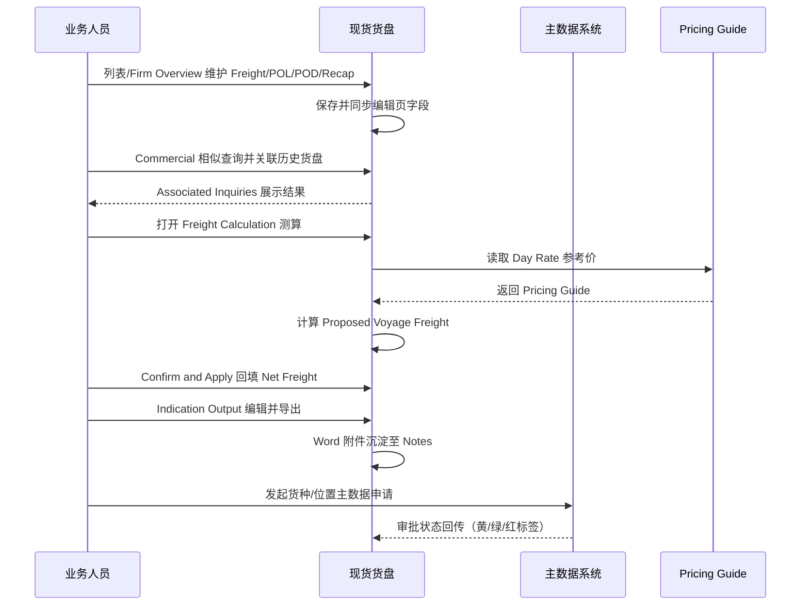
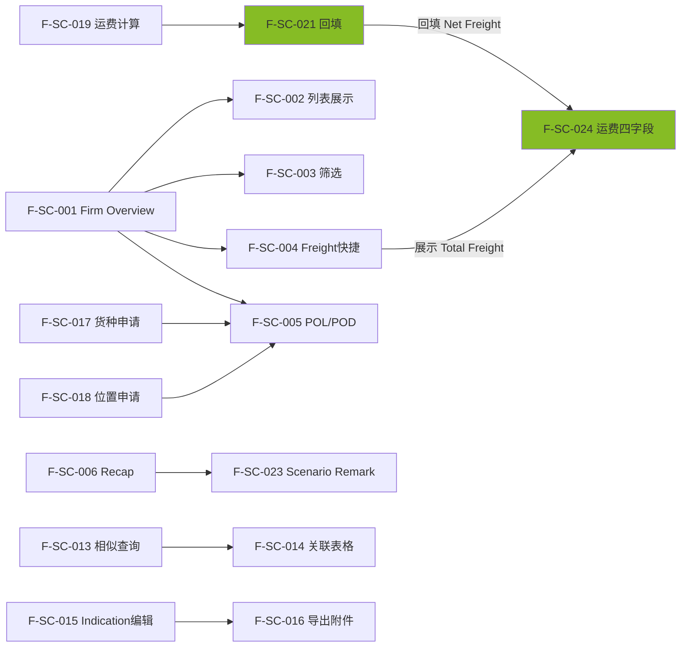

### Spot Cargo 页面改造模块功能清单

## 文档说明

| 项目   | 内容                                           |
| ---- | -------------------------------------------- |
| 产物类型 | 功能清单（与用户故事合称「正向开发的起点」）                       |
| 命名   | `PRD-SpotCargo页面改造-功能清单.md`（每模块唯一，累计追加）      |
| 职责   | 第一、二章引言与总体描述；第三章业务需求分析；第四章功能需求（功能列表 + 角色与权限） |
| 适用范围 | 全部公司（Spot Cargo 现货货盘管理）                      |
| 模板版本 | v1.6                                         |

## 文档信息

| 项目       | 内容                                                                             |
| -------- | ------------------------------------------------------------------------------ |
| 文档名称     | Spot Cargo 页面改造模块功能清单                                                          |
| 微服务 / 模块 | HTZT-CIS / Spot Cargo（spotcargo）页面改造                                           |
| 版本       | v1.0.4                                                                         |
| 创建日期     | 2026-08-27                                                                     |
| 需求来源     | `Spot Cargo需求分析.md` v1.0.13、`Spot-Cargo-v1.5.html`、`关于SpotCargo指标口径-v1.0.xlsx` |

---

## 一、引言

### 1.1 目的

本文档用于定义 Spot Cargo 页面本次改造范围内的功能目录、业务需求分析与角色权限，作为产品、开发、测试的共同基线。单功能验收细节与交互规则见关联用户故事 `PRD-SpotCargo页面改造-UserStory-v1.0.0.md`。

### 1.2 范围

**在范围内：**

- Spot Cargo 列表页与 Firm Overview 视图（含筛选、快捷维护、置顶、导出；Export 含 Export Port Distribution）
- 编辑页 Project info 字段调整（Recap、Shared Workspace、长期未更新提醒）
- Proposed Vessel 快捷船型选择
- Commercial 相似项目查询、Associated Inquiries 关联
- Indication Output 在线编辑与导出
- Scenario Remark 与 Recap 联动（仅 Remark 部分）
- Cargo Type / POL / POD 主数据申请入口
- Freight Calculation 弹窗（Vessel 船舶单选、按所选船舶测算、版本、导入导出、Day Rate 偏离提醒、运费回填）

**不在范围内：**

- 旧 Spot Cargo 页面中本次未改造的功能（默认保持旧页面一致）
- 主数据审批后台实现

### 1.3 定义、简写和省略语

| 术语 / 简写              | 全称或含义                                           |
| -------------------- | ----------------------------------------------- |
| Spot Cargo           | 现货货盘管理页面                                        |
| Firm Overview        | 面向全部项目的列表概览视图，用于快速查看和维护核心字段                     |
| Recap                | 项目摘要字段，含 Competitor、Project Development 等项目进展内容 |
| Associated Inquiries | 与当前货盘条件相似的历史货盘列表                                |
| Indication           | 对外报价函内容                                         |
| Scenario             | 发送至船期表弹窗                                        |
| Freight Calculation  | 运费计算弹窗，按所选船舶基于线下台账逻辑测算运费                        |
| Pricing Guide        | 系统提供的 Day Rate 参考价格                             |
| Net Freight          | 运费计算结果回填字段                                      |
| Extra Cost           | 额外费用字段                                          |
| Total Freight        | 总运费，等于 Net Freight + Extra Cost                 |
| PID                  | 货盘项目编号                                          |

---

## 二、总体描述

### 2.1 需求背景

Spot Cargo 页面用于管理现货货盘。现有页面已具备基础录入、查看、编辑能力，但业务使用中仍存在：列表无法从项目概览视角快速维护关键字段；缺少相似历史货盘匹配关联；Indication 需在线编辑并导出存档；运费计算模板待更新；Scenario、Recap、Freight、POL/POD、主数据申请联动分散。

### 2.2 建设目标

- 支持 Firm Overview 集中查看和维护全部项目关键经营字段
- 支持 Freight、POL、POD、Recap 在列表或编辑页快捷修改并保持同步
- 支持按匹配并关联相似货盘，辅助报价与业务判断
- 支持 Indication 在线编辑（含插图）、保存、导出并自动存档 Word 附件
- 支持 Freight Calculation 按所选船舶结构化测算、版本保存、Excel 导入导出、Day Rate 偏离提醒与结果回填
- 支持 Cargo Type、POL、POD 主数据申请入口，降低主数据缺失导致的录入阻塞

### 2.3 软件功能要求

本模块需具备：双视图列表（默认列表 / Firm Overview）、列表快捷编辑与置顶导出、编辑页基础信息扩展、Proposed Vessel 快捷选船、Commercial 相似查询与运费维护、Indication 编辑导出、主数据申请弹窗、Freight Calculation 全链路测算与回填、Scenario Remark 与 Recap 联动。逐功能验收见第四章功能列表与关联用户故事。

### 2.5 运行环境

- 浏览器：与现有 HTZT-CIS Web 端一致
- 依赖系统：主数据管理（货种/位置申请）、Pricing Guide、站内消息、附件服务、系统币种与权限服务
- 网络与权限：沿用 Spot Cargo 既有登录与数据权限体系

### 2.6 假定和约束

- 假定用户已具备 Spot Cargo 既有页面访问与编辑权限
- 假定主数据审批结果可回传至 Spot Cargo 标签状态
- 约束：未在本文和原型中明确改造的能力，默认保持旧页面一致
- 约束：Freight Calculation 字段与计算逻辑以 `关于SpotCargo指标口径-v1.0.xlsx` 为准
- 约束：Indication 模板与默认取值以 `CHT现货报价单范本.docx` 为准

---

## 三、业务需求分析

### 3.1 主流程（业务主线）

业务人员在 Spot Cargo 列表维护货盘并进入编辑页完成报价相关操作：列表快捷维护核心字段 → Commercial 查询相似货盘并维护运费 → Freight Calculation 测算并回填 Net Freight → Indication 编辑导出报价函 → 必要时发起主数据申请；列表与编辑页字段保持同步。（关键功能：F-SC-001～008、F-SC-013～016、F-SC-019～021）

### 3.2 异常流程

| 异常点                       | 触发条件                                                    | 系统响应                       |
| ------------------------- | ------------------------------------------------------- | -------------------------- |
| 相似查询条件不完整                 | Charterer/POL/POD/Cargo Type/Shipment Year 任一未填即 Search | 提示并禁止查询                    |
| Indication 未保存退出          | 有未保存修改时 Cancel 或关闭弹窗                                    | 提示「报价函存在未保存的修改…」，可选继续编辑或放弃 |
| Freight Calculation 未保存关闭 | Close 时存在未保存修改                                          | 提示可保存为新版本、不保存关闭或取消         |
| Day Rate 偏离 Pricing Guide | 偏离 5%～10%                                               | 弹窗提醒，不阻断，Day Rate 仍有效      |
| Day Rate 严重偏离             | 偏离 ≥10%                                                 | 站内消息通知 PIC，不发邮件            |
| 置顶数量超限                    | 同一用户置顶超过 50 条                                           | 提示并禁止继续置顶                  |
| 导出未选记录                    | Select to Export 模式下未勾选任何记录                             | 提示至少选择一条                   |
| 主数据审批不通过                  | 货种/位置申请被驳回                                              | 对应标签变为红色，用户可重新处理           |
| LAYCAN 筛选日期无效             | Firm Overview 筛选开始日期晚于结束日期                              | 提示并禁止查询                    |
| Excel 导入失败                | Freight Calculation Excel Import 格式或内容不合法               | 提示导入失败，保持当前工作区不变           |

### 3.3 边界流程

- **置顶与筛选**：筛选后不符合条件的记录（含已置顶）不展示；重置筛选后，仍置顶且符合列表范围的记录回到置顶区。
- **LAYCAN 筛选**：只填单侧日期时使用开放区间；填写任一日期后，无 LAYCAN 的记录不命中。
- **Associated Inquiries 关联持久化**：关联记录在修改查询条件或重新进入页面后仍保留。
- **Freight Calculation 无历史版本**：首次打开 Version 显示 1，测算数值字段留空，Day Rate 可取 Pricing Guide。
- **Indication 导出**：Export as Word/PDF 后清除未保存状态并关闭弹窗；Save 不生成附件但关闭弹窗。

---

## 四、功能需求

### 4.1 功能列表

| 功能编号     | 功能名称                           | 功能描述（用户操作→系统响应→预期结果）                                                                                                                                                                                                                                                                                                            | 适用范围 | 优先级 | 引入版本   | 状态  |
| -------- | ------------------------------ | ------------------------------------------------------------------------------------------------------------------------------------------------------------------------------------------------------------------------------------------------------------------------------------------------------------------------------- | ---- | --- | ------ | --- |
| F-SC-001 | Firm Overview 视图切换             | 点击 Export 左侧 `Firm Overview` → 按钮选中态、列表切换 Firm Overview 视图，Status 图例隐藏；再次点击恢复默认列表与图例 → 视图与按钮状态同步切换                                                                                                                                                                                                                              | 全部公司 | P0  | v1.0.0 | 待开发 |
| F-SC-002 | Firm Overview 列表展示             | 切换 Firm Overview → 展示全部状态货盘核心列（No./Project Name/Vessel/LAYCAN/POL/POD/Freight/Recap/PIC/Operate）；No. 跨页连续编号；指定列支持排序，Recap 不支持排序；置顶记录始终在非置顶之前 → 用户可概览并快捷维护关键字段                                                                                                                                                                   | 全部公司 | P0  | v1.0.0 | 待开发 |
| F-SC-003 | Firm Overview 筛选区              | 切换 Firm Overview → 筛选区仅保留 Project Name/Vessel/LAYCAN/POL/POD/PIC；LAYCAN 按区间交集匹配；开始日期不能晚于结束日期；无 LAYCAN 记录在填写日期后不命中 → 仅展示命中记录                                                                                                                                                                                                     | 全部公司 | P0  | v1.0.0 | 待开发 |
| F-SC-004 | Freight 快捷修改                   | 在默认列表或 Firm Overview 修改 Freight 金额/币种（对应 Total Freight）→ 千分位展示与币种下拉 → 同步详情页 Total Freight 与 Currency；两视图互相同步                                                                                                                                                                                                                    | 全部公司 | P0  | v1.0.0 | 待开发 |
| F-SC-005 | POL/POD 快捷修改与状态标签              | 列表打开 POL/POD 选择器多选修改 → 绿/黄/红标签展示主数据/审批中/审批不通过 → 同步编辑页 Project info 对应字段                                                                                                                                                                                                                                                         | 全部公司 | P0  | v1.0.0 | 待开发 |
| F-SC-006 | Recap 字段与同步                    | 编辑页或 Firm Overview 修改 Recap → 双向同步；默认含 Competitor/Project Development 两行 → 两处内容一致                                                                                                                                                                                                                                               | 全部公司 | P0  | v1.0.0 | 待开发 |
| F-SC-007 | 列表置顶                           | 点击 Operate 置顶 → 记录在当前用户列表置顶区；筛选后不符合条件记录（含置顶）不展示；重置筛选后置顶记录再出现；每用户最多 50 条 → 置顶持久化且受筛选约束                                                                                                                                                                                                                                           | 全部公司 | P1  | v1.0.0 | 待开发 |
| F-SC-008 | Export 功能改造                    | 点击 Export → 选 `Export Filtered results`、`Select to Export` 或 `Export Port Distribution`（见 F-SC-025）；Select to Export 默认全选全部筛选结果（含所有分页）；跨页保留勾选、表头全选仅当前页；未勾选时提示 → 导出勾选记录或当前筛选结果                                                                                                                                                   | 全部公司 | P0  | v1.0.0 | 待开发 |
| F-SC-009 | 列表页 Charterer 列名调整             | 查看默认列表 Charterer 列 → 列名无原注释文字 → 列头简洁展示                                                                                                                                                                                                                                                                                          | 全部公司 | P1  | v1.0.0 | 待开发 |
| F-SC-010 | Shared Workspace               | 编辑页录入 Shared Workspace 链接 → 识别可点击链接、文本框高度自适应 → 可访问共享空间                                                                                                                                                                                                                                                                          | 全部公司 | P1  | v1.0.0 | 待开发 |
| F-SC-011 | 项目进展长期未更新提醒                    | 系统定时检查 Last Updated → 超 3 个月站内通知 PIC；超 6 个月自动 Closed → PIC 收到系统提醒且不发送邮件                                                                                                                                                                                                                                                         | 全部公司 | P1  | v1.0.0 | 待开发 |
| F-SC-012 | Proposed Vessel 快捷船型选择         | 打开 Proposed Vessel 弹窗 → K-Class/X-Class/26K-Class 快捷勾选与列表勾选联动；Selected 标签与列表一致 → 确认后回填 Proposed Vessel                                                                                                                                                                                                                          | 全部公司 | P1  | v1.0.0 | 待开发 |
| F-SC-013 | 相似项目查询                         | 填写 Charterer/POL/POD/Cargo Type/Shipment Year（五字段必填、精确匹配）点 Search → 检索相似货盘；条件不反向修改当前货盘 → 结果展示于 Associated Inquiries                                                                                                                                                                                                             | 全部公司 | P0  | v1.0.0 | 待开发 |
| F-SC-014 | Associated Inquiries 表格        | 展示 No./Priority/PID/Status/Charterer/Freight 等列（取相似货盘自身数据）；有权限时 PID 只读跳转；Operate 为关联/取消关联 → 关联记录持久保留；Close 返回原编辑页并保留查询结果                                                                                                                                                                                                        | 全部公司 | P0  | v1.0.0 | 待开发 |
| F-SC-015 | Indication Output 在线编辑         | 点 `Indication Output` → 按 `CHT现货报价单范本.docx` 与货盘字段默认取值打开可编辑弹窗；Insert Pictures、图片工具栏；Save 保存并关窗（不生成附件）；Cancel/关闭有未保存修改时提示 → 内容可编辑保存                                                                                                                                                                                               | 全部公司 | P0  | v1.0.0 | 待开发 |
| F-SC-016 | Indication 导出与附件               | Export as Word：导出 Word 并新增 Word 附件；Export as PDF：导出 PDF 且 Attachment 仍存 Word 快照；命名 Indication_{PID}_Vxx.doc 递增；清除未保存状态并关闭弹窗                                                                                                                                                                                                     | 全部公司 | P1  | v1.0.0 | 待开发 |
| F-SC-017 | Cargo Type 主数据申请               | 点 Cargo Type 旁 `+` → 打开货种申请弹窗（同主数据新建页）→ 保存草稿/提交审核 → 黄/绿/红标签展示审批状态                                                                                                                                                                                                                                                               | 全部公司 | P1  | v1.0.0 | 待开发 |
| F-SC-018 | POL/POD 位置信息申请                 | 点 POL/POD 旁 `+` → 打开位置申请弹窗（同主数据新建页）→ 保存草稿/提交审核 → 黄/绿/红标签展示审批状态                                                                                                                                                                                                                                                                  | 全部公司 | P0  | v1.0.0 | 待开发 |
| F-SC-019 | Freight Calculation 弹窗         | 打开弹窗 → 带入 PID/Client/Cargo/LAYCAN/航线；顶部摘要 Vessel 通过船舶选择器单选一艘船，测算按该船进行，更换船舶后按新选船舶重算；顶部摘要+Basis+1–5 分项+Bunker Detail+Pricing Summary+Day-rate sensitivity；Excel Import（Overwrite/Import As New Version）/Export、Bunker Price、Select Version、Save as New Version、Confirm & Apply；Close 未保存提示 → 按所选船舶与指标口径计算 Proposed Voyage Freight | 全部公司 | P0  | v1.0.0 | 待开发 |
| F-SC-020 | Freight Calculation Version 管理 | Save as New Version / Import As New Version → Version 递增并保存历史；Select Version Load 载入 → 历史版本可查看与恢复                                                                                                                                                                                                                               | 全部公司 | P1  | v1.0.0 | 待开发 |
| F-SC-021 | 运费回填 Confirm & Apply           | 点 Confirm & Apply → 四舍五入 Proposed Voyage Freight 回填 Net Freight（USD），Total Freight 重算 → 关闭弹窗                                                                                                                                                                                                                                    | 全部公司 | P0  | v1.0.0 | 待开发 |
| F-SC-022 | Day Rate 偏离提醒                  | 修改 Day Rate 低于 Pricing Guide → <5% 无提示；5%–10% 弹窗提醒不阻断；≥10% 站内通知 PIC → 用户可继续操作                                                                                                                                                                                                                                                   | 全部公司 | P0  | v1.0.0 | 待开发 |
| F-SC-023 | Scenario Remark 与 Recap 联动     | 打开 Scenario 弹窗 → 未发送时 Remark 默认 Recap；已发送保留原 Remark；Overwrite/Append 手动同步 Recap → Remark 按用户操作更新                                                                                                                                                                                                                                | 全部公司 | P0  | v1.0.0 | 待开发 |
| F-SC-024 | Commercial 运费信息字段              | 维护 Currency/Net Freight/Extra Cost → Total Freight 自动计算（= Net + Extra）；列表 Freight 展示 Total Freight → 列表与详情同步                                                                                                                                                                                                                    | 全部公司 | P0  | v1.0.0 | 待开发 |
| F-SC-025 | Export Port Distribution       | 点击 Export → 选择 `Export Port Distribution` → 导出 POL、POD 分布文档，文件与原页面导出一致                                                                                                                                                                                                                                                          | 全部公司 | P0  | v1.0.3 | 待开发 |

### 4.2 角色与权限

| 角色                    | 可执行功能 / 操作                                                                        | 数据范围            | 备注               |
| --------------------- | --------------------------------------------------------------------------------- | --------------- | ---------------- |
| 市场营销人员/揽货人员           | F-SC-001～016、F-SC-017～025 全部维护与查询操作；含 F-SC-017、F-SC-018 发起货种/位置主数据申请（弹窗内容同主数据新建页） | 授权范围内货盘；本人发起的申请 | Spot Cargo 主要使用者 |
| Person in charge（PIC） | 同市场营销人员/揽货人员；接收 F-SC-011、F-SC-022 站内通知                                            | 本人负责货盘          | 不发送邮件            |
| 市场部负责人                | 主数据后台审批（不在本模块实现）                                                                  | 待审申请            | 审批结果回传标签状态       |
| 只读访客                  | F-SC-013/014 中 PID 无权限时仅文本展示，不可跳转编辑                                               | 授权范围内           | 只读详情页不可变更货盘数据    |

---

## 五、优先级说明

| 优先级 | 说明   |
| --- | ---- |
| P0  | 核心功能 |
| P1  | 重要功能 |
| P2  | 次要功能 |

---

## 六、功能依赖关系图（含数据流依赖）

---

## 附录：字段清单

### 附录 A 业务口径字段表

> **口径来源**：关于SpotCargo指标口径-v1.0.xlsx Sheet1（189 项）+ Spot Cargo需求分析.md v1.0.13 补充（Firm Overview 列表列/筛选、附件、货盘级字段）。指标口径中 Associated Inquiries 的 No. 描述仍写「锁定」，以需求分析「关联」为准。

#### A.1 默认列表

| 页面字段名称         | 来源   | 格式       | 取值范围                              | 编辑权限                 | 失败处理  |
| -------------- | ---- | -------- | --------------------------------- | -------------------- | ----- |
| 默认列表 / Freight | 选择带出 | 金额+币种    | 取自 Total Freight 与 Currency；千分位展示 | 可编辑（改 Total Freight） | 非数字提示 |
| 默认列表 / POL     | 用户录入 | 多选/标签或文本 | —                                 | 可编辑                  | —     |
| 默认列表 / POD     | 用户录入 | 多选/标签或文本 | —                                 | 可编辑                  | —     |

#### A.2 Firm Overview 视图

| 页面字段名称                                       | 来源   | 格式  | 取值范围 | 编辑权限 | 失败处理 |
| -------------------------------------------- | ---- | --- | ---- | ---- | ---- |
| Firm Overview 视图 / 视图与数据范围（见需求 F-SC-001～003） | 用户录入 | 文本  | —    | 可编辑  | —    |
| Firm Overview 视图 / Recap                     | 选择带出 | 文本  | —    | 可编辑  | —    |

#### A.3 Firm Overview 列表列

| 页面字段名称       | 来源   | 格式   | 取值范围             | 编辑权限        | 失败处理    |
| ------------ | ---- | ---- | ---------------- | ----------- | ------- |
| No.          | 系统生成 | 序号   | 跨页连续编号，从1起       | 只读          | —       |
| Project Name | 选择带出 | 文本   | 货盘项目名称           | 只读（列内不可快捷改） | —       |
| Vessel       | 选择带出 | 文本   | Proposed Vessel  | 只读（列内不可快捷改） | —       |
| LAYCAN       | 选择带出 | 日期区间 | 发运起止             | 只读（列内不可快捷改） | —       |
| PIC          | 选择带出 | 文本   | Person in charge | 只读          | —       |
| Operate（置顶）  | 用户操作 | 按钮   | 每用户最多50条         | 可编辑         | 超限提示并禁止 |

#### A.4 Firm Overview 筛选

| 页面字段名称       | 来源   | 格式   | 取值范围       | 编辑权限 | 失败处理     |
| ------------ | ---- | ---- | ---------- | ---- | -------- |
| Project Name | 用户录入 | 文本   | 模糊/精确按旧页规则 | 可编辑  | —        |
| Vessel       | 用户录入 | 文本   | —          | 可编辑  | —        |
| LAYCAN       | 用户录入 | 日期区间 | 区间交集匹配，含边界 | 可编辑  | 开始>结束则阻断 |
| POL          | 用户录入 | 多选   | —          | 可编辑  | —        |
| POD          | 用户录入 | 多选   | —          | 可编辑  | —        |
| PIC          | 用户录入 | 文本   | —          | 可编辑  | —        |

#### A.5 Project info

| 页面字段名称                          | 来源   | 格式       | 取值范围 | 编辑权限 | 失败处理 |
| ------------------------------- | ---- | -------- | ---- | ---- | ---- |
| Project info / Proposed Vessel  | 用户录入 | 文本       | —    | 可编辑  | 必填校验 |
| Project info / Cargo Type       | 用户录入 | 多选/标签或文本 | —    | 可编辑  | 必填校验 |
| Project info / POL              | 用户录入 | 多选/标签或文本 | —    | 可编辑  | 必填校验 |
| Project info / POD              | 用户录入 | 多选/标签或文本 | —    | 可编辑  | 必填校验 |
| Project info / Recap            | 用户录入 | 文本       | —    | 可编辑  | —    |
| Project info / Shared Workspace | 用户录入 | 文本       | —    | 可编辑  | —    |

#### A.6 Proposed Vessel 弹窗

| 页面字段名称                                           | 来源   | 格式       | 取值范围 | 编辑权限 | 失败处理 |
| ------------------------------------------------ | ---- | -------- | ---- | ---- | ---- |
| Proposed Vessel 弹窗 / Vessel Type                 | 用户录入 | 文本       | —    | 可编辑  | —    |
| Proposed Vessel 弹窗 / Quick Vessel Type Selection | 用户录入 | 文本       | —    | 可编辑  | —    |
| Proposed Vessel 弹窗 / Selected                    | 用户录入 | 多选/标签或文本 | —    | 可编辑  | —    |

#### A.7 Commercial 相似货盘查询

| 页面字段名称                            | 来源   | 格式       | 取值范围             | 编辑权限 | 失败处理              |
| --------------------------------- | ---- | -------- | ---------------- | ---- | ----------------- |
| Commercial 相似货盘查询 / Charterer     | 选择带出 | 文本       | 与另外四字段完全相同（精确匹配） | 可编辑  | —                 |
| Commercial 相似货盘查询 / POL           | 选择带出 | 多选/标签或文本 | 与另外四字段完全相同（精确匹配） | 可编辑  | —                 |
| Commercial 相似货盘查询 / POD           | 选择带出 | 多选/标签或文本 | 与另外四字段完全相同（精确匹配） | 可编辑  | —                 |
| Commercial 相似货盘查询 / Cargo Type    | 选择带出 | 多选/标签或文本 | 与另外四字段完全相同（精确匹配） | 可编辑  | —                 |
| Commercial 相似货盘查询 / Shipment Year | 选择带出 | 年份（日历网格） | —                | 可编辑  | 禁止自由文本；Search 前必填 |

#### A.8 Associated Inquiries

| 页面字段名称                              | 来源   | 格式       | 取值范围    | 编辑权限 | 失败处理 |
| ----------------------------------- | ---- | -------- | ------- | ---- | ---- |
| Associated Inquiries / No.          | 系统生成 | 文本       | —       | 只读   | —    |
| Associated Inquiries / Priority     | 用户录入 | 文本       | —       | 只读   | —    |
| Associated Inquiries / PID          | 用户录入 | 文本       | —       | 只读   | —    |
| Associated Inquiries / Status       | 用户录入 | 文本       | —       | 只读   | —    |
| Associated Inquiries / Charterer    | 用户录入 | 文本       | —       | 只读   | —    |
| Associated Inquiries / Freight      | 用户录入 | 金额/数字    | —       | 只读   | —    |
| Associated Inquiries / Cargo Type   | 用户录入 | 多选/标签或文本 | —       | 只读   | —    |
| Associated Inquiries / LAYCAN       | 用户录入 | 文本       | —       | 只读   | —    |
| Associated Inquiries / VESSEL       | 选择带出 | 文本       | —       | 只读   | —    |
| Associated Inquiries / POL          | 用户录入 | 多选/标签或文本 | —       | 只读   | —    |
| Associated Inquiries / POD          | 用户录入 | 多选/标签或文本 | —       | 只读   | —    |
| Associated Inquiries / PIC          | 用户录入 | 文本       | —       | 只读   | —    |
| Associated Inquiries / Last Updated | 系统生成 | 日期/日期时间  | —       | 只读   | —    |
| Operate（关联）                         | 用户操作 | 按钮       | 关联/取消关联 | 可编辑  | —    |

#### A.9 Commercial 运费信息

| 页面字段名称                          | 来源   | 格式       | 取值范围 | 编辑权限 | 失败处理 |
| ------------------------------- | ---- | -------- | ---- | ---- | ---- |
| Commercial 运费信息 / Currency      | 用户录入 | 枚举（系统币种） | —    | 可编辑  | 必填校验 |
| Commercial 运费信息 / Net Freight   | 计算得出 | 金额/数字    | —    | 可编辑  | 必填校验 |
| Commercial 运费信息 / Extra Cost    | 用户录入 | 金额/数字    | —    | 可编辑  | —    |
| Commercial 运费信息 / Total Freight | 计算得出 | 金额/数字    | —    | 只读   | —    |

#### A.10 Freight Calculation 弹窗

| 页面字段名称                                                               | 来源        | 格式      | 取值范围                                                                                             | 编辑权限    | 失败处理         |
| -------------------------------------------------------------------- | --------- | ------- | ------------------------------------------------------------------------------------------------ | ------- | ------------ |
| Freight Calculation 弹窗 / COSCOHT PID                                 | 系统生成      | 文本      | —                                                                                                | 只读      | —            |
| Freight Calculation 弹窗 / Version                                     | 系统生成      | 数字      | —                                                                                                | 只读      | —            |
| Freight Calculation 弹窗 / Client                                      | 选择带出      | 文本      | —                                                                                                | 只读      | —            |
| Freight Calculation 弹窗 / Vessel                                      | 选择带出      | 文本      | 船舶选择器，单选；运费测算以所选船舶为计算对象，更换后按新选船舶重算                                                               | 可编辑     | —            |
| Freight Calculation 弹窗 / Proposed Voyage Freight                     | 计算得出      | 金额/数字   | Proposed Voyage Freight = Cost Subtotal (1–5) × (1 + Additional Commission 比例)；计算对象为 Vessel 所选船舶 | 只读      | —            |
| Freight Calculation 弹窗 / Mobilization                                | 用户录入      | 文本      | Mobilization Days = Mobilization Distance ÷ (Mobilization Speed × 24)                            | 可编辑     | —            |
| Freight Calculation 弹窗 / Transport                                   | 用户录入      | 文本      | Transport Days = Transport Distance ÷ (Transport Speed × 24)                                     | 可编辑     | —            |
| Freight Calculation 弹窗 / Seca Area if applicable                     | 用户录入      | 文本      | Seca Area Days = Seca Area Distance ÷ (Seca Area Speed × 24)                                     | 可编辑     | —            |
| Freight Calculation 弹窗 / Demobilization                              | 用户录入      | 文本      | Demobilization Days = Demobilization Distance ÷ (Demobilization Speed × 24)                      | 可编辑     | —            |
| Freight Calculation 弹窗 / Distance                                    | 用户录入      | 数字      | —                                                                                                | 可编辑     | —            |
| Freight Calculation 弹窗 / Speed                                       | 用户录入      | 数字      | —                                                                                                | 可编辑     | —            |
| Freight Calculation 弹窗 / Consumption                                 | 用户录入      | 数字      | Total Tons = Days × Consumption                                                                  | 可编辑     | —            |
| Freight Calculation 弹窗 / Days                                        | 计算得出      | 数字（天数）  | Days = Distance ÷ (Speed × 24)                                                                   | 只读      | —            |
| Freight Calculation 弹窗 / Day Rate                                    | 用户录入/选择带出 | 金额/数字   | 偏离比例 = (Pricing Guide - Day Rate)/Pricing Guide × 100%                                           | 可编辑     | 偏离见 F-SC-022 |
| Freight Calculation 弹窗 / Cargo                                       | 用户录入      | 文本      | —                                                                                                | 可编辑     | —            |
| Freight Calculation 弹窗 / Loading Dates                               | 用户录入      | 日期/日期时间 | —                                                                                                | 可编辑     | —            |
| Freight Calculation 弹窗 / Via                                         | 用户录入      | 文本      | —                                                                                                | 可编辑     | —            |
| Freight Calculation 弹窗 / LSFO (Voyage) $/mt                          | 用户录入      | 金额/数字   | —                                                                                                | 可编辑     | —            |
| Freight Calculation 弹窗 / LSFO (Mob/Demob) $/mt                       | 计算得出      | 金额/数字   | LSFO (Mob/Demob) $/mt = LSFO (Voyage) $/mt                                                       | 只读      | —            |
| Freight Calculation 弹窗 / LSMGO (Port/Seca) $/mt                      | 用户录入      | 金额/数字   | —                                                                                                | 可编辑     | —            |
| Freight Calculation 弹窗 / Additional Commission                       | 用户录入      | 金额/数字   | —                                                                                                | 可编辑     | —            |
| Freight Calculation 弹窗 / Charterers Freetime                         | 用户录入      | 文本      | —                                                                                                | 可编辑     | —            |
| Freight Calculation 弹窗 / Owners Time                                 | 用户录入      | 文本      | —                                                                                                | 可编辑     | —            |
| Freight Calculation 弹窗 / Prepared by                                 | 用户录入      | 文本      | —                                                                                                | 可编辑     | —            |
| Freight Calculation 弹窗 / Reviewed by                                 | 用户录入      | 文本      | —                                                                                                | 可编辑     | —            |
| Freight Calculation 弹窗 / Project Mgmt                                | 用户录入      | 金额/数字   | —                                                                                                | 可编辑     | —            |
| Freight Calculation 弹窗 / Engineering                                 | 用户录入      | 金额/数字   | —                                                                                                | 可编辑     | —            |
| Freight Calculation 弹窗 / TOTAL PM & Engineering                      | 计算得出      | 金额/数字   | TOTAL PM & Engineering = Project Mgmt + Engineering                                              | 只读      | —            |
| Freight Calculation 弹窗 / Mobilization - Cost                         | 计算得出      | 金额/数字   | Mobilization Cost = Mobilization Days × Day Rate + Mobilization Bunker Cost                      | 只读      | —            |
| Freight Calculation 弹窗 / Mobilization - Distance                     | 用户录入      | 文本      | —                                                                                                | 只读      | —            |
| Freight Calculation 弹窗 / Mobilization - Speed                        | 用户录入      | 文本      | —                                                                                                | 只读      | —            |
| Freight Calculation 弹窗 / Mobilization - Days                         | 用户录入      | 数字（天数）  | Mobilization Days = Mobilization Distance ÷ (Mobilization Speed × 24)                            | 只读      | —            |
| Freight Calculation 弹窗 / Mobilization - Day Rate                     | 用户录入      | 金额/数字   | —                                                                                                | 只读      | —            |
| Freight Calculation 弹窗 / Mobilization - Bunker Cost                  | 计算得出      | 金额/数字   | Mobilization Bunker Cost = Mobilization Days × Mobilization Consumption × LSFO (                 | 只读      | —            |
| Freight Calculation 弹窗 / Demobilization - Cost                       | 计算得出      | 金额/数字   | Demobilization Cost = Demobilization Days × Day Rate + Demobilization Bunker Cos                 | 只读      | —            |
| Freight Calculation 弹窗 / Demobilization - Distance                   | 用户录入      | 文本      | —                                                                                                | 只读      | —            |
| Freight Calculation 弹窗 / Demobilization - Speed                      | 用户录入      | 文本      | —                                                                                                | 只读      | —            |
| Freight Calculation 弹窗 / Demobilization - Days                       | 用户录入      | 数字（天数）  | Demobilization Days = Demobilization Distance ÷ (Demobilization Speed × 24)                      | 只读      | —            |
| Freight Calculation 弹窗 / Demobilization - Day Rate                   | 用户录入      | 金额/数字   | —                                                                                                | 只读      | —            |
| Freight Calculation 弹窗 / Demobilization - Bunker Cost                | 用户录入      | 金额/数字   | Demobilization Bunker Cost = Demobilization Days × Demobilization Consumption ×                  | 只读      | —            |
| Freight Calculation 弹窗 / Deck Cleaning                               | 用户录入      | 文本      | —                                                                                                | 可编辑     | —            |
| Freight Calculation 弹窗 / TOTAL MOB/DEMOB                             | 计算得出      | 文本      | TOTAL MOB/DEMOB = Mobilization Cost + Demobilization Cost + Deck Cleaning                        | 只读      | —            |
| Freight Calculation 弹窗 / Charterers Freetime - Cost                  | 计算得出      | 金额/数字   | Charterers Freetime Cost = Charterers Freetime × Day Rate + Charterers Freetime                  | 只读      | —            |
| Freight Calculation 弹窗 / Charterers Freetime - Days                  | 用户录入      | 数字（天数）  | —                                                                                                | 只读      | —            |
| Freight Calculation 弹窗 / Charterers Freetime - Day Rate              | 用户录入      | 金额/数字   | —                                                                                                | 只读      | —            |
| Freight Calculation 弹窗 / Charterers Freetime - Bunker Cost           | 用户录入      | 金额/数字   | Charterers Freetime Bunker Cost = Charterers Freetime × Charterers Freetime Cons                 | 只读      | —            |
| Freight Calculation 弹窗 / Loading Port Costs                          | 用户录入      | 金额/数字   | —                                                                                                | 可编辑     | —            |
| Freight Calculation 弹窗 / Lashing & Securing Costs                    | 用户录入      | 金额/数字   | —                                                                                                | 可编辑     | —            |
| Freight Calculation 弹窗 / Additonal Equipment/Casing Relocation Costs | 用户录入      | 金额/数字   | —                                                                                                | 可编辑     | —            |
| Freight Calculation 弹窗 / Vessel Security Costs                       | 用户录入      | 金额/数字   | —                                                                                                | 可编辑     | —            |
| Freight Calculation 弹窗 / Window Narrowing Costs                      | 用户录入      | 金额/数字   | —                                                                                                | 可编辑     | —            |
| Freight Calculation 弹窗 / TOTAL LOADING                               | 计算得出      | 文本      | TOTAL LOADING = Charterers Freetime Cost + Loading Port Costs + Lashing & Securi                 | 只读      | —            |
| Freight Calculation 弹窗 / Transport to Site - Cost                    | 计算得出      | 金额/数字   | Transport to Site Cost = Transport Days × Day Rate + Transport to Site Bunker Co                 | 只读      | —            |
| Freight Calculation 弹窗 / Transport to Site - Distance                | 用户录入      | 文本      | —                                                                                                | 只读      | —            |
| Freight Calculation 弹窗 / Transport to Site - Speed                   | 用户录入      | 文本      | —                                                                                                | 只读      | —            |
| Freight Calculation 弹窗 / Transport to Site - Days                    | 用户录入      | 数字（天数）  | Transport Days = Transport Distance ÷ (Transport Speed × 24)                                     | 只读      | —            |
| Freight Calculation 弹窗 / Transport to Site - Day Rate                | 用户录入      | 金额/数字   | —                                                                                                | 只读      | —            |
| Freight Calculation 弹窗 / Transport to Site - Bunker Cost             | 用户录入      | 金额/数字   | Transport to Site Bunker Cost = Transport Days × Transport Consumption × LSFO (V                 | 只读      | —            |
| Freight Calculation 弹窗 / Seca Area - Cost                            | 用户录入      | 金额/数字   | Seca Area Cost = Seca Area Days × Day Rate + Seca Area Bunker Cost                               | 只读      | —            |
| Freight Calculation 弹窗 / Seca Area - Distance                        | 用户录入      | 文本      | —                                                                                                | 只读      | —            |
| Freight Calculation 弹窗 / Seca Area - Speed                           | 用户录入      | 文本      | —                                                                                                | 只读      | —            |
| Freight Calculation 弹窗 / Seca Area - Days                            | 用户录入      | 数字（天数）  | Seca Area Days = Seca Area Distance ÷ (Seca Area Speed × 24)                                     | 只读      | —            |
| Freight Calculation 弹窗 / Seca Area - Day Rate                        | 用户录入      | 金额/数字   | —                                                                                                | 只读      | —            |
| Freight Calculation 弹窗 / Seca Area - Bunker Cost                     | 用户录入      | 金额/数字   | Seca Area Bunker Cost = Seca Area Days × Seca Area Consumption × LSMGO (Port/Sec                 | 只读      | —            |
| Freight Calculation 弹窗 / Canal Dues                                  | 用户录入      | 金额/数字   | —                                                                                                | 可编辑     | —            |
| Freight Calculation 弹窗 / TOTAL TRANSPORT                             | 计算得出      | 文本      | TOTAL TRANSPORT = Transport to Site Cost + Seca Area Cost + Canal Dues                           | 只读      | —            |
| Freight Calculation 弹窗 / Owners Time - Cost                          | 计算得出      | 金额/数字   | Owners Time Cost = Owners Time × Day Rate + Owners Time Bunker Cost                              | 只读      | —            |
| Freight Calculation 弹窗 / Owners Time - Days                          | 用户录入      | 数字（天数）  | —                                                                                                | 只读      | —            |
| Freight Calculation 弹窗 / Owners Time - Day Rate                      | 用户录入      | 金额/数字   | —                                                                                                | 只读      | —            |
| Freight Calculation 弹窗 / Owners Time - Bunker Cost                   | 用户录入      | 金额/数字   | Owners Time Bunker Cost = Owners Time × Owners Time Consumption × LSMGO (Port/Se                 | 只读      | —            |
| Freight Calculation 弹窗 / Discharge Port Costs                        | 用户录入      | 金额/数字   | —                                                                                                | 可编辑     | —            |
| Freight Calculation 弹窗 / Unlashing Costs                             | 用户录入      | 金额/数字   | —                                                                                                | 可编辑     | —            |
| Freight Calculation 弹窗 / FUEL EU Costs                               | 用户录入      | 金额/数字   | —                                                                                                | 可编辑     | —            |
| Freight Calculation 弹窗 / EU ETS Costs                                | 用户录入      | 金额/数字   | —                                                                                                | 可编辑     | —            |
| Freight Calculation 弹窗 / Riders/Accomodations Costs                  | 用户录入      | 金额/数字   | —                                                                                                | 可编辑     | —            |
| Freight Calculation 弹窗 / DP Usage Days                               | 用户录入      | 数字（天数）  | —                                                                                                | 可编辑     | —            |
| Freight Calculation 弹窗 / DP Bunker Costs                             | 计算得出      | 金额/数字   | DP Bunker Costs = DP Usage Days × DP Consumption × LSFO (Voyage) $/mt                            | 只读      | —            |
| Freight Calculation 弹窗 / Note                                        | 用户录入      | 文本      | —                                                                                                | 可编辑     | —            |
| Freight Calculation 弹窗 / TOTAL DISCHARGE                             | 计算得出      | 文本      | TOTAL DISCHARGE = Owners Time Cost + Discharge Port Costs + Unlashing Costs + FU                 | 只读      | —            |
| Freight Calculation 弹窗 / TTL TRANSPORT (1-5)                         | 用户录入      | 文本      | TTL TRANSPORT (1-5) = (TOTAL PM & Engineering + TOTAL MOB/DEMOB + TOTAL LOADING                  | 只读      | —            |
| Freight Calculation 弹窗 / Item                                        | 用户录入      | 文本      | —                                                                                                | 可编辑     | —            |
| Freight Calculation 弹窗 / Bunker Calculation Detail - Bunker Costs    | 计算得出      | 金额/数字   | —                                                                                                | 只读      | —            |
| Freight Calculation 弹窗 / $ per mt                                    | 用户录入      | 文本      | —                                                                                                | 只读      | —            |
| Freight Calculation 弹窗 / Bunker Calculation Detail - Days            | 用户录入      | 数字（天数）  | —                                                                                                | 只读      | —            |
| Freight Calculation 弹窗 / Bunker Calculation Detail - Consumption     | 用户录入      | 金额/数字   | —                                                                                                | 只读      | —            |
| Freight Calculation 弹窗 / Bunker Calculation Detail - Total Tons      | 计算得出      | 金额/数字   | —                                                                                                | 只读      | —            |
| Freight Calculation 弹窗 / LSFO Consumption                            | 用户录入      | 文本      | —                                                                                                | 可编辑     | —            |
| Freight Calculation 弹窗 / MGO Consumption                             | 计算得出      | 文本      | MGO Consumption = SECA Area Total Tons + Charterers Freetime Total Tons + Owners                 | 只读      | —            |
| Freight Calculation 弹窗 / Cost Subtotal (1–5)                         | 计算得出      | 金额/数字   | Cost Subtotal (1–5) = TOTAL PM & Engineering + TOTAL MOB/DEMOB + TOTAL LOADING +                 | 只读      | —            |
| Freight Calculation 弹窗 / Commission Amount                           | 计算得出      | 金额/数字   | Additional Commission 金额 = Cost Subtotal (1–5) × Additional Commission                           | 只读      | —            |
| Freight Calculation 弹窗 / Bunker Days                                 | 计算得出      | 数字（天数）  | Bunker Days = Mobilization Days + Transport Days + Seca Area Days + Demobilizati                 | 只读      | —            |
| Freight Calculation 弹窗 / Total Tons                                  | 计算得出      | 金额/数字   | Total Tons = MOB Total Tons + TRANSPORT Total Tons + Seca Area Total Tons + DEMO                 | 只读      | —            |
| Freight Calculation 弹窗 / Bunker Costs                                | 计算得出      | 金额/数字   | Bunker Costs = MOB Bunker Costs + TRANSPORT Bunker Costs + Seca Area Bunker Cost                 | 只读      | —            |
| Freight Calculation 弹窗 / 1) PM & Engineering                         | 用户录入      | 金额/数字   | PM & Engineering = TOTAL PM & Engineering                                                        | 只读      | —            |
| Freight Calculation 弹窗 / 2) MOB / DEMOB                              | 用户录入      | 文本      | MOB / DEMOB = TOTAL MOB/DEMOB                                                                    | 只读      | —            |
| Freight Calculation 弹窗 / 3) LOADING                                  | 用户录入      | 文本      | LOADING = TOTAL LOADING                                                                          | 只读      | —            |
| Freight Calculation 弹窗 / 4) TRANSPORT                                | 用户录入      | 文本      | TRANSPORT = TOTAL TRANSPORT                                                                      | 只读      | —            |
| Freight Calculation 弹窗 / 5) DISCHARGE                                | 用户录入      | 文本      | DISCHARGE = TOTAL DISCHARGE                                                                      | 只读      | —            |
| Freight Calculation 弹窗 / Scenario                                    | 用户录入      | 文本      | —                                                                                                | 只读      | —            |
| Freight Calculation 弹窗 / Scenario - Day Rate                         | 用户录入/选择带出 | 金额/数字   | 千分位展示，部分字段无小数                                                                                    | 只读      | —            |
| Freight Calculation 弹窗 / Voyage Freight                              | 计算得出      | 金额/数字   | —                                                                                                | 只读      | —            |
| Freight Calculation 弹窗 / Saved Time                                  | 系统生成      | 日期/日期时间 | —                                                                                                | 可编辑     | —            |
| Freight Calculation 弹窗 / Excel Import                                | 用户录入      | 文本      | —                                                                                                | 可编辑（操作） | —            |
| Freight Calculation 弹窗 / Overwrite Current Version                   | 用户录入      | 文本      | —                                                                                                | 可编辑（操作） | —            |
| Freight Calculation 弹窗 / Import As New Version                       | 用户录入      | 文本      | 新 Version = 已保存的最大 Version + 1                                                                   | 可编辑（操作） | —            |
| Freight Calculation 弹窗 / Excel Export                                | 用户录入      | 文本      | —                                                                                                | 可编辑（操作） | —            |
| Freight Calculation 弹窗 / Select Version                              | 用户录入      | 文本      | —                                                                                                | 可编辑（操作） | —            |
| Freight Calculation 弹窗 / Load                                        | 用户录入      | 文本      | —                                                                                                | 可编辑（操作） | —            |
| Freight Calculation 弹窗 / Save as New Version                         | 用户录入      | 文本      | 新 Version = 已保存的最大 Version + 1                                                                   | 可编辑（操作） | —            |
| Freight Calculation 弹窗 / Confirm & Apply                             | 用户录入      | 文本      | —                                                                                                | 可编辑（操作） | —            |
| Freight Calculation 弹窗 / Cancel                                      | 用户录入      | 文本      | —                                                                                                | 可编辑（操作） | —            |
| Freight Calculation 弹窗 / Close                                       | 用户录入      | 文本      | —                                                                                                | 可编辑（操作） | —            |

#### A.11 Scenario 弹窗

| 页面字段名称               | 来源   | 格式  | 取值范围 | 编辑权限 | 失败处理 |
| -------------------- | ---- | --- | ---- | ---- | ---- |
| Scenario 弹窗 / Remark | 选择带出 | 文本  | —    | 可编辑  | —    |

#### A.12 Indication Output 弹窗

| 页面字段名称                                           | 来源        | 格式       | 取值范围 | 编辑权限    | 失败处理 |
| ------------------------------------------------ | --------- | -------- | ---- | ------- | ---- |
| Indication Output 弹窗 / 视图与数据范围（见需求 F-SC-001～003） | 用户录入      | 文本       | —    | 可编辑     | —    |
| Indication Output 弹窗 / Insert Pictures           | 用户录入      | 图片/富文本   | —    | 可编辑（操作） | —    |
| Indication Output 弹窗 / Smaller                   | 用户录入      | 文本       | —    | 可编辑     | —    |
| Indication Output 弹窗 / Larger                    | 用户录入      | 文本       | —    | 可编辑     | —    |
| Indication Output 弹窗 / Align Left                | 用户录入      | 文本       | —    | 可编辑     | —    |
| Indication Output 弹窗 / Align Center              | 用户录入      | 文本       | —    | 可编辑     | —    |
| Indication Output 弹窗 / Align Right               | 用户录入      | 文本       | —    | 可编辑     | —    |
| Indication Output 弹窗 / Fit Page Width            | 用户录入      | 文本       | —    | 可编辑     | —    |
| Indication Output 弹窗 / Delete Picture            | 用户录入      | 图片/富文本   | —    | 可编辑     | —    |
| Indication Output 弹窗 / Export as Word            | 用户录入      | 文本       | —    | 可编辑（操作） | —    |
| Indication Output 弹窗 / Export as PDF             | 用户录入      | 文本       | —    | 可编辑（操作） | —    |
| Indication Output 弹窗 / Save                      | 用户录入      | 文本       | —    | 可编辑（操作） | —    |
| Indication Output 弹窗 / Cancel/Close              | 用户录入      | 文本       | —    | 可编辑（操作） | —    |
| Indication Output 弹窗 / Document Name             | 计算得出      | 文本       | —    | 可编辑     | —    |
| Indication Output 弹窗 / From                      | 系统生成/固定默认 | 文本       | —    | 可编辑     | —    |
| Indication Output 弹窗 / To                        | 用户录入      | 文本       | —    | 可编辑     | —    |
| Indication Output 弹窗 / Attn                      | 用户录入      | 文本       | —    | 可编辑     | —    |
| Indication Output 弹窗 / Date                      | 系统生成      | 日期/日期时间  | —    | 可编辑     | —    |
| Indication Output 弹窗 / Our ref                   | 用户录入      | 文本       | —    | 可编辑     | —    |
| Indication Output 弹窗 / Subject                   | 用户录入      | 文本       | —    | 可编辑     | —    |
| Indication Output 弹窗 / Indication 开头             | 用户录入      | 文本       | —    | 可编辑     | —    |
| Indication Output 弹窗 / Total Cargo               | 用户录入      | 文本       | —    | 可编辑     | —    |
| Indication Output 弹窗 / Vessel                    | 用户录入      | 文本       | —    | 可编辑     | —    |
| Indication Output 弹窗 / Load Port                 | 用户录入      | 多选/标签或文本 | —    | 可编辑     | —    |
| Indication Output 弹窗 / Discharge Port            | 用户录入      | 多选/标签或文本 | —    | 可编辑     | —    |
| Indication Output 弹窗 / Loading Date              | 用户录入      | 文本       | —    | 可编辑     | —    |
| Indication Output 弹窗 / Freight Indication        | 选择带出      | 金额/数字    | —    | 可编辑     | —    |
| Indication Output 弹窗 / Route                     | 用户录入      | 图片/富文本   | —    | 可编辑     | —    |
| Indication Output 弹窗 / Transit Time              | 用户录入      | 文本       | —    | 可编辑     | —    |
| Indication Output 弹窗 / Free Time                 | 用户录入      | 文本       | —    | 可编辑     | —    |
| Indication Output 弹窗 / Demurrage                 | 用户录入      | 文本       | —    | 可编辑     | —    |
| Indication Output 弹窗 / Bunker                    | 用户录入      | 金额/数字    | —    | 可编辑     | —    |
| Indication Output 弹窗 / Lashing / Unlashing       | 用户录入      | 文本       | —    | 可编辑     | —    |
| Indication Output 弹窗 / Deck Preparation          | 用户录入      | 文本       | —    | 可编辑     | —    |
| Indication Output 弹窗 / Deck Cleaning             | 用户录入      | 文本       | —    | 可编辑     | —    |
| Indication Output 弹窗 / Indication Includes       | 用户录入      | 文本       | —    | 可编辑     | —    |
| Indication Output 弹窗 / Indication Excludes       | 用户录入      | 文本       | —    | 可编辑     | —    |
| Indication Output 弹窗 / Subjects                  | 用户录入      | 文本       | —    | 可编辑     | —    |
| Indication Output 弹窗 / Contract                  | 用户录入      | 文本       | —    | 可编辑     | —    |
| Indication Output 弹窗 / Payment Terms             | 用户录入      | 文本       | —    | 可编辑     | —    |
| Indication Output 弹窗 / Validity                  | 用户录入      | 文本       | —    | 可编辑     | —    |

#### A.13 Notes 附件（Indication 导出）

| 页面字段名称                    | 来源   | 格式      | 取值范围                        | 编辑权限 | 失败处理 |
| ------------------------- | ---- | ------- | --------------------------- | ---- | ---- |
| Attachment 文件名            | 系统生成 | 文本      | Indication_{PID}_Vxx.doc 递增 | 只读   | —    |
| Document type             | 系统生成 | 枚举      | Commercial Indication       | 只读   | —    |
| File Description          | 系统生成 | 文本      | Indication Output 在线编辑导出    | 只读   | —    |
| Uploaded by / Upload time | 系统生成 | 文本/日期时间 | 当前用户与实际导出时间                 | 只读   | —    |

#### A.14 系统字段（货盘级）

| 页面字段名称            | 来源        | 格式   | 取值范围                                 | 编辑权限            | 失败处理             |
| ----------------- | --------- | ---- | ------------------------------------ | --------------- | ---------------- |
| Last Updated      | 系统生成      | 日期时间 | 货盘最近更新时间                             | 只读              | 超3/6个月见 F-SC-011 |
| Status            | 用户录入/系统生成 | 枚举   | Open/Firm/Fixed/Booked/Closed/Lost 等 | 可编辑/6个月自动Closed | —                |
| Charterer（默认列表列头） | 选择带出      | 文本   | 列头仅显示 Charterer，无注释                  | 只读              | —                |

---

## 七、文档核查说明（v1.0.1）

对照 Spot Cargo需求分析.md v1.0.13、Spot-Cargo-v1.5.html、关于SpotCargo指标口径-v1.0.xlsx 核查结论：

### 7.1 功能列表完整性

| 结论    | 说明                                                                                                            |
| ----- | ------------------------------------------------------------------------------------------------------------- |
| 功能项覆盖 | F-SC-001～024 与需求分析 §5、§9 跟踪矩阵一致，无遗漏                                                                           |
| 原型对齐  | Firm Overview、Export 双模式、26K-Class、Overwrite/Append、Freight Calculation 按钮组、Indication 导出关窗等均可在 v1.5 原型找到对应交互 |
| 范围边界  | 已明确排除 Freight Remark、Demurrage Lookup；Scenario 仅 Remark；与需求 1.2 一致                                            |

### 7.2 本次修正项（v1.0.1）

| 位置           | 修正                                                    |
| ------------ | ----------------------------------------------------- |
| F-SC-003     | 补充 LAYCAN 日期校验与无 LAYCAN 不命中规则                         |
| F-SC-004     | 明确列表改的是 Total Freight，不自动拆分 Net/Extra                 |
| F-SC-008     | 补充 Select to Export 默认全选全部筛选结果（含跨页）                   |
| F-SC-014     | 补充表格列范围与「关联」命名                                        |
| F-SC-015/016 | 区分 Save（关窗不附件）与 Export（关窗并沉淀 Word 附件）；PDF 导出附件仍存 Word |
| F-SC-019     | 补充完整按钮组与 Day-rate sensitivity                         |
| 3.2 异常流程     | 补充 LAYCAN 校验、Excel 导入失败                               |
| 附录 A         | 由 14 条扩展为 **209 条**全量字段（指标口径 189 项 + 需求补充 20 项）       |

---

## 变更记录

| 版本     | 日期         | 变更内容                                                                     | 变更人 |
| ------ | ---------- | ------------------------------------------------------------------------ | --- |
| v1.0.0 | 2026-08-27 | 初版：按 B.0 功能清单模板重组；覆盖 F-SC-001～024                                        | —   |
| v1.0.1 | 2026-08-27 | 全量附录 A；对照三份源文档核查并修正 F-SC-003/004/008/014/015/016/019 及异常流程               | —   |
| v1.0.2 | 2026-09-24 | Freight Calculation 增加 Vessel：船舶选择器单选，测算按所选船舶进行（F-SC-019、附录 A.10）        | —   |
| v1.0.3 | 2026-10-09 | 列表 Export 新增 `Export Port Distribution`，导出与原页面相同的 POL、POD 分布文档（F-SC-025） | —   |
| v1.0.4 | 2026-10-09 | 原型版本由 `Spot-Cargo-v1.3.html` 更新为 `Spot-Cargo-v1.5.html` | —   |

