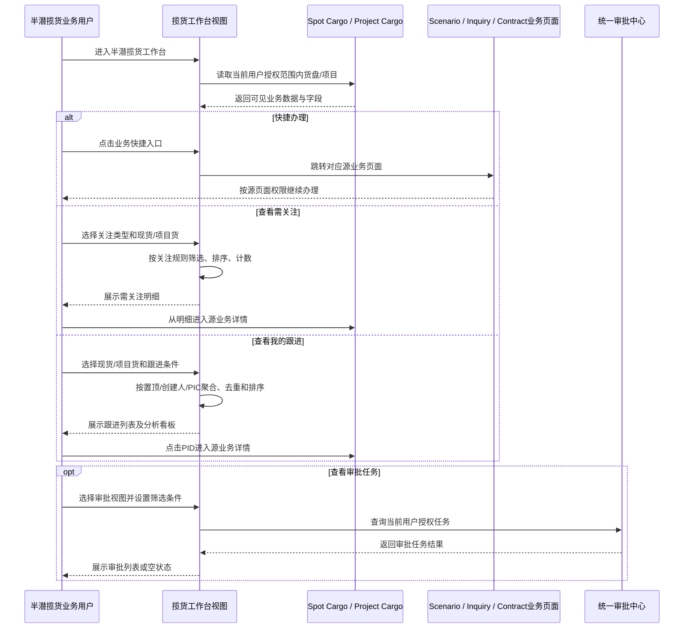
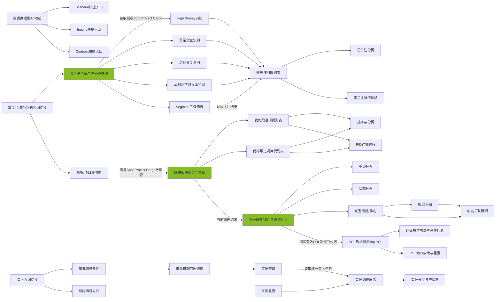

# 半潜揽货工作台模块功能清单

## 文档说明

| 项目   | 内容                                           |
| ---- | -------------------------------------------- |
| 产物类型 | 功能清单（与用户故事合称「正向开发的起点」）                       |
| 命名   | `PRD-半潜揽货工作台-功能清单.md`（每模块唯一，累计追加）            |
| 职责   | 第一、二章引言与总体描述；第三章业务需求分析；第四章功能需求（功能列表 + 角色与权限） |
| 适用范围 | 半潜合资公司和本部半潜船经营部                              |
| 模板版本 | v1.6                                         |

## 文档信息

| 项目       | 内容                                       |
| -------- | ---------------------------------------- |
| 文档名称     | 半潜揽货工作台模块功能清单                            |
| 微服务 / 模块 | 待确认 / 半潜揽货工作台                            |
| 版本       | v1.0.0                                   |
| 创建日期     | 2026-08-20                               |
| 逆向来源     | `半潜揽货工作台-原型-v4.1-一级二级筛选优先级修正(9).html`    |
| 参考口径     | 半潜揽货工作台指标口径（已确认的需关注、我的跟进、船舶排名、POL 热点图口径） |

---

## 一、引言

### 1.1 目的

本文档给出半潜揽货工作台的功能目录、模块级业务主线和页面字段口径，供产品、研发、测试作为正向开发、范围管理与后续用户故事编写的起点。工作台聚合半潜揽货常用办理入口、需关注货盘、当前用户跟进货盘、业务分析看板及审批待办，但不在本功能清单中展开单功能验收标准和异常四元组。

### 1.2 范围

**在范围内：**

- “我要办理”快捷区的 Scenario、Inquiry、Contract 业务入口及整块展开/收起
- “需关注”中 High Priority、异常货盘、过期货盘、本月及下月发运货盘的识别、筛选、数量、明细和分页
- “我的跟进”中现货/项目货切换，以及“全部、置顶、我创建、我负责”个人跟进范围筛选
- “我的跟进”现货列表、项目货列表、排序、分页和源业务详情跳转
- “我的跟进”分析看板的类型分布、状态分布、船舶排名与下钻、POL 热点图

**不在范围内：**

- Spot Cargo、Project Cargo、Master Scenario、Personal Scenario、Competitor Scenario、Price Viewer、合同、配船、航次任务、登记簿等源页面内部的新增、编辑、审批及状态流转
- 顶部“主页、全局搜索、待办、通知、应用、当前用户”等集团门户公共框架能力
- 统一审批中心内部的同意、驳回、传阅、审批历史处理规则；工作台仅复用其入口、查询与列表能力
- 源业务数据库表结构、接口协议和统一认证实现

### 1.3 定义、简写和省略语

| 术语 / 简写         | 全称或含义                                          |
| --------------- | ---------------------------------------------- |
| Spot Cargo      | 现货货盘；“需关注”和“我的跟进-现货”的源数据                       |
| Project Cargo   | 项目货货盘；“需关注”和“我的跟进-项目货”的源数据                     |
| Segment         | 业务类型，工作台中取“现货 / 项目货”                           |
| PID             | 货盘或项目业务标识，用于识别并进入对应源货盘详情                       |
| PIC             | Person in Charge，业务负责人；“我负责”按 PIC 是否为当前登录用户判断  |
| Priority        | 跟进优先级；High Priority 关注项按 Priority＝High 判断      |
| Freight         | 货盘报价/运费金额；异常货盘按有效 Freight 是否低于 10,000 USD 判断   |
| LAYCAN / Laycan | 装期或执行日期区间；用于过期货盘及本月、下月发运货盘判断                   |
| POL             | Port of Loading，装货港；用于 POL 热点图聚合               |
| POD             | Port of Discharge，卸货港                          |
| Top POL         | 当前筛选范围内按有效货盘/项目数量从高到低排列的前 8 个 POL              |
| 当前登录用户          | 由系统统一登录态确定，用于“我创建”“我负责”等个人关系判断，不使用原型示例姓名作为业务常量 |

---

## 二、总体描述

### 2.1 需求背景

半潜揽货业务同时涉及现货、项目货、船期表、价格查看、合同、配船、航次任务等多个页面。业务人员日常既要快速进入相关业务办理，也要持续识别高优先级、异常报价、长期未推进和近期发运货盘，并集中跟进本人创建、本人负责或主动置顶的记录。

若仍依赖逐个页面查询，业务入口分散，重点货盘需要人工判断，个人跟进信息难以统一汇总，船舶及装货港分布也缺少直观分析。因此需要建设统一揽货工作台，在不改变源业务数据和权限边界的前提下，对授权数据进行聚合、筛选、排序和可视化，并可从工作台回到对应源页面继续办理。

### 2.2 建设目标

- 提供半潜揽货常用业务的一站式入口，减少跨菜单查找和重复导航
- 按统一规则形成“需关注”清单，使高优先级、异常、过期和近期发运货盘可被快速识别
- 将“置顶、我创建、我负责”聚合为“我的跟进”，同一货盘重复命中时在“全部”中只统计一次
- 现货与项目货使用差异化列表字段，同时保证筛选、数量、分页和详情入口一致可用
- 列表与类型分布、状态分布、船舶排名、POL 热点图共享同一当前筛选结果，避免看板与明细口径不一致
- 复用审批待办能力，在工作台内提供审批任务的快速查看和检索入口

### 2.3 软件功能要求

从业务视角，本模块需具备：常用业务快捷入口；需关注货盘的规则识别与两级筛选；当前用户相关货盘的聚合、筛选、排序和分页；现货/项目货差异化字段展示；源业务详情跳转；可展开的数据分析看板；Cargo Type / Project Type 与状态分布；船型/船名排名、下钻及关联明细；按 POL 聚合的 Top POL、热度、气泡和地图缩放；以及统一审批任务的视图切换、筛选、日期范围、列表和分页。细节见第四章功能表与附录 A。

### 2.5 运行环境

- 部署于集团门户 Web 端，采用统一登录、菜单权限和数据权限
- 以内网 PC 为主要使用终端；当前原型按桌面端宽表和数据看板设计
- 依赖 Spot Cargo、Project Cargo 提供当前用户有权查看的货盘/项目及字段数据
- 依赖 Scenario、Inquiry、Contract 相关源页面提供可访问路由
- POL 热点图依赖有效 POL 与港口位置/国家信息；无法识别位置的记录不进入地图聚合
- 审批区域依赖既有审批待办组件提供任务数据、筛选项和流程发起能力

### 2.6 假定和约束

- 假定当前登录用户已通过统一认证，工作台不建立独立账号体系
- “需关注”“我的跟进”和分析看板仅处理当前用户在 Spot Cargo / Project Cargo 中有查看权限的数据；字段可见范围继承源页面
- “需关注”动态日期判断应使用系统统一业务日期和时区；原型浏览器运行时日期仅用于交互演示
- 工作台不修改 Spot Cargo / Project Cargo 业务数据；用户点击明细或 PID 后进入对应源页面继续办理
- 当前原型对快捷入口和详情跳转以 Toast 模拟，正式实现需替换为真实路由；当前用户无目标页面权限时不展示对应入口，列表仅展示有权查看的记录
- 审批筛选、查询、重置和“新建流程”沿用统一审批中心既有能力；系统来源枚举、默认日期范围、具体新建流程路由以对接结果为准

---

## 三、业务需求分析

### 3.1 主流程（业务主线）

半潜揽货业务用户进入工作台后，可直接通过“我要办理”进入相关业务页面，也可先在“需关注”识别优先处理货盘，或在“我的跟进”查看本人相关现货/项目货并通过看板分析，再进入 Spot Cargo / Project Cargo 详情继续办理；审批区域并行提供统一流程任务入口。（F-QUICK-002 / F-QUICK-003 / F-QUICK-004 / F-WORK-001 / F-FOCUS-001 / F-FOLLOW-001 / F-DASH-001 / F-APP-001）

### 3.2 异常流程

| 异常点          | 触发条件                                               | 系统响应                                   |
| ------------ | -------------------------------------------------- | -------------------------------------- |
| 源业务无权限或数据不可见 | 当前用户对某条 Spot Cargo / Project Cargo 无查看权限           | 该记录不进入需关注、我的跟进、数量及看板统计，也不出现对应跳转入口 |
| 快捷入口无页面权限   | 当前用户对 Scenario / Inquiry / Contract 某目标页面无访问权限  | 工作台不展示对应快捷入口                           |
| 关注规则关键字段无效   | Freight、Laycan 或 Last Updated 缺失/无法识别，且当前关注规则依赖该字段 | 跳过对应规则判断，不影响该记录参与其他满足条件的关注类型或我的跟进列表    |
| POL 无法识别或定位  | POL 为空、无效或无法匹配港口位置信息                               | 该记录仍可在我的跟进列表展示，但不进入 Top POL、热度、气泡和地图统计 |
| 当前筛选无结果      | 一级/二级筛选、我的跟进条件或审批条件命中 0 条                          | 对应列表展示空状态，数量显示 0；分页保持可用但不产生数据行         |

### 3.3 边界流程

- 同一货盘可同时命中多个“需关注”规则：分别计入各关注卡片，各卡片之间不互斥
- “需关注”的“全部 / 现货 / 项目货”仅作用于当前选中的一级关注卡片；切换一级卡片后二级筛选恢复“全部”
- “我的跟进-全部”＝“置顶 OR 我创建 OR 我负责”的并集；同一记录同时满足多个条件时只展示和统计一次，各单项数量独立统计
- 切换“现货 / 项目货”后，当前跟进条件恢复“全部”，船舶排名恢复“船型”，POL 地图恢复全球视图
- 无有效船名时不参与船舶排名；有效船名无法归类至已知船型时归入“其他船型”
- 无有效 POL 时 Top POL 显示“暂无 POL 数据”，地图不生成港口气泡
- 列表每页固定 10 条；跨页序号连续，筛选条件变化后回到第 1 页
- 日期范围第二次选择早于第一次时，起止日期自动交换，保证起始日期不晚于结束日期

---

## 四、功能需求

### 4.1 功能列表

功能按原型业务顺序排列（我要办理 → 工作视图 → 需关注 → 我的跟进 → 分析看板 → 审批待办）。共 37 项，功能编号按业务模块分组。本模块按正向建设管理，状态取值：已规划 / 待开发 / 开发中 / 测试中 / 已完成。

适用范围统一为：半潜揽货业务人员、市场营销人员、项目管理人员；具体公司范围及数据范围沿用系统菜单、Spot Cargo、Project Cargo 和统一审批中心权限配置。

| 功能编号         | 功能名称                         | 功能描述（用户操作→系统响应→预期结果）                                                                                                                                     | 适用范围                   | 优先级 | 引入版本 | 状态  |
| ------------ | ---------------------------- | -------------------------------------------------------------------------------------------------------------------------------------------------------- | ---------------------- | --- | ---- | --- |
| F-QUICK-001  | “我要办理”展开/收起                  | 点击“我要办理”展开/收起 → 系统切换快捷入口内容区显隐并同步控件状态 → 用户按需释放或恢复工作台空间                                                                                                    | 半潜揽货业务人员、市场营销人员、项目管理人员 | P1  | v1.0 | 待开发 |
| F-QUICK-002  | Scenario 快捷入口                | 系统仅展示当前用户有权限的 Scenario 入口；点击后进入对应 Scenario 页面 → 用户快速办理场景方案业务                                                                                                  | 半潜揽货业务人员、市场营销人员、项目管理人员 | P1  | v1.0 | 待开发 |
| F-QUICK-003  | Inquiry 快捷入口                 | 系统仅展示当前用户有权限的 Inquiry 入口；点击后进入对应页面 → 用户快速办理揽货及价格查看业务                                                                                                        | 半潜揽货业务人员、市场营销人员、项目管理人员 | P0  | v1.0 | 待开发 |
| F-QUICK-004  | Contract 快捷入口                | 系统仅展示当前用户有权限的 Contract 入口；点击后进入对应业务页面 → 用户快速办理 Contract 相关业务                                                                                                | 半潜揽货业务人员、市场营销人员、项目管理人员 | P1  | v1.0 | 待开发 |
| F-WORK-001   | “需关注 / 我的跟进”视图切换             | 点击“需关注”或“我的跟进” → 系统切换对应内容区和专属筛选/看板入口 → 用户在重点识别与个人跟进两类工作视图间切换                                                                                             | 半潜揽货业务人员、市场营销人员、项目管理人员 | P0  | v1.0 | 待开发 |
| F-FOCUS-001  | 关注卡片展示与一级筛选                  | 进入“需关注”或点击关注卡片 → 系统展示 High Priority、异常货盘、过期货盘、本月及下月发运货盘及各自数量，并加载当前卡片明细 → 用户快速定位需优先处理的货盘                                                                  | 半潜揽货业务人员、市场营销人员、项目管理人员 | P0  | v1.0 | 待开发 |
| F-FOCUS-002  | Segment 二级筛选                 | 在当前关注卡片下选择“全部 / 现货 / 项目货” → 系统仅过滤当前一级关注类型并刷新当前卡片数量和明细 → 用户按业务类型聚焦需关注记录                                                                                   | 半潜揽货业务人员、市场营销人员、项目管理人员 | P0  | v1.0 | 待开发 |
| F-FOCUS-003  | High Priority 识别             | 选择 High Priority → 系统筛选当前用户有权查看且 Priority＝High 的现货/项目货 → 展示高优先级货盘明细                                                                                      | 半潜揽货业务人员、市场营销人员、项目管理人员 | P0  | v1.0 | 待开发 |
| F-FOCUS-004  | 异常货盘识别                       | 选择“异常货盘” → 系统筛选 Freight 为有效金额且低于 10,000 USD 的记录并按 Freight 从低到高排序 → 用户优先检查异常低报价货盘                                                                         | 半潜揽货业务人员、市场营销人员、项目管理人员 | P0  | v1.0 | 待开发 |
| F-FOCUS-005  | 过期货盘识别                       | 选择“过期货盘” → 系统筛选 Laycan 起始日期和 Last Updated 均早于当前日期前 60 天的记录并按 Laycan 从早到晚排序 → 用户识别长期未推进货盘                                                                 | 半潜揽货业务人员、市场营销人员、项目管理人员 | P0  | v1.0 | 待开发 |
| F-FOCUS-006  | 本月及下月发运识别                    | 选择“本月及下月发运货盘” → 系统筛选 Laycan 与本月第 1 日（含）至下下月第 1 日（不含）存在交集的记录并按 Laycan 从早到晚排序 → 用户关注近期执行货盘                                                                 | 半潜揽货业务人员、市场营销人员、项目管理人员 | P0  | v1.0 | 待开发 |
| F-FOCUS-007  | 需关注明细列表                      | 选定关注类型和 Segment → 系统展示 No.、Segment、Project Name、Status、Client、Market、Freight、Laycan / Period、PIC、Updated → 用户查看命中当前关注规则的货盘信息                             | 半潜揽货业务人员、市场营销人员、项目管理人员 | P0  | v1.0 | 待开发 |
| F-FOCUS-008  | 需关注分页                        | 切换页码 → 系统按当前关注类型和 Segment 对结果每页 10 条分页并连续编号 → 用户浏览全部需关注记录                                                                                                | 半潜揽货业务人员、市场营销人员、项目管理人员 | P1  | v1.0 | 待开发 |
| F-FOCUS-009  | 需关注详情跳转                      | 点击需关注明细行 → 系统根据 Segment 进入对应 Spot Cargo / Project Cargo 详情 → 用户查看或处理具体货盘；明细仅含当前用户有权查看的记录                                                                   | 半潜揽货业务人员、市场营销人员、项目管理人员 | P0  | v1.0 | 待开发 |
| F-FOLLOW-001 | 现货 / 项目货切换                   | 进入“我的跟进”并选择“现货 / 项目货” → 系统切换数据源、列表字段及看板统计口径，并恢复跟进条件为“全部” → 用户按业务类型查看本人相关货盘                                                                               | 半潜揽货业务人员、市场营销人员、项目管理人员 | P0  | v1.0 | 待开发 |
| F-FOLLOW-002 | 跟进条件筛选与数量                    | 选择“全部 / 置顶 / 我创建 / 我负责” → 系统按当前用户与记录的置顶、创建人、PIC 关系筛选并独立统计各条件数量 → 用户快速定位本人相关货盘                                                                            | 半潜揽货业务人员、市场营销人员、项目管理人员 | P0  | v1.0 | 待开发 |
| F-FOLLOW-003 | 我的跟进现货列表                     | 选择“现货” → 系统展示 Priority、PID、Status、Charterer、Freight、Cargo Type、LAYCAN、VESSEL、POL、POD、PIC、Last Updated → 用户查看个人现货货盘                                       | 半潜揽货业务人员、市场营销人员、项目管理人员 | P0  | v1.0 | 待开发 |
| F-FOLLOW-004 | 我的跟进项目货列表                    | 选择“项目货” → 系统展示 Priority、Project Market、Project Type、Project Name、Project Status、End Client、Direct Client、Project Period、PID、PIC、Last Updated → 用户查看个人项目货 | 半潜揽货业务人员、市场营销人员、项目管理人员 | P0  | v1.0 | 待开发 |
| F-FOLLOW-005 | 我的跟进排序与分页                    | 加载或切换跟进条件/页码 → 系统先按 Priority 排序（High 优先于 Normal），同一 Priority 内按 Last Updated 从近到远，并每页 10 条分页 → 用户按优先级连续浏览货盘                                              | 半潜揽货业务人员、市场营销人员、项目管理人员 | P0  | v1.0 | 待开发 |
| F-FOLLOW-006 | PID 详情跳转                     | 点击现货/项目货列表中的 PID → 系统进入对应 Spot Cargo / Project Cargo 详情 → 用户查看完整业务信息；列表仅含当前用户有权查看且具备 PID 的记录                                                              | 半潜揽货业务人员、市场营销人员、项目管理人员 | P0  | v1.0 | 待开发 |
| F-DASH-001   | 看板展开/收起与筛选同步                 | 点击“展开看板 / 收起看板” → 系统切换看板显隐且不改变当前现货/项目货和跟进条件 → 用户在明细与分析视图之间切换并保持同一统计口径                                                                                    | 半潜揽货业务人员、市场营销人员、项目管理人员 | P1  | v1.0 | 待开发 |
| F-DASH-002   | Cargo Type / Project Type 分布 | 展开看板 → 系统按当前筛选结果的 Cargo Type / Project Type 分组统计数量、总数和占比并提供悬浮提示 → 用户识别货物/项目类型结构                                                                          | 半潜揽货业务人员、市场营销人员、项目管理人员 | P1  | v1.0 | 待开发 |
| F-DASH-003   | 货盘状态分布                       | 展开看板 → 系统按当前筛选结果的 Status / Project Status 分组统计数量、总数和占比并提供悬浮提示 → 用户识别当前业务状态结构                                                                             | 半潜揽货业务人员、市场营销人员、项目管理人员 | P1  | v1.0 | 待开发 |
| F-DASH-004   | 船型 / 船名排名                    | 选择“船型 / 船名” → 系统对当前筛选范围内有效船舶按关联货盘/项目数降序排名，同数按名称排序 → 用户比较船舶承接业务的集中度                                                                                       | 半潜揽货业务人员、市场营销人员、项目管理人员 | P1  | v1.0 | 待开发 |
| F-DASH-005   | 船型下钻                         | 在“船型”排名点击某船型 → 系统限定该船型关联记录并重新按具体船名排名；点击“返回船型排名”恢复总排行 → 用户从船型逐层定位具体船舶                                                                                     | 半潜揽货业务人员、市场营销人员、项目管理人员 | P1  | v1.0 | 待开发 |
| F-DASH-006   | 船名关联明细                       | 在船名排行点击某船名 → 系统展示该船名关联记录数及 PID、Charterer、Cargo Type、POL、LAYCAN、PIC，并支持返回排行 → 用户追溯具体船舶关联货盘/项目                                                             | 半潜揽货业务人员、市场营销人员、项目管理人员 | P1  | v1.0 | 待开发 |
| F-DASH-007   | POL 热点图与 Top POL             | 展开看板 → 系统按当前筛选结果聚合可识别且可定位的有效 POL，以货盘/项目数量降序展示 Top 8 并在地图生成热点 → 用户识别装货港业务集中区域                                                                             | 半潜揽货业务人员、市场营销人员、项目管理人员 | P1  | v1.0 | 待开发 |
| F-DASH-008   | POL 热度、气泡与悬浮信息               | 查看 POL 热点图 → 系统按各港口 Count 相对最大 Count 计算热度和气泡大小，悬浮显示港口、国家、Cargo Count / Project Count 及当前指标占比 → 用户比较港口相对热度                                                | 半潜揽货业务人员、市场营销人员、项目管理人员 | P1  | v1.0 | 待开发 |
| F-DASH-009   | POL 港口放大与重置                  | 点击港口气泡 → 系统以该港口为中心放大地图且不改变列表筛选；点击重置或切换现货/项目货后恢复全球视图 → 用户查看局部热点后返回全局                                                                                      | 半潜揽货业务人员、市场营销人员、项目管理人员 | P2  | v1.0 | 待开发 |

### 4.2 角色与权限

本模块不建立独立角色体系，沿用集团门户、Spot Cargo、Project Cargo 及统一审批中心既有权限。

| 角色          | 可执行功能 / 操作                                   | 数据范围                                       | 备注                                |
| ----------- | -------------------------------------------- | ------------------------------------------ | --------------------------------- |
| 半潜揽货工作台授权用户 | F-QUICK-001～F-DASH-009；查看需关注、我的跟进、看板及进入源业务详情 | 当前用户在 Spot Cargo / Project Cargo 中有查看权限的数据 | 工作台以查询、聚合、分析和导航为主，不在工作台直接修改源货盘/项目 |
| 审批待办插件授权用户  | F-APP-001～F-APP-007；切换任务视图、设置筛选、查询和查看任务      | 当前用户在统一审批中心有权查看的流程任务                       | 审批处理动作仍由统一审批中心承接                  |

---

## 五、优先级说明

| 优先级 | 说明   |
| --- | ---- |
| P0  | 核心功能 |
| P1  | 重要功能 |
| P2  | 次要功能 |

---

## 六、功能依赖关系图（含数据流依赖）

本期无已核实库表，数据流按业务数据对象标注，不臆造物理表名。

---

## 附录：字段清单

### 附录 A 业务口径字段表

**编制说明：**

- 本附录以《半潜揽货工作台-原型-v4.1-一级二级筛选优先级修正(10).html》中的实际可见字段、筛选项、列表列、看板交互为页面依据，并以《关于半潜揽货工作台指标口径-v1.1(1).xlsx》中的指标名称与口径说明作为主要业务口径依据。
- “需关注”“我的跟进”及看板的数据范围均受当前登录用户在 Spot Cargo / Project Cargo 中的查看权限约束；无权限记录不展示、不参与数量及看板统计，字段可见范围继承源页面。
- 指标口径已明确的规则按指标口径填写；仅在 HTML 原型出现、但指标口径未定义的内容，仅记录原型实际行为，不扩展推测正式业务规则。
- 页面中的示例姓名、示例数量、示例金额及示例日期均为原型演示数据，不作为固定业务常量。

#### A.1 我要办理

| 页面字段名称              | 来源     | 格式   | 取值范围                                                                                                    | 编辑权限        | 失败处理                       |
| ------------------- | ------ | ---- | ------------------------------------------------------------------------------------------------------- | ----------- | -------------------------- |
| Scenario            | 系统功能配置 | 入口分组 | Master Scenario / Personal Scenario / Competitor Scenario                                               | 只读；分组内入口可点击 | —                          |
| Master Scenario     | 系统功能配置 | 页面入口 | Master Scenario                                                                                         | 可点击         | 无目标页面权限时不展示该入口 |
| Personal Scenario   | 系统功能配置 | 页面入口 | Personal Scenario                                                                                       | 可点击         | 无目标页面权限时不展示该入口 |
| Competitor Scenario | 系统功能配置 | 页面入口 | Competitor Scenario                                                                                     | 可点击         | 无目标页面权限时不展示该入口 |
| Inquiry             | 系统功能配置 | 入口分组 | Spot Cargo / Project Cargo / Price Viewer                                                               | 只读；分组内入口可点击 | —                          |
| Spot Cargo          | 系统功能配置 | 页面入口 | Spot Cargo                                                                                              | 可点击         | 无目标页面权限时不展示该入口 |
| Project Cargo       | 系统功能配置 | 页面入口 | Project Cargo                                                                                           | 可点击         | 无目标页面权限时不展示该入口 |
| Price Viewer        | 系统功能配置 | 页面入口 | Price Viewer                                                                                            | 可点击         | 无目标页面权限时不展示该入口 |
| Contract            | 系统功能配置 | 入口分组 | 物流供应商合同 / 船舶期租合同 / 船舶舱租合同 / 程租配船 / 舱租配船 / 航次任务单 / Contract Register / LOI Register / 航次任务变更 Task Change | 只读；分组内入口可点击 | —                          |
| 物流供应商合同             | 系统功能配置 | 页面入口 | 物流供应商合同                                                                                                 | 可点击         | 无目标页面权限时不展示该入口 |
| 船舶期租合同              | 系统功能配置 | 页面入口 | 船舶期租合同                                                                                                  | 可点击         | 无目标页面权限时不展示该入口 |
| 船舶舱租合同              | 系统功能配置 | 页面入口 | 船舶舱租合同                                                                                                  | 可点击         | 无目标页面权限时不展示该入口 |
| 程租配船                | 系统功能配置 | 页面入口 | 程租配船                                                                                                    | 可点击         | 无目标页面权限时不展示该入口 |
| 舱租配船                | 系统功能配置 | 页面入口 | 舱租配船                                                                                                    | 可点击         | 无目标页面权限时不展示该入口 |
| 航次任务单               | 系统功能配置 | 页面入口 | 航次任务单                                                                                                   | 可点击         | 无目标页面权限时不展示该入口 |
| Contract Register   | 系统功能配置 | 页面入口 | Contract Register                                                                                       | 可点击         | 无目标页面权限时不展示该入口 |
| LOI Register        | 系统功能配置 | 页面入口 | LOI Register                                                                                            | 可点击         | 无目标页面权限时不展示该入口 |
| 航次任务变更 Task Change  | 系统功能配置 | 页面入口 | 航次任务变更 Task Change                                                                                      | 可点击         | 无目标页面权限时不展示该入口 |
| 展开/收起               | 用户操作   | 界面状态 | 展开 / 收起                                                                                                 | 可切换         | —                          |

> 说明：“我要办理”仅作为系统功能入口，不产生独立业务数据；当前用户无目标页面权限时不展示对应入口。当前 HTML 原型以提示方式模拟入口跳转。

#### A.2 需关注-筛选

| 页面字段名称        | 来源                                | 格式            | 取值范围                                                                              | 编辑权限    | 失败处理                                 |
| ------------- | --------------------------------- | ------------- | --------------------------------------------------------------------------------- | ------- | ------------------------------------ |
| 全部            | 用户选择 + 系统计算                       | 二级筛选项 / 整数数量  | 默认选中；展示当前一级关注类型下有权查看的全部现货与项目货；数量为现货 + 项目货去重后的合计                                   | 可筛选     | 切换一级关注卡片后自动恢复“全部”                    |
| 现货            | 用户选择 + 系统计算                       | 二级筛选项 / 整数数量  | 仅展示当前一级关注类型下 Segment＝现货的记录                                                        | 可筛选     | 无命中记录时数量为 0                          |
| 项目货           | 用户选择 + 系统计算                       | 二级筛选项 / 整数数量  | 仅展示当前一级关注类型下 Segment＝项目货的记录                                                       | 可筛选     | 无命中记录时数量为 0                          |
| 货盘数量          | 系统计算                              | 整数            | 分别统计当前一级关注类型下“全部 / 现货 / 项目货”的数量；现货、项目货分别按 PID 去重后统计                               | 只读      | 无命中记录时为 0                            |
| High Priority | Spot Cargo / Project Cargo + 系统计算 | 一级关注卡片 / 整数数量 | 当前用户有权查看且 Priority＝High 的货盘                                                       | 只读；卡片可选 | 无命中记录时为 0                            |
| 异常货盘          | Spot Cargo / Project Cargo + 系统计算 | 一级关注卡片 / 整数数量 | Freight 为有效金额且低于 10,000 USD；明细按 Freight 从低到高排序                                    | 只读；卡片可选 | Freight 未维护或无法识别为有效金额时不计入该关注规则       |
| 过期货盘          | Spot Cargo / Project Cargo + 系统计算 | 一级关注卡片 / 整数数量 | Laycan 起始日期早于系统当前日期往前 60 天，且 Last Updated 同样早于系统当前日期往前 60 天；明细按 Laycan 起始日期从早到晚排序 | 只读；卡片可选 | Laycan 或 Last Updated 无有效日期时不计入该关注规则 |
| 本月及下月发运货盘     | Spot Cargo / Project Cargo + 系统计算 | 一级关注卡片 / 整数数量 | Laycan 区间与“本月第 1 日（含）至下下月第 1 日（不含）”存在交集；明细按 Laycan 起始日期从早到晚排序                     | 只读；卡片可选 | Laycan 无有效日期时不计入该关注规则                |
| 关注卡片数量        | 系统计算                              | 整数            | 默认显示各关注类型在“全部”范围下的总数量；选择“现货 / 项目货”后仅当前选中卡片数量随二级筛选变化，其他卡片仍显示各自总数                   | 只读      | 无命中记录时为 0                            |

> 说明：一级关注类型与二级 Segment 为两层筛选关系。二级筛选只作用于当前选中的关注卡片；同一货盘可同时命中多个关注规则，并分别计入对应关注卡片。

#### A.3 需关注-货盘明细

| 页面字段名称          | 来源                              | 格式        | 取值范围                       | 编辑权限 | 失败处理                            |
| --------------- | ------------------------------- | --------- | -------------------------- | ---- | ------------------------------- |
| No.             | 系统生成                            | 整数        | 按当前列表展示顺序连续编号；每页 10 条，跨页连续 | 只读   | 无记录时不生成序号                       |
| Segment         | Spot Cargo / Project Cargo 聚合结果 | 枚举        | 现货 / 项目货                   | 只读   | —                               |
| Project Name    | Spot Cargo / Project Cargo 聚合结果 | 文本        | 货盘对应项目名称                   | 只读   | 未维护时按源页面数据展示                    |
| Status          | Spot Cargo / Project Cargo 聚合结果 | 枚举 / 文本   | 当前业务状态，以源页面记录为准            | 只读   | 未维护时按源页面数据展示                    |
| Client          | Spot Cargo / Project Cargo 聚合结果 | 文本        | 货盘对应客户名称                   | 只读   | 未维护时按源页面数据展示                    |
| Market          | Spot Cargo / Project Cargo 聚合结果 | 文本 / 枚举   | 货盘所属市场或业务市场分类              | 只读   | 未维护时按源页面数据展示                    |
| Freight         | Spot Cargo / Project Cargo 聚合结果 | 金额 / 文本   | 货盘 Freight / 报价金额          | 只读   | 未维护时显示“—”；无法识别为有效金额时不参与“异常货盘”判断 |
| Laycan / Period | Spot Cargo / Project Cargo 聚合结果 | 日期区间 / 文本 | 货盘计划执行时间范围                 | 只读   | 无有效日期时不参与依赖日期的关注规则              |
| PIC             | Spot Cargo / Project Cargo 聚合结果 | 人员 / 文本   | 货盘主要负责人                    | 只读   | 未维护时按源页面数据展示                    |
| Updated         | Spot Cargo / Project Cargo 聚合结果 | 日期 / 日期时间 | 货盘最近一次更新时间                 | 只读   | 无有效时间时不参与“过期货盘”判断               |

> 说明：点击货盘明细行后，根据 Segment 进入对应 Spot Cargo / Project Cargo 详情；明细仅含当前用户有权查看的记录，故不单独处理无权限跳转。当前 HTML 原型仅以提示方式模拟跳转。

#### A.4 我的跟进-筛选

| 页面字段名称 | 来源                  | 格式         | 取值范围                                            | 编辑权限        | 失败处理          |
| ------ | ------------------- | ---------- | ----------------------------------------------- | ----------- | ------------- |
| 我的跟进   | 当前用户权限数据 + 系统聚合     | 业务视图       | 当前用户有权查看，且满足“已置顶 / 创建人为当前用户 / PIC 为当前用户”任一条件的记录 | 只读；可切换进入该视图 | 无符合条件记录时展示空列表 |
| 现货     | 用户选择                | 一级 Tab     | Spot Cargo                                      | 可切换         | 切换后跟进条件恢复“全部” |
| 项目货    | 用户选择                | 一级 Tab     | Project Cargo                                   | 可切换         | 切换后跟进条件恢复“全部” |
| 全部     | 系统计算 + 用户选择         | 筛选项 / 整数数量 | “已置顶 OR 我创建 OR 我负责”的并集；同一记录同时命中多个条件时仅展示、统计 1 次  | 可筛选         | 无命中记录时数量为 0   |
| 置顶     | 当前用户置顶关系 + 用户选择     | 筛选项 / 整数数量 | 当前用户已置顶且有查看权限的记录                                | 可筛选         | 无命中记录时数量为 0   |
| 我创建    | 创建人 + 当前登录用户 + 用户选择 | 筛选项 / 整数数量 | 创建人为当前登录用户且有查看权限的记录                             | 可筛选         | 无命中记录时数量为 0   |
| 我负责    | PIC + 当前登录用户 + 用户选择 | 筛选项 / 整数数量 | PIC 为当前登录用户且有查看权限的记录                            | 可筛选         | 无命中记录时数量为 0   |
| 货盘数量   | 系统计算                | 整数         | 分别独立统计“全部 / 置顶 / 我创建 / 我负责”的数量                  | 只读          | 无命中记录时为 0     |

> 说明：“置顶 / 我创建 / 我负责”三个数量按各自条件独立统计，彼此可能重叠，因此不可直接相加推导“全部”数量。

#### A.5 我的跟进-现货列表

| 页面字段名称       | 来源         | 格式        | 取值范围                                                    | 编辑权限   | 失败处理                       |
| ------------ | ---------- | --------- | ------------------------------------------------------- | ------ | -------------------------- |
| No.          | 系统生成       | 整数        | 当前筛选结果连续编号；每页 10 条，跨页连续                                 | 只读     | 无记录时不生成序号                  |
| Priority     | Spot Cargo | 枚举        | 按 Spot Cargo 当前记录展示；原型示例包含 High / Normal                | 只读     | —                          |
| PID          | Spot Cargo | 文本        | Spot Cargo 业务标识                                         | 只读；可点击 | 详情访问按源页面权限控制               |
| Status       | Spot Cargo | 枚举 / 文本   | 按 Spot Cargo 当前记录展示；原型示例包含 Open / Firm / Fixed / Booked | 只读     | —                          |
| Charterer    | Spot Cargo | 文本        | 租家 / 委托方名称                                              | 只读     | 未维护时按源页面数据展示               |
| Freight      | Spot Cargo | 金额 / 文本   | 按 Spot Cargo 当前记录展示                                     | 只读     | 未维护时显示“—”                  |
| Cargo Type   | Spot Cargo | 文本 / 枚举   | 按 Spot Cargo 当前记录展示                                     | 只读     | 未维护时按源页面数据展示               |
| LAYCAN       | Spot Cargo | 日期区间 / 文本 | 装期区间                                                    | 只读     | 未维护时按源页面数据展示               |
| VESSEL       | Spot Cargo | 文本        | 拟配 / 已配船舶                                               | 只读     | 无有效船名的记录不参与船舶排名            |
| POL          | Spot Cargo | 文本        | Port of Loading，装货港                                     | 只读     | 未维护或无法匹配地图位置时不参与 POL 热点图统计 |
| POD          | Spot Cargo | 文本        | Port of Discharge，卸货港                                   | 只读     | 未维护时按源页面数据展示               |
| PIC          | Spot Cargo | 人员 / 文本   | 主要负责人                                                   | 只读     | “我负责”以 PIC 是否为当前登录用户作为判断条件 |
| Last Updated | Spot Cargo | 日期 / 日期时间 | 最近一次更新时间                                                | 只读     | 同一 Priority 内按该时间从近到远排序    |

> 说明：列表默认先按 Priority 排序（High 优先于 Normal），同一 Priority 内再按 Last Updated 从近到远排序；点击 PID 后进入对应 Spot Cargo 详情。列表仅含有权查看且具备 PID 的记录。当前 HTML 原型仅以提示方式模拟跳转。

#### A.6 我的跟进-项目货列表

| 页面字段名称         | 来源            | 格式        | 取值范围                                                           | 编辑权限   | 失败处理                       |
| -------------- | ------------- | --------- | -------------------------------------------------------------- | ------ | -------------------------- |
| No.            | 系统生成          | 整数        | 当前筛选结果连续编号；每页 10 条，跨页连续                                        | 只读     | 无记录时不生成序号                  |
| Priority       | Project Cargo | 枚举        | 按 Project Cargo 当前记录展示；原型示例包含 High / Normal                    | 只读     | —                          |
| Project Market | Project Cargo | 文本 / 枚举   | 优先取 Project Market；未维护时取同一记录的 Market                           | 只读     | 两者均无值时按页面空值规则展示            |
| Project Type   | Project Cargo | 文本 / 枚举   | 当前原型按 Project Cargo 记录中的 Cargo Type 作为 Project Type 展示         | 只读     | 未维护时显示“—”                  |
| Project Name   | Project Cargo | 文本        | 项目名称                                                           | 只读     | 未维护时显示“—”                  |
| Project Status | Project Cargo | 枚举 / 文本   | 取 Project Cargo 当前记录的 Status；原型示例包含 Firm / Proceed / Budgetary | 只读     | —                          |
| End Client     | Project Cargo | 文本        | 最终客户                                                           | 只读     | 未维护时显示“—”                  |
| Direct Client  | Project Cargo | 文本        | 优先取 Direct Client；未维护时取同一记录的 Charterer                         | 只读     | 两者均无值时显示“—”                |
| Project Period | Project Cargo | 日期区间 / 文本 | 优先取 Project Period；未维护时取同一记录的 Laycan                           | 只读     | 两者均无值时显示“—”                |
| PID            | Project Cargo | 文本        | 优先展示 Project PID；未维护时取同一记录的底层 PID                              | 只读；可点击 | 详情访问按源页面权限控制               |
| PIC            | Project Cargo | 人员 / 文本   | 项目主要负责人                                                        | 只读     | “我负责”以 PIC 是否为当前登录用户作为判断条件 |
| Last Updated   | Project Cargo | 日期时间      | 优先展示包含时分秒的 Last Updated；未维护时取 Updated                          | 只读     | 列表排序仍按 Updated 从近到远        |

> 说明：项目货列表同样先按 Priority 排序，同一 Priority 内按 Last Updated / Updated 从近到远排序；点击 PID 后进入对应 Project Cargo 详情。列表仅含有权查看且具备 PID 的记录。当前 HTML 原型仅以提示方式模拟跳转。

#### A.7 我的跟进-看板

| 页面字段名称  | 来源                   | 格式   | 取值范围                               | 编辑权限 | 失败处理                                  |
| ------- | -------------------- | ---- | ---------------------------------- | ---- | ------------------------------------- |
| 现货 Tab  | 用户选择 + Spot Cargo    | Tab  | 统计范围与当前“我的跟进-现货”列表保持一致             | 可切换  | 切换后跟进条件恢复“全部”，船舶排名恢复“船型”，POL 地图恢复全球视图 |
| 项目货 Tab | 用户选择 + Project Cargo | Tab  | 统计范围与当前“我的跟进-项目货”列表保持一致            | 可切换  | 切换后跟进条件恢复“全部”，船舶排名恢复“船型”，POL 地图恢复全球视图 |
| 展开/收起看板 | 用户操作                 | 界面状态 | 默认收起；展开后显示类型分布、货盘状态分布、船舶排名、POL 热点图 | 可切换  | 展开/收起仅改变看板显示状态，不改变当前数据筛选范围            |

#### A.8 我的跟进看板-Cargo Type / Project Type 分布

| 页面字段名称 | 来源                               | 格式   | 取值范围                                 | 编辑权限 | 失败处理                      |
| ------ | -------------------------------- | ---- | ------------------------------------ | ---- | ------------------------- |
| 看板标题   | 系统根据当前 Tab 生成                    | 文本   | 现货：Cargo Type 分布；项目货：Project Type 分布 | 只读   | —                         |
| 总数     | 系统计算                             | 整数   | 当前筛选范围内纳入类型分布的记录总数，等于各类别数量之和         | 只读   | 无数据时为 0                   |
| 类别数量   | Cargo Type / Project Type + 系统聚合 | 整数   | 按当前类型字段分组，1 条货盘 / 项目记录计 1 个          | 只读   | 类型字段为空时，当前 HTML 原型归入“未指定” |
| 类别占比   | 系统计算                             | 百分比  | 类别数量 ÷ 总数 × 100%，按整数百分比四舍五入展示        | 只读   | 总数为 0 时不产生有效占比            |
| 类别顺序   | 系统计算                             | 排序规则 | 按类别数量从高到低；数量相同时按系统原有顺序展示             | 只读   | —                         |
| 悬浮提示   | 系统生成                             | 浮层文本 | 类别名称 / 记录数量 / 类别占比                   | 只读   | 鼠标移出图形或图例后隐藏              |

#### A.9 我的跟进看板-货盘状态分布

| 页面字段名称 | 来源                             | 格式   | 取值范围                          | 编辑权限 | 失败处理                      |
| ------ | ------------------------------ | ---- | ----------------------------- | ---- | ------------------------- |
| 总数     | 系统计算                           | 整数   | 当前筛选范围内纳入状态分布的记录总数，等于各状态数量之和  | 只读   | 无数据时为 0                   |
| 状态数量   | Status / Project Status + 系统聚合 | 整数   | 按当前状态字段分组，1 条货盘 / 项目记录计 1 个   | 只读   | 状态字段为空时，当前 HTML 原型归入“未指定” |
| 状态占比   | 系统计算                           | 百分比  | 状态数量 ÷ 总数 × 100%，按整数百分比四舍五入展示 | 只读   | 总数为 0 时不产生有效占比            |
| 状态顺序   | 系统计算                           | 排序规则 | 按状态数量从高到低；数量相同时按系统原有顺序展示      | 只读   | —                         |
| 悬浮提示   | 系统生成                           | 浮层文本 | 状态名称 / 记录数量 / 状态占比            | 只读   | 鼠标移出图形或图例后隐藏              |

#### A.10 我的跟进看板-船舶排名

| 页面字段名称     | 来源                                    | 格式        | 取值范围                                        | 编辑权限       | 失败处理          |
| ---------- | ------------------------------------- | --------- | ------------------------------------------- | ---------- | ------------- |
| 船型         | 有效船名 + 系统船型映射                         | 排名维度 / 文本 | 默认排名维度；按船型统计关联货盘 / 项目数量；无法识别船型的有效船名归入“其他船型” | 可切换；排名条可下钻 | 无有效船名的记录不参与排名 |
| 船名         | Spot Cargo / Project Cargo 船舶信息       | 排名维度 / 文本 | 按具体有效船名统计当前筛选范围内关联记录数                       | 可切换；排名条可点击 | 无有效船名的记录不参与排名 |
| 货盘/项目数     | 系统计算                                  | 整数        | 当前筛选范围内各船型或船名关联的记录数，1 条有效记录计 1 个            | 只读         | 无有效记录时不生成排名项  |
| 排名排序       | 系统计算                                  | 排序规则      | 按货盘 / 项目数从高到低；数量相同时按船型或船名字母顺序               | 只读         | —             |
| 悬浮提示       | 系统生成                                  | 浮层文本      | 船型 / 船名 + 关联记录数量                            | 只读         | 鼠标移出排名条后隐藏    |
| 船型下钻       | 用户操作 + 系统计算                           | 下钻状态      | 点击某船型后，仅保留该船型的当前筛选记录并按具体船名重新排名              | 可操作        | —             |
| 船名明细       | 用户操作 + 当前筛选结果                         | 明细视图      | 点击具体船名后展示该船名关联的货盘 / 项目明细                    | 可操作        | 无关联记录时不进入明细   |
| 明细标题       | 系统生成                                  | 文本        | `船名：{所选船名} 共 N 个项目`                         | 只读         | 未进入船名明细时不展示   |
| PID        | 当前船名关联的 Spot Cargo / Project Cargo 记录 | 文本        | 关联业务标识                                      | 只读；可点击     | 详情访问按源页面权限控制  |
| Charterer  | 当前船名关联记录                              | 文本        | 租家 / 委托方                                    | 只读         | 未维护时按当前记录展示   |
| Cargo Type | 当前船名关联记录                              | 文本 / 枚举   | 现货展示 Cargo Type；项目货范围内作为 Project Type 使用    | 只读         | 未维护时显示“—”     |
| POL        | 当前船名关联记录                              | 文本        | 装货港                                         | 只读         | 未维护时显示“—”     |
| LAYCAN     | 当前船名关联记录                              | 日期区间 / 文本 | LAYCAN 或项目执行期间                              | 只读         | 未维护时按当前记录展示   |
| PIC        | 当前船名关联记录                              | 人员 / 文本   | 主要负责人                                       | 只读         | —             |
| 返回船型排名     | 用户操作                                  | 返回操作      | 从当前船型下的船名排名返回全部船型排名                         | 可点击        | —             |
| 返回排行       | 用户操作                                  | 返回操作      | 从船名明细返回进入明细前的排名页面                           | 可点击        | —             |

#### A.11 我的跟进看板-POL 热点图

| 页面字段名称                             | 来源                                      | 格式    | 取值范围                                                                 | 编辑权限       | 失败处理                              |
| ---------------------------------- | --------------------------------------- | ----- | -------------------------------------------------------------------- | ---------- | --------------------------------- |
| 现货 POL                             | Spot Cargo + 当前“我的跟进”筛选结果               | 统计范围  | 使用当前用户有权查看且满足当前“全部 / 置顶 / 我创建 / 我负责”条件的现货记录                          | 只读         | POL 未维护、无效或无法匹配地图位置时不纳入热点图统计      |
| 项目货 POL                            | Project Cargo + 当前“我的跟进”筛选结果            | 统计范围  | 使用当前用户有权查看且满足当前“全部 / 置顶 / 我创建 / 我负责”条件的项目货记录                         | 只读         | POL 未维护、无效或无法匹配地图位置时不纳入热点图统计      |
| POL数量（Cargo Count / Project Count） | 系统计算                                    | 整数    | 按有效 POL 分组统计记录数；现货对应 Cargo Count，项目货对应 Project Count；1 条有效记录计 1 个    | 只读         | 无有效 POL 时为 0                      |
| Top POL 排名                         | 系统计算                                    | 排名    | 按 Cargo Count / Project Count 从高到低；数量相同时按港口名称字母顺序；最多前 8 个港口          | 只读         | 无有效 POL 时显示“暂无 POL 数据”            |
| 港口名称                               | Spot Cargo / Project Cargo POL + 港口位置匹配 | 文本    | 当前筛选结果中可识别且可匹配地图位置的装货港                                               | 只读；地图气泡可点击 | 未维护或无法识别 / 定位的港口不展示在地图及 Top POL 中 |
| Country · Main Market              | 港口基础信息 + 当前港口关联记录聚合                     | 文本    | Country 为 POL 所属国家；Main Market 取当前筛选结果中该港口关联记录数量最多的 Market           | 只读         | Main Market 无法判断时显示“—”            |
| 数量（Cargo Count / Project Count）    | 系统计算                                    | 整数    | Top POL 中该港口在当前筛选范围内关联的记录数；随当前 Tab 和跟进条件同步更新                         | 只读         | 无有效记录时为 0                         |
| 热度计算                               | 系统计算                                    | 相对值   | 港口相对热度＝该港口 Count ÷ 当前最大 POL 的 Count                                  | 只读         | 无有效 POL 时不计算                      |
| 热度分级                               | 系统计算                                    | 分档规则  | ≤38% 蓝色；>38%～62% 青色；>62%～82% 黄色；>82% 橙色                              | 只读         | 无有效 POL 时不生成热度颜色                  |
| 气泡大小                               | 系统计算                                    | 可视化大小 | 根据该港口 Count 相对于当前最大 POL Count 动态计算；Count 越高气泡及外圈越大                   | 只读         | 无有效 POL 时不生成气泡                    |
| 地图悬浮提示                             | 系统生成                                    | 浮层文本  | 港口名称 / Country / Cargo Count 或 Project Count / 当前指标占比；当前指标占比保留 1 位小数 | 只读         | 无对应港口数据时不显示                       |
| 港口点击                               | 用户操作                                    | 地图交互  | 点击港口气泡后以该港口为中心放大；只改变地图查看范围，不改变列表筛选、Top POL 排名和统计数量                   | 可点击        | —                                 |
| 重置地图                               | 用户操作                                    | 地图交互  | 地图放大后点击缩小按钮恢复全球视图                                                    | 可点击        | —                                 |
| Low-High 图例                        | 系统生成                                    | 图例    | Low 表示当前 Count 相对较低，High 表示相对较高                                      | 只读         | —                                 |

> 说明：POL 热点图与当前“我的跟进”列表使用同一 Tab、同一“全部 / 置顶 / 我创建 / 我负责”筛选结果；切换现货 / 项目货后，新的 Tab 跟进条件恢复“全部”，POL 地图恢复全球视图。

---

## 变更记录

| 版本     | 日期         | 变更内容                           | 变更人 |
| ------ | ---------- | ------------------------------ | --- |
| v1.0.0 | 2026-08-20 | 基于半潜揽货工作台原型、需求分析文档形成初始功能清单 |  邵艺晨   |

