# 项目管理模块功能清单

> **产物类型**：功能清单（节点④ 第二步·功能循环 步骤③）—— 与 UserStory 合称「正向开发的起点」
> **命名对齐白皮书 §3.4**：拷贝到正向空间时命名为 `PRD-项目管理-功能清单.md`（每模块唯一，累计追加）
> **职责**：第一节为目录级信息（功能描述用三段式：用户操作 → 系统响应 → 预期结果，每段 ≤ 20 字）；第四节为模块级流程探测（主流程 / 异常流程 / 边界流程）
> **特别标记**：集成/异步依赖用标签标注 `[第三方对接]` / `[定时任务]` / `[数据同步]` / `[跨模块公用表]`
> **模板版本**：v1.2（2026-06-30：4.1 主流程改用业务对象时序图；v1.1 新增第四节「模块流程探测」）

## 文档信息


| 项目       | 内容         |
| -------- | ---------- |
| 文档名称     | 项目管理模块功能清单 |
| 微服务 / 模块 | — / 项目管理   |
| 版本       | v1.3.0     |
| 创建日期     | 2026-08-11 |
| 逆向来源     | 正向设计       |


> 本清单仅覆盖本次增量新增或修改范围。源需求中的功能编号保持不变（拆出细则另赋新编号），作为需求、设计、开发和测试的追踪键。
> 功能条目合计：**332** 条。

---


## 一、功能模块清单


### 1.1 地图与航线总览


| 功能编号      | 功能名称             | 功能描述（用户操作→系统响应→预期结果）                      | 集成/异步标记       | 优先级 | 引入版本 | 状态  |
| --------- | ---------------- | ----------------------------------------- | ------------- | --- | ---- | --- |
| F-MAP-001 | 地图底图初始化          | 进入工作台地图页 → 对接海图加载底图 → 默认不绘制航线             | [第三方对接]       | P1  | v1.0 | 已规划 |
| F-MAP-016 | 筛选刷新不自动画线        | 切换阶段筛选或刷新统计 → 不自动绘制航线 → 地图保持无自动画线         | —             | P1  | v1.0 | 已规划 |
| F-MAP-002 | 选中项目行高亮          | 点击执行情况项目表格某行 → 该行高亮为选中 → 进入当前选中态          | —             | P0  | v1.0 | 已规划 |
| F-MAP-011 | 清除并重绘航线          | 选中项目后 → 清除原航线按航次重绘 → 仅展示当前项目航线            | [第三方对接]       | P0  | v1.0 | 已规划 |
| F-MAP-012 | 当前已完航次实线         | 当前/已完航次有完整航线 → 按数据绘制实线 → 地图显示实线航线         | [第三方对接]       | P0  | v1.0 | 已规划 |
| F-MAP-013 | 计划航次虚线           | 计划航次仅有装卸港 → 装港与卸港虚线连接 → 地图显示虚线航线          | [第三方对接]       | P0  | v1.0 | 已规划 |
| F-MAP-014 | 无航线不绘制           | 项目无可展示航线 → 不绘航线与标记且不提示 → 项目仍留在列表统计        | —             | P0  | v1.0 | 已规划 |
| F-MAP-015 | 视野适配航线           | 有航线绘制完成 → 调整地图视野 → 可看清该航线                 | —             | P0  | v1.0 | 已规划 |
| F-MAP-003 | 航线悬浮窗            | 鼠标移到已绘航线 → 显示名称/PID/船舶/航次 → 不打开项目卡片       | —             | P2  | v1.0 | 已规划 |
| F-MAP-004 | 打开项目浮动卡片         | 点击航线 → 打开项目浮动卡片 → 当前选中项目不变                | —             | P1  | v1.0 | 已规划 |
| F-MAP-017 | 卡片基础信息展示         | 打开项目卡片后 → 展示名称/PID/客户/船名航次/状态 → 信息只读可见    | [跨模块公用表]      | P1  | v1.0 | 已规划 |
| F-MAP-018 | 航次任务进度展示         | 打开项目卡片后 → 按起止天数算进度并四舍五入 → 显示进度条与百分比       | [跨模块公用表]      | P1  | v1.0 | 已规划 |
| F-MAP-019 | 卡片风险提示           | 打开项目卡片后 → 同步海图大数据风险 → 卡片展示风险提示            | [第三方对接][数据同步] | P1  | v1.0 | 已规划 |
| F-MAP-005 | Milestone 小卡片组   | 打开项目卡片后 → 按当前船名航次展示 Milestone → 卡片内可见进度组  | [跨模块公用表]      | P1  | v1.0 | 已规划 |
| F-MAP-020 | Milestone 取数范围   | 进入 Milestone 展示 → 取工期=0 天任务为节点 → 名称取任务名称  | [跨模块公用表]      | P1  | v1.0 | 已规划 |
| F-MAP-021 | Milestone 计划实际日期 | 展示 Milestone 卡片 → 计划取任务起止、实际取报文 → 无报文实际为空 | [跨模块公用表]      | P1  | v1.0 | 已规划 |
| F-MAP-022 | Milestone 进度偏差   | 有实际或已到计划日 → 按规则计算偏差天数 → 未到计划日显示「—」        | —             | P1  | v1.0 | 已规划 |
| F-MAP-023 | Milestone 进度标签   | 根据实际与偏差判定 → 标注待启动/按期/延期 → 卡片显示进度标签        | —             | P1  | v1.0 | 已规划 |
| F-MAP-024 | Milestone 随航次刷新  | 切换船名航次或项目 → 按新航次重算 Milestone → 列表与标签更新    | [跨模块公用表]      | P1  | v1.0 | 已规划 |
| F-MAP-006 | 卡片折叠展开           | 点击收起或展开 → 完整卡片与摘要小卡片互斥切换 → 航线仍保留          | —             | P2  | v1.0 | 已规划 |
| F-MAP-007 | 收起态摘要小卡片         | 卡片处于收起态 → 展示名称/PID/进度/风险摘要 → 可点「我知道了」关闭   | [第三方对接]       | P2  | v1.0 | 已规划 |
| F-MAP-025 | 摘要小卡片关闭记忆        | 关闭摘要小卡片后 → 本次对该项目不再自动弹出 → 重选该项目后再收起可再出    | —             | P2  | v1.0 | 已规划 |
| F-MAP-008 | 详情跳转             | 点击完整卡片项目名称 → 以查看形式进入项目详情 → 打开当前项目详情页      | —             | P1  | v1.0 | 已规划 |
| F-MAP-009 | 切换项目重绘           | 在执行情况改选其他行 → 更新高亮并关卡片清航线 → 按新项目重执行绘制链路    | —             | P1  | v1.0 | 已规划 |
| F-MAP-010 | 地图模糊查询输入         | 在工具栏输入关键词 → 模糊匹配名称/PID/船名/航次 → 展示下拉建议列表   | —             | P1  | v1.0 | 已规划 |
| F-MAP-026 | 地图查询无匹配提示        | 输入后无匹配结果 → 提示未找到匹配项目航次 → 不改变当前选中与航线       | —             | P1  | v1.0 | 已规划 |
| F-MAP-027 | 地图查询定位开卡         | 点击建议或命中查询 → 定位项目航次并绘航线 → 展开打开完整项目卡片       | [第三方对接]       | P1  | v1.0 | 已规划 |


### 1.2 项目执行情况


| 功能编号       | 功能名称       | 功能描述（用户操作→系统响应→预期结果）                       | 集成/异步标记        | 优先级 | 引入版本 | 状态  |
| ---------- | ---------- | ------------------------------------------ | -------------- | --- | ---- | --- |
| F-EXEC-003 | 航次状态唯一判定   | 系统读取项目与报文时间 → 按规则判定唯一航次状态 → 状态为准备/装货/卸货/完工 | [跨模块公用表][数据同步] | P0  | v1.0 | 已规划 |
| F-EXEC-006 | 前期准备航次归集   | 项目状态为前期准备 → 其下全部航次计为准备 → 不按报文时间分流          | [跨模块公用表]       | P0  | v1.0 | 已规划 |
| F-EXEC-007 | 报文时间依据判定   | 存在装/卸/加班清理结束时间 → 构成对应状态依据 → 参与唯一状态选取       | [跨模块公用表]       | P0  | v1.0 | 已规划 |
| F-EXEC-008 | 多时间取最新状态   | 同一航次多个时间依据并存 → 取时间值最新对应状态 → 航次仅保留一个状态      | —              | P0  | v1.0 | 已规划 |
| F-EXEC-009 | 无报文回落准备    | 非前期准备且无装卸清理时间 → 航次计为准备 → 列表按准备统计           | —              | P0  | v1.0 | 已规划 |
| F-EXEC-001 | 指标卡统计      | 查看执行情况指标卡 → 按下方列表可见范围统计 → 展示总数/前期准备/执行阶段   | [跨模块公用表]       | P1  | v1.0 | 已规划 |
| F-EXEC-010 | 指标卡不重复统计   | 统计项目状态数量时 → 一项目只计入一个状态 → 三类数量不交叉重复         | —              | P1  | v1.0 | 已规划 |
| F-EXEC-002 | 点击项目总数展示列表 | 点击「项目总数」指标卡 → 下方小列表展示全部项目 → 各列显示航次状态计数     | —              | P1  | v1.0 | 已规划 |
| F-EXEC-011 | 小列表驱动绘航线   | 点击小列表某一项目行 → 行高亮并驱动地图绘线 → 地图展示该项目航线        | —              | P1  | v1.0 | 已规划 |
| F-EXEC-012 | 无项目空态      | 可见范围无项目时 → 小列表显示空态 → 不展示状态计数行              | —              | P1  | v1.0 | 已规划 |
| F-EXEC-004 | 阶段指标筛选     | 点击前期准备/执行阶段卡 → 小列表按项目状态筛选并高亮 → 切换不自动绘航线    | —              | P1  | v1.0 | 已规划 |
| F-EXEC-013 | 恢复全部项目展示   | 再点「项目总数」 → 恢复展示全部项目 → 取消阶段筛选高亮口径           | —              | P1  | v1.0 | 已规划 |
| F-EXEC-005 | 数据刷新重算     | 项目状态或报文时间更新后 → 同步重算指标卡与各列数字 → 展示最新统计       | [数据同步]         | P1  | v1.0 | 已规划 |


### 1.3 工作台项目装备管理


| 功能编号        | 功能名称        | 功能描述（用户操作→系统响应→预期结果）                     | 集成/异步标记  | 优先级 | 引入版本 | 状态  |
| ----------- | ----------- | ---------------------------------------- | -------- | --- | ---- | --- |
| F-MAPEQ-001 | 视角切换        | 点击设备视角/项目视角 → 重置筛选并重渲染对应内容 → 同时仅展示一种视角   | —        | P1  | v1.0 | 已规划 |
| F-MAPEQ-010 | 默认进入设备视角    | 进入装备管理区块 → 默认展示设备视角 → 可见设备总览与列表          | —        | P1  | v1.0 | 已规划 |
| F-MAPEQ-002 | 设备视角总览      | 进入设备视角 → 统计总量/已使用/闲置及占比 → 顶部展示三类汇总       | [跨模块公用表] | P1  | v1.0 | 已规划 |
| F-MAPEQ-011 | 设备总量全员可见    | 统计设备总量时 → 取整体设备管理全量记录 → 不做按人过滤           | [跨模块公用表] | P1  | v1.0 | 已规划 |
| F-MAPEQ-003 | 设备视角标签筛选    | 点击全部或标签页签 → 列表只保留对应标签类别 → 页签可附类别数量       | [跨模块公用表] | P1  | v1.0 | 已规划 |
| F-MAPEQ-004 | 设备视角类别列表    | 查看类别列表 → 按类别展示已用/总量/使用率/闲置 → 可点击展开型号明细   | —        | P1  | v1.0 | 已规划 |
| F-MAPEQ-012 | 无型号明细空态     | 展开无型号的类别 → 展开区显示暂无型号明细 → 不报错             | —        | P1  | v1.0 | 已规划 |
| F-MAPEQ-005 | 设备视角型号与项目分配 | 展开类别后查看型号 → 展示已用/总量与查看项目 → 可看型号项目占用      | [跨模块公用表] | P1  | v1.0 | 已规划 |
| F-MAPEQ-013 | 型号无项目分配空态   | 展开无分配型号 → 显示暂无项目分配 → 不展示占用行              | —        | P1  | v1.0 | 已规划 |
| F-MAPEQ-006 | 项目视角阶段筛选    | 切换到项目视角 → 按全部/前期准备/执行阶段/结束总结过滤 → 列表随阶段变化 | [跨模块公用表] | P1  | v1.0 | 已规划 |
| F-MAPEQ-014 | 项目视角领用状态筛选  | 选择领用状态下拉 → 按待审批到已取消等状态过滤 → 可与阶段筛选组合      | [跨模块公用表] | P1  | v1.0 | 已规划 |
| F-MAPEQ-007 | 项目视角列表      | 进入项目视角 → 按项目展示关联设备台数并可展开 → 按台数降序同名排序     | [跨模块公用表] | P1  | v1.0 | 已规划 |
| F-MAPEQ-015 | 项目视角无数据空态   | 无项目设备数据时 → 显示暂无项目设备数据 → 不展示空项目行          | —        | P1  | v1.0 | 已规划 |
| F-MAPEQ-008 | 项目视角设备明细    | 展开项目行 → 列出设备名称/编号/型号 → 受领用状态筛选约束         | [跨模块公用表] | P1  | v1.0 | 已规划 |
| F-MAPEQ-016 | 筛后无设备隐藏项目   | 领用状态筛选后项目无命中设备 → 该项目不出现在列表 → 列表仅保留有设备项目  | —        | P1  | v1.0 | 已规划 |
| F-MAPEQ-009 | 查看详情跳转      | 点击查看详情 → 跳转整体设备管理页面 → 进入跨项目设备台账          | —        | P1  | v1.0 | 已规划 |


### 1.4 项目状态管理


| 功能编号      | 功能名称       | 功能描述（用户操作→系统响应→预期结果）                           | 集成/异步标记        | 优先级 | 引入版本 | 状态  |
| --------- | ---------- | ---------------------------------------------- | -------------- | --- | ---- | --- |
| F-STS-002 | 运行时状态判定    | 航次开始或完工事件触发 → 按航次进度重算项目状态 → 得到三阶段之一            | [数据同步][跨模块公用表] | P0  | v1.0 | 已规划 |
| F-STS-005 | 无航次开始为前期准备 | 尚无航次开始 → 项目状态判定为前期准备 → 各处按前期准备展示               | —              | P0  | v1.0 | 已规划 |
| F-STS-006 | 部分航次进行中为执行 | 至少一航次已开始且未全部完毕 → 判定为执行阶段 → 各处按执行阶段展示           | —              | P0  | v1.0 | 已规划 |
| F-STS-007 | 全部航次完毕为结束  | 全部航次执行完毕 → 判定为结束总结 → 各处按结束总结展示                 | —              | P0  | v1.0 | 已规划 |
| F-STS-008 | 时点口径对齐航次状态 | 判定航次开始/完毕时点 → 与 F-EXEC-003 口径保持一致 → 项目与航次状态不冲突 | [跨模块公用表]       | P0  | v1.0 | 已规划 |
| F-STS-001 | 三阶段统一展示    | 进入筛选/列表/指标/导出等 → 统一用前期准备/执行阶段/结束总结 → 不再主展示旧名   | [跨模块公用表]       | P1  | v1.0 | 已规划 |
| F-STS-003 | 历史进行中暂停映射  | 存量状态为进行中或暂停 → 一次性映射为执行阶段 → 历史项目可按新口径筛选         | —              | P1  | v1.0 | 已规划 |
| F-STS-009 | 历史归档终止映射   | 存量状态为已归档或终止 → 一次性映射为结束总结 → 历史项目可按新口径筛选         | —              | P1  | v1.0 | 已规划 |
| F-STS-004 | 状态同步刷新     | 项目状态因航次变化后 → 同步列表/指标卡/小列表/导出 → 各入口展示一致         | [数据同步][跨模块公用表] | P1  | v1.0 | 已规划 |


### 1.5 项目创建


| 功能编号      | 功能名称       | 功能描述（用户操作→系统响应→预期结果）                     | 集成/异步标记  | 优先级 | 引入版本 | 状态  |
| --------- | ---------- | ---------------------------------------- | -------- | --- | ---- | --- |
| F-NEW-001 | 新建弹窗增补字段   | 打开新建项目弹窗 → 展示收入/币种/毛利率/用船/合同预览 → 可按新字段录入 | —        | P1  | v1.0 | 已规划 |
| F-NEW-010 | 收入币种同行录入   | 录入项目收入与 Currency → 金额后方展示币种选择 → 同行组合录入完成 | —        | P1  | v1.0 | 已规划 |
| F-NEW-011 | 毛利润率百分号展示  | 录入毛利润率 → 输入框右侧固定显示 % → 用户按百分比理解填写        | —        | P1  | v1.0 | 已规划 |
| F-NEW-002 | 创建必填校验     | 提交创建时 → 校验收入/币种/毛利率合法性 → 失败则阻止并提示不关窗     | —        | P0  | v1.0 | 已规划 |
| F-NEW-012 | 用船合同不参与必填  | 提交创建时 → 计划用船与合同预览不做必填校验 → 未填也可创建         | —        | P0  | v1.0 | 已规划 |
| F-NEW-003 | 保存预算目标     | 创建成功后 → 写入收入/币种/毛利率为预算固定目标 → 预算页只读展示目标   | [跨模块公用表] | P0  | v1.0 | 已规划 |
| F-NEW-013 | 计算固定成本预算总额 | 创建成功后 → 按收入与毛利率计算成本预算总额 → 预算页使用该固定总额     | [跨模块公用表] | P0  | v1.0 | 已规划 |
| F-NEW-004 | 项目计划用船多选   | 打开计划用船选择器 → 以船舶表格勾选多船并保持展开 → 可连续勾选多艘     | [跨模块公用表] | P1  | v1.0 | 已规划 |
| F-NEW-014 | 用船选择器关闭    | 点击选择器外部 → 关闭船舶表格选择器 → 已选结果保留在字段中         | —        | P1  | v1.0 | 已规划 |
| F-NEW-005 | 已选船舶标签     | 勾选船舶后 → 字段框内以船名标签展示 → 可点标签取消移除单船         | —        | P1  | v1.0 | 已规划 |
| F-NEW-015 | 标签移除同步取消勾选 | 移除某船名标签 → 同步取消表格勾选状态 → 已选集合与表格一致         | —        | P1  | v1.0 | 已规划 |
| F-NEW-006 | 未选船可创建     | 未选择计划用船时提交 → 不阻止项目创建 → 不生成项目计划船舶记录       | —        | P1  | v1.0 | 已规划 |
| F-NEW-007 | 保存并联动项目计划  | 创建成功且已选船 → 按船初始化项目计划空白记录 → 计划页可见对应船记录    | [跨模块公用表] | P1  | v1.0 | 已规划 |
| F-NEW-008 | 合同文件列表     | 通过项目号选定项目后 → 合同预览区展示关联合同文件列表 → 可见文件名与大小  | [跨模块公用表] | P1  | v1.0 | 已规划 |
| F-NEW-009 | 合同预览       | 点击合同文件名 → 打开该合同文件预览 → 用户可查看合同内容          | —        | P2  | v1.0 | 已规划 |


### 1.6 项目概述


| 功能编号      | 功能名称             | 功能描述（用户操作→系统响应→预期结果）                    | 集成/异步标记  | 优先级 | 引入版本 | 状态  |
| --------- | ---------------- | --------------------------------------- | -------- | --- | ---- | --- |
| F-OVW-001 | 项目描述只读展示         | 进入概述页查看描述 → 以只读文本展示 → 无内容显示空态           | —        | P1  | v1.0 | 已规划 |
| F-OVW-002 | 项目描述编辑入口         | 项目经理点击编辑 → 进入编辑态并显示保存取消 → 其他角色无编辑入口     | —        | P1  | v1.0 | 已规划 |
| F-OVW-022 | 项目描述纯文本限长        | 编辑项目描述时 → 仅允许纯文本且≤2000字 → 超限不可保存        | —        | P1  | v1.0 | 已规划 |
| F-OVW-023 | 项目描述保存           | 点击保存 → 校验通过后落库并恢复只读 → 提示保存成功            | —        | P1  | v1.0 | 已规划 |
| F-OVW-024 | 项目描述取消           | 点击取消 → 恢复进入编辑前内容 → 不落库                  | —        | P1  | v1.0 | 已规划 |
| F-OVW-005 | 项目照片轮播           | 有照片时浏览 → 支持上下切换并显示名称 → 可查看当前照片          | —        | P1  | v1.0 | 已规划 |
| F-OVW-006 | 项目照片下载           | 成员点击下载 → 下载当前轮播原文件 → 无照片时不可用            | —        | P1  | v1.0 | 已规划 |
| F-OVW-007 | 项目照片上传           | 成员选择多张上传 → 加入当前项目轮播 → 可继续轮播查看           | —        | P1  | v1.0 | 已规划 |
| F-OVW-008 | 项目照片重命名          | 点击编辑改名称 → 弹窗确认后刷新展示名 → 不改变原文件           | —        | P1  | v1.0 | 已规划 |
| F-OVW-025 | 照片重命名取消          | 重命名弹窗点取消 → 关闭且不保存 → 展示名不变               | —        | P1  | v1.0 | 已规划 |
| F-OVW-009 | 项目照片删除确认         | 点击删除当前照片 → 弹出确认删除文案 → 可选取消或确认           | —        | P1  | v1.0 | 已规划 |
| F-OVW-026 | 项目照片确认删除         | 确认删除后 → 移除该照片并刷新轮播 → 定位相邻或空态            | —        | P1  | v1.0 | 已规划 |
| F-OVW-027 | 无照片操作禁用          | 无照片时点下载编辑删除 → 对应操作不可用 → 不执行变更           | —        | P1  | v1.0 | 已规划 |
| F-OVW-010 | Notes个人隔离        | 进入Notes → 按用户加项目读写本人记录 → 他人不可见          | —        | P1  | v1.0 | 已规划 |
| F-OVW-028 | Notes切换项目重载      | 切换到其他项目 → 重载本人在该项目Notes → 展示目标项目个人记录    | —        | P1  | v1.0 | 已规划 |
| F-OVW-011 | Notes编辑保存        | 进入概述页编辑Notes → 保存更新本人该项目记录 → 成功后恢复只读    | —        | P1  | v1.0 | 已规划 |
| F-OVW-029 | Notes长度限制        | 编辑Notes时 → 校验长度≤2000字 → 超限阻止保存          | —        | P1  | v1.0 | 已规划 |
| F-OVW-012 | Notes隐私边界        | 保存Notes后 → 不进入Track change导出总结 → 保持个人私密 | —        | P1  | v1.0 | 已规划 |
| F-OVW-014 | 日历复用团队组件         | 打开日历计划 → 复用团队日历会议室能力 → 交互与原组件一致         | [跨模块公用表] | P1  | v1.0 | 已规划 |
| F-OVW-030 | 日历维护仅项目经理        | 成员试图维护日程 → 仅项目经理可创建编辑删除 → 其他成员只读查看      | —        | P1  | v1.0 | 已规划 |
| F-OVW-015 | 日历仅本项目日程         | 查看日历计划 → 仅展示关联当前PID日程 → 未关联不出现          | [跨模块公用表] | P1  | v1.0 | 已规划 |
| F-OVW-016 | 移除订阅成员日程         | 使用本页日历 → 不提供订阅成员入口 → 无法订阅他人日程           | —        | P1  | v1.0 | 已规划 |
| F-OVW-017 | 创建固定关联项目         | 项目经理创建日程 → 关联项目固定是且不可改 → 项目名固定当前项目      | [跨模块公用表] | P1  | v1.0 | 已规划 |
| F-OVW-018 | Track change写入时机 | 业务页点保存成功 → 新增一条Track change → 未保存不产生记录  | —        | P1  | v1.0 | 已规划 |
| F-OVW-019 | Track change记录范围 | 各业务页保存成功 → 写入页面级修改记录 → Notes不进入记录       | —        | P1  | v1.0 | 已规划 |
| F-OVW-031 | Track change含日历  | 日历变更并保存 → 写入修改-日历计划 → 列表可见该条            | —        | P1  | v1.0 | 已规划 |
| F-OVW-032 | Track change操作格式 | 保存成功写入时 → 操作记为修改-页面名称 → 不展示字段级摘要        | —        | P1  | v1.0 | 已规划 |
| F-OVW-020 | Track change列表分页 | 查看Track change → 按时间倒序分页展示 → 可翻页浏览历史    | —        | P2  | v1.0 | 已规划 |
| F-OVW-021 | Track change只读   | 尝试改删记录 → 业务用户不可修改删除 → 列表保持只读            | —        | P1  | v1.0 | 已规划 |


### 1.7 项目计划


| 功能编号       | 功能名称              | 功能描述（用户操作→系统响应→预期结果）                                               | 集成/异步标记  | 优先级 | 引入版本 | 状态  |
| ---------- | ----------------- | ------------------------------------------------------------------ | -------- | --- | ---- | --- |
| F-PLAN-001 | 任务配置维护            | 在任务配置中新增或编辑行 → 校验编号/名称/天数并保存 → 计划选择窗口可用                            | —        | P1  | v1.0 | 已规划 |
| F-PLAN-011 | 配置编号可重复           | 保存任务配置时 → 允许编号重复 → 配置行成功保存                                         | —        | P1  | v1.0 | 已规划 |
| F-PLAN-002 | 正常态宣船日期           | 上方连续 Done 且下一条为 TBN → 取首条 TBN 的 Next Notification Date → 船期行显示可点日期 | [跨模块公用表] | P0  | v1.0 | 已规划 |
| F-PLAN-003 | 异常态展示查看           | 无窗口/无 TBN/顺序夹心等异常 → 不展示具体日期 → 统一显示可点「查看」                           | [跨模块公用表] | P0  | v1.0 | 已规划 |
| F-PLAN-012 | 夹心顺序识别            | Project Window 出现 Done 夹 TBN 等 → 识别为异常顺序 → 走异常态展示                  | —        | P0  | v1.0 | 已规划 |
| F-PLAN-004 | 打开 Project Window | 点击宣船日期或「查看」 → 只读打开对应 Project Window → 弹窗展示窗口数据                     | [跨模块公用表] | P1  | v1.0 | 已规划 |
| F-PLAN-005 | 窗口数据来源            | 打开 Project Window 时 → 读取 Master Scenario 对应数据 → 不另建维护数据源           | [跨模块公用表] | P1  | v1.0 | 已规划 |
| F-PLAN-006 | 只读裁剪窗口            | 打开弹窗后 → 隐藏 New/Save/Operate 操作 → 仅可查看不可维护                          | —        | P1  | v1.0 | 已规划 |
| F-PLAN-007 | 关闭 Project Window | 点 Close/右上角关闭/遮罩 → 关闭 Project Window 弹窗 → 返回计划页                    | —        | P2  | v1.0 | 已规划 |
| F-PLAN-008 | 按船初始化空白记录         | 新建项目成功后 → 按所选船舶逐艘生成计划记录 → 每条初始仅展示船名                                | [跨模块公用表] | P1  | v1.0 | 已规划 |
| F-PLAN-009 | 计划信息保持为空          | 初始化船记录后 → 航次/日期/任务/甘特均为空 → 不按船名自动生成计划                              | —        | P1  | v1.0 | 已规划 |
| F-PLAN-010 | 主动创建后生成计划         | 用户点创建默认日程或新增保存 → 才生成航次日期与任务 → 进入/展开不自动补任务                          | —        | P1  | v1.0 | 已规划 |


### 1.8 项目预算


| 功能编号      | 功能名称     | 功能描述（用户操作→系统响应→预期结果）                               | 集成/异步标记        | 优先级 | 引入版本 | 状态  |
| --------- | -------- | -------------------------------------------------- | -------------- | --- | ---- | --- |
| F-BUD-001 | 阶段切换     | 切换三阶段标签 → 只改展示与可操作范围 → 不清除已落库数据                    | —              | P0  | v1.0 | 已规划 |
| F-BUD-013 | 切走保存工作预算 | 从准备及执行切走 → 保存一级分项预算为工作预算 → 再进入其他阶段                 | —              | P0  | v1.0 | 已规划 |
| F-BUD-014 | 结算确认前提   | 点击最终结算前 → 校验项目状态为结束总结 → 否则不可确认                     | —              | P0  | v1.0 | 已规划 |
| F-BUD-015 | 已结算只读归档  | 已最终结算后进入准备执行 → 分类与预算调整不可用 → 只读归档展示                 | —              | P0  | v1.0 | 已规划 |
| F-BUD-016 | 初始配置只读目标 | 进入初始配置 → 展示收入币种毛利率与成本总额 → KPI执行位为空占位               | —              | P0  | v1.0 | 已规划 |
| F-BUD-017 | 准备执行工作台  | 进入准备及执行 → 动态刷新KPI与净利润率 → 可分类维护明细                   | —              | P0  | v1.0 | 已规划 |
| F-BUD-018 | 结算阶段面板   | 进入结算阶段 → 隐藏待分类并展示结算确认 → 分项预算只读                     | —              | P0  | v1.0 | 已规划 |
| F-BUD-002 | 账单入池     | 费用账单带本项目PID → 进入待分类账单池 → 未分类不计入KPI                 | [跨模块公用表][数据同步] | P0  | v1.0 | 已规划 |
| F-BUD-019 | 港口使费账单同步 | 港口使费产生关联账单 → 同步入本项目待分类 → 可勾选分类                     | [跨模块公用表][数据同步] | P0  | v1.0 | 已规划 |
| F-BUD-020 | 分包商账单同步  | 分包商结算产生关联账单 → 同步入本项目待分类 → 可勾选分类                    | [跨模块公用表][数据同步] | P0  | v1.0 | 已规划 |
| F-BUD-021 | 初始配置账单空态 | 初始配置无账单时 → 显示尚未产生账单文案 → 无分类操作                      | —              | P1  | v1.0 | 已规划 |
| F-BUD-022 | 结算隐藏待分类  | 进入结算阶段 → 隐藏待分类账单区 → 不可再从此区分类                       | —              | P1  | v1.0 | 已规划 |
| F-BUD-003 | 账单分类     | 勾选账单选叶子分项点分类 → 账单进入分项明细 → 提示分类成功                   | —              | P0  | v1.0 | 已规划 |
| F-BUD-023 | 分类刷新KPI  | 分类成功后 → 刷新分项与已占用待支付已支付 → 顶部KPI同步                   | —              | P0  | v1.0 | 已规划 |
| F-BUD-024 | 分类前置校验   | 未勾选或未选分项点分类 → 提示并中止 → 账单仍待分类                       | —              | P0  | v1.0 | 已规划 |
| F-BUD-033 | 已占用统一口径  | 查看顶部及分项已占用 → 汇总分包管理已保存合同分配金额与调度已归集账单金额 → 按业务唯一标识去重 | [跨模块公用表][数据同步] | P0  | v1.1 | 已规划 |
| F-BUD-004 | 维护分项预算   | 负责人改一级分项预算 → 失焦或保存后重算剩余进度合计 → 分项数据更新               | —              | P0  | v1.0 | 已规划 |
| F-BUD-025 | 分项不改固定目标 | 调整分项预算后 → 不改收入币种毛利率与成本总额 → 顶部仍按固定总额                | —              | P0  | v1.0 | 已规划 |
| F-BUD-026 | 结算后预算只读  | 结算阶段或已结算 → 分项预算输入只读 → 不可再改金额                       | —              | P0  | v1.0 | 已规划 |
| F-BUD-005 | 展开分项明细   | 点叶子分项明细 → 展开已归集账单列表 → 可见合同供应商金额等                   | —              | P1  | v1.0 | 已规划 |
| F-BUD-027 | 收起分项明细   | 再次点击明细 → 收起明细列表 → 行恢复折叠                            | —              | P1  | v1.0 | 已规划 |
| F-BUD-028 | 明细空态     | 展开无归集分项 → 显示暂无已分类明细 → 不报错                          | —              | P1  | v1.0 | 已规划 |
| F-BUD-006 | 编辑明细改挂   | 明细点编辑选新叶子分项 → 账单改挂新分项 → 原新分项与KPI更新                 | —              | P1  | v1.0 | 已规划 |
| F-BUD-007 | 删除明细确认   | 明细点删除 → 弹出是否确认删除提示 → 可选取消或确认                       | —              | P1  | v1.0 | 已规划 |
| F-BUD-029 | 删除明细回待分类 | 确认删除明细后 → 取消归集并回待分类 → 原分项与KPI回滚                    | —              | P1  | v1.0 | 已规划 |
| F-BUD-030 | 删除不物理删源单 | 删除明细成功后 → 不物理删除财务源账单 → 仅取消本项目归集                    | [跨模块公用表]       | P1  | v1.0 | 已规划 |
| F-BUD-008 | 结算核对展示   | 进入结算核对 → 展示收入成本利润结余与核对项 → 可返回准备执行调整                | —              | P1  | v1.0 | 已规划 |
| F-BUD-009 | 确认最终结算   | 负责人点确认最终结算 → 校验无待分类后变已确认 → 按钮不可再点                  | —              | P0  | v1.0 | 已规划 |
| F-BUD-031 | 有待分类阻止结算 | 仍有待分类账单时确认 → 阻止并提示先回准备执行分类 → 状态不变                  | —              | P0  | v1.0 | 已规划 |
| F-BUD-010 | 结算锁定     | 确认结算后 → 锁定预算分类改挂删除 → 数据归档不可改                       | —              | P1  | v1.0 | 已规划 |
| F-BUD-011 | 导出数据     | 打开导出数据 → 预览分项进度与明细字段 → 可导出只读快照                     | —              | P2  | v1.0 | 已规划 |
| F-BUD-012 | 导出报告     | 确认导出效益进度报告 → 按全展开树导出PDF → 不按页面收起裁剪                 | —              | P2  | v1.0 | 已规划 |


### 1.9 项目收款


| 功能编号      | 功能名称      | 功能描述（用户操作→系统响应→预期结果）                 | 集成/异步标记        | 优先级 | 引入版本 | 状态  |
| --------- | --------- | ------------------------------------ | -------------- | --- | ---- | --- |
| F-RCV-001 | 收款计划列表    | 进入收款页 → 展示合同金额进度附件驳回与操作 → 可见当前计划全貌   | —              | P1  | v1.0 | 已规划 |
| F-RCV-012 | 列表进度标签    | 查看财务处理进度列 → 以状态标签展示 → 无驳回原因显示—       | —              | P1  | v1.0 | 已规划 |
| F-RCV-013 | 列表附件入口    | 查看附件列 → 显示附件入口及数量 → 可打开附件弹窗          | —              | P1  | v1.0 | 已规划 |
| F-RCV-002 | 新增收款计划行   | 点击新增 → 列表底部增加编辑态行 → 可填写计划字段          | —              | P1  | v1.0 | 已规划 |
| F-RCV-014 | 编辑收款计划    | 点未通知或驳回编辑 → 进入编辑态 → 可改金额日期账期等        | —              | P1  | v1.0 | 已规划 |
| F-RCV-015 | 合同带出字段    | 选择或切换合同号 → 刷新合同名币种金额条件 → 不残留旧合同数据    | [跨模块公用表]       | P1  | v1.0 | 已规划 |
| F-RCV-016 | 保存取消编辑    | 编辑态点保存或取消 → 保存落库或恢复原值 → 退出编辑态        | —              | P1  | v1.0 | 已规划 |
| F-RCV-003 | 附件管理弹窗    | 点击附件入口 → 打开附件列表弹窗 → 可见文件名上传人时间       | —              | P1  | v1.0 | 已规划 |
| F-RCV-017 | 附件上传删除    | 可编辑态维护附件 → 支持上传预览下载删除 → 格式限PDF等      | —              | P1  | v1.0 | 已规划 |
| F-RCV-018 | 附件只读      | 只读状态打开附件 → 隐藏上传与删除 → 仅可预览下载          | —              | P1  | v1.0 | 已规划 |
| F-RCV-019 | 关闭刷新附件数   | 关闭附件弹窗后 → 刷新该计划附件数量 → 列表数量与实际一致      | —              | P1  | v1.0 | 已规划 |
| F-RCV-004 | 铃铛打开预收款   | 未通知或驳回点铃铛 → 打开预收款弹窗 → 逻辑与原页面相同       | [跨模块公用表][数据同步] | P0  | v1.0 | 已规划 |
| F-RCV-020 | 铃铛状态启用    | 查看操作列铃铛 → 未通知通知驳回重通知可点 → 其他状态禁用      | —              | P0  | v1.0 | 已规划 |
| F-RCV-005 | 预收款提交关联   | 预收款弹窗提交成功 → 关联商务预收款记录 → 失败不建关联       | [跨模块公用表][数据同步] | P0  | v1.0 | 已规划 |
| F-RCV-021 | 提交后变未处理   | 提交商务成功后 → 收款计划进度变为未处理 → 可待财务处理       | [跨模块公用表][数据同步] | P0  | v1.0 | 已规划 |
| F-RCV-006 | 撤回并编辑     | 未处理点撤回并编辑确认 → 恢复未通知并进编辑态 → 原通知失效     | —              | P0  | v1.0 | 已规划 |
| F-RCV-022 | 撤回取消保持    | 撤回确认点取消 → 不撤回通知 → 进度保持未处理            | —              | P0  | v1.0 | 已规划 |
| F-RCV-023 | 撤回后需重通知   | 撤回编辑保存后 → 需再点铃铛开预收款 → 方可再次提交商务       | —              | P0  | v1.0 | 已规划 |
| F-RCV-007 | 进度自动判定    | 关联商务预收款变化 → 自动同步财务处理进度 → 本页不可手改进度    | [跨模块公用表][数据同步] | P0  | v1.0 | 已规划 |
| F-RCV-024 | 未通知判定     | 未提交商务时 → 进度判定为未通知 → 列表展示未通知          | [跨模块公用表][数据同步] | P0  | v1.0 | 已规划 |
| F-RCV-025 | 未处理判定     | 已提交尚未生成确认单 → 进度判定为未处理 → 列表展示未处理      | [跨模块公用表][数据同步] | P0  | v1.0 | 已规划 |
| F-RCV-026 | 处理中判定     | 已有确认单且发票未全开 → 进度判定为处理中 → 列表展示处理中     | [跨模块公用表][数据同步] | P0  | v1.0 | 已规划 |
| F-RCV-027 | 已开票判定     | 相关发票均为已开票 → 进度判定为已开票 → 列表展示已开票       | [跨模块公用表][数据同步] | P0  | v1.0 | 已规划 |
| F-RCV-028 | 驳回判定      | 审批不通过或退回业务 → 进度判定为驳回 → 列表展示驳回        | [跨模块公用表][数据同步] | P0  | v1.0 | 已规划 |
| F-RCV-008 | 状态操作权限矩阵  | 按财务处理进度 → 自动启用禁用铃铛编辑删除附件下载 → 操作与状态一致 | —              | P0  | v1.0 | 已规划 |
| F-RCV-029 | 未通知驳回可维护  | 进度为未通知或驳回 → 允许编辑删除附件与铃铛 → 可通知或重通知    | —              | P0  | v1.0 | 已规划 |
| F-RCV-030 | 未处理仅可撤回   | 进度为未处理 → 仅允许撤回并编辑且附件只读 → 铃铛删除禁用      | —              | P0  | v1.0 | 已规划 |
| F-RCV-031 | 处理中已开票只读  | 进度为处理中或已开票 → 不可编辑删除附件只读 → 操作入口受限     | —              | P0  | v1.0 | 已规划 |
| F-RCV-009 | 驳回原因展示    | 进度为驳回时 → 列表展示最新退回原因 → 其他状态显示—        | [跨模块公用表][数据同步] | P1  | v1.0 | 已规划 |
| F-RCV-032 | 重通知清除驳回原因 | 驳回后重新通知提交成功 → 清除当前驳回原因 → 列表显示—       | [跨模块公用表][数据同步] | P1  | v1.0 | 已规划 |
| F-RCV-010 | 发票下载      | 已开票点下载发票 → 下载关联预收款发票文件 → 其他状态禁用      | [跨模块公用表][数据同步] | P1  | v1.0 | 已规划 |
| F-RCV-011 | 删除收款计划    | 未通知或驳回点删除 → 弹出确定删除确认 → 确认后删记录刷列表     | —              | P1  | v1.0 | 已规划 |
| F-RCV-033 | 删除状态限制    | 未处理处理中已开票 → 删除按钮禁用 → 不可删除            | —              | P1  | v1.0 | 已规划 |
| F-RCV-034 | 删除取消无变更   | 删除确认点取消或关闭 → 不产生变更 → 记录仍在列表          | —              | P1  | v1.0 | 已规划 |


### 1.10 分包管理


| 功能编号      | 功能名称       | 功能描述（用户操作→系统响应→预期结果）                                | 集成/异步标记  | 优先级 | 引入版本 | 状态  |
| --------- | ---------- | --------------------------------------------------- | -------- | --- | ---- | --- |
| F-SUB-001 | 页面表格命名分包管理 | 进入本页查看标题与表格名 → 均展示为分包管理 → 不再使用分包商管理旧名               | —        | P1  | v1.0 | 已规划 |
| F-SUB-002 | 成本树对齐项目预算  | 打开分包管理表 → 成本类别/分项/明细与项目预算同源 → 层级结构一致可对照             | [跨模块公用表] | P0  | v1.0 | 已规划 |
| F-SUB-003 | 表头中文列名     | 查看分包管理表头 → 展示成本类别、成本分项、成本明细、预算金额、分包金额、备注等中文列        | —        | P1  | v1.1 | 已规划 |
| F-SUB-004 | 成本类别折叠展开   | 点击成本类别+/− → 展开或收起其下成本分项 → 其他类别互不影响                  | —        | P0  | v1.0 | 已规划 |
| F-SUB-005 | 成本分项折叠展开   | 点击成本分项+/− → 展开或收起其下成本明细 → 同级分项互不影响                  | —        | P0  | v1.0 | 已规划 |
| F-SUB-006 | 成本明细折叠展开   | 点击成本明细+/− → 展开或收起分包合同子表（各明细独立） → 可见序号合同名金额操作与ADD    | —        | P0  | v1.0 | 已规划 |
| F-SUB-007 | 新增明细行      | 点击ADD → 新增编辑态明细行 → 可选手选合同填金额                        | —        | P0  | v1.0 | 已规划 |
| F-SUB-008 | 选择分包合同     | 编辑态选择分包合同 → 系统自动带出合同总额 → 金额允许手工修改                   | —        | P0  | v1.1 | 已规划 |
| F-SUB-009 | 填写分包金额     | 在金额列修改分包金额 → 保存后计入成本明细分包金额 → 未保存金额不计入               | —        | P0  | v1.1 | 已规划 |
| F-SUB-010 | 无明细空态      | 展开后暂无明细 → 显示暂无数据 → 可点ADD新增                          | —        | P2  | v1.0 | 已规划 |
| F-SUB-011 | 保存计入分包金额   | 保存已填明细 → 校验合同、金额及两类上限 → 行变只读并重算该成本明细分包金额            | —        | P0  | v1.1 | 已规划 |
| F-SUB-012 | 保存前校验      | 点击保存时 → 校验已选合同且已填金额 → 失败提示不保存                       | —        | P0  | v1.0 | 已规划 |
| F-SUB-013 | 保存后只读      | 保存成功 → 明细行变为只读 → 可再编辑或删除                            | —        | P0  | v1.0 | 已规划 |
| F-SUB-014 | 成本明细分包金额   | 分包合同明细保存/变更后 → 该成本明细分包金额=其下已保存分包合同金额合计 → 未保存金额不计    | —        | P0  | v1.1 | 已规划 |
| F-SUB-015 | 同步成本合计     | 成本类别分包金额变更后 → 表底成本合计行分包金额同步重算 → 与各成本类别分包金额之和一致      | —        | P0  | v1.1 | 已规划 |
| F-SUB-016 | 成本合计行展示    | 查看表底合计行 → 汇总预算金额与分包金额 → 展示成本合计                      | —        | P1  | v1.1 | 已规划 |
| F-SUB-017 | 编辑取消删除     | 对已保存明细操作 → 支持编辑取消删除 → 变更后重算成本                       | —        | P0  | v1.0 | 已规划 |
| F-SUB-018 | 编辑已保存明细    | 点击编辑 → 进入编辑态可改合同金额 → 再保存后重算                         | —        | P0  | v1.0 | 已规划 |
| F-SUB-019 | 取消操作确认     | 点击取消 → 弹二次确认是否取消 → 确认后按规则回退                         | —        | P1  | v1.0 | 已规划 |
| F-SUB-020 | 取消新增行      | 确认取消未保存新增行 → 删除该明细行 → 列表不再显示                        | —        | P1  | v1.0 | 已规划 |
| F-SUB-021 | 取消编辑恢复     | 确认取消已保存行编辑 → 恢复编辑前合同金额 → 保持只读                       | —        | P1  | v1.0 | 已规划 |
| F-SUB-022 | 删除明细确认     | 点击删除 → 弹二次确认删除文案 → 确认才移除并重算                         | —        | P0  | v1.0 | 已规划 |
| F-SUB-023 | 成本分项分包金额汇总 | 成本明细分包金额变更后 → 所属成本分项分包金额=其下全部成本明细分包金额之和 → 分项行同步刷新   | —        | P0  | v1.1 | 已规划 |
| F-SUB-024 | 成本类别分包金额汇总 | 成本分项分包金额变更后 → 所属成本类别分包金额=其下全部成本分项分包金额之和 → 类别行同步刷新   | —        | P0  | v1.1 | 已规划 |
| F-SUB-025 | 引入预算类别     | 点击引入预算类别 → 居中弹窗下拉选择预算金额大于0且未引入的一级类别 → 引入完整成本树       | [跨模块公用表] | P0  | v1.1 | 已规划 |
| F-SUB-026 | 类别预算上限校验   | 保存分包金额 → 累计分包金额超过类别预算则阻止保存 → 居中提示可跳转项目预算调整          | [跨模块联动]  | P0  | v1.1 | 已规划 |
| F-SUB-027 | 合同总额上限校验   | 保存分包金额 → 校验同一合同跨成本明细累计金额 → 超过合同总额则阻止保存并提示调整         | —        | P0  | v1.1 | 已规划 |
| F-SUB-028 | 项目级共享备注    | 编辑类别/分项/明细备注 → 保存为项目共享数据 → 授权人员可编辑、其他成员只读           | —        | P1  | v1.1 | 已规划 |
| F-SUB-029 | 预付款入口      | 点击已保存合同金额行预付款图标 → 跳转预付款页并带入锁定项目号及关联字段               | [跨模块联动]  | P0  | v1.1 | 已规划 |
| F-SUB-030 | 默认空表       | 首次进入分包管理 → 成本表为空并提示引入预算类别 → 不自动加载全部预算成本树            | —        | P0  | v1.1 | 已规划 |
| F-SUB-031 | 精简页面按钮     | 查看分包管理与预付台账 → 保留引入预算类别、新建合同及行内预付款入口 → 删除查看成本和台账新建付款 | —        | P1  | v1.1 | 已规划 |


### 1.11 组织架构


| 功能编号      | 功能名称        | 功能描述（用户操作→系统响应→预期结果）                            | 集成/异步标记 | 优先级 | 引入版本 | 状态  |
| --------- | ----------- | ----------------------------------------------- | ------- | --- | ---- | --- |
| F-ORG-001 | 打开新增角色      | 成员行下拉选ADD → 打开Add Project Role弹窗 → 可录入新角色       | —       | P1  | v1.0 | 已规划 |
| F-ORG-002 | 创建并回填       | 负责人确认创建 → 校验通过回填当前行 → 一次性角色不入下拉                 | —       | P0  | v1.0 | 已规划 |
| F-ORG-003 | 仅负责人可创建     | 非项目负责人尝试创建 → 拒绝创建操作 → 无法生成新角色                   | —       | P0  | v1.0 | 已规划 |
| F-ORG-004 | 录入角色名称      | 在弹窗输入名称 → 校验非空且项目内不重复 → 名称可用于创建                 | —       | P0  | v1.0 | 已规划 |
| F-ORG-005 | 选择父节点       | 在组织图选父节点 → 高亮并显示父角色名 → 提交时父节点须有效                | —       | P0  | v1.0 | 已规划 |
| F-ORG-006 | Confirm创建回填 | 点击Confirm → 校验通过并回填当前成员行 → 成员行显示新角色             | —       | P0  | v1.0 | 已规划 |
| F-ORG-007 | 一次性不入下拉     | 角色创建成功后 → 不加入Project Role下拉 → 其他行不可再选           | —       | P0  | v1.0 | 已规划 |
| F-ORG-008 | 取消关闭不创建     | 点Cancel或关闭 → 不创建不回填 → 成员行恢复原选择                  | —       | P1  | v1.0 | 已规划 |
| F-ORG-009 | 取消成员行作废     | 取消该成员行或未保存 → 一次性角色一并作废 → 不残留可选角色                | —       | P0  | v1.0 | 已规划 |
| F-ORG-010 | 无负责人角色不入架构图 | 渲染上方架构图时 → 过滤人员表未安排负责人的Project Role → 架构图不展示该角色 | —       | P0  | v1.0 | 已规划 |


### 1.12 项目文件


| 功能编号       | 功能名称         | 功能描述（用户操作→系统响应→预期结果）               | 集成/异步标记       | 优先级 | 引入版本 | 状态  |
| ---------- | ------------ | ---------------------------------- | ------------- | --- | ---- | --- |
| F-FILE-001 | OneDrive链接   | 粘贴链接并保存 → 项目绑定该外链 → 可点击跳转网页        | —             | P1  | v1.0 | 已规划 |
| F-FILE-012 | 点击跳转OneDrive | 点击已保存链接 → 新开页签打开网页 → 进入对应OneDrive  | —             | P1  | v1.0 | 已规划 |
| F-FILE-013 | 清空重填链接       | 清空文本框后重填 → 保存新链接覆盖旧值 → 项目绑定更新      | —             | P2  | v1.0 | 已规划 |
| F-FILE-014 | 不对接目录同步      | 使用OneDrive链接时 → 不同步目录不嵌入映射 → 仅外链跳转 | —             | P1  | v1.0 | 已规划 |
| F-FILE-002 | 影音上传         | 打开上传窗选文件 → 填描述必填与备注并上传 → 列表展示新记录   | —             | P1  | v1.0 | 已规划 |
| F-FILE-015 | 影音描述必填       | 提交上传时 → 校验文件描述必填 → 未填则阻止上传         | —             | P1  | v1.0 | 已规划 |
| F-FILE-003 | 影音预览下载删除     | 对影音列表行操作 → 支持预览下载删除 → 删除须二次确认      | —             | P1  | v1.0 | 已规划 |
| F-FILE-016 | 影音预览         | 点击文件名称链接 → 新开页签打开预览 → 可查看影音内容      | —             | P1  | v1.0 | 已规划 |
| F-FILE-017 | 影音下载         | 点击操作列下载 → 按原文件名下载 → 获得原文件          | —             | P1  | v1.0 | 已规划 |
| F-FILE-018 | 影音删除确认       | 点击删除图标 → 弹确认删除弹窗 → 确定才移除该条         | —             | P1  | v1.0 | 已规划 |
| F-FILE-004 | 执行报文入库列表     | 固定邮箱收到报文 → 按项目号归属入库 → 列表展示无需审核     | —             | P0  | v1.0 | 已规划 |
| F-FILE-019 | 执行报文无附件展示    | 列表行无附件时 → 附件列显示— → 仍可预览下载删除        | —             | P2  | v1.0 | 已规划 |
| F-FILE-005 | 执行报文预览       | 点击邮件或附件链接 → 新开页签预览内容 → 可查看报文信息     | —             | P1  | v1.0 | 已规划 |
| F-FILE-020 | 执行报文邮件预览     | 点击邮件列链接 → 新开页签预览邮件 → 可见主题正文等       | —             | P1  | v1.0 | 已规划 |
| F-FILE-021 | 执行报文附件预览     | 点击附件列链接 → 新开页签预览附件 → 可见附件内容        | —             | P1  | v1.0 | 已规划 |
| F-FILE-006 | 执行报文下载       | 点击操作列下载 → 邮件与附件打成ZIP → 按邮件名下载      | —             | P1  | v1.0 | 已规划 |
| F-FILE-007 | 执行报文删除       | 点击删除图标 → 弹确认删除弹窗 → 确定才从列表移除        | —             | P1  | v1.0 | 已规划 |
| F-FILE-008 | 项目邮件入库列表     | 固定邮箱收到转发邮件 → 按PID归属入库 → 仅项目成员可见    | [第三方对接][数据同步] | P0  | v1.0 | 已规划 |
| F-FILE-022 | 项目邮件无附件展示    | 列表行无附件时 → 附件列显示— → 仍可预览下载删除        | —             | P2  | v1.0 | 已规划 |
| F-FILE-009 | 项目邮件预览       | 点击邮件或附件链接 → 新开页签预览内容 → 列表字段只读      | —             | P1  | v1.0 | 已规划 |
| F-FILE-023 | 项目邮件邮件预览     | 点击邮件列链接 → 新开页签预览邮件 → 可查看邮件正文       | —             | P1  | v1.0 | 已规划 |
| F-FILE-024 | 项目邮件附件预览     | 点击附件列链接 → 新开页签预览附件 → 可查看附件内容       | —             | P1  | v1.0 | 已规划 |
| F-FILE-010 | 项目邮件下载       | 点击操作列下载 → 邮件与附件打成ZIP → 按邮件名下载      | —             | P1  | v1.0 | 已规划 |
| F-FILE-011 | 项目邮件删除       | 点击删除图标 → 弹确认删除弹窗 → 确定才从列表移除        | —             | P1  | v1.0 | 已规划 |


### 1.13 整体设备管理


| 功能编号     | 功能名称    | 功能描述（用户操作→系统响应→预期结果）                 | 集成/异步标记        | 优先级 | 引入版本 | 状态  |
| -------- | ------- | ------------------------------------ | -------------- | --- | ---- | --- |
| F-EQ-001 | 新增/编辑设备 | 打开新增或编辑弹窗并保存 → 校验名称标签并落库 → 列表刷新      | —              | P1  | v1.0 | 已规划 |
| F-EQ-002 | 设备详情    | 点击设备编号 → 只读打开详情 → 可预览设备资料            | —              | P1  | v1.0 | 已规划 |
| F-EQ-003 | 提交领用申请  | 勾选未报废设备并提交 → 校验冲突后生成待审批计划 → 设备主状态不变  | [跨模块公用表][数据同步] | P0  | v1.0 | 已规划 |
| F-EQ-004 | 确认归还    | 勾选已领用并确认归还 → 按结果更新主状态与计划 → 计划已归还     | —              | P0  | v1.0 | 已规划 |
| F-EQ-005 | 确认报废    | 勾选空闲并确认报废 → 主状态变为已报废 → 提示报废完成        | —              | P0  | v1.0 | 已规划 |
| F-EQ-006 | 报废连带失效  | 设备进入已报废 → 后续待审批/待领用改已失效 → 不再占用排期     | [数据同步]         | P0  | v1.0 | 已规划 |
| F-EQ-007 | 查看排期历史  | 点击查看排期 → 展示流转历史与计划表 → 无计划显示空态        | —              | P1  | v1.0 | 已规划 |
| F-EQ-008 | 导出台账    | 点击导出 → 生成台账 CSV → 按时刻命名下载            | —              | P2  | v1.0 | 已规划 |
| F-EQ-009 | 导入台账    | 选择 csv/txt 导入 → 跳过已有并新建空闲 → 提示新建条数   | —              | P2  | v1.0 | 已规划 |
| F-EQ-010 | 页面入口布局  | 从地图或项目页进入 → 展示筛选列表工具栏 → 可跨项目操作台账     | —              | P1  | v1.0 | 已规划 |
| F-EQ-011 | 筛选查询重置  | 填写筛选条件点查询 → 按条件过滤列表 → 重置恢复全量         | —              | P1  | v1.0 | 已规划 |
| F-EQ-012 | 时间段可用性  | 填起止并选可用性 → 按占用态判定可用/冲突 → 已报废一律不可用    | —              | P0  | v1.0 | 已规划 |
| F-EQ-013 | 设备列表分页  | 查看列表与分页 → 展示三态与活跃占用列 → 无数据空态提示       | —              | P1  | v1.0 | 已规划 |
| F-EQ-014 | 工具栏批量启用 | 勾选设备 → 按状态启用申请/归还/报废 → 不满足给提示        | —              | P0  | v1.0 | 已规划 |
| F-EQ-015 | 删除设备校验  | 点击行内删除 → 有业务记录则拦截 → 可删时确认后移除         | —              | P1  | v1.0 | 已规划 |
| F-EQ-016 | 主状态口径   | 申请/审批/领用/归还报废 → 统一三态口径 → 列表筛选导出一致    | [数据同步]         | P0  | v1.0 | 已规划 |
| F-EQ-017 | 申请字段选择器 | 打开申请弹窗 → 选项目与领用人 → 已选设备只读展示          | [跨模块公用表]       | P1  | v1.0 | 已规划 |
| F-EQ-018 | 申请排期日历  | 调整起止或设备 → 日历着色刷新 → 悬停见占用区间           | —              | P1  | v1.0 | 已规划 |
| F-EQ-019 | 审批结果同步  | 审批待办通过或驳回 → 计划改待领用/已驳回 → 跨页同步刷新      | [跨模块公用表][数据同步] | P0  | v1.0 | 已规划 |
| F-EQ-020 | 归还字段联动  | 选择归还结果 → 显隐必填与影响提示 → 可确认归还           | —              | P1  | v1.0 | 已规划 |
| F-EQ-021 | 报废字段提示  | 打开报废弹窗 → 校验处置原因与影响提示 → 可确认报废         | —              | P1  | v1.0 | 已规划 |
| F-EQ-022 | 行内操作可用性 | 按空闲/已领用/已报废 → 统一控制行与批量按钮 → 仅合法操作可点   | —              | P1  | v1.0 | 已规划 |
| F-EQ-023 | 新增默认空闲  | 保存新增设备 → 编号系统生成 → 状态固定空闲             | —              | P1  | v1.0 | 已规划 |
| F-EQ-024 | 编辑只读编号  | 打开修改设备 → 编号只读展示 → 其余可改字段保存           | —              | P1  | v1.0 | 已规划 |
| F-EQ-025 | 申请冲突中止  | 任一台时间冲突 → 整批中止并提示编号 → 不生成任何计划        | —              | P0  | v1.0 | 已规划 |
| F-EQ-026 | 申请写入待办  | 提交申请成功 → 写入项目待审批与审批待办 → 待后续审批        | [跨模块公用表][数据同步] | P0  | v1.0 | 已规划 |
| F-EQ-027 | 筛选日期成对  | 只填一侧日期查询 → 提示须成对且结束晚于开始 → 不执行查询      | —              | P1  | v1.0 | 已规划 |
| F-EQ-028 | 占用态判定口径 | 判定可用性时 → 五态占用三态释放 → 交叉即冲突            | —              | P0  | v1.0 | 已规划 |
| F-EQ-029 | 活跃计划列展示 | 列表渲染已领用行 → 取待检验/使用中/待归还计划 → 显示项目人归还日 | —              | P1  | v1.0 | 已规划 |
| F-EQ-030 | 导入跳过已有  | 导入遇已有编号 → 整行跳过不覆盖 → 状态仍由业务变更         | —              | P2  | v1.0 | 已规划 |
| F-EQ-031 | 导入非法标签  | 导入非法标签值 → 归入其他并新建 → 计入成功条数           | —              | P2  | v1.0 | 已规划 |
| F-EQ-032 | 归还报废提示  | 归还选报废且有后续计划 → 展示将失效条数 → 确认后触发失效      | —              | P0  | v1.0 | 已规划 |
| F-EQ-033 | 流转类型口径  | 写入流转历史 → 类型对齐业务操作名 → 含报废路径归类         | —              | P1  | v1.0 | 已规划 |
| F-EQ-034 | 跨页状态同步  | 项目页正式领用/归还报废 → 同步整体页主状态与排期 → 两端一致    | [跨模块公用表][数据同步] | P0  | v1.0 | 已规划 |


### 1.14 项目设备信息


| 功能编号      | 功能名称    | 功能描述（用户操作→系统响应→预期结果）                | 集成/异步标记        | 优先级 | 引入版本 | 状态  |
| --------- | ------- | ----------------------------------- | -------------- | --- | ---- | --- |
| F-PEQ-001 | 页签筛选    | 进入本页 → 按九态计数量并筛选 → 切换清空勾选           | —              | P1  | v1.0 | 已规划 |
| F-PEQ-002 | 跳转申请    | 点击申请领用设备 → 跳转整体页可带项目 → 提交后待审批出现     | [跨模块公用表][数据同步] | P1  | v1.0 | 已规划 |
| F-PEQ-003 | 变更计划    | 单选待审批/待领用变更 → 冲突校验后重提审批 → 状态回待审批    | [跨模块公用表][数据同步] | P0  | v1.0 | 已规划 |
| F-PEQ-004 | 取消领用    | 对待审批/待领用取消 → 必填原因后改已取消 → 不再占用排期     | —              | P0  | v1.0 | 已规划 |
| F-PEQ-005 | 正式领用    | 对待领用确认领用 → 计划改待检验 → 设备主状态已领用        | [数据同步]         | P0  | v1.0 | 已规划 |
| F-PEQ-006 | 设备检验    | 对待检验保存结果 → 合格用中不合格待归还 → 记检验信息       | —              | P0  | v1.0 | 已规划 |
| F-PEQ-007 | 项目归还    | 对待检验/使用中/待归还归还 → 计划已归还主状态更新 → 可触发失效 | [数据同步]         | P0  | v1.0 | 已规划 |
| F-PEQ-008 | 设备详情    | 点击设备编号 → 只读展示主数据与领用检验 → 附件可预览       | —              | P1  | v1.0 | 已规划 |
| F-PEQ-009 | 流转历史    | 查看本项目流转 → 按时间列申请到归还 → 无记录空态         | —              | P1  | v1.0 | 已规划 |
| F-PEQ-010 | 领用计划列表  | 进入项目设备页 → 仅列本项目计划 → 编号可开详情          | —              | P1  | v1.0 | 已规划 |
| F-PEQ-011 | 工具栏矩阵   | 勾选记录 → 按状态启用合法按钮 → 多选不满足则禁用         | —              | P0  | v1.0 | 已规划 |
| F-PEQ-012 | 状态口径    | 列表页签导出读取 → 九态领用与检验分列 → 口径全页一致       | —              | P0  | v1.0 | 已规划 |
| F-PEQ-013 | 审批结果接收  | 审批待办有结果 → 待审批改待领用/已驳回 → 页签列表刷新      | [跨模块公用表][数据同步] | P0  | v1.0 | 已规划 |
| F-PEQ-014 | 排期释放流转  | 取消驳回失效归还等 → 释放排期占用 → 占用态不再挡新申请      | —              | P1  | v1.0 | 已规划 |
| F-PEQ-015 | 导出清单    | 点击导出 → 按当前页签结果出 CSV → 按项目名时刻命名      | —              | P2  | v1.0 | 已规划 |
| F-PEQ-016 | 变更冲突校验  | 变更提交前校验 → 冲突则中止并提示 → 不回写计划          | —              | P0  | v1.0 | 已规划 |
| F-PEQ-017 | 变更排期日历  | 打开变更弹窗 → 右侧展示排期并可翻月 → 着色区分占用冲突      | —              | P1  | v1.0 | 已规划 |
| F-PEQ-018 | 不可重复领用  | 对已正式领用记录再领用 → 系统拒绝 → 保持原状态          | —              | P0  | v1.0 | 已规划 |
| F-PEQ-019 | 待检验直还口径 | 待检验未检验直接归还 → 检验状态变为— → 领用已归还        | —              | P0  | v1.0 | 已规划 |
| F-PEQ-020 | 归还报废失效  | 项目归还选报废 → 后续待审批/待领用改已失效 → 记失效原因     | [数据同步]         | P0  | v1.0 | 已规划 |
| F-PEQ-021 | 本页无审批按钮 | 查看待审批记录 → 不提供通过驳回入口 → 仅接收待办结果       | [跨模块公用表]       | P0  | v1.0 | 已规划 |
| F-PEQ-022 | 检验状态分列  | 渲染列表检验列 → 取值—/待检验/合格/不合格 → 与领用分列    | —              | P0  | v1.0 | 已规划 |
| F-PEQ-023 | 历史范围限定  | 打开流转历史 → 仅当前项目当前计划 → 跨项目看整体排期       | —              | P1  | v1.0 | 已规划 |
| F-PEQ-024 | 页签数量重算  | 状态变更后 → 各页签数量同步重算 → 与列表一致           | —              | P1  | v1.0 | 已规划 |


### 1.15 客户评价


| 功能编号      | 功能名称        | 功能描述（用户操作→系统响应→预期结果）                         | 集成/异步标记  | 优先级 | 引入版本 | 状态  |
| --------- | ----------- | -------------------------------------------- | -------- | --- | ---- | --- |
| F-EVL-001 | 问卷调查列表      | 进入问卷调查区 → 展示问卷核心字段与操作 → 按更新时间倒序查看            | —        | P1  | v1.0 | 已规划 |
| F-EVL-002 | 上传问卷        | 点击上传问卷 → 录入名称链接题目数 → 问卷登记到当前项目                | —        | P0  | v1.0 | 已规划 |
| F-EVL-003 | 上传问卷校验      | 提交问卷信息 → 校验必填链接格式题目数 → 合法后完成登记                | —        | P0  | v1.0 | 已规划 |
| F-EVL-004 | 查看问卷详情      | 点击查看图标 → 只读展示问卷登记信息 → 可关闭返回列表                  | —        | P1  | v1.0 | 已规划 |
| F-EVL-005 | 问卷链接访问      | 点击问卷链接 → 新页打开外部问卷地址 → 可访问对应问卷                  | —        | P2  | v1.0 | 已规划 |
| F-EVL-006 | 手动上传答卷Excel | 点击问卷上传答卷 → 选择问卷星导出Excel → 答卷进入导入识别             | —        | P0  | v1.0 | 已规划 |
| F-EVL-007 | 已回收统计       | 答卷Excel导入后 → 汇总已归类与待分类答卷 → 已回收数量同步更新          | —        | P0  | v1.0 | 已规划 |
| F-EVL-008 | 答卷客户识别      | 导入答卷后 → 按用户自填公司匹配客户 → 成功归类失败进待分类              | [跨模块公用表] | P0  | v1.0 | 已规划 |
| F-EVL-009 | 待分类答卷列表     | 存在未识别答卷 → 展示编号问卷公司时间 → 支持勾选待处理答卷              | —        | P1  | v1.0 | 已规划 |
| F-EVL-010 | 待分类客户选择     | 点击请选择客户 → 搜索并选择客户主数据 → 显示代码名称可清空              | [跨模块公用表] | P1  | v1.0 | 已规划 |
| F-EVL-011 | 手动分类答卷      | 勾选答卷并选客户 → 点击分类变更答卷归属 → 进入目标客户评价              | [跨模块公用表] | P0  | v1.0 | 已规划 |
| F-EVL-012 | 客户评价分组      | 进入客户评价区 → 按客户汇总答卷与评价文件 → 每客户形成一条汇总           | [跨模块公用表] | P1  | v1.0 | 已规划 |
| F-EVL-013 | 客户评价分组统计    | 渲染客户汇总 → 统计问卷答卷文件及最近时间 → 主表展示最新结果             | —        | P1  | v1.0 | 已规划 |
| F-EVL-014 | 查看收起评价      | 点击查看评价 → 展开该客户评价明细 → 再次点击可收起                    | —        | P1  | v1.0 | 已规划 |
| F-EVL-015 | 问卷答卷详情      | 问卷答卷点查看详情 → 弹窗展示问题与回答 → 可关闭返回                  | —        | P1  | v1.0 | 已规划 |
| F-EVL-016 | 上传客户评价文件    | 点击上传客户评价文件 → 录入评价信息及附件 → 保存到所选客户分组            | [跨模块公用表] | P1  | v1.0 | 已规划 |
| F-EVL-017 | 评价文件必填校验    | 提交评价文件 → 校验对象标题日期附件 → 不完整时阻止上传                 | —        | P0  | v1.0 | 已规划 |
| F-EVL-018 | 附件数量格式限     | 选择评价附件 → 校验格式大小数量及重复 → 合法附件进入待上传列表            | —        | P1  | v1.0 | 已规划 |
| F-EVL-019 | 附件弹窗        | 客户文件点查看详情 → 弹窗展示附件信息 → 可查看每个附件                 | —        | P2  | v1.0 | 已规划 |
| F-EVL-020 | 附件预览下载      | 在附件弹窗操作 → 在线预览或下载所选文件 → 获取对应附件                 | —        | P2  | v1.0 | 已规划 |
| F-EVL-021 | 删除问卷确认      | 点击问卷删除 → 二次确认是否删除 → 确认后移除问卷登记                  | —        | P1  | v1.0 | 已规划 |
| F-EVL-022 | 页面三区块布局     | 进入客户评价页 → 展示问卷待分类评价三区 → 均限定当前项目                | —        | P1  | v1.0 | 已规划 |


> 状态取值：已规划 / 待开发 / 开发中 / 测试中 / 已完成

---


## 二、优先级说明


| 优先级 | 说明   |
| --- | ---- |
| P0  | 核心功能 |
| P1  | 重要功能 |
| P2  | 次要功能 |


---


## 三、功能依赖关系图（含数据流依赖）

> **必须填写**。下方先给模块总览依赖，再按子域展开到功能编号。


### 3.1 子域总览

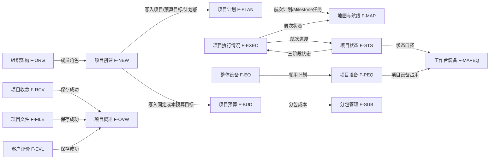


### 3.2 子域内功能依赖


#### 地图与航线总览

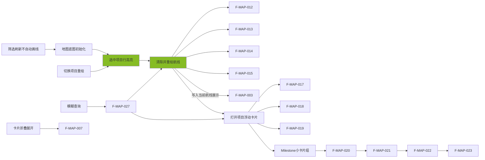


#### 项目执行情况

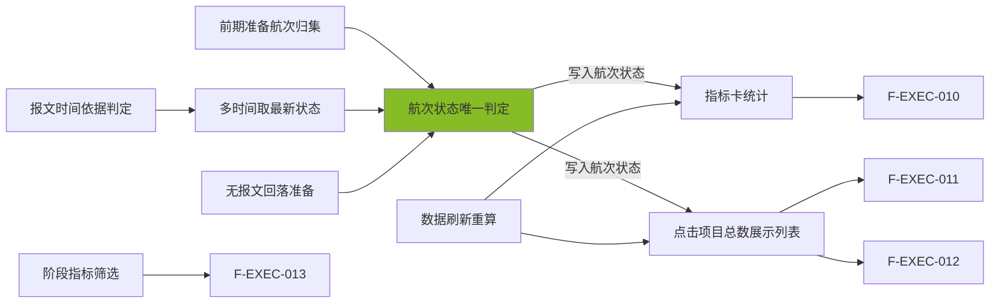


#### 工作台项目装备管理

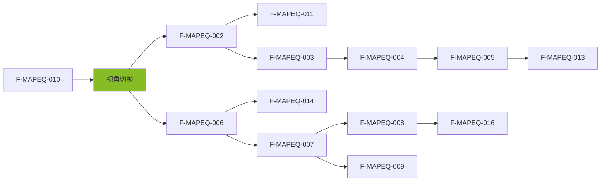


#### 项目状态管理

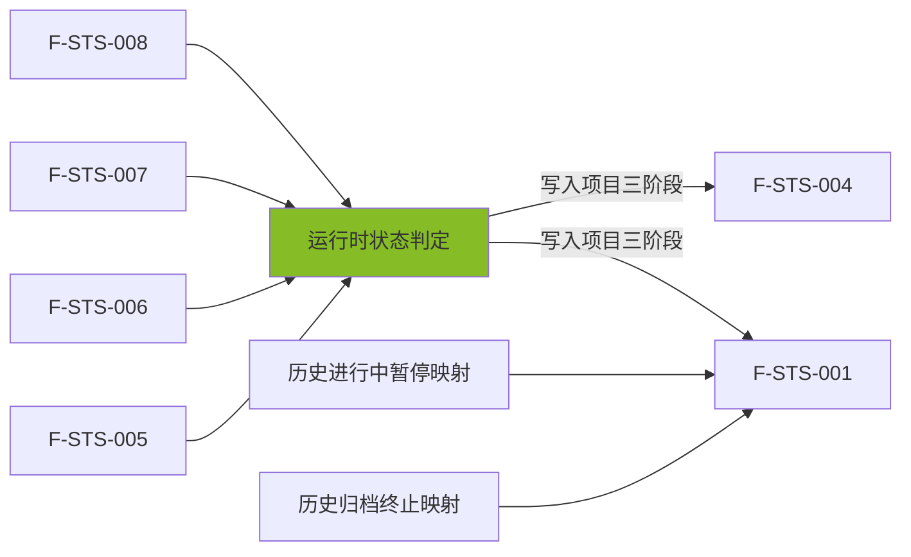


#### 项目创建

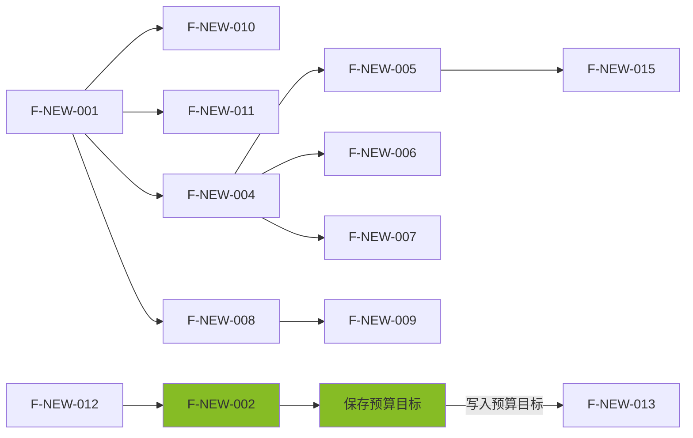


#### 项目概述

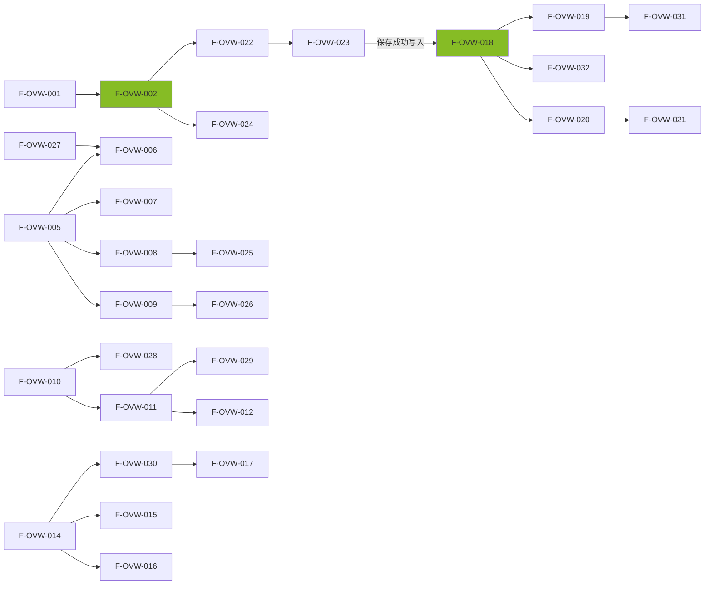


#### 项目计划

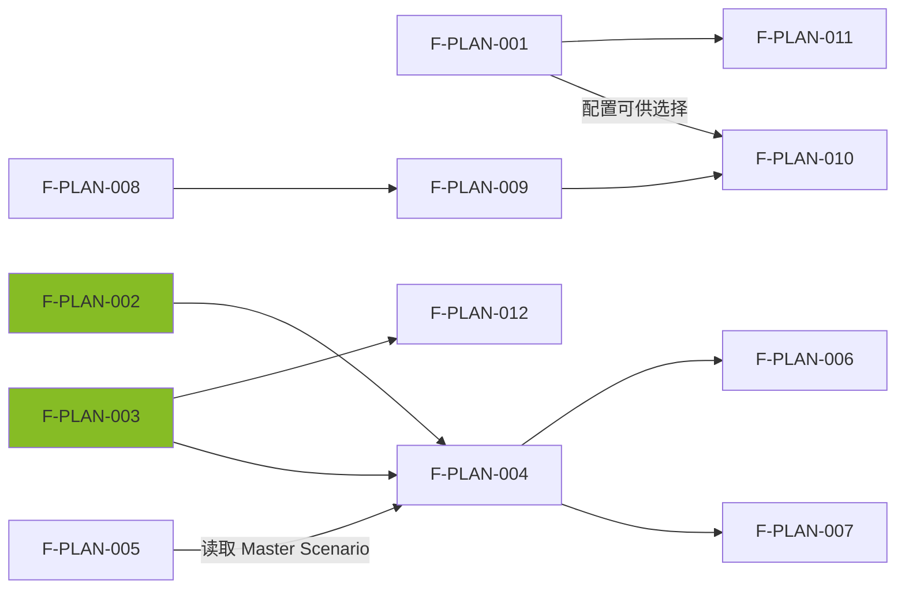


#### 项目预算

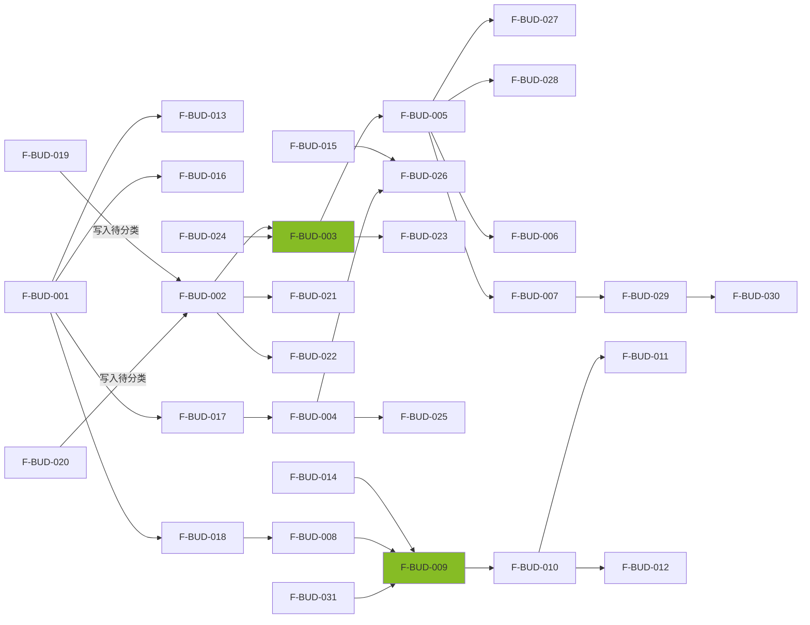


#### 项目收款

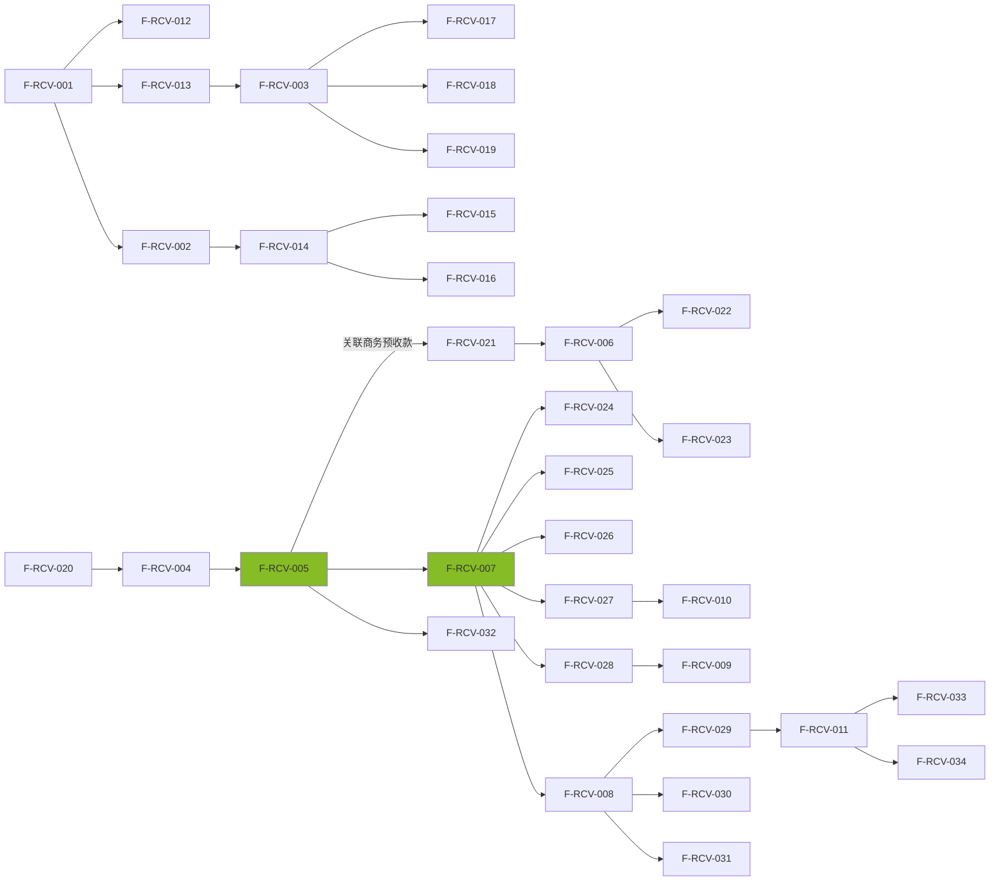


#### 分包管理

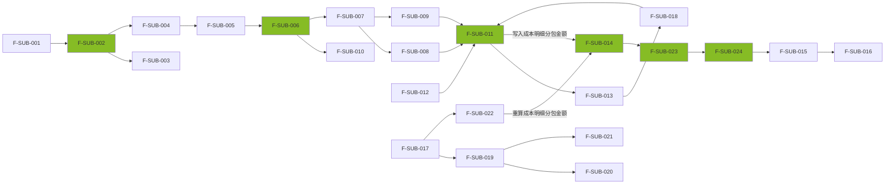


#### 组织架构

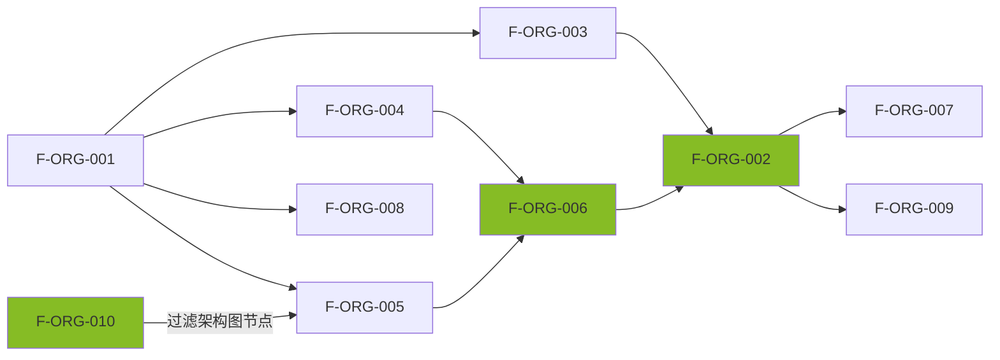


#### 项目文件

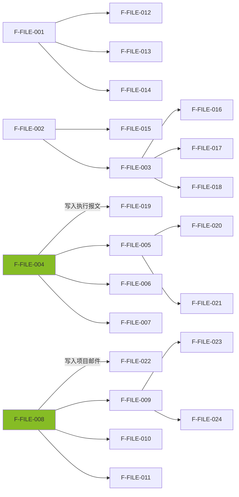


#### 整体设备管理

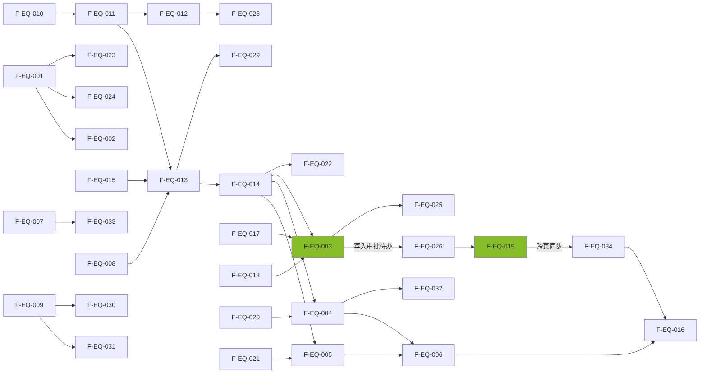


#### 项目设备信息

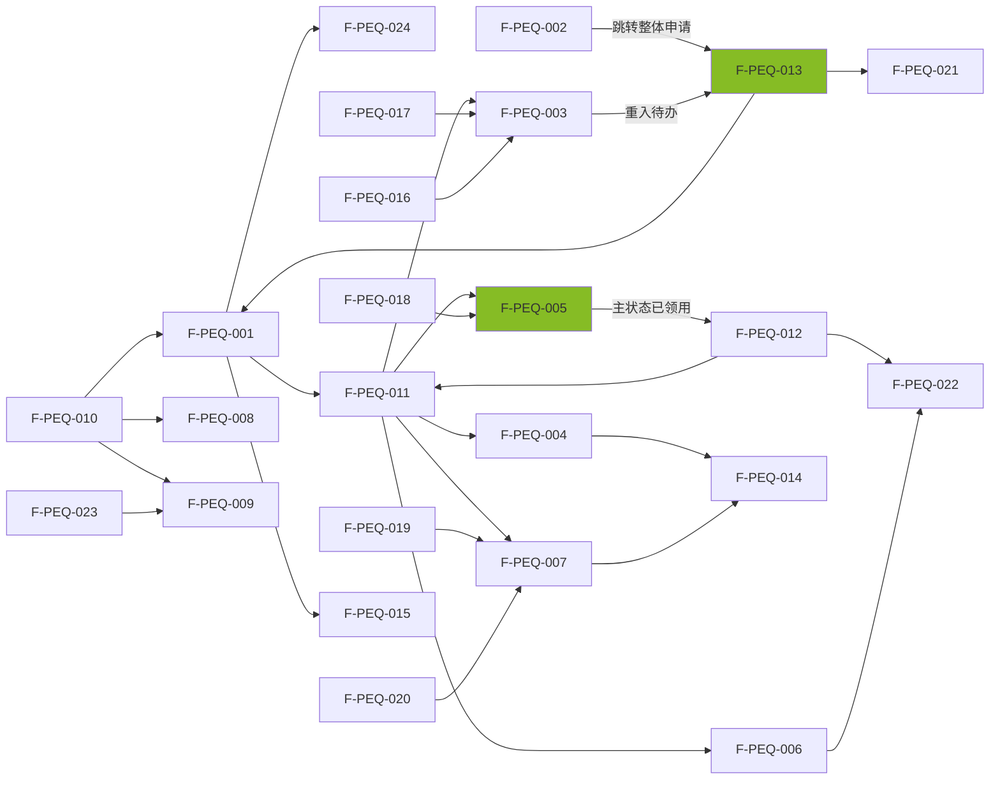


#### 客户评价

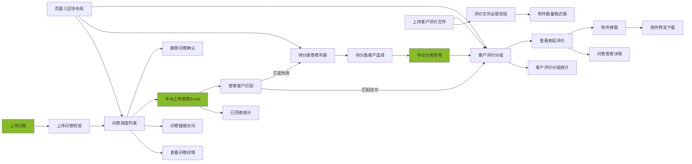


---


## 四、项目管理模块流程探测

> **必须填写**。先给一条总主线，再按主要子域补充流程组。写在业务高度，不重复单个功能的目录细节。


### 4.1 总主线（项目管理）

创建项目并初始化计划与预算目标；执行期跟踪航次/状态/地图航线与装备；费用入账分类与收款推进；过程资料与客户评价沉淀；项目收尾结算锁定。

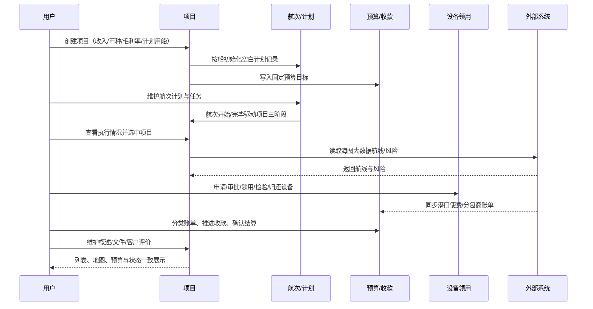


#### 总主线·异常流程


| 异常点      | 触发条件             | 系统响应               |
| -------- | ---------------- | ------------------ |
| 创建校验失败   | 收入/币种/毛利率不合法或缺失  | 阻止创建，弹窗不关闭并提示      |
| 航次状态无法判定 | 报文时间字段缺失或不满足规则   | 按规则回落为「准备」，不阻断列表展示 |
| 账单分类条件不足 | 未勾选账单或未选叶子成本分项   | 提示并中止分类，数据不变       |
| 结算仍有待分类  | 确认最终结算时待分类账单 N>0 | 阻止确认，提示先回准备及执行分类   |
| 设备排期冲突   | 申请/变更领用与已有计划交叉   | 整批中止并提示冲突设备编号      |


#### 总主线·边界流程

- 项目无可展示航线：地图不绘制、不提示；项目仍留在列表与统计中
- 历史项目状态映射：存量状态一次性映射到新三阶段
- 已最终结算：预算分类与分项调整只读归档，仍可导出只读快照
- 无设备/无评价/无文件：各区块展示对应空态，不阻断其他子域


### 4.2 地图与航线总览


#### 主流程（业务主线）

进入页面加载空底图；在执行情况选中项目后绘制该项目航线并打开卡片；可查询定位、切换项目、折叠卡片查看摘要。（F-MAP-001 / F-MAP-002 / F-MAP-011 / F-MAP-004）

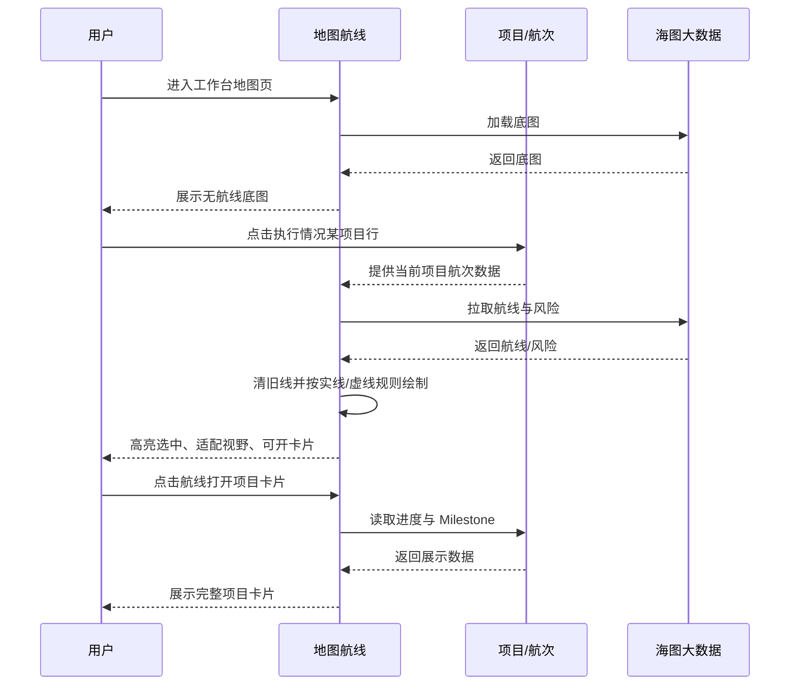


#### 异常流程


| 异常点      | 触发条件        | 系统响应                 |
| -------- | ----------- | -------------------- |
| 海图航线不可用  | 对接失败或无返回航线  | 按无航线处理：不绘制、不额外提示     |
| 查询无匹配    | 关键词无命中项目/航次 | 提示「未找到匹配的项目航次」，保持原选中 |
| 计划航次信息不足 | 仅部分装卸港缺失    | 无法构成虚线时不绘制该段，不阻断选中   |


#### 边界流程

- 同一时刻只展示当前选中项目航线，不叠加未选中项目
- 仅切换阶段筛选或刷新统计时不自动画线
- 摘要小卡片关闭后，本次对该项目不再自动弹出，直至重新选中后再收起

---


### 4.3 项目执行情况


#### 主流程（业务主线）

按项目与报文规则判定航次状态；指标卡按列表可见范围统计；用户点击指标卡筛选或点行驱动地图。（F-EXEC-003 / F-EXEC-001 / F-EXEC-002 / F-EXEC-004）

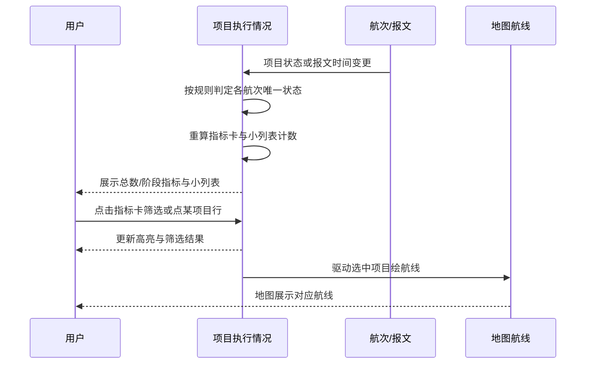


#### 异常流程


| 异常点       | 触发条件           | 系统响应                   |
| --------- | -------------- | ---------------------- |
| 报文字段不完整   | 缺少装/卸/加班清理结束时间 | 非前期准备时回落「准备」，不阻断展示     |
| 统计口径不一致风险 | 列表过滤条件变化       | 指标卡必须随当前可见范围重算，禁止用全量口径 |


#### 边界流程

- 一个航次有且仅有一个状态；一个项目在指标卡中只计入一个项目状态
- 切换阶段筛选时不自动绘制地图航线
- 无项目时小列表空态，不出现计数行

---


### 4.4 工作台项目装备管理


#### 主流程（业务主线）

默认设备视角看总量与类别占用；可切到项目视角按阶段/领用状态查看项目设备；支持跳转整体设备管理。（F-MAPEQ-001 / F-MAPEQ-002 / F-MAPEQ-007 / F-MAPEQ-009）

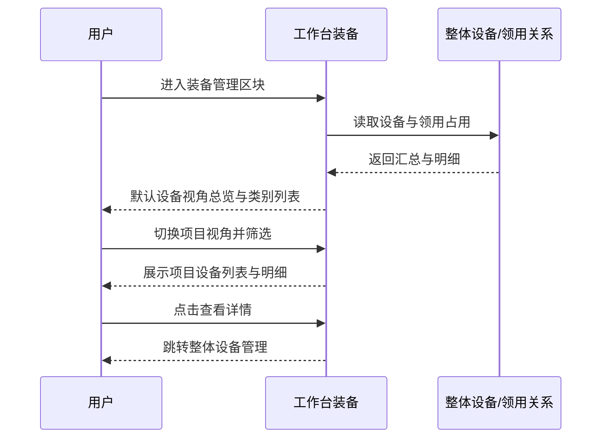


#### 异常流程


| 异常点       | 触发条件        | 系统响应                 |
| --------- | ----------- | -------------------- |
| 设备主数据缺失标签 | 标签与主数据不一致   | 按主数据标签口径筛选；无匹配时列表为空态 |
| 同一设备多条领用  | 同项目存在多条领用计划 | 按当前有效领用关系展示          |


#### 边界流程

- 两种视角互斥，切换时重置本区块筛选
- 设备总量全员可见，不做按人过滤
- 筛后某项目无设备则不出现在项目视角列表

---


### 4.5 项目状态管理


#### 主流程（业务主线）

航次事件触发项目三阶段重算；全模块统一展示新状态名；存量数据一次性映射后同步各入口。（F-STS-002 / F-STS-001 / F-STS-003 / F-STS-004）

```mermaid
sequenceDiagram
    participant U as 用户
    participant S as 项目状态
    participant V as 航次进度
    participant P as 项目列表/指标/导出

    V->>S: 航次开始或全部完毕事件
    S->>S: 按规则重算三阶段
    S->>P: 同步写入最新项目状态
    P-->>U: 筛选、标签、指标卡、导出一致展示
    U->>S: 查看历史存量项目
    S->>S: 按映射规则转为新三阶段
    S-->>U: 历史项目按新口径可见
```


#### 异常流程


| 异常点       | 触发条件           | 系统响应                        |
| --------- | -------------- | --------------------------- |
| 航次时点口径冲突  | 与执行情况航次状态判定不一致 | 以 F-EXEC-003 时点口径为准重算，避免双口径 |
| 映射规则未覆盖旧值 | 出现未定义的历史状态值    | 标记待确认，不静默丢弃；展示侧暂不纳入错误阶段     |


#### 边界流程

- 无航次开始：固定前期准备
- 全部航次完毕：固定结束总结
- 映射为一次性处理，不在日常操作中反复改写业务含义

---


### 4.6 项目创建


#### 主流程（业务主线）

打开新建弹窗补录收入与用船等信息，校验通过后创建项目，并联动预算目标与计划空白船记录。（F-NEW-001 / F-NEW-002 / F-NEW-003 / F-NEW-007）

```mermaid
sequenceDiagram
    participant U as 用户
    participant N as 项目创建
    participant P as 项目计划

    U->>N: 打开新建项目弹窗并填写字段
    U->>N: 可选多选计划用船、预览合同
    U->>N: 提交创建
    N->>N: 校验收入/币种/毛利率
    N->>B: 写入固定预算目标并计算成本总额
    N->>P: 按已选船初始化空白计划记录
    N-->>U: 创建成功，进入后续项目管理
```


#### 异常流程


| 异常点    | 触发条件               | 系统响应              |
| ------ | ------------------ | ----------------- |
| 必填校验失败 | 收入非合法非负、币种未选或毛利率非法 | 阻止创建，提示错误，不关闭弹窗   |
| 创建中断   | 用户取消或关闭弹窗          | 不落库，不生成预算目标与计划船记录 |


#### 边界流程

- 未选计划用船：允许创建，不生成计划船舶记录
- 计划用船与合同预览不参与必填校验
- 预算目标各阶段只读，页面不可改收入/币种/毛利率及由此得到的固定成本总额

---


### 4.7 项目概述


#### 主流程（业务主线）

维护公共项目描述与照片，记录个人 Notes；项目经理维护本项目日历；各业务页保存成功后沉淀 Track change。（F-OVW-002 / F-OVW-007 / F-OVW-011 / F-OVW-017 / F-OVW-018）

```mermaid
sequenceDiagram
    participant U as 用户
    participant O as 项目概述
    participant N as Notes
    participant C as 日历计划
    participant T as Track change

    U->>O: 查看/编辑项目描述与照片
    O-->>U: 只读展示或保存成功
    U->>N: 编辑并保存个人Notes
    N-->>U: 仅本人可见，不进公共痕迹
    U->>C: 项目经理创建本项目日程
    C-->>U: 固定关联当前项目
    U->>O: 业务页保存成功
    O->>T: 写入页面级修改记录
    T-->>U: 倒序分页只读展示
```


#### 异常流程


| 异常点       | 触发条件            | 系统响应            |
| --------- | --------------- | --------------- |
| 描述超长或非纯文本 | 保存时长度>2000或含富文本 | 阻止保存并提示，保持编辑态   |
| 无照片操作     | 无照片时下载/重命名/删除   | 对应操作不可用，不产生变更   |
| 非项目经理维护   | 非项目经理编辑描述或维护日历  | 无编辑入口或维护入口，只读查看 |
| Notes超长   | Notes长度>2000    | 阻止保存并提示         |


#### 边界流程

- Notes 按「当前用户+当前项目」隔离，切换项目重载本人记录
- Notes 不进入 Track change、公共导出与项目总结
- 日历仅展示关联当前 PID 的日程，且无订阅成员入口
- Track change 仅页面级「修改-页面名称」，不展示字段级摘要

---


### 4.8 项目计划


#### 主流程（业务主线）

新建后按船生成空白计划；用户主动创建后才有航次任务；船期根据 Project Window 展示宣船日期或「查看」并只读打开窗口。（F-PLAN-008 / F-PLAN-010 / F-PLAN-002 / F-PLAN-004）

```mermaid
sequenceDiagram
    participant U as 用户
    participant P as 项目计划
    participant M as Master Scenario

    U->>P: 新建项目带出已选船舶
    P->>P: 按船生成仅含船名的空白记录
    U->>P: 主动创建默认日程或新增保存
    P-->>U: 生成航次、日期与任务
    U->>P: 查看船期宣船信息
    P->>M: 读取 Project Window
    M-->>P: 返回窗口记录
    P-->>U: 正常态显示日期或异常态显示查看
    U->>P: 点击日期或查看
    P-->>U: 只读打开 Project Window
```


#### 异常流程


| 异常点                 | 触发条件                    | 系统响应           |
| ------------------- | ----------------------- | -------------- |
| Project Window 异常顺序 | 无数据、无 TBN、夹心 Done/TBN 等 | 不展示具体日期，统一「查看」 |
| 配置校验失败              | 未选编号、名称为空或天数 < 0        | 阻止保存并提示        |


#### 边界流程

- 初始化记录不得根据船名自动生成航次、日期或默认任务
- 仅用户主动创建/新增保存后才生成计划内容
- Project Window 弹窗不可 New/Save/Operate

---


### 4.9 项目预算


#### 主流程（业务主线）

立项目标只读展示；执行中同步账单并分类归集、维护分项预算；结束总结后核对并确认结算锁定。（F-BUD-001 / F-BUD-002 / F-BUD-003 / F-BUD-004 / F-BUD-009）

```mermaid
sequenceDiagram
    participant U as 用户
    participant Bill as 费用账单
    participant Cost as 成本分项
    participant Settle as 结算确认

    U->>B: 切换初始配置/准备执行/结算
    Bill-->>B: 港口使费/分包商账单入待分类
    U->>B: 勾选账单并分类到叶子分项
    B->>Cost: 归集账单并刷新KPI
    U->>Cost: 维护一级分项预算金额
    Cost-->>U: 重算剩余可用与进度
    U->>Settle: 核对后确认最终结算
    Settle->>B: 锁定归档
    B-->>U: 已确认且不可再改
```


#### 异常流程


| 异常点     | 触发条件                  | 系统响应            |
| ------- | --------------------- | --------------- |
| 分类前置失败  | 未勾选账单或未选叶子分项          | 提示并中止，账单仍待分类    |
| 非结束总结结算 | 项目状态非结束总结却确认结算        | 阻止确认            |
| 待分类未清   | 仍有待分类账单时确认最终结算        | 阻止并提示先回准备执行完成分类 |
| 已结算再调整  | 已最终结算后尝试分类/改预算/改挂/删明细 | 操作不可用，只读归档      |


#### 边界流程

- 分项预算调整不改写收入、币种、毛利率及固定成本预算总额
- 删除明细仅取消本项目归集回待分类，不物理删除源账单
- 初始配置无账单显示空态；结算阶段隐藏待分类区
- 已结算后仍可导出数据与报告只读快照

---


### 4.10 项目收款


#### 主流程（业务主线）

维护收款计划与附件，经铃铛提交商务预收款；进度由商务侧自动回写；按状态控制操作直至开票下载或驳回重提。（F-RCV-002 / F-RCV-004 / F-RCV-005 / F-RCV-007 / F-RCV-010）

```mermaid
sequenceDiagram
    participant U as 用户
    participant R as 收款计划
    participant P as 商务预收款
    participant F as 财务处理进度

    U->>R: 新增/编辑计划并维护附件
    R-->>U: 保存为未通知
    U->>R: 点击铃铛打开预收款
    R->>P: 提交并建立关联
    P-->>F: 回写未处理/处理中/驳回/已开票
    F-->>R: 同步进度与驳回原因
    alt 未处理撤回
        U->>R: 确认撤回并编辑
        R-->>U: 恢复未通知进入编辑
    else 已开票
        U->>R: 下载发票
        R-->>U: 返回关联发票文件
    end
```


#### 异常流程


| 异常点     | 触发条件                | 系统响应            |
| ------- | ------------------- | --------------- |
| 预收款提交失败 | 商务侧提交失败             | 不建立关联，收款计划保持原状态 |
| 非法状态操作  | 处理中/已开票编辑删除，或非已开票下载 | 对应按钮禁用，不执行      |
| 撤回取消    | 撤回确认点取消或关闭          | 不撤回，进度保持未处理     |
| 删除取消    | 删除确认点取消或关闭          | 不删除，列表不变        |


#### 边界流程

- 财务处理进度仅由商务预收款关联记录自动判定，本页无手改入口
- 驳回重通知提交成功后清除当前驳回原因；再次驳回展示最新原因
- 切换合同必须刷新带出字段，不得残留旧合同数据
- 未处理附件只读；需修改须先撤回并编辑

---


### 4.11 分包管理


#### 主流程（业务主线）

首次进入分包管理为空表，不自动加载全部预算成本树；用户按需引入预算金额大于 0 且未引入的一级类别及其完整分项/明细树后，再折叠展开并在成本明细下维护分包金额。保存时校验合同、金额、类别预算上限与合同总额上限，通过后重算明细分包金额并向上汇总；已保存行可跳转预付款。（F-SUB-030 / F-SUB-025 / F-SUB-002 / F-SUB-009 / F-SUB-011 / F-SUB-026 / F-SUB-027 / F-SUB-014 / F-SUB-023 / F-SUB-024 / F-SUB-015 / F-SUB-029）

```mermaid
sequenceDiagram
    participant U as 用户
    participant T as 分包管理成本树
    participant D as 分包合同金额明细
    participant Pay as 预付款

    U->>T: 首次进入分包管理页
    T-->>U: 空表并提示引入预算类别
    U->>T: 引入预算金额大于0且未引入的一级类别
    T-->>U: 展示该类别完整成本树（与预算同源）
    U->>T: 展开成本类别/分项/明细
    T-->>U: 展示成本明细下合同子表
    U->>D: 点击ADD并选合同、填分包金额
    U->>D: 保存明细
    D->>D: 校验合同、金额、类别预算上限、合同总额上限
    D->>T: 按已保存分包合同金额重算成本明细分包金额
    T->>T: 向上汇总成本分项与成本类别分包金额
    T->>T: 同步表底成本合计行
    T-->>U: 明细只读，各级分包金额与成本合计已更新
    U->>D: 已保存行点预付款图标
    D->>Pay: 跳转预付款页并带入锁定项目号及合同字段
    U->>D: 编辑或删除已保存明细
    D->>T: 再次重算各级分包金额
    T-->>U: 成本结果刷新
```


#### 异常流程


| 异常点      | 触发条件                         | 系统响应                                      |
| -------- | ---------------------------- | ----------------------------------------- |
| 引入未选类别   | 引入弹窗未选择类别即确认                   | 不得确认，表格不变                                 |
| 保存校验失败   | 未选分包合同或未填金额                    | 提示错误，不保存、不计入分包金额                          |
| 类别预算超限   | 当前类别已保存分包金额与本次金额之和超过类别预算       | 阻止保存，居中提示可跳转项目预算调整；暂不调整则保留编辑数据            |
| 合同总额超限   | 同一合同跨成本明细累计分配金额超过合同总额          | 阻止保存并提示调整本次金额；保留编辑数据、不更新各级分包金额            |
| 取消操作     | 用户确认取消                       | 新增未保存行删除；已保存行编辑恢复原值                       |
| 删除确认     | 用户确认删除明细                     | 移除该明细并重算分包金额                              |


#### 边界流程

- 新项目首次进入成本表为空，不自动复制项目预算全部成本树；空态提示「暂无成本类别，请点击“引入预算类别”添加」
- 已引入类别保存为项目级数据，再次进入继续展示；最后一个已引入类别被移除后恢复空态
- 操作区保留「引入预算类别」「新建合同」；无「查看成本」；预付台账无独立「新建付款」，预付款仅从已保存合同金额行图标进入
- 引入候选仅为预算金额大于 0 且尚未引入的一级成本类别；确认后带入完整分项/明细树，层级与项目预算同源
- 页面标题与表格名均为「分包管理」
- 同一成本明细下不可重复选择同一分包合同
- 未保存的编辑行金额不计入成本明细分包金额
- 成本明细分包金额=其下已保存分包合同金额合计；成本分项/成本类别分包金额分别汇总其下子级分包金额
- 表底成本合计行分包金额=全部成本类别分包金额之和
- 类别/分项/明细备注为项目级共享数据；授权人员可编辑，其他成员只读
- 无明细时展示「暂无数据」，各节点独立展开互不影响

---


### 4.12 组织架构


#### 主流程（业务主线）

成员行缺少合适角色时，项目负责人通过 ADD 打开弹窗创建一次性角色并回填当前行，不进入下拉供他人选用；上方架构图仅展示人员表已安排负责人的 Project Role。（F-ORG-001 / F-ORG-002 / F-ORG-006 / F-ORG-010）

```mermaid
sequenceDiagram
    participant U as 项目负责人
    participant M as 成员行
    participant R as Project Role
    participant C as 上方架构图

    U->>M: 在Project Role下拉选择ADD
    M-->>U: 打开Add Project Role弹窗
    U->>R: 输入角色名称并选择父节点
    U->>R: 点击Confirm
    R->>R: 校验名称与父节点
    R->>M: 回填新角色到当前成员行
    R-->>U: 一次性角色创建成功且不入下拉
    M->>C: 按人员表是否已安排负责人过滤角色
    C-->>U: 未安排负责人的角色不出现在架构图
```


#### 异常流程


| 异常点    | 触发条件            | 系统响应           |
| ------ | --------------- | -------------- |
| 无创建权限  | 非项目负责人尝试创建      | 拒绝创建，不生成角色、不回填 |
| 名称校验失败 | 名称为空或与项目内已有角色重复 | 阻止创建并提示        |
| 父节点无效  | 提交时父节点已不存在或未选   | 阻止创建并提示        |


#### 边界流程

- 新角色仅一次性回填当前成员行，不加入 Project Role 下拉
- Cancel / 关闭：不创建、不回填，成员行恢复原选择
- 随后取消该成员行或未保存：一次性角色一并作废，不残留可选角色
- 人员表格中未安排负责人的 Project Role 不出现在上方架构图

---


### 4.13 项目文件


#### 主流程（业务主线）

维护 OneDrive 外链与影音资料；执行报文与项目邮件由固定邮箱按项目号/PID 自动入库后，用户可预览、打包下载或确认删除。（F-FILE-001 / F-FILE-002 / F-FILE-004 / F-FILE-008）

```mermaid
sequenceDiagram
    participant U as 用户
    participant F as 项目文件
    participant M as 固定邮箱
    participant E as 外部发件方

    U->>F: 粘贴并保存OneDrive链接
    F-->>U: 可点击跳转外链网页
    U->>F: 上传影音并填写描述备注
    F-->>U: 列表可预览下载删除
    E->>M: 发送执行报文或转发项目邮件
    M->>F: 按项目号或PID分流入库
    F-->>U: 列表展示已入库记录
    U->>F: 预览、打包下载或确认删除
    F-->>U: 返回预览页、ZIP文件或列表更新
```


#### 异常流程


| 异常点    | 触发条件            | 系统响应       |
| ------ | --------------- | ---------- |
| 影音描述缺失 | 上传时未填文件描述       | 阻止上传并提示    |
| 删除取消   | 用户在确认弹窗点取消或关闭   | 不删除，列表保持原样 |
| 邮件无法归属 | 邮件缺少可解析的项目号/PID | 不进入当前项目列表  |


#### 边界流程

- OneDrive 仅外链跳转，不对接目录同步、嵌入或权限映射
- 执行报文 / 项目邮件区块无人工上传入口，仅展示已入库数据
- 无附件时附件列显示「—」；项目邮件仅当前项目成员可见
- 打包下载：有附件则邮件+附件入 ZIP，仅邮件则包内只有邮件文件

---


### 4.14 整体设备管理


#### 主流程（业务主线）

维护设备主数据并筛选可用性；批量申请进入审批待办；审批通过后在项目侧正式领用；整体页可归还/报废并失效后续计划，排期与跨页状态同步。（F-EQ-001 / F-EQ-003 / F-EQ-019 / F-EQ-004 / F-EQ-006）

```mermaid
sequenceDiagram
    participant U as 用户
    participant E as 设备主数据
    participant P as 领用计划
    participant A as 审批待办
    participant Proj as 项目设备信息

    U->>E: 新增/维护设备
    E-->>U: 列表展示空闲设备
    U->>P: 勾选设备提交领用申请
    P->>P: 校验排期冲突
    P->>A: 写入审批待办
    P->>Proj: 同步待审批记录
    A-->>P: 通过/驳回
    P-->>Proj: 同步待领用或已驳回
    Proj->>E: 正式领用后改已领用
    U->>E: 归还或报废处理
    E->>P: 报废时失效后续计划
    E-->>U: 主状态与排期更新
```


#### 异常流程


| 异常点     | 触发条件            | 系统响应            |
| ------- | --------------- | --------------- |
| 申请排期冲突  | 任一台与有效计划日期交叉    | 整批中止，提示冲突设备编号   |
| 批量状态不满足 | 勾选含已报废/非已领用/非空闲 | 对应按钮禁用并给出状态 tip |
| 删除有业务记录 | 已有领用计划或非新增流转    | 禁止删除并提示不可删      |
| 筛选日期不成对 | 只填一侧或结束不晚于开始    | 阻止查询并提示         |


#### 边界流程

- 提交申请本身不改变设备主状态
- 已报废设备筛选可用性一律不可用
- 导入已有编号整行跳过，不以文件写入已领用/已报废
- 审批动作不在整体设备页内执行，仅接收同步结果

---


### 4.15 项目设备信息


#### 主流程（业务主线）

本项目按页签跟进领用计划；审批在待办完成并回写本页；通过后正式领用→检验→归还；变更/取消影响排期占用。（F-PEQ-001 / F-PEQ-013 / F-PEQ-005 / F-PEQ-006 / F-PEQ-007）

```mermaid
sequenceDiagram
    participant U as 用户
    participant Proj as 项目领用计划
    participant A as 审批待办
    participant E as 设备主数据

    U->>Proj: 跳转整体页申请后回看待审批
    A-->>Proj: 通过→待领用 / 驳回→已驳回
    Proj-->>U: 页签数量与列表刷新
    U->>Proj: 正式领用
    Proj->>E: 设备主状态改为已领用
    Proj-->>U: 领用状态待检验
    U->>Proj: 检验合格或不合格
    Proj-->>U: 使用中或待归还
    U->>Proj: 确认归还
    Proj->>E: 主状态空闲或已报废
    Proj-->>U: 领用状态已归还并释放排期
```


#### 异常流程


| 异常点    | 触发条件         | 系统响应        |
| ------ | ------------ | ----------- |
| 变更排期冲突 | 变更后区间与有效计划交叉 | 中止提交并提示冲突   |
| 多选状态不一 | 勾选记录不满足同一操作  | 对应工具栏按钮保持禁用 |
| 重复正式领用 | 同一计划再次确认领用   | 拒绝操作，保持原状态  |
| 取消原因缺失 | 未填取消原因点确认    | 阻止取消并提示必填   |


#### 边界流程

- 本页不提供审批通过/驳回入口
- 待检验未检验直接归还时检验状态显示「—」
- 流转历史仅当前项目当前计划；跨项目看整体排期
- 终态（已归还/已驳回/已失效/已取消）业务按钮全部禁用

---


### 4.16 客户评价


#### 主流程（业务主线）

业务人员先在问卷星创建并收集问卷答卷，在本系统仅登记问卷名称、问卷链接和题目数；收到答卷后，业务人员须从问卷星**手动导出 Excel 答卷并回到对应问卷行手动上传**。系统解析答卷中的「用户自填公司」识别客户，识别失败的答卷进入待分类区由用户手工分类；最终问卷答卷与客户评价文件均按客户汇总展示。（F-EVL-002 / F-EVL-006 / F-EVL-008 / F-EVL-011 / F-EVL-012 / F-EVL-016）

```mermaid
sequenceDiagram
    participant U as 用户
    participant W as 问卷星
    participant Q as 问卷调查
    participant M as 客户主数据
    participant P as 待分类答卷
    participant R as 客户评价

    U->>W: 创建问卷并收集客户答卷
    U->>Q: 上传登记问卷名称/链接/题目数
    Q-->>U: 问卷调查列表展示登记信息
    U->>W: 手动导出该问卷答卷Excel
    U->>Q: 点击“上传答卷Excel”手动导入
    Q->>M: 按第1题“所属公司”匹配客户
    alt 匹配成功
        M->>R: 答卷归入对应客户
    else 匹配失败
        M->>P: 答卷进入待分类答卷
        U->>P: 勾选答卷并选择客户后点击分类
        P->>R: 答卷归入目标客户
    end
    U->>R: 上传客户评价文件
    R-->>U: 按客户展示问卷数/答卷数/客户文件数/最近反馈时间
    U->>R: 查看评价与查看详情
    R-->>U: 展示问卷问答详情或附件列表
```


#### 异常流程


| 异常点          | 触发条件                         | 系统响应                                      |
| ------------ | ---------------------------- | ----------------------------------------- |
| 上传问卷信息不合法    | 名称为空、链接非http(s)、题目数<1或非整数       | 对应控件标红并阻止上传                              |
| 答卷文件格式不支持    | 上传文件不是.xlsx或.xls               | 提示「请上传 Excel 格式的答卷文件（.xlsx / .xls）」并阻止导入 |
| 待分类未勾选答卷     | 点击分类时未选择任何答卷                  | 提示「请先选择待分类答卷」，不执行分类                    |
| 待分类未选择客户     | 已勾选答卷但未选择目标客户                 | 客户选择框标红并提示「请选择客户」，不执行分类                |
| 评价文件缺必填项     | 未选调查对象、评价标题/反馈日期为空或未添加附件       | 对应控件标红并阻止上传                              |
| 评价附件超限       | 单文件>20MB、附件超过10个或文件重复           | 超限文件不加入；最多保留10个；同名同大小文件不重复添加            |


#### 边界流程

- **本版本不与问卷星自动同步答卷**；答卷进入系统的唯一入口为用户在问卷星手动导出后，通过对应问卷行「上传答卷Excel」手动导入
- 「上传问卷」仅登记外部问卷信息，不在本系统内创建问卷，也不导入答卷
- 用于客户识别的问卷第1题须填写客户所属公司；系统按「用户自填公司」匹配客户主数据
- 「已回收」统计已手动导入系统的全部答卷，包括已归入客户评价的答卷和待分类答卷；分类仅变更客户归属，不重复计数
- 客户评价页固定包含「问卷调查 / 待分类答卷 / 客户评价」三区块，均仅展示当前项目数据
- 客户评价主表按客户汇总；问卷数按不同问卷去重，答卷数按问卷答卷记录数统计，客户文件数按评价文件记录数统计，最近反馈时间取该客户全部评价记录的最大反馈时间
- 客户评价文件附件支持 PDF、Word、JPG、PNG，单文件不超过20MB，最多10个；附件详情展示文件名称、上传人、上传时间及预览/下载操作

---

---


## 变更记录


| 版本     | 日期         | 变更内容                                                                           | 变更人 |
| ------ | ---------- | ------------------------------------------------------------------------------ | --- |
| v1.0.0 | 2026-08-11 | 初稿                                                                             | 邵艺晨 |
| v1.0.0 | 2026-08-12 | 按新模板调整：三段式描述、拆条、依赖图与流程探测；合成单份清单                                                | 邵艺晨 |
| v1.0.0 | 2026-08-12 | 补充：组织架构无负责人角色不入图；分包商管理更名分包管理并对齐预算成本树与中文列/折叠                                    | 邵艺晨 |
| v1.0.0 | 2026-08-12 | 分包管理删除重叠的「展开收起合同明细」；原成本明细折叠（旧022）保留并重编为 F-SUB-006；本子域 F-SUB 连续编号 001～022       | 邵艺晨 |
| v1.0.0 | 2026-08-12 | 分包管理明确最终成本三级汇总：明细=已保存分包合同金额合计；分项/类别向上汇总；新增 F-SUB-023/024；修正 F-SUB-014 去除「基础」口径 | 邵艺晨 |
| v1.3.0 | 2026-08-25 | 条数更正为 332；文档版本统一为 v1.3.0；3.1 删除 BUD→OVW 预算摘要边；4.11 按 1.10/US 改为先空表再引入类别，并补两类上限与预付款入口 | 邵艺晨 |


