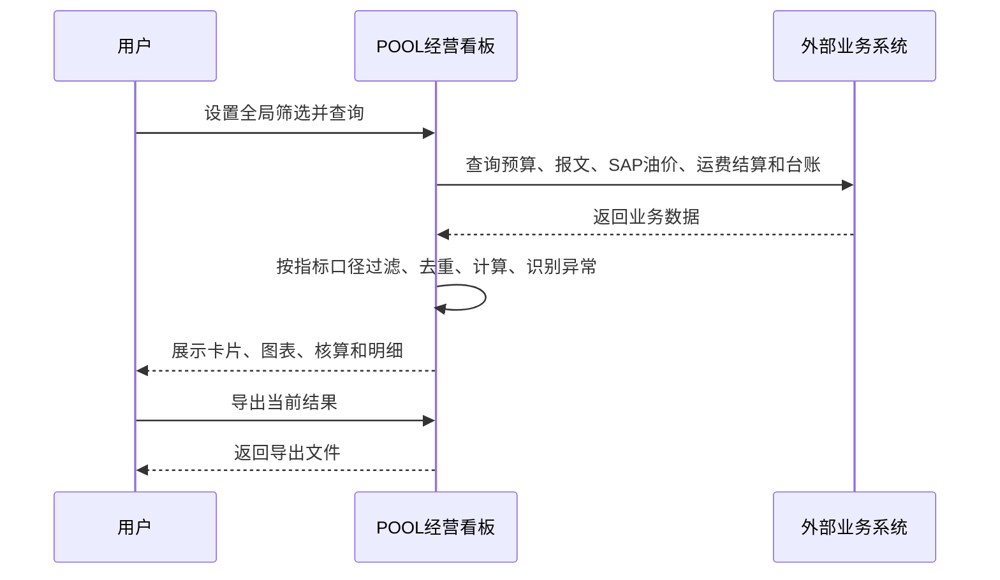
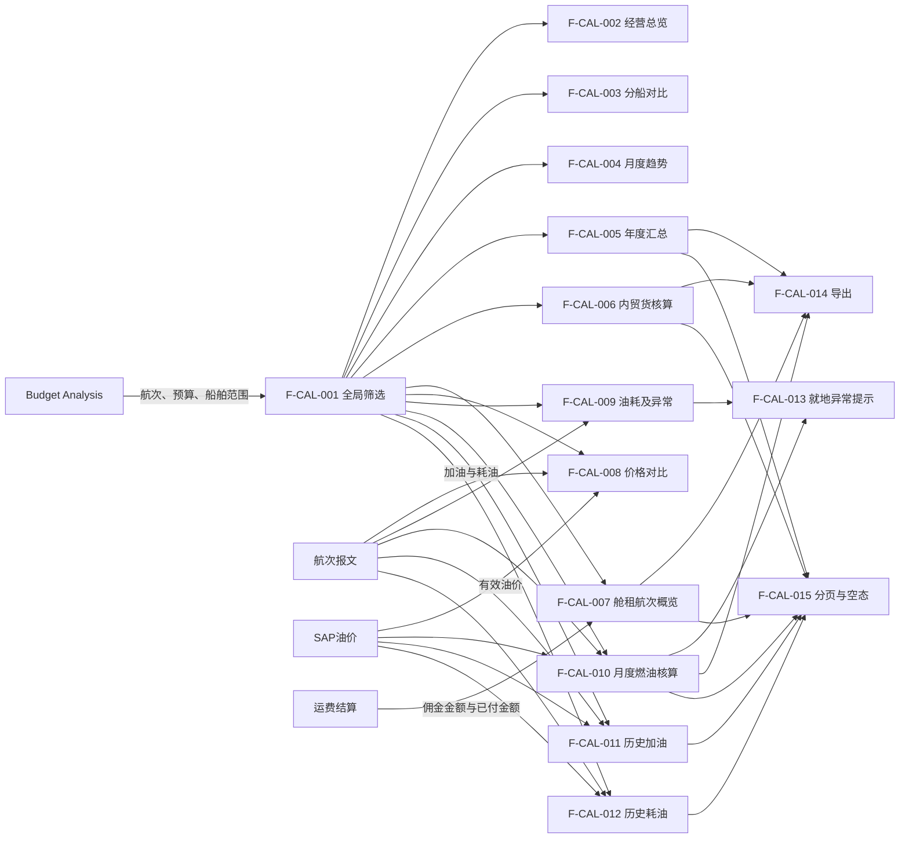

# POOL运营看板模块功能清单

## 文档说明

| 项目   | 内容                                                                                |
| ---- | --------------------------------------------------------------------------------- |
| 产物类型 | 功能清单（与用户故事合称“正向开发的起点”）                                                            |
| 命名   | `PRD-POOL运营看板-FeatureList.md`（模板规范名为 `PRD-POOL运营看板-功能清单.md`，本文件沿用现有文件名，项目全周期持续追加） |
| 职责   | 第一、二章引言与总体描述；第三章业务需求分析；第四章功能需求（功能列表 + 角色与权限）；附录 A 登记业务口径及来源、格式、取值范围、失败处理          |
| 适用范围 | 全部经营公司；数据范围受统一权限和筛选条件约束                                                           |
| 模板版本 | v1.6                                                                              |

## 文档信息

| 项目       | 内容                                                 |
| -------- | -------------------------------------------------- |
| 文档名称     | POOL运营看板模块功能清单                                     |
| 微服务 / 模块 | POOL运营平台 / POOL运营看板                                |
| 版本       | v1.3.2                                             |
| 创建日期     | 2026-09-21                                         |
| 逆向来源     | `POOL运营看板-原型-v1.3.html`、`关于POOL运营看板指标口径-v1.3.xlsx` |

---

## 一、引言

### 1.1 目的

本文档将原型交互、功能范围和指标口径统一整理为可评审、可设计、可开发、可验收的功能清单。全部指标口径以附录 A 为准；用户故事按第四章功能编号展开。

### 1.2 范围

覆盖全局筛选、POOL经营总览、分船贡献与租金差额、月度经营趋势、船舶年度经营汇总、内贸货年度核算与收益成本明细、舱租航次概览、各月加油价与市场价及月末移动加权均价、各船月度油耗及异常、船舶月度燃油核算、历史加油明细、历史耗油明细、导出、分页和空态。

不包含上游系统自身的数据录入、主数据配置和 SAP 价格维护。不包含特殊航次附件的查看、上传、预览、下载和删除。

### 1.3 定义、简写和省略语

| 术语 / 简写              | 全称或含义                          |
| -------------------- | ------------------------------ |
| Budget Analysis      | 预算分析页面，看板数据源                   |
| Group And Change Amt | Budget Analysis 中用于配置船舶范围的分组数据 |
| SAP油价                | SAP中按船舶、油品维护的燃油价格              |
| VLSFO                | Very Low Sulfur Fuel Oil，低硫燃油  |
| 累计截至月份               | 所选年份1月至指定月份的累计统计范围             |
| 舱租航次概览               | 由原舱租航次概览迁入本看板的航次台账             |

---

## 二、总体描述

### 2.1 需求背景

POOL经营数据分散在预算分析、航次报文、SAP油价和舱租航次概览中。人工汇总容易产生时间边界不一致、航次重复计算、燃油价格错配和异常不可追溯等问题，需要统一看板支撑经营分析和数据核对。

### 2.2 建设目标

建立统一的筛选和指标计算口径；让用户从总览看到分船、月份、船舶年度、内贸货、舱租航次和燃油价格、油耗、月度核算及逐笔加油耗油；对缺失、消耗不平、价格异常和油耗异常提示；支持当前结果导出。

### 2.3 软件功能要求

系统应提供全局筛选及联动、经营指标卡片、分船对比、月度趋势、年度汇总、内贸货核算、舱租航次概览、燃油价格对比、油耗异常、月度燃油核算、历史加油与耗油明细、异常提示、导出、分页和空态。每个展示指标必须遵循附录 A 对来源、过滤、去重、计算、格式和失败处理的定义。

### 2.5 运行环境

企业内网浏览器；依赖 Budget Analysis、航次报文、SAP油价、运费结算和特殊航次统一业务台账；使用系统统一身份认证和权限控制。

### 2.6 假定和约束

上游数据按约定周期同步；船舶、航次、经营公司、油品和时间字段可关联；关键数据缺失时不得静默按零计算；跨模块聚合必须按附录 A 的唯一标识去重。舱租沿用字段已在附录 A 登记名称，原页面计算公式未在指标表展开，实现时沿用原舱租航次概览，不得另造公式。

---

## 三、业务需求分析

### 3.1 主流程（业务主线）

用户设置年份、累计截至月份、船舶和经营公司后，系统按该范围计算经营总览、分船对比、月度趋势和船舶年度汇总；用户再查看内贸货核算或舱租航次，并在燃油区域查看价格、油耗和月度核算，必要时进入逐笔加油或耗油，并可导出当前结果。

### 3.2 异常流程

| 异常点     | 触发条件                 | 系统响应                          |
| ------- | -------------------- | ----------------------------- |
| 筛选条件缺失  | 年份未选择                | 阻断查询并提示具体字段                   |
| 局部筛选越界  | 区域内年月或船舶超出全局范围       | 不允许应用，自动移除已不在全局范围内的船舶         |
| 数据缺失    | 报文、船舶、航次或 SAP 油价无法匹配 | 相关指标显示“—”，并按口径标记数据缺失；不得按 0 计算 |
| 外部系统不可用 | 上游查询超时或返回错误          | 展示错误状态，不展示伪造结果                |

### 3.3 边界流程

- 清空船舶或经营公司表示全量，不表示无数据。
- 累计截至月份为 1 月时只统计 1 月，趋势只产生一个数据点。
- 区域内的年月、船舶选择不得超出全局时间和船舶范围。
- 价格折线在某月没有 VLSFO 价格数据时显示断点或“—”，不得按 0 元/吨展示。
- 油耗历史不足 6 个月时，按已有月份计算近 6 个月基准。
- 同一航次跨多条来源记录时，按口径规定的唯一标识处理。
- 列表分页后，当前页超出总页数时回到上一有效页。

---

## 四、功能需求

### 4.1 功能列表

状态取值：本期新增。本清单依据原型和指标口径编写，不使用逆向语境的“已存在(旧)”。

| 功能编号      | 功能名称                 | 功能描述（用户操作→系统响应→预期结果）                                                                                                                                                                        | 适用范围   | 优先级 | 引入版本 | 状态  |
| --------- | -------------------- | ------------------------------------------------------------------------------------------------------------------------------------------------------------------------------------------- | ------ | --- | ---- | --- |
| F-CAL-001 | 全局筛选                 | 选择年份、累计截至月份、船舶和经营公司，可折叠筛选区，点击查询或重置 → 年份必填；统计范围为所选年 1 月至累计截至月份；船舶按唯一编码去重，支持按编码和中英文名称搜索且搜索不清除已选项；经营公司按船东去重，默认全部公司 → 以该范围刷新全部模块；重置恢复当前年、当前月、全部船舶和全部公司；区域内筛选不得超出全局范围                            | 半潜财务人员 | P0  | v1.3 | 待开发 |
| F-CAL-002 | POOL经营总览             | 进入页面或应用全局筛选 → 汇总已完航或 POC 航次的实际贡献毛利，以及切割营运天×每天租金；计算租金占贡献毛利、贡献与租金差额，并汇总内贸货、转手货的贡献和航次数及燃油成本 → 展示五类指标卡。差额大于等于 0 显示“正向结余”，小于 0 显示“租金高于贡献”；分母为 0 或缺失时占比显示“—”。特殊航次金额按字段口径取 Budget Analysis         | 半潜财务人员 | P0  | v1.3 | 待开发 |
| F-CAL-003 | 分船贡献与租金差额            | 查看分船区域 → 按船舶编码汇总已完航或 POC 航次的贡献毛利和已分配租金，差额降序、差额相同再按贡献毛利降序 → 以排名、船舶中文名、条形图和悬浮提示展示同一口径。本区域不分页，也不进入航次明细                                                                                         | 半潜财务人员 | P0  | v1.3 | 待开发 |
| F-CAL-004 | 月度经营趋势               | 按全局年份和累计截至月份查看趋势 → 从 1 月到截至月逐月单独汇总贡献毛利、已分配租金和燃油成本，航次状态限于已完航或 POC → 横轴连续展示各月。某月无数据时不补 0                                                                                                      | 半潜财务人员 | P0  | v1.3 | 待开发 |
| F-CAL-005 | 船舶年度经营汇总             | 在表头于全局船舶范围内进一步多选，未选则展示全部 → 按所选年份加船舶编码汇总贡献毛利、已分配租金、贡献差额、年初指定值、当前实际值、指定差额、特殊航次贡献、跨年调整和燃油成本，并判定已达标或未达标 → 默认按贡献差额降序，每页 5 条。船舶筛选只影响本表。年初指定值不按累计截至月份折算。不提供构成明细下钻                                  | 半潜财务人员 | P0  | v1.3 | 待开发 |
| F-CAL-006 | 内贸货年度核算与收益成本明细       | 打开内贸货页签，可用 POOL 归属年份和“仅看跨年”在全局结果内再筛选 → 只纳入航次归属为内贸货的航次；汇总已确认的年度收益、年度成本、年度贡献和跨年航次数；明细展示船舶、航次、起止时间、确认金额、贡献毛利、归属年份和跨年状态 → 待确认金额和年份显示“—”，且不计入金额汇总。无数据时提示“当前筛选条件下暂无内贸货年度核算记录”。可导出本表，规则见 F-CAL-014 | 半潜财务人员 | P1  | v1.3 | 待开发 |
| F-CAL-007 | 舱租航次概览               | 打开舱租航次概览 → 保留原舱租列，并展示航次开始时间、航次结束时间、佣金金额、佣金支付情况、转手货差价和差价调整归属年份；按转手合同号加船名航次匹配运费结算佣金；差价等于应收客户的金额减佣金金额再减应收转手金额 → 支持导出和展示字段设置，每页 5 条。沿用字段的计算公式以原页面为准，见附录 A 的 M-119 起                             | 半潜财务人员 | P1  | v1.3 | 待开发 |
| F-CAL-008 | 各月实际加油价、市场价与月末移动加权均价 | 查看价格区域，可在全局船舶范围内多选且只影响本区域 → 指标卡累计所选年 1 月至截至月的实际采购均价、采购价差和采购价差金额；折线按月展示实际加油价、市场价和月末移动加权均价 → 无有效加油、加油量为 0 或无法匹配价格时显示“—”或断点，不按 0 元/吨展示。多船月末均价按库存量加权，不做算术平均                                     | 半潜财务人员 | P0  | v1.3 | 待开发 |
| F-CAL-009 | 各船月度油耗及异常            | 选择分析月份，默认全局累计截至月份，且只能选全局年份 1 月至截至月 → 计算年内累计耗油、航行和在港平均单位油耗，以及相对近 6 个月同状态基准的偏差和正常、关注、异常 → 修改分析月份只影响本区域。年内累计耗油不随分析月份变化。分母为 0、缺失或历史基准无法计算时显示“—”。不使用营运天                                          | 半潜财务人员 | P0  | v1.3 | 待开发 |
| F-CAL-010 | 船舶月度燃油核算             | 在月度核算页签选择年月和船舶 → 年月默认全局累计截至月份，船舶不得超出全局范围；该页签条件独立于逐笔加油和逐笔耗油 → 按年月加船舶编码加 VLSFO 展示期初存油、本月加油、本月耗油、期末存油、移动加权均价、耗油成本和异常情况。缺报文或缺有效 SAP 油价时相关值显示“—”，并标记数据缺失，不按 0 计算                                 | 半潜财务人员 | P0  | v1.3 | 待开发 |
| F-CAL-011 | 历史加油明细               | 在逐笔加油页签按年月和船舶筛选，条件只影响本页签 → 加油记录取航次正午报，按加油时间倒序，每页 5 条 → 展示日期、船舶、加油量、SAP 油价、市场价、港口、加油时库存、本次加油金额和加油后库存。缺加油量或 SAP 油价时金额显示“—”，不按 0 计算，并标记数据缺失。不展示折扣                                              | 半潜财务人员 | P1  | v1.3 | 待开发 |
| F-CAL-012 | 历史耗油明细               | 在逐笔耗油页签按年月和船舶筛选，条件只影响本页签 → 用相邻有效正午报推算耗油量，并按船舶编码、VLSFO 和耗油时间匹配当时有效的 SAP 油价 → 按耗油时间倒序、每页 5 条展示日期、船舶、航次、耗油量、耗用时点和成本。缺数显示“—”；耗油量小于 0 时标记数量不平，不改为 0                                              | 半潜财务人员 | P1  | v1.3 | 待开发 |
| F-CAL-013 | 就地异常提示               | 查看各船月度油耗或船舶月度燃油核算 → 油耗按偏差率判定正常、关注、异常；月度核算按库存为负、数量不平、单价异常、油耗异常和数据缺失判定 → 在原区域展示状态。多项同时命中时优先级为数据缺失、数量不平、库存为负、单价异常、油耗异常、正常                                                                      | 半潜财务人员 | P0  | v1.3 | 待开发 |
| F-CAL-014 | 导出                   | 点击页头“导出报表”，或在内贸货明细、舱租航次概览点击导出 → 导出当前筛选结果中的可见列；页头导出包含船舶年度经营汇总、内贸货年度确认、舱租航次概览和燃油月度核算 → 无数据时提示“暂无可导出数据”                                                                                        | 半潜财务人员 | P1  | v1.3 | 待开发 |
| F-CAL-015 | 分页与空态                | 翻阅船舶年度经营汇总、收益与成本年度确认明细、舱租航次概览、船舶月度燃油核算、历史加油明细和历史耗油明细 → 每页 5 条；筛选后当前页超出总页数时回到上一有效页 → 无数据时展示空态，不把缺失值展示为 0                                                                                     | 半潜财务人员 | P1  | v1.3 | 待开发 |

### 4.2 角色与权限

| 角色   | 可执行功能 / 操作                           | 数据范围      | 备注     |
| ---- | ------------------------------------ | --------- | ------ |
| 财务人员 | F-CAL-001 至 F-CAL-015 的查询、筛选、口径核对和导出 | 授权经营公司和船舶 | 业务数据只读 |

---

## 五、优先级说明

| 优先级 | 说明   |
| --- | ---- |
| P0  | 核心功能 |
| P1  | 重要功能 |
| P2  | 次要功能 |

---

## 六、功能依赖关系图（含数据流依赖）

---

## 附录：字段清单

### 附录 A 业务口径字段表

| 编号    | 页面/模块                           | 页面字段名称              | 来源   | 格式                       | 取值范围                                       | 业务口径                                                                                                                                                                                                                                                                                                                                                                                                                                                                                                              | 编辑权限 | 失败处理                                              |
| ----- | ------------------------------- | ------------------- | ---- | ------------------------ | ------------------------------------------ | ----------------------------------------------------------------------------------------------------------------------------------------------------------------------------------------------------------------------------------------------------------------------------------------------------------------------------------------------------------------------------------------------------------------------------------------------------------------------------------------------------------------- | ---- | ------------------------------------------------- |
| M-001 | POOL运营看板 / 筛选条件                 | 通用                  | 选择带出 | —                        | 年份必填；进入和重置后默认为当前年、当前月、全部船舶、全部公司            | 1. 用于设置看板的全局查询范围，包括年份、累计截至月份、船舶和经营公司；2. 年份为必填项；进入页面及点击重置后，年份默认为系统当前年份，累计截至月份默认为系统当前月份，船舶和经营公司默认为全部；3. 累计截至月份表示从所选年份1月累计至所选月份，并非仅查询单个月份；4. 左侧筛选条件控制整个看板的数据范围；各业务区域内的年月、船舶等选择器用于在全局范围内进一步筛选，不得超出全局筛选范围；5. 船舶选项来源于 Budget Analysis 中 Group And Change Amt 配置的船舶，并按照唯一船舶编码去重；同一船舶仅展示一个选项；6. 经营公司选项来源于 Budget Analysis 各航次对应的船东集合，并按照船东去重；同一船东仅展示一个选项                                                                                                                                                                  | 可选择  | —                                                 |
| M-002 | POOL运营看板 / 筛选条件                 | 年份                  | 选择带出 | 年份                       | 必填；进入页面和重置后默认为当前年                          | 1. 选择看板查询年份，为全局筛选条件且必填；2. 进入页面时默认为系统当前年份；3. 点击重置后恢复为系统当前年份                                                                                                                                                                                                                                                                                                                                                                                                                                                        | 可选择  | —                                                 |
| M-003 | POOL运营看板 / 筛选条件                 | 累计截至月份              | 选择带出 | 月份                       | 所选年份1月至该月，不是单月                             | 1. 选择所选年份内的累计截止月份，为全局筛选条件；2. 统计范围为所选年份1月至该月份，并非仅统计所选单月；3. 进入页面时默认为系统当前月份；4. 点击重置后恢复为系统当前月份                                                                                                                                                                                                                                                                                                                                                                                                                        | 可选择  | —                                                 |
| M-004 | POOL运营看板 / 筛选条件                 | 船舶                  | 选择带出 | 文本                       | 可多选；未选表示全部候选船舶                             | 1. 为全局筛选条件，支持多选；未选择任何船舶表示不限制船舶范围，即查询全部候选船舶；2. 候选项来源于 Budget Analysis 中 Group And Change Amt 配置的船舶，并按照唯一船舶编码去重；3. 支持按船舶编码、船舶中文名称和船舶英文名称搜索；搜索仅缩小候选列表范围，不清除已经选中的船舶；4. 页面各区域内的船舶选择器只能在全局选定的船舶范围内进一步选择；全局未选择船舶时，可从全部候选船舶中选择                                                                                                                                                                                                                                                                                            | 可选择  | —                                                 |
| M-005 | POOL运营看板 / 筛选条件                 | 经营公司                | 选择带出 | 文本                       | 默认全部公司                                     | 1. 为全局筛选条件，默认选择“全部公司”；2. 选项来源于 Budget Analysis 各航次对应的船东集合，按照船东去重后展示；3. 选择具体经营公司后，页面仅展示对应经营公司范围内的数据                                                                                                                                                                                                                                                                                                                                                                                                                | 可选择  | —                                                 |
| M-006 | POOL运营看板 / 经营总览                 | 通用                  | 计算   | —                        | —                                          | 1. 汇总展示当前查询范围内的POOL贡献毛利、已分配POOL租金、贡献差额、特殊航次贡献和燃油成本；2. 按照全局选择的年份、累计截至月份、船舶和经营公司确定统计范围；统计期间为所选年份1月至累计截至月份；3. 贡献毛利、已分配POOL租金和年初指定值来源于 Budget Analysis；特殊航次数据来源于内贸货与转手货统一业务台账；燃油成本来源于燃油核算结果                                                                                                                                                                                                                                                                                                                           | 只读   | —                                                 |
| M-007 | POOL运营看板 / 经营总览                 | POOL贡献毛利合计          | 计算   | 金额，万元                    | —                                          | 1. 反映当前查询范围内船舶为POOL创造的实际贡献毛利总额；2. 根据当前选择的年份、累计截至月份、船舶和经营公司确定查询范围，筛选 Budget Analysis 中航次状态为“已完航”或“POC”的航次，汇总其实际贡献毛利，单位为万元；3. 数据来源为 Budget Analysis；按航次汇总实际贡献毛利，同一航次仅计入一次                                                                                                                                                                                                                                                                                                                                           | 只读   | —                                                 |
| M-008 | POOL运营看板 / 经营总览                 | 已分配POOL租金合计         | 计算   | 金额，万元                    | —                                          | 1. 反映当前查询范围内，已按照航次切割营运天数分配至各船的POOL租金总额；2. 根据当前选择的年份、累计截至月份、船舶和经营公司确定查询范围，筛选 Budget Analysis 中航次状态为“已完航”或“POC”的航次；3. 单个航次已分配POOL租金 ＝ 切割营运天×每天租金（天成本）；已分配POOL租金合计 ＝ 符合条件的各航次已分配POOL租金之和，单位为万元                                                                                                                                                                                                                                                                                                                       | 只读   | —                                                 |
| M-009 | POOL运营看板 / 经营总览                 | 占贡献毛利               | 计算   | 百分比，保留1位小数               | —                                          | 1. 反映已分配POOL租金占POOL贡献毛利的比例；2. 占贡献毛利 = 已分配POOL租金合计 / POOL贡献毛利合计 × 100%，保留1位小数；贡献毛利合计为0时显示“—”                                                                                                                                                                                                                                                                                                                                                                                                                       | 只读   | 贡献毛利合计为0时显示“—”                                    |
| M-010 | POOL运营看板 / 经营总览                 | 贡献毛利与租金差额           | 计算   | 金额，万元                    | 差额大于等于0为正向结余；小于0为租金高于贡献                    | 1. 反映POOL贡献毛利扣除已分配POOL租金后的结余或不足；2. 贡献毛利与租金差额 = POOL贡献毛利合计－已分配POOL租金合计，单位为万元；结果可为正数、零或负数；3. 差额≥0时数字下方显示“正向结余”；差额＜0时显示“租金高于贡献”                                                                                                                                                                                                                                                                                                                                                                                      | 只读   | —                                                 |
| M-011 | POOL运营看板 / 经营总览                 | 特殊航次贡献              | 计算   | 金额，万元                    | —                                          | 1. 反映当前查询范围内内贸货航次和转手货航次产生的贡献毛利总额；2. 特殊航次贡献 ＝ 内贸货贡献毛利＋转手货贡献毛利，单位为万元；3. 内贸货与转手货航次均按照全局选择的年份、累计截至月份、船舶和经营公司确定统计范围；4. 数据来源为 Budget Analysis                                                                                                                                                                                                                                                                                                                                                                           | 只读   | —                                                 |
| M-012 | POOL运营看板 / 经营总览                 | 内贸货贡献毛利             | 计算   | 金额，万元                    | —                                          | 1. 反映当前查询范围内内贸货航次产生的贡献毛利；2. 在当前查询范围内，筛选 Budget Analysis 中“航次归属＝内贸货”的航次，汇总其贡献毛利，单位为万元                                                                                                                                                                                                                                                                                                                                                                                                                              | 只读   | —                                                 |
| M-013 | POOL运营看板 / 经营总览                 | 内贸货航次数量             | 计算   | 整数                       | —                                          | 1. 反映当前查询范围内内贸货航次的数量；2. 在当前查询范围内，筛选 Budget Analysis 中“航次归属＝内贸货”的记录，按照航次唯一标识去重计数                                                                                                                                                                                                                                                                                                                                                                                                                                   | 只读   | —                                                 |
| M-014 | POOL运营看板 / 经营总览                 | 转手货贡献毛利             | 计算   | 金额，万元                    | —                                          | 1. 反映当前查询范围内转手货航次产生的贡献毛利；2. 在当前查询范围内，筛选 Budget Analysis 中属于互租合同的航次，汇总其贡献毛利，单位为万元                                                                                                                                                                                                                                                                                                                                                                                                                                  | 只读   | —                                                 |
| M-015 | POOL运营看板 / 经营总览                 | 转手货航次数量             | 计算   | 整数                       | —                                          | 1. 反映当前查询范围内转手货航次的数量；2. 在当前查询范围内，筛选 Budget Analysis 中属于互租合同的航次，按照航次唯一标识去重计数                                                                                                                                                                                                                                                                                                                                                                                                                                       | 只读   | —                                                 |
| M-016 | POOL运营看板 / 经营总览                 | 燃油成本                | 计算   | 金额，万元                    | —                                          | 1. 反映当前查询范围内，各船航次实际耗油对应的核算成本，单位为万元；2. 根据全局选择的年份、累计截至月份、船舶和经营公司确定统计范围；3. 单笔燃油成本 ＝ 航次报文上报的耗油量 × SAP中对应船舶、VLSFO的油价；4. 燃油成本合计 ＝ 统计范围内各笔燃油成本之和 / 10,000；5. 耗油量来源于航次报文，油价来源于SAP中配置的各船舶VLSFO价格，计算时应根据船舶编码和VLSFO进行匹配                                                                                                                                                                                                                                                                                                      | 只读   | —                                                 |
| M-017 | POOL运营看板 / 经营总览                 | 占贡献毛利               | 计算   | 百分比，保留1位小数               | —                                          | 1. 反映燃油成本占当前查询范围内POOL贡献毛利的比例；2. 燃油成本占贡献毛利 ＝ 燃油成本合计 / POOL贡献毛利合计 × 100%，建议保留1位小数；POOL贡献毛利合计为0或缺失时显示“—”                                                                                                                                                                                                                                                                                                                                                                                                             | 只读   | POOL贡献毛利合计为0或缺失时显示“—”                             |
| M-018 | POOL运营看板 / 分船贡献与租金差额            | 通用                  | 计算   | —                        | —                                          | 1. 逐船对比贡献毛利、已分配POOL租金及两者差额，用于识别各船对POOL的实际贡献及租金分配情况。；2. 根据全局选择的年份、累计截至月份、船舶和经营公司确定查询范围，筛选 Budget Analysis 中航次状态为“已完航”或“POC”的航次，按船舶分别汇总贡献毛利和已分配POOL租金；累计期间为所选年份1月至累计截至月份。；3. 默认按照“贡献毛利－已分配POOL租金”的差额从高到低排列；差额相同时，按照贡献毛利从高到低排列。；4. 贡献毛利、切割营运天和每天租金（天成本）来源于 Budget Analysis；船舶范围来源于 Budget Analysis 中 Group And Change Amt 配置的船                                                                                                                                                                                       | 只读   | —                                                 |
| M-019 | POOL运营看板 / 分船贡献与租金差额            | 排名                  | 计算   | 整数，从1连续编号                | —                                          | 1. 反映各船在当前查询范围内的贡献毛利与已分配POOL租金差额排名。；2. 按照各船“贡献毛利－已分配POOL租金”的差额从高到低排列，并生成从1开始的连续序号。；3. 差额相同时，按照贡献毛利从高到低排列，以保证排序结果稳定。；4. 根据当前分船贡献毛利和已分配POOL租金的汇总结果计算                                                                                                                                                                                                                                                                                                                                                                | 只读   | —                                                 |
| M-020 | POOL运营看板 / 分船贡献与租金差额            | 船舶                  | 选择带出 | 文本                       | —                                          | 1. 表示当前汇总记录对应的船舶；2. 按照唯一船舶编码识别和汇总，同一船舶在当前查询范围内仅展示一条记录；页面展示船舶中文名称；3. 数据来源于Budget Analysis 中 Group And Change Amt 配置的船舶                                                                                                                                                                                                                                                                                                                                                                                             | 只读   | —                                                 |
| M-021 | POOL运营看板 / 分船贡献与租金差额            | 贡献毛利                | 计算   | 金额，万元                    | —                                          | 1. 反映当前统计期间内，各船符合条件的航次为POOL创造的贡献毛利；2. 筛选 Budget Analysis 中属于各船且航次状态为“已完航”或“POC”的航次，汇总其实际贡献毛利，单位为万元；3. 数据来源于 Budget Analysis 中的各船舶对应航次的贡献毛利                                                                                                                                                                                                                                                                                                                                                                        | 只读   | —                                                 |
| M-022 | POOL运营看板 / 分船贡献与租金差额            | 已分配租金               | 计算   | 金额，万元                    | —                                          | 1. 反映当前统计期间内，按照航次切割营运天数分配至该船的POOL租金；2. 单个航次已分配POOL租金＝切割营运天×每天租金（天成本）；该船已分配租金＝该船符合条件的各航次已分配POOL租金之和，单位为万元；3. 数据来源于 Budget Analysis 中的切割营运天和每天租金（天成本）                                                                                                                                                                                                                                                                                                                                                               | 只读   | —                                                 |
| M-023 | POOL运营看板 / 分船贡献与租金差额            | 差额                  | 计算   | 金额，万元                    | —                                          | 1. 反映该船贡献毛利与已分配POOL租金之间的结余或不足；2. 差额＝该船贡献毛利－该船已分配POOL租金，单位为万元；差额大于0表示贡献毛利高于租金，差额小于0表示租金高于贡献毛利；3. 根据该船的贡献毛利和已分配POOL租金计算；列表、条形图及悬浮提示均使用相同口径                                                                                                                                                                                                                                                                                                                                                                          | 只读   | —                                                 |
| M-024 | POOL运营看板 / 月度经营趋势               | 通用                  | 计算   | —                        | —                                          | 1. 按月展示贡献毛利、已分配POOL租金和燃油成本的变化趋势；2. 根据看板选择的年份和累计截至月份，依次将该年度1月至累计截至月份中的每个月作为 Budget Analysis 的月份筛选条件，同时应用当前选择的船舶、经营公司等筛选条件，逐月查询数据；3. 每个月分别汇总当月查询结果，形成该月数据点；4. 贡献毛利和已分配POOL租金仅统计 Budget Analysis 中航次状态为“已完航”或“POC”的记录                                                                                                                                                                                                                                                                                                | 只读   | —                                                 |
| M-025 | POOL运营看板 / 月度经营趋势               | 月份                  | 系统生成 | 月份                       | —                                          | 1. 表示当前数据点对应的独立查询月份；2. 横轴从所选年份1月连续展示至累计截至月份                                                                                                                                                                                                                                                                                                                                                                                                                                                                       | 只读   | —                                                 |
| M-026 | POOL运营看板 / 月度经营趋势               | 贡献毛利                | 计算   | 金额，万元                    | —                                          | 1. 将当前月份、船舶和经营公司等条件应用至 Budget Analysis；2. 筛选航次状态为“已完航”或“POC”的记录，汇总查询结果中的实际贡献毛利；3. 每个月单独查询、单独汇总，单位为万元                                                                                                                                                                                                                                                                                                                                                                                                              | 只读   | —                                                 |
| M-027 | POOL运营看板 / 月度经营趋势               | 已分配租金               | 计算   | 金额，万元                    | —                                          | 1. 将当前月份、船舶和经营公司等条件应用至 Budget Analysis；2. 筛选航次状态为“已完航”或“POC”的记录，逐航次计算“切割营运天×每天租金（天成本）”，再汇总该月全部符合条件的航次；3. 每个月单独查询、单独汇总，单位为万元                                                                                                                                                                                                                                                                                                                                                                                       | 只读   | —                                                 |
| M-028 | POOL运营看板 / 月度经营趋势               | 燃油成本                | 计算   | 金额，万元                    | —                                          | 1. 按当前月份、船舶和经营公司等条件筛选航次报文耗油数据；2. 单笔燃油成本＝航次报文上报的耗油量×SAP中对应船舶、VLSFO的油价，再汇总该月全部燃油成本；3. 每个月单独查询、单独汇总，单位为万元                                                                                                                                                                                                                                                                                                                                                                                                            | 只读   | —                                                 |
| M-029 | POOL运营看板 / 船舶年度经营汇总             | 通用                  | 计算   | —                        | —                                          | 1. 按船汇总所选年度从1月至累计截至月份的贡献毛利、已分配POOL租金、年度预算执行、特殊航次贡献和燃油成本；2. 根据全局选择的年份、累计截至月份、船舶和经营公司确定数据范围；仅统计 Budget Analysis 中航次状态为“已完航”或“POC”的航次；3. 表格右上方的船舶选择器支持在全局船舶范围内进一步多选，仅影响本表，不改变上方指标卡、图表及其他表格；未选择船舶时展示全局范围内的全部船舶；4. 默认按照贡献差额从高到低排列；贡献差额相同时，按照贡献毛利从高到低排列；5. 按照“所选年份＋唯一船舶编码”汇总，同一船舶在同一年度仅展示一条记录                                                                                                                                                                                                                           | 只读   | —                                                 |
| M-030 | POOL运营看板 / 船舶年度经营汇总             | 排名                  | 计算   | 整数，从1连续编号                | —                                          | 1. 反映本表最终筛选范围内各船的贡献差额排名；2. 按照贡献差额从高到低排列，并生成从1开始的连续序号；3. 贡献差额相同时，按照贡献毛利从高到低排列；排名是本表当前筛选结果内的排名，不是固定的全船队名次                                                                                                                                                                                                                                                                                                                                                                                                           | 只读   | —                                                 |
| M-031 | POOL运营看板 / 船舶年度经营汇总             | 船舶                  | 选择带出 | 文本                       | —                                          | 1. 表示当前汇总记录对应的船舶；2. 按照唯一船舶编码识别和汇总，页面展示船舶中文名称；3. Budget Analysis 中 Group And Change Amt 配置的船舶                                                                                                                                                                                                                                                                                                                                                                                                                      | 只读   | —                                                 |
| M-032 | POOL运营看板 / 船舶年度经营汇总             | 贡献毛利                | 计算   | 金额，万元                    | —                                          | 1. 反映各船当前统计期间为POOL创造的实际贡献毛利；2. 将当前年份、累计截至月份、船舶和经营公司条件应用至 Budget Analysis，筛选航次状态为“已完航”或“POC”的航次，汇总实际贡献毛利，单位为万元；3. Budget Analysis 中的航次实际贡献毛利                                                                                                                                                                                                                                                                                                                                                                       | 只读   | —                                                 |
| M-033 | POOL运营看板 / 船舶年度经营汇总             | 已分配租金               | 计算   | 金额，万元                    | —                                          | 1. 反映当前统计期间按照航次切割营运天数分配至各船的POOL租金；2. 单个航次已分配POOL租金＝切割营运天×每天租金（天成本）；再汇总各船全部符合条件的航次，单位为万元；3. Budget Analysis 中的切割营运天和每天租金（天成本）                                                                                                                                                                                                                                                                                                                                                                                      | 只读   | —                                                 |
| M-034 | POOL运营看板 / 船舶年度经营汇总             | 贡献差额                | 计算   | 金额，万元                    | —                                          | 1. 反映各船实际贡献毛利与已分配POOL租金之间的结余或不足；2. 贡献差额＝贡献毛利－已分配POOL租金，单位为万元；3. 正数使用正向颜色，负数使用负向颜色，单元格背景保持白色                                                                                                                                                                                                                                                                                                                                                                                                                       | 只读   | —                                                 |
| M-035 | POOL运营看板 / 船舶年度经营汇总             | 年初指定值               | 选择带出 | 金额，万元                    | 全年预算，不按累计月份折算                              | 1. 表示各船在看板所选年度的全年考核利润预算；2. 获取 Budget Analysis 中该船舶、所选年度对应的全年考核利润预算，单位为万元；不随累计截至月份按比例折算                                                                                                                                                                                                                                                                                                                                                                                                                            | 只读   | —                                                 |
| M-036 | POOL运营看板 / 船舶年度经营汇总             | 当前实际值               | 计算   | 金额，万元                    | —                                          | 1. 表示各船从所选年份1月至累计截至月份实际实现的贡献毛利；2. 与本表“贡献毛利”字段使用相同取数及计算口径；3. Budget Analysis 中的航次实际贡献毛利                                                                                                                                                                                                                                                                                                                                                                                                                            | 只读   | —                                                 |
| M-037 | POOL运营看板 / 船舶年度经营汇总             | 指定差额                | 计算   | 金额，万元                    | —                                          | 1. 反映各船累计实际贡献毛利与全年考核利润预算的差距；2. 指定差额＝累计实际贡献毛利－全年考核利润预算，单位为万元；3. 正数使用正向颜色，负数使用负向颜色，单元格背景保持白色                                                                                                                                                                                                                                                                                                                                                                                                                        | 只读   | —                                                 |
| M-038 | POOL运营看板 / 船舶年度经营汇总             | 特殊航次贡献              | 计算   | 金额，万元                    | —                                          | 1. 反映各船当前查询范围内内贸货航次和转手货航次产生的贡献毛利；2. 特殊航次贡献＝ Budget Analysis 中航次归属为“内贸货”的航次贡献毛利＋属于互租合同的航次贡献毛利，单位为万元；同一航次不得重复累计                                                                                                                                                                                                                                                                                                                                                                                                     | 只读   | —                                                 |
| M-039 | POOL运营看板 / 船舶年度经营汇总             | 跨年调整                | 选择带出 | 金额，万元                    | —                                          | 1. 用于展示该船以前年度贡献毛利，单位为万元；2. 按当前选择的POOL年度和船舶进行统计，仅纳入当前POOL年度的上一年度贡献毛利；3. 数据来源为SAP中的年度贡献毛利及其归属年度信息                                                                                                                                                                                                                                                                                                                                                                                                                   | 只读   | —                                                 |
| M-040 | POOL运营看板 / 船舶年度经营汇总             | 燃油成本                | 计算   | 金额，万元                    | —                                          | 1. 反映各船当前统计期间实际耗油形成的核算成本；2. 单笔燃油成本＝航次报文上报的耗油量×SAP中该船对应耗油VLSFO的油价；汇总当前期间全部记录并转换为万元；3. 耗油量来源于航次报文，船舶对应VLSFO价格来源于SAP                                                                                                                                                                                                                                                                                                                                                                                                 | 只读   | —                                                 |
| M-041 | POOL运营看板 / 船舶年度经营汇总             | 状态                  | 计算   | 枚举                       | 已达标、未达标；两者相等为已达标                           | 1. 反映各船累计实际贡献毛利是否达到全年考核利润预算；2. 累计实际贡献毛利≥全年考核利润预算时显示“已达标”；否则显示“未达标”；两者相等时视为已达标                                                                                                                                                                                                                                                                                                                                                                                                                                     | 只读   | —                                                 |
| M-042 | POOL运营看板 / 内贸货年度核算              | 通用                  | 计算   | —                        | 跨年、不跨年、待确认                                 | 1. 汇总内贸货航次的年度收益确认金额、年度成本确认金额、年度贡献毛利及跨年航次数量，用于核对收益、成本确认年份与POOL归属年份是否一致；2. 将全局选择的年份、累计截至月份、船舶和经营公司应用至 Budget Analysis，仅纳入“航次归属＝内贸货”的航次，不包含转手货航次；3. POOL归属年份用于在全局航次范围内进一步筛选归属于指定POOL年度的记录；未选择时不限制POOL归属年份；“仅看跨年”开启后，只展示跨年状态为“跨年”的记录；4. 年度确认收益、年度确认成本和年度贡献毛利只汇总已完成收益及成本确认的记录；待确认记录可在明细中展示，但不计入金额汇总；跨年航次数量只统计跨年状态为“跨年”的航次；5. 内贸货航次范围来源于 Budget Analysis；收益确认金额、成本确认金额及对应确认年份来源于年度收益与成本确认数据                                                                                                                             | 只读   | —                                                 |
| M-043 | POOL运营看板 / 内贸货年度核算              | 年度确认收益              | 计算   | 金额，万元                    | —                                          | 1. 反映当前筛选范围内，内贸货航次已经完成年度确认的收益金额；2. 统计 Budget Analysis 中的已完航内贸货航次，以及按 POC 切割的内贸货航次的贡献毛利，单位为万元                                                                                                                                                                                                                                                                                                                                                                                                                      | 只读   | —                                                 |
| M-044 | POOL运营看板 / 内贸货年度核算              | 年度确认成本              | 计算   | 金额，万元                    | —                                          | 1. 反映当前筛选范围内，内贸货航次的年度确认成本金额；2. 汇总 Budget Analysis 中已完航内贸货航次及按 POC 切割的内贸货航次的航次运行费用，单位为万元                                                                                                                                                                                                                                                                                                                                                                                                                           | 只读   | —                                                 |
| M-045 | POOL运营看板 / 内贸货年度核算              | 年度贡献毛利              | 计算   | 金额，万元                    | —                                          | 1. 反映当前筛选范围内内贸货航次产生的贡献毛利总额；2. 将当前年份、累计截至月份、船舶和经营公司等筛选条件应用至 Budget Analysis，筛选“航次归属＝内贸货”的航次，汇总其贡献毛利，单位为万元                                                                                                                                                                                                                                                                                                                                                                                                          | 只读   | —                                                 |
| M-046 | POOL运营看板 / 内贸货年度核算              | 跨年航次                | 计算   | 整数                       | 跨年、不跨年、待确认                                 | 1. 反映航次开始年份与结束年份不一致的内贸货航次数量；2. 航次开始年份与结束年份不一致，判定为“跨年”；航次开始年份与结束年份一致，判定为“不跨年”；收益或成本尚未完成确认时，判定为“待确认”；3. 仅对跨年状态为“跨年”的航次去重计数，“不跨年”和“待确认”均不计入                                                                                                                                                                                                                                                                                                                                                                          | 只读   | —                                                 |
| M-047 | POOL运营看板 / 收益与成本年度确认明细          | 通用                  | 计算   | —                        | 跨年、不跨年、待确认                                 | 1. 按内贸货航次展示收益确认金额、成本确认金额、各自确认年份、航次贡献毛利、POOL归属年份及跨年状态；2. 将全局选择的年份、累计截至月份、船舶和经营公司应用至 Budget Analysis，筛选“航次归属＝内贸货”的航次，再关联对应的收益与成本年度确认信息；转手货航次不纳入本表；3. POOL归属年份用于在上述航次范围内进一步筛选；未选择时不限制POOL归属年份；“仅看跨年”开启后只展示跨年状态为“跨年”的记录；4. 收益或成本尚未确认的记录仍可展示，未确认的金额和年份显示“—”；待确认记录不计入年度确认收益、年度确认成本汇总                                                                                                                                                                                                                                    | 只读   | 收益或成本尚未确认的记录仍可展示，未确认的金额和年份显示“—”                   |
| M-048 | POOL运营看板 / 收益与成本年度确认明细          | POOL归属年份（筛选）        | 选择带出 | 年份，可清空                   | 默认当前年；清空后不限制归属年份                           | 1. 用于查看归属于指定POOL年度的内贸货航次；2. 在全局查询结果内，按照明细记录的POOL归属年份进一步筛选；3. 默认显示系统当前年份；选择年份后可清空，清空表示不限制POOL归属年份                                                                                                                                                                                                                                                                                                                                                                                                                  | 可选择  | —                                                 |
| M-049 | POOL运营看板 / 收益与成本年度确认明细          | 仅看跨年                | 用户录入 | 枚举                       | 开启只展示跨年；关闭后恢复其他筛选条件下的全部记录                  | 1. 用于快速定位存在跨年度确认情况的内贸货航次；2. 点击开启后仅展示跨年状态为“跨年”的记录；3. 点击关闭后恢复展示符合其他筛选条件的全部记录                                                                                                                                                                                                                                                                                                                                                                                                                                        | 可切换  | —                                                 |
| M-050 | POOL运营看板 / 收益与成本年度确认明细          | 船舶                  | 选择带出 | 文本                       | —                                          | 1. 展示当前内贸货航次对应的船舶；2. 展示 Budget Analysis 中内贸货航次对应的船舶中文名称                                                                                                                                                                                                                                                                                                                                                                                                                                                           | 只读   | —                                                 |
| M-051 | POOL运营看板 / 收益与成本年度确认明细          | 航次                  | 选择带出 | 文本                       | —                                          | 展示当前内贸货航次对应的航次信息                                                                                                                                                                                                                                                                                                                                                                                                                                                                                                  | 只读   | —                                                 |
| M-052 | POOL运营看板 / 收益与成本年度确认明细          | 航次开始时间              | 选择带出 | 日期时间，YYYY-MM-DD HH:mm:ss | —                                          | 1. 展示各内贸货航次开始入POOL时间；2. 展示当前列表筛选范围内各航次对应的开始时间，随船舶、POOL归属年份及“仅看跨年”等列表筛选条件过滤；展示格式为 YYYY-MM-DD HH:mm:ss；3. 按船舶代码＋航次识别，同一船舶同一航次仅展示一次；4. 取各航次在 Budget Analysis 中对应的“入Pool时间/航次开始时间”字段值                                                                                                                                                                                                                                                                                                                                 | 只读   | —                                                 |
| M-053 | POOL运营看板 / 收益与成本年度确认明细          | 航次结束时间              | 选择带出 | 日期时间，YYYY-MM-DD HH:mm:ss | —                                          | 1. 表示各内贸货航次结束的时间；2. 展示当前列表筛选范围内各航次对应的结束时间，随船舶、POOL归属年份及“仅看跨年”等列表筛选条件过滤；展示格式为 YYYY-MM-DD HH:mm:ss；3. 按船舶代码＋航次识别，同一船舶同一航次仅展示一次；4. 取 Budget Analysis 中各航次对应的“结束时间”字段值                                                                                                                                                                                                                                                                                                                                                | 只读   | —                                                 |
| M-054 | POOL运营看板 / 收益与成本年度确认明细          | 收益确认金额              | 选择带出 | 金额，万元                    | —                                          | 1. 表示该航次已完成年度确认的收益金额；2. 取 Budget Analysis 中已完航内贸货航次及按 POC 切割的内贸货航次对应的贡献毛利，单位为万元；收益尚未确认时显示“—”                                                                                                                                                                                                                                                                                                                                                                                                                      | 只读   | 收益尚未确认时显示“—”                                      |
| M-055 | POOL运营看板 / 收益与成本年度确认明细          | 成本确认金额              | 选择带出 | 金额，万元                    | —                                          | 1. 表示该航次已完成年度确认的成本金额；2. 取 Budget Analysis 中已完航内贸货航次及按 POC 切割的内贸货航次对应的航次运行费用，单位为万元；成本尚未确认时显示“—”                                                                                                                                                                                                                                                                                                                                                                                                                    | 只读   | 成本尚未确认时显示“—”                                      |
| M-056 | POOL运营看板 / 收益与成本年度确认明细          | 贡献毛利                | 选择带出 | 金额，万元                    | —                                          | 1. 表示该内贸货航次在 Budget Analysis 中记录的贡献毛利；2. 直接获取 Budget Analysis 中该航次的贡献毛利，单位为万元                                                                                                                                                                                                                                                                                                                                                                                                                                     | 只读   | —                                                 |
| M-057 | POOL运营看板 / 收益与成本年度确认明细          | POOL归属年份            | 计算   | 年份                       | 非跨年为航次开始年份；跨年展示为开始年份/开始年份+1                | 1. 表示该内贸货航次参与POOL年度核算时所属的年度；2. 非跨年航次，归属年份为航次开始年份；3. 跨年航次，归属年份展示为“航次开始年份/航次开始年份＋1”，例如“2025/2026”                                                                                                                                                                                                                                                                                                                                                                                                                   | 只读   | —                                                 |
| M-058 | POOL运营看板 / 收益与成本年度确认明细          | 跨年状态                | 计算   | 枚举                       | 跨年、不跨年、待确认                                 | 1. 反映各内贸货航次否跨年；2. 航次开始时间和航次结束时间任一缺失时，显示“待确认”；3. 航次开始年份与结束年份不一致时，显示“跨年”；4. 航次开始年份与结束年份一致时，显示“不跨年”                                                                                                                                                                                                                                                                                                                                                                                                                  | 只读   | —                                                 |
| M-059 | POOL运营看板 / 舱租航次概览               | 通用                  | 计算   | —                        | 不适用、待支付、部分支付、已支付                           | 1.将原有“舱租航次概览”迁移至POOL运营看板，保留原有字段及其口径，新增航次开始时间、航次结束时间、佣金金额、佣金支付情况、转手货差价和差价调整归属年份字段；2.在当前舱租航次概览筛选范围内，按“转手合同号＋船名航次”匹配运费结算中的费用明细，取佣金明细部分的“折让/佣金总额”作为佣金金额，并根据该总额和“已付金额”判断佣金支付情况：总额＝0为“不适用”；总额＞0且已付金额＝0为“待支付”；0＜已付金额＜总额为“部分支付”；总额＞0且已付金额≥总额为“已支付”；3.按航次计算转手货差价＝应收客户的金额－佣金金额－应收转手金额，其中“应收客户的金额”对应海特收入，“应收转手金额”对应合资公司收入；4.差价调整归属年份取该航次在 Budget Analysis 中对应结束时间的年份，用于确定转手货差价在哪一年度年末纳入POOL调整，不代表该航次全部收益和成本的年度归属；5.航次开始时间、航次结束时间取该航次在 Budget Analysis 中对应的开始时间、结束时间                                                          | 只读   | —                                                 |
| M-060 | POOL运营看板 / 舱租航次概览               | 佣金金额                | 选择带出 | 金额，单位沿用来源字段              | —                                          | 1. 反映各转手货航次对应的佣金金额，作为计算转手货差价的扣减项，不等同于已支付佣金金额；2. 展示当前舱租航次概览筛选范围内，按“转手合同号＋船名航次”匹配运费结算中的对应费用明细，取佣金明细部分的“折让/佣金总额”，金额单位与来源字段保持一致；3. 数据来源为运费结算中，对应转手合同号及船名航次的费用明细—佣金明细中的“折让/佣金总额”字段                                                                                                                                                                                                                                                                                                                                     | 只读   | —                                                 |
| M-061 | POOL运营看板 / 舱租航次概览               | 佣金支付情况              | 计算   | 枚举                       | 不适用、待支付、部分支付、已支付                           | 1. 反映各转手货航次对应佣金的实际支付情况，用于了解佣金是否完成支付；2. 展示当前舱租航次概览筛选范围内，按“转手合同号＋船名航次”匹配运费结算中的对应费用明细，根据佣金明细部分的“折让/佣金总额”和“已付金额”判断：折让/佣金总额＝0时为“不适用”；总额＞0且已付金额＝0时为“待支付”；0＜已付金额＜总额时为“部分支付”；已付金额≥总额时为“已支付”；3. 数据来源为运费结算中，对应转手合同号及船名航次的费用明细—佣金明细中的“折让/佣金总额”和“已付金额”字段                                                                                                                                                                                                                                                                      | 只读   | —                                                 |
| M-062 | POOL运营看板 / 舱租航次概览               | 转手货差价               | 计算   | 金额，沿用原页面单位               | —                                          | 1. 反映海特收入扣除佣金和合资公司收入后的差额，该差额每年年末需要纳入POOL调整；2. 按当前舱租航次概览筛选结果逐航次计算：转手货差价＝应收客户的金额－佣金金额－应收转手金额；3. 数据来源为舱租航次概览中的“应收客户的金额”“佣金金额”和“应收转手金额”字段                                                                                                                                                                                                                                                                                                                                                                             | 只读   | —                                                 |
| M-063 | POOL运营看板 / 舱租航次概览               | 差价调整归属年份            | 计算   | 年份                       | —                                          | 1. 界定该转手货航次差价在哪一年度年末纳入POOL调整，不代表该航次全部收益和成本的年度归属。；2. 对当前舱租航次概览筛选范围内的航次，取航次实际结束时间对应的年份；例如实际结束时间为2026-01-08，则归属年份为2026年；3. 数据来源于各航次在 Budget Analysis 中对应的结束时间字段值                                                                                                                                                                                                                                                                                                                                                     | 只读   | —                                                 |
| M-064 | POOL运营看板 / 各月实际加油价、市场价与月末移动加权均价 | 通用                  | 计算   | —                        | —                                          | 1. 在VLSFO口径下，对比当前查询范围内的SAP油价、市场基准价格和月末库存移动加权平均价格，分析各月价格变化及累计采购价差；2. 上方三个指标卡统计所选年份1月至累计截至月份的累计结果；折线图每个数据点表示对应月份独立计算的月度价格；3. 根据全局选择的年份、累计截至月份、船舶和经营公司，以及VLSFO确定数据范围；4. 表格右上方的船舶选择器支持在全局船舶范围内进一步多选，仅影响本表，不改变上方指标卡、图表及其他表格；未选择船舶时展示全局范围内的全部船舶；5. 加油量来源于航次正午报中的加油信息；SAP油价按照船舶编码、VLSFO和加油时间匹配；市场价来源为市场信息；移动加权均价根据期初库存及逐笔加油记录滚动计算                                                                                                                                                                                        | 只读   | —                                                 |
| M-065 | POOL运营看板 / 各月实际加油价、市场价与月末移动加权均价 | 截至月份实际采购均价          | 计算   | 单价，元/吨                   | —                                          | 1. 反映VLSFO从所选年份1月至累计截至月份的加权平均SAP油价；2. 截至月份平均油价＝Σ（期间内每笔加油量×该笔加油发生时点SAP中该船VLSFO的有效油价）÷Σ期间内加油量，单位为元/吨；3. SAP油价按照“船舶编码＋VLSFO＋加油时间”匹配；4. 期间内没有加油记录、加油量合计为0或无法匹配SAP油价时显示“—”                                                                                                                                                                                                                                                                                                                                             | 只读   | 期间内没有加油记录、加油量合计为0或无法匹配SAP油价时显示“—”                 |
| M-066 | POOL运营看板 / 各月实际加油价、市场价与月末移动加权均价 | 截至月份采购价差            | 计算   | 单价，元/吨                   | —                                          | 1. 反映VLSFO累计平均油价与同期市场基准均价之间的差异；2. 截至月份SAP油价较市场价差＝截至月份平均SAP油价－截至月份市场基准均价，单位为元/吨；3. 截至月份平均SAP油价＝Σ（期间内每笔加油量×该笔对应SAP油价）÷Σ期间内加油量；4. 截至月份市场基准均价＝Σ（期间内每笔加油量×该笔对应市场基准价）÷Σ期间内加油量；5. 正数表示SAP油价高于市场基准价，负数表示低于市场基准价；任一均价无法计算时显示“—”                                                                                                                                                                                                                                                                                            | 只读   | 任一均价无法计算时显示“—”                                    |
| M-067 | POOL运营看板 / 各月实际加油价、市场价与月末移动加权均价 | 累计采购价差金额            | 计算   | 金额，万元                    | —                                          | 1. 反映VLSFO从所选年份1月至累计截至月份，相对市场基准价格形成的累计成本增加或节约金额；2. 累计采购价差金额＝Σ［每笔加油量×（该笔对应SAP油价－该笔对应市场价）］÷10,000，单位为万元；3. 正数表示相对市场基准增加采购成本，负数表示节约采购成本；无法匹配市场价的记录不参与计算                                                                                                                                                                                                                                                                                                                                                              | 只读   | —                                                 |
| M-068 | POOL运营看板 / 各月实际加油价、市场价与月末移动加权均价 | 月份                  | 系统生成 | 月份                       | —                                          | 1. 表示折线图数据点对应的独立统计月份；2. 从所选年份1月连续展示至累计截至月份；3. 某月没有VLSFO的价格数据时显示断点或“—”，不得按0元/吨展示                                                                                                                                                                                                                                                                                                                                                                                                                                   | 只读   | 某月没有VLSFO的价格数据时显示断点或“—”，不得按0元/吨展示                 |
| M-069 | POOL运营看板 / 各月实际加油价、市场价与月末移动加权均价 | 月度实际加油价             | 计算   | 单价，元/吨                   | —                                          | 1.反映对应月份、所选船舶、VLSFO的加权平均SAP油价；2.月度实际加油价＝Σ（当月各船VLSFO每笔加油量×该笔加油发生时点SAP中各船VLSFO的有效油价）÷Σ当月各船VLSFO加油量，单位为元/吨；3.加油量来源于航次正午报；SAP油价按照“船舶编码＋VLSFO＋加油时间”匹配；4.当月该船没有有效加油记录或加油量合计为0时，显示断点或“—”                                                                                                                                                                                                                                                                                                                                 | 只读   | —                                                 |
| M-070 | POOL运营看板 / 各月实际加油价、市场价与月末移动加权均价 | 月度市场价               | 计算   | 单价，元/吨                   | —                                          | 1. 反映对应月份内，与VLSFO实际加油记录相匹配的市场基准价格；2. 先根据VLSFO和加油日期为每笔加油记录匹配市场价，再按照加油量加权计算：月度市场价＝Σ（加油量×对应市场价）÷Σ加油量，单位为元/吨                                                                                                                                                                                                                                                                                                                                                                                                          | 只读   | —                                                 |
| M-071 | POOL运营看板 / 各月实际加油价、市场价与月末移动加权均价 | 月末移动加权均价            | 计算   | 单价，元/吨                   | —                                          | 1. 反映对应月份月末，VLSFO库存的移动加权平均价格；2. 每次加油后移动加权均价＝（加油前库存金额＋本次加油金额）÷加油后库存量。；3. 按船舶和VLSFO取当月最后一笔库存变动后的移动加权均价作为该船月末值；4. 选择多条船舶时，按照各船VLSFO的月末库存量加权计算，不直接对各船月末移动加权均价进行算术平均                                                                                                                                                                                                                                                                                                                                                   | 只读   | —                                                 |
| M-072 | POOL运营看板 / 各船月度油耗及异常            | 通用                  | 计算   | —                        | 历史不足6个月时按已有月份计算                            | 1.展示分析月份内VLSFO的耗油总量、平均单位油耗（区分航行、在港），以及各船相对自身历史油耗基准的偏差和异常状态。；2.分析月份通过本区域的月份选择器确定，默认取全局“累计截至月份”，并且只能选择全局年份1月至累计截至月份范围内的月份。；3.数据范围同时受全局年份、累计截至月份、船舶、经营公司，以及燃油分析区域控制；本区域月份选择器在全局时间范围内进一步筛选单个月份。；4.耗油记录通过船舶编码和航次关联船舶报文/历史耗油记录；不再使用 Budget Analysis 中的营运天字段计算单位油耗。；5.耗油量来源于航次报文或历史耗油记录；航行时间取船位时间，在港时间取其他时间（除去退出营运和修船），不再使用营运天。；6.计算单位油耗时，分母按航行时间（船位时间）和在港时间（除去退出营运和修船）区分，单位统一为吨/天。历史月份不足6个月时，按已有月份计算。                                                                                                                   | 只读   | —                                                 |
| M-073 | POOL运营看板 / 各船月度油耗及异常            | 分析月份                | 选择带出 | 年月，YYYY.MM               | 只能选全局年份1月至累计截至月份                           | 1. 用于确定本区域计算指标和识别异常的单个月份；2. 默认取全局累计截至月份，展示格式为“YYYY.MM”；3. 可选范围为全局所选年份1月至累计截至月份。例如全局选择“2026年、累计截至8月”，本区域可选择2026.01—2026.08；4. 修改分析月份只影响“各船月度油耗及异常”区域，不改变全局筛选条件及其他区域                                                                                                                                                                                                                                                                                                                                                | 可选择  | —                                                 |
| M-074 | POOL运营看板 / 各船月度油耗及异常            | 年内累计耗油量（吨）          | 计算   | 数值，吨                     | —                                          | 1. 反映当前查询范围内，VLSFO从所选年份1月至累计截至月份的实际耗油总量；2. 年内累计耗油量＝Σ所选年份1月至累计截至月份内，符合船舶、经营公司的逐笔耗油量，单位为吨；3. 该指标随全局累计截至月份变化，不随本区域分析月份变化；4. 没有符合条件的耗油记录时显示0                                                                                                                                                                                                                                                                                                                                                                          | 只读   | —                                                 |
| M-075 | POOL运营看板 / 各船月度油耗及异常            | 航行平均单位油耗（吨/天）       | 计算   | 数值，吨/天                   | —                                          | 1.反映分析月份内，当前筛选范围VLSFO在航行状态下的平均每天耗油量；2.航行平均单位油耗＝分析月份内VLSFO航行耗油量合计÷航行时间合计（船位时间），单位为吨/天；3.数据来源为船舶报文；航行时间取船位时间，航行耗油量取对应船位时间内的VLSFO耗油量。该时间与油耗状态匹配，不再使用航次整体营运天；4.航行时间为0或缺失时显示“—”                                                                                                                                                                                                                                                                                                                                        | 只读   | 航行时间为0或缺失时显示“—”                                   |
| M-076 | POOL运营看板 / 各船月度油耗及异常            | 在港平均单位油耗（吨/天）       | 计算   | 数值，吨/天                   | —                                          | 1.反映分析月份内，当前筛选范围VLSFO在港状态下的平均每天耗油量；2.在港平均单位油耗＝分析月份内VLSFO在港耗油量合计÷在港时间合计，单位为吨/天；3.数据来源为船舶报文；在港时间取其他时间（除去退出营运和修船），在港耗油量取对应时间内的VLSFO耗油量。该时间与油耗状态匹配，不再使用航次整体营运天；4.在港时间为0或缺失时显示“—”                                                                                                                                                                                                                                                                                                                                      | 只读   | 在港时间为0或缺失时显示“—”                                   |
| M-077 | POOL运营看板 / 各船月度油耗及异常            | 异常船舶（艘）             | 计算   | 整数，艘                     | —                                          | 1. 反映分析月份内，VLSFO单位油耗明显高于该船自身历史基准的船舶数量；2. 统计油耗偏差率大于10%、状态为“异常”的船舶，并按船舶编码去重；3. 状态为“关注”的船舶不计入该指标；4. 无法计算分析月份单位油耗或近6个月平均单位油耗的船舶不参与异常计数                                                                                                                                                                                                                                                                                                                                                                                | 只读   | —                                                 |
| M-078 | POOL运营看板 / 各船月度油耗及异常            | 船舶                  | 选择带出 | 文本                       | —                                          | 1. 展示参与分析月份油耗比较的船舶名称；2. 船舶范围受全局船舶和经营公司筛选条件控制；3. 按船舶编码识别，同一船舶只展示一次                                                                                                                                                                                                                                                                                                                                                                                                                                                 | 只读   | —                                                 |
| M-079 | POOL运营看板 / 各船月度油耗及异常            | 分析月份单位油耗（航行）（吨/天）   | 计算   | 数值，吨/天                   | —                                          | 1. 反映单艘船在分析月份内，VLSFO在航行状态下平均每天的耗油量；2. 分析月份单位油耗（航行）＝该船分析月份VLSFO航行耗油量合计÷同期航行时间（船位时间）合计，单位为吨/天                                                                                                                                                                                                                                                                                                                                                                                                                       | 只读   | —                                                 |
| M-080 | POOL运营看板 / 各船月度油耗及异常            | 分析月份单位油耗（在港）（吨/天）   | 计算   | 数值，吨/天                   | —                                          | 1.反映单艘船在分析月份内，VLSFO在港状态下平均每天的耗油量；2.分析月份单位油耗（在港）＝该船分析月份VLSFO在港耗油量合计÷同期在港时间合计，单位为吨/天                                                                                                                                                                                                                                                                                                                                                                                                                                | 只读   | —                                                 |
| M-081 | POOL运营看板 / 各船月度油耗及异常            | 近6个月平均单位油耗（航行）（吨/天） | 计算   | 数值，吨/天                   | 历史不足6个月时按已有月份计算                            | 1.反映该船在分析月份之前6个月内，VLSFO在航行状态下的平均单位油耗，作为判断分析月份航行油耗是否异常的比较基准；2.近6个月平均单位油耗（航行）＝该船分析月份近6个月的VLSFO航行耗油量合计÷同期航行时间（船位时间）合计，单位为吨/天；3.数据来源为船舶报文；不包含当前分析月份；分析月份变化时，历史计算期间同步向前移动；4.历史月份不足6个月时，按已有月份计算                                                                                                                                                                                                                                                                                                                         | 只读   | —                                                 |
| M-082 | POOL运营看板 / 各船月度油耗及异常            | 近6个月平均单位油耗（在港）（吨/天） | 计算   | 数值，吨/天                   | 历史不足6个月时按已有月份计算                            | 1.反映该船在分析月份近6个月内，VLSFO在港状态下的平均单位油耗，作为判断分析月份在港油耗是否异常的比较基准；2.近6个月平均单位油耗（在港）＝该船分析月份之前6个月的VLSFO在港耗油量合计÷同期在港时间合计，单位为吨/天；3.数据来源为船舶报文；不包含当前分析月份；分析月份变化时，历史计算期间同步向前移动；4.历史月份不足6个月时，按已有月份计算                                                                                                                                                                                                                                                                                                                                | 只读   | —                                                 |
| M-083 | POOL运营看板 / 各船月度油耗及异常            | 油耗偏差率（航行）（%）        | 计算   | 百分比，保留1位小数               | —                                          | 1.反映单艘船分析月份单位油耗（航行）相对近6个月平均单位油耗（航行）的偏离程度；2.油耗偏差率（航行）＝（分析月份单位油耗（航行）－近6个月平均单位油耗（航行））÷近6个月平均单位油耗（航行）×100%，保留1位小数；3.正值表示高于历史基准，负值表示低于历史基准；4.近6个月平均单位油耗（航行）为0或缺失时显示“—”，不进行状态判断                                                                                                                                                                                                                                                                                                                                         | 只读   | 近6个月平均单位油耗（航行）为0或缺失时显示“—”，不进行状态判断                 |
| M-084 | POOL运营看板 / 各船月度油耗及异常            | 油耗偏差率（在港）（%）        | 计算   | 百分比，保留1位小数               | —                                          | 1.反映单艘船分析月份单位油耗（在港）相对近6个月平均单位油耗（在港）的偏离程度；2.油耗偏差率（在港）＝（分析月份单位油耗（在港）－近6个月平均单位油耗（在港））÷近6个月平均单位油耗（在港）×100%，保留1位小数；3.正值表示高于历史基准，负值表示低于历史基准；4.近6个月平均单位油耗（在港）为0或缺失时显示“—”，不进行状态判断                                                                                                                                                                                                                                                                                                                                         | 只读   | 近6个月平均单位油耗（在港）为0或缺失时显示“—”，不进行状态判断                 |
| M-085 | POOL运营看板 / 各船月度油耗及异常            | 正常／关注／异常            | 计算   | 枚举                       | 正常：偏差率小于等于5%，含负偏差；关注：大于5%且小于等于10%；异常：大于10% | 1. 油耗偏差率≤5%时为“正常”，包括负偏差；2. 油耗偏差率>5%且≤10%时为“关注”；3. 油耗偏差率>10%时为“异常”；4. 状态按照偏差方向判断，不按照偏差率绝对值判断；5. 无法计算油耗偏差率时显示“—”                                                                                                                                                                                                                                                                                                                                                                                                    | 只读   | 无法计算油耗偏差率时显示“—”                                   |
| M-086 | POOL运营看板 / 船舶月度燃油核算             | 通用                  | 计算   | —                        | —                                          | 1. 以“年月＋船舶＋VLSFO”为粒度，展示燃油期初库存、当月加油、当月耗油、期末库存、月末移动加权均价、耗油成本及异常情况；2. 数据范围首先受全局年份、累计截至月份、船舶和经营公司控制；本页签的年月和船舶选择器用于在全局范围内进一步筛选；3. 本页签可选择的船舶来源于 Budget Analysis 中 Group And Change Amt 配置的船舶，并按照船舶编码去重；4. 本页签年月默认取全局累计截至月份，只能选择全局所选年份1月至累计截至月份范围内的月份；5. 本页签船舶选择器支持多选，候选范围不得超出全局船舶筛选范围；未选择船舶表示展示全局范围内的全部船舶；6. 月度核算、逐笔加油和逐笔耗油三个页签的年月及船舶条件相互独立，修改一个页签的局部条件不影响另外两个页签；7. 每个“年月＋船舶编码＋VLSFO”只生成一条月度核算结果；逐笔加油和耗油记录按照业务唯一标识去重后汇总；7. 数据来源包括 Budget Analysis 中 Group And Change Amt 配置的船舶，以及这些船舶对应的分VLSFO期初库存、逐笔加油记录、逐笔耗油记录及相关价格数据 | 只读   | —                                                 |
| M-087 | POOL运营看板 / 船舶月度燃油核算             | 年月（筛选）              | 选择带出 | 年月，YYYY.MM               | 只能选全局年份1月至累计截至月份                           | 1. 用于筛选本页签需要展示的单个核算月份，仅影响本页签；2. 默认取全局累计截至月份，选择后显示为“YYYY.MM”；3. 可选范围为全局所选年份1月至累计截至月份。例如全局选择2026年、累计截至8月，则可选择2026.01—2026.08；4. 选择超出全局时间范围的月份时不允许应用                                                                                                                                                                                                                                                                                                                                                                 | 可选择  | 选择超出全局时间范围的月份时不允许应用                               |
| M-088 | POOL运营看板 / 船舶月度燃油核算             | 船舶（筛选）              | 选择带出 | 文本，可多选                   | 可多选；未选表示全部候选船舶                             | 1. 船舶候选来源于 Budget Analysis 中 Group And Change Amt 配置的船舶，并按照船舶编码去重；2. 仅展示符合全局年份和经营公司条件、且配置在 Group And Change Amt 中的船舶；3. 在全局船舶范围内支持多选；未选择任何船舶表示展示当前全局范围内的全部船舶；4. 当全局船舶筛选发生变化时，本选择器的候选范围同步更新；已选择但不再属于全局范围的船舶自动移除；5. 该选择器只影响当前“船舶月度燃油核算”页签，不改变全局筛选条件及页面其他区域                                                                                                                                                                                                                                                          | 可选择  | 已选择但不再属于全局范围的船舶自动移除                               |
| M-089 | POOL运营看板 / 船舶月度燃油核算             | 月份                  | 系统生成 | 年月，YYYY-MM               | —                                          | 1. 展示该条月度燃油核算记录对应的核算年月；2. 页面展示格式为“YYYY-MM”，例如2026年8月显示为“2026-08”                                                                                                                                                                                                                                                                                                                                                                                                                                                  | 只读   | —                                                 |
| M-090 | POOL运营看板 / 船舶月度燃油核算             | 船舶                  | 选择带出 | 文本                       | —                                          | 1. 展示月度燃油核算记录对应的船舶；2. 船舶必须属于 Budget Analysis 中 Group And Change Amt 配置的船舶范围；3. 船舶按照船舶编码识别；船舶名称用于页面展示，不作为唯一判断依据                                                                                                                                                                                                                                                                                                                                                                                                    | 只读   | —                                                 |
| M-091 | POOL运营看板 / 船舶月度燃油核算             | 期初存油                | 选择带出 | 数值，吨                     | —                                          | 1. 反映该船VLSFO在核算年月期初的存油数量，单位为吨；2. 取该船在核算年月第一天航次正午报中填报的对应VLSFO存油量；3. 核算年月第一天没有航次正午报，或正午报未填报该VLSFO存油量时，期初存油显示“—”                                                                                                                                                                                                                                                                                                                                                                                                     | 只读   | 核算年月第一天没有航次正午报，或正午报未填报该VLSFO存油量时，期初存油显示“—”        |
| M-092 | POOL运营看板 / 船舶月度燃油核算             | 本月加油                | 计算   | 数值，吨                     | —                                          | 1. 反映该船VLSFO在核算年月内通过航次正午报上报的实际加油总量，单位为吨；2. 本月加油＝Σ该船在核算年月每天有效航次正午报中填报的VLSFO加油量                                                                                                                                                                                                                                                                                                                                                                                                                                     | 只读   | —                                                 |
| M-093 | POOL运营看板 / 船舶月度燃油核算             | 本月耗油                | 计算   | 数值，吨                     | —                                          | 1. 反映该船VLSFO在核算年月内，根据相邻有效航次正午报推算的耗油总量，单位为吨；2. 单次耗油量＝上一份有效正午报存油量＋上一份有效正午报填报的加油量－本次有效正午报存油量；3. 本月耗油＝Σ核算年月内该船VLSFO各相邻正午报期间的单次耗油量；4. 核算月份第一份正午报的耗油量计算，需要关联该份报文之前最近一份有效正午报；5. 缺少相邻正午报或VLSFO存油量时，相关耗油量显示“—”并标记“数据缺失”                                                                                                                                                                                                                                                                                                    | 只读   | 缺少相邻正午报或VLSFO存油量时，相关耗油量显示“—”并标记“数据缺失”             |
| M-094 | POOL运营看板 / 船舶月度燃油核算             | 期末存油                | 选择带出 | 数值，吨                     | —                                          | 1. 反映该船VLSFO在核算年月期末的存油数量，单位为吨；2. 优先取该船在核算年月最后一天航次正午报中填报的VLSFO存油量；3. 核算年月最后一天没有有效正午报时，取该船在该核算年月内时间最晚的一份有效航次正午报中填报的VLSFO存油量；4. 按“船舶编码＋核算年月＋VLSFO”匹配。；5. 整个核算年月内均没有有效正午报，显示“—”并将该条核算记录标记为“数据缺失”                                                                                                                                                                                                                                                                                                                      | 只读   | 整个核算年月内均没有有效正午报，显示“—”并将该条核算记录标记为“数据缺失”            |
| M-095 | POOL运营看板 / 船舶月度燃油核算             | 移动加权均价              | 计算   | 单价，元/吨                   | —                                          | 1. 反映该船VLSFO截至核算年月最后一笔燃油业务处理完成后的库存平均采购价格，单位为元/吨；2. 每发生一笔加油，按照“加油后移动加权均价＝（加油前库存金额＋本次加油金额）÷（加油前库存量＋本次加油量）”重新计算；3. 其中，加油前库存金额＝加油前库存量×加油前移动加权均价；本次加油金额＝本次加油量×SAP对应油价；4. 发生耗油时，库存数量和库存金额按照耗油时移动加权均价同步扣减，移动加权均价保持不变；5. 月末移动加权均价取该船VLSFO在核算年月内最后一笔有效燃油业务处理完成后的移动加权均价；本月没有加油或耗油业务时，沿用上月月末移动加权均价；6. 该指标用于反映库存燃油的平均采购成本，不作为本页面耗油成本的计算价格；耗油成本仍按照耗油发生时点SAP中该船VLSFO的有效油价计算；7. 加油后库存量为0、负数或缺少期初移动加权均价时，显示“—”并标记“数据缺失”                                                                                                           | 只读   | 加油后库存量为0、负数或缺少期初移动加权均价时，显示“—”并标记“数据缺失”            |
| M-096 | POOL运营看板 / 船舶月度燃油核算             | 耗油成本                | 计算   | 金额，万元                    | —                                          | 1. 反映该船在核算年月内实际耗用燃油对应的成本，单位为万元；2. 先逐笔计算耗油成本，再汇总总：本月耗油成本＝Σ［每笔耗油量×耗油发生时点SAP中该船VLSFO的有效油价］÷10,000；3. SAP油价必须应同时匹配船舶唯一编码、VLSFO和耗油发生时间；取耗油发生时已经生效且未失效的对应油价；4. 未匹配到对应SAP油价时，该笔耗油成本不得按0计算；应显示“—”并将月度核算记录标记为“数据缺失”；6. 月度耗油成本按“年月＋船舶编码＋VLSFO”汇总逐笔耗油成本                                                                                                                                                                                                                                                                      | 只读   | 未匹配到对应SAP油价时，该笔耗油成本不得按0计算；应显示“—”并将月度核算记录标记为“数据缺失” |
| M-097 | POOL运营看板 / 船舶月度燃油核算             | 异常情况                | 计算   | 枚举                       | 正常、库存为负、数量不平、单价异常、油耗异常、数据缺失                | 1.用于标识月度燃油核算过程中发现的库存、数量、价格、油耗或数据质量问题。；2.“正常”：未触发任何异常规则。；3.“库存为负”：实际期末存油小于0。；4.“数量不平”：期初存油＋本月加油－本月耗油与实际期末存油之间的差异超过允许误差（允许误差设定为5吨）。；5.“单价异常”：实际加油价或移动加权均价相对对应市场价的偏差超过设定阈值（单价异常阈值设定为25%）。；6.“油耗异常”：分析月份单位油耗高于该船相同VLSFO近6个月平均单位油耗10%以上。；7.“数据缺失”：缺少期初库存、加油量、耗油量、价格或其他完成核算所必需的数据。；8.当同一记录命中多个异常时，展示优先级为：数据缺失 ＞ 数量不平 ＞ 库存为负 ＞ 单价异常 ＞ 油耗异常 ＞ 正常。                                                                                                                                                                         | 只读   | —                                                 |
| M-098 | POOL运营看板 / 历史加油明细               | 通用                  | 计算   | —                        | —                                          | 1. 按笔展示和追溯船舶加油时间、加油量、实际单价、市场价、港口、加油金额及加油前后库存；2. 加油记录来源于船舶航次正午报中填报的加油信息；3. 数据范围首先受全局年份、累计截至月份、船舶和经营公司控制；本页签年月及船舶选择器用于在全局范围内进一步筛选；4. 本页签年月默认取全局累计截至月份，只能选择全局所选年份1月至累计截至月份范围内的月份；5. 本页签的年月和船舶条件只影响历史加油明细，不影响月度燃油核算及历史耗油明细；6. 默认按照加油时间倒序排列，最新发生的加油记录展示在最上方                                                                                                                                                                                                                                                            | 只读   | —                                                 |
| M-099 | POOL运营看板 / 历史加油明细               | 年月（筛选）              | 选择带出 | 年月，YYYY.MM               | 只能选全局年份1月至累计截至月份                           | 1. 按加油时间所属年月筛选，仅影响历史加油明细页签；2. 默认取全局累计截至月份，选中后显示为“YYYY.MM”；3. 可选范围为全局所选年份1月至累计截至月份。例如全局选择2026年、累计截至8月，可选择2026.01—2026.08；4. 选择超出全局时间范围的年月时不允许应用                                                                                                                                                                                                                                                                                                                                                                    | 可选择  | 选择超出全局时间范围的年月时不允许应用                               |
| M-100 | POOL运营看板 / 历史加油明细               | 船舶（筛选）              | 选择带出 | 文本，可多选                   | 可多选；未选表示全部候选船舶                             | 1. 在全局船舶范围内进一步筛选加油记录，仅影响历史加油明细页签；2. 船舶来源于 Budget Analysis 中 Group And Change Amt 配置的船舶，并按照船舶编码去重；3. 支持多选；未选择任何船舶时，展示全局筛选范围内的全部船舶；4. 当全局船舶范围发生变化时，已选但不再属于全局范围的船舶自动移除                                                                                                                                                                                                                                                                                                                                               | 可选择  | 当全局船舶范围发生变化时，已选但不再属于全局范围的船舶自动移除                   |
| M-101 | POOL运营看板 / 历史加油明细               | 日期                  | 选择带出 | 日期，YYYY-MM-DD            | —                                          | 反映该笔加油业务实际发生的时间，取正午报提交时间，展示格式为“YYYY-MM-DD”                                                                                                                                                                                                                                                                                                                                                                                                                                                                        | 只读   | —                                                 |
| M-102 | POOL运营看板 / 历史加油明细               | 船舶                  | 选择带出 | 文本                       | —                                          | 1. 展示该笔加油所属所属船舶名称；2. 通过正午报中的船舶编码关联 Budget Analysis 中 Group And Change Amt 配置的船舶；3.同一船舶按照船舶编码识别                                                                                                                                                                                                                                                                                                                                                                                                                    | 只读   | —                                                 |
| M-103 | POOL运营看板 / 历史加油明细               | 加油量（吨）              | 选择带出 | 数值，吨                     | —                                          | 1. 反映该笔实际加油数量，单位为吨；2. 取航次正午报加油信息中填报的该笔加油量                                                                                                                                                                                                                                                                                                                                                                                                                                                                         | 只读   | —                                                 |
| M-104 | POOL运营看板 / 历史加油明细               | SAP油价（元/吨）          | 选择带出 | 单价，元/吨                   | —                                          | 1. 反映本笔加油发生时，SAP中针对该船舶、VLSFO配置的油价，单位为元/吨；2. 按照“船舶编码＋VLSFO＋加油时间”匹配SAP价格数据，取加油发生时已经生效且尚未失效的价格；3. 未匹配到对应SAP油价时显示“—”，本次加油金额不进行计算，并将该记录标记为“数据缺失”                                                                                                                                                                                                                                                                                                                                                                       | 只读   | 未匹配到对应SAP油价时显示“—”，本次加油金额不进行计算，并将该记录标记为“数据缺失”      |
| M-105 | POOL运营看板 / 历史加油明细               | 市场价                 | 选择带出 | 单价，元/吨                   | —                                          | 1. 反映本笔加油对应的同期市场基准价格，单位为元/吨；2. 取数来源为船舶报文                                                                                                                                                                                                                                                                                                                                                                                                                                                                          | 只读   | —                                                 |
| M-106 | POOL运营看板 / 历史加油明细               | 港口                  | 选择带出 | 文本                       | —                                          | 1. 展示该笔加油作业发生的港口；2. 取航次正午报加油信息中填报的港口；3. 港口名称应关联统一港口主数据                                                                                                                                                                                                                                                                                                                                                                                                                                                            | 只读   | —                                                 |
| M-107 | POOL运营看板 / 历史加油明细               | 加油时库存               | 选择带出 | 数值，吨                     | —                                          | 1. 反映记录该笔加油信息的航次正午报中，该船VLSFO的存油数量，单位为吨；2. 直接取该份航次正午报中填报的VLSFO存油量；3. 按照“船舶编码＋正午报业务唯一标识”匹配                                                                                                                                                                                                                                                                                                                                                                                                                          | 只读   | —                                                 |
| M-108 | POOL运营看板 / 历史加油明细               | 本次加油金额              | 计算   | 金额，元                     | —                                          | 1. 反映该笔加油按照SAP有效油价计算的金额，单位为元；2. 本次加油金额＝本次加油量×加油发生时SAP中该船VLSFO的有效油价；3. 加油量或SAP油价任一缺失时显示“—”，不得按照0计算                                                                                                                                                                                                                                                                                                                                                                                                                 | 只读   | 加油量或SAP油价任一缺失时显示“—”，不得按照0计算                       |
| M-109 | POOL运营看板 / 历史加油明细               | 加油后库存               | 计算   | 数值，吨                     | —                                          | 1. 反映本笔加油完成后，该船VLSFO的库存数量，单位为吨；2. 加油后库存＝加油前库存＋本次加油量                                                                                                                                                                                                                                                                                                                                                                                                                                                               | 只读   | —                                                 |
| M-110 | POOL运营看板 / 历史耗油明细               | 通用                  | 计算   | —                        | —                                          | 1. 按笔展示船舶耗油时间、所属航次、耗油量、耗油发生时点SAP油价、耗油成本；2. 耗油记录来源于航次正午报或对应历史耗油记录；3. 数据范围首先受全局年份、累计截至月份、船舶和经营公司控制；本页签年月及船舶选择器用于在全局范围内进一步筛选；4. 本页签年月默认取全局累计截至月份，只能选择全局所选年份1月至累计截至月份范围内的月份；5. 本页签的年月和船舶条件只影响历史耗油明细，不影响船舶月度燃油核算及历史加油明细；6. 默认按照耗油时间倒序排列，最新发生的耗油记录展示在最上方                                                                                                                                                                                                                                                                | 只读   | —                                                 |
| M-111 | POOL运营看板 / 历史耗油明细               | 年月（筛选）              | 选择带出 | 年月，YYYY.MM               | 只能选全局年份1月至累计截至月份                           | 1. 按耗油时间所属年月筛选，仅影响历史耗油明细页签；2. 默认取全局累计截至月份，选中后显示为“YYYY.MM”；3. 可选范围为全局所选年份1月至累计截至月份。例如全局选择2026年、累计截至8月，可选择2026.01—2026.08；4. 选择超出全局时间范围的年月时不允许应用                                                                                                                                                                                                                                                                                                                                                                    | 可选择  | 选择超出全局时间范围的年月时不允许应用                               |
| M-112 | POOL运营看板 / 历史耗油明细               | 船舶（筛选）              | 选择带出 | 文本，可多选                   | 可多选；未选表示全部候选船舶                             | 1. 在全局船舶范围内进一步筛选耗油记录，仅影响历史耗油明细页签；2. 船舶来源于 Budget Analysis 中 Group And Change Amt 配置的船舶，并按照船舶编码去重；3. 支持多选；未选择任何船舶时，展示全局筛选范围内的全部船舶；4. 当全局船舶范围发生变化时，已选但不再属于全局范围的船舶自动移除                                                                                                                                                                                                                                                                                                                                               | 可选择  | 当全局船舶范围发生变化时，已选但不再属于全局范围的船舶自动移除                   |
| M-113 | POOL运营看板 / 历史耗油明细               | 日期                  | 选择带出 | 日期，YYYY-MM-DD            | —                                          | 1. 反映该笔耗油实际发生的时间；2. 取航次正午报或历史耗油记录中填报的耗油时间，展示格式为“YYYY-MM-DD”                                                                                                                                                                                                                                                                                                                                                                                                                                                       | 只读   | —                                                 |
| M-114 | POOL运营看板 / 历史耗油明细               | 船舶                  | 选择带出 | 文本                       | —                                          | 1. 展示该笔耗油所属船舶名称；2. 通过耗油记录中的船舶编码关联 Budget Analysis 中 Group And Change Amt 配置的船舶                                                                                                                                                                                                                                                                                                                                                                                                                                    | 只读   | —                                                 |
| M-115 | POOL运营看板 / 历史耗油明细               | 航次                  | 选择带出 | 文本                       | —                                          | 1. 展示该笔耗油所属航次号；2. 无法关联 Budget Analysis 航次时仍可展示原始耗油记录，但应标记为“数据缺失”                                                                                                                                                                                                                                                                                                                                                                                                                                                  | 只读   | —                                                 |
| M-116 | POOL运营看板 / 历史耗油明细               | 耗油量（吨）              | 计算   | 数值，吨                     | —                                          | 1. 反映该船在相邻两份有效航次正午报之间的推算耗油量，单位为吨；2. 单次耗油量＝上一份有效正午报填报的存油量＋上一份有效正午报的加油量－本次有效正午报填报的存油量；3. 按照相同船舶分别计算；4. 缺少上一份正午报、本次正午报或存油量时，本次耗油量显示“—”并标记“数据缺失”，不得按0计算；5. 计算结果小于0时，说明存油、加油量或报文时点可能存在异常，应标记为“数量不平”，不得直接将负值改为0                                                                                                                                                                                                                                                                                                         | 只读   | 缺少上一份正午报、本次正午报或存油量时，本次耗油量显示“—”并标记“数据缺失”，不得按0计算    |
| M-117 | POOL运营看板 / 历史耗油明细               | 耗用时移动均价             | 选择带出 | 单价，元/吨                   | —                                          | 1. 反映该笔耗油发生时，SAP中针对该船舶、VLSFO配置并处于有效期内的油价，单位为元/吨；2. 按照“船舶编码＋VLSFO＋耗油时间”匹配SAP价格数据，取耗油发生时已经生效且尚未失效的有效价格；3. 未匹配到对应SAP油价时显示“—”，耗油成本不进行计算，并将该记录标记为“数据缺失”                                                                                                                                                                                                                                                                                                                                                                | 只读   | 未匹配到对应SAP油价时显示“—”，耗油成本不进行计算，并将该记录标记为“数据缺失”        |
| M-118 | POOL运营看板 / 历史耗油明细               | 耗油成本（万元）            | 计算   | 金额，万元，页面保留2位小数           | —                                          | 1. 反映该笔耗油按照SAP有效油价计算的燃油成本，单位为万元；2. 单笔耗油成本＝该笔耗油量×耗油发生时SAP中该船VLSFO的有效油价÷10,000；3. 页面保留2位小数，汇总计算时应使用未四舍五入的原始金额，避免逐笔取整产生累计误差；4. 耗油量或SAP油价任一缺失时显示“—”，不得按照0计算                                                                                                                                                                                                                                                                                                                                                           | 只读   | 耗油量或SAP油价任一缺失时显示“—”，不得按照0计算                       |

---

## 变更记录

| 版本     | 日期         | 变更内容                                                                             | 变更人 |
| ------ | ---------- | -------------------------------------------------------------------------------- | --- |
| v1.3.0 | 2026-09-21 | 按 B.0 模板重构，并完整纳入指标口径表全部有效记录                                                      |     |
| v1.3.1 | 2026-09-23 | 按原型页面和指标口径修订功能目录：删除外贸航次与历史航次，补齐舱租、价格对比、油耗异常、导出；修正依赖图编号；附录 A 补齐页面、来源、格式、取值范围和失败处理 |     |
| v1.3.2 | 2026-09-23 | 按当前原型删除特殊航次附件：移除 F-CAL-014 附件维护及附录附件字段，导出和分页顺延为 F-CAL-014、F-CAL-015              |     |

