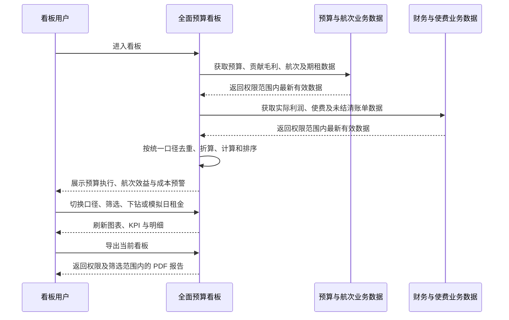
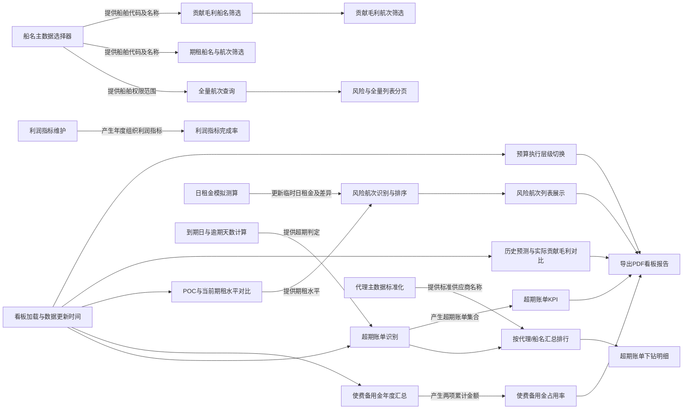

# 全面预算看板模块功能清单

## 文档说明

| 项目   | 内容                                         |
| ---- | ------------------------------------------ |
| 产物类型 | 功能清单（与用户故事合称「正向开发的起点」）                     |
| 命名   | `PRD-全面预算看板-功能清单.md`（本模块唯一，累计追加）           |
| 职责   | 第一、二章引言与总体描述；第三章业务需求分析；第四章功能需求（功能列表＋角色与权限） |
| 适用范围 | 全面预算管理看板授权用户；数据按组织、船舶及用户权限过滤               |
| 模板版本 | v1.6                                       |

## 文档信息

| 项目       | 内容                                                 |
| -------- | -------------------------------------------------- |
| 文档名称     | 全面预算看板模块功能清单                                       |
| 微服务 / 模块 | 待确认 / 全面预算看板                                       |
| 版本       | v1.0.4                                             |
| 创建日期     | 2026-09-03                                         |
| 需求来源     | `原型-全面预算看板-v1.4.html` / `关于全面预算管理看板指标口径-v1.0.xlsx` |

---

## 一、引言

### 1.1 目的

本文档用于界定全面预算看板的业务范围、整体流程、功能目录、角色权限、业务口径及功能间依赖，作为产品评审、概要设计、开发拆分和验收追踪的范围基线。预期读者包括管理层、财务人员、项目管理人员、调度人员、产品经理、开发人员和测试人员。单功能的详细验收标准和业务规则见关联 User Story 文档。

### 1.2 范围

本模块覆盖：年度预算执行、利润指标维护、历史预测与实际贡献毛利对比、单航次期租水平对比、风险航次识别、使费备用金占用率、超期账单统计与下钻、看板 PDF 导出。

本模块不负责源业务数据的生产，不替代 Budget Analysis、SAP、POC、Master Scenario、港口使费数据表及港口使费账单；日租金模拟不回写源系统。利润指标维护属于本模块写入范围，其余业务数据以只读汇总和分析为主。

### 1.3 定义、简写和省略语

| 术语 / 简写                | 全称或含义                          |
| ---------------------- | ------------------------------ |
| Budget Analysis        | Pool Control 下的预算分析页面          |
| Budget Analysis Profix | Budget Analysis 页面中的 Profix 弹窗 |
| Master Scenario        | 船期表，航次装货港、卸货港等港口信息来源           |
| 入 Pool 船舶              | 纳入合资公司统一经营池及单船预算统计范围的船舶        |
| T                      | 系统当前自然月                        |
| POL                    | 装货港                            |
| POD                    | 卸货港                            |
| 预算执行率                  | 实际效益/预算总额（预测）×100%             |
| 利润指标完成率                | 实际效益/利润指标数×100%                |
| 使费备用金占用率               | 累计实际预付金额/累计预估使费金额×100%         |
| 风险航次                   | 状态为 POC 且期租水平－日租金＜0 的航次        |
| 超期账单                   | 未结清且系统当前日期－凭证输入日期＞90 天的有效账单    |

---

## 二、总体描述

### 2.1 需求背景

年度预算、航次经营效益、港口使费和账单数据分散在多个页面，管理人员需要跨页面比对预算与实际、历史预测与当前结果，并及时发现低收益航次、备用金占用和长期未结清账单。现有分析依赖人工汇总，存在口径不一致、数据更新时间不清晰、风险发现滞后及结果不便归档的问题，因此需要建设统一的全面预算看板。

### 2.2 建设目标

- 统一预算、实际效益、贡献毛利、期租、使费及账单的页面口径、单位和数据截止时间。
- 支持组织与单船多层级分析，快速定位预算偏差和经营异常。
- 自动识别高风险 POC 航次和超过 90 天的未结清账单。
- 支持利润指标维护和日租金临时模拟，兼顾目标管理与情景判断。
- 支持按当前权限及筛选条件导出完整 PDF，满足管理汇报和留档需要。

### 2.3 软件功能要求

系统应提供统一看板入口和数据更新时间，按用户权限加载滚动预算、航次效益和成本超支预警三类内容；支持组织层级切换、船名/航次筛选、图表展示、列表分页、风险下钻、指标维护和 PDF 导出。指标计算必须使用一致的年度、组织/船舶范围、币种和数据截止日期；异常、空值和分母为零场景须明确处理。

### 2.5 运行环境

- 终端：企业桌面浏览器。
- 网络：可访问统一认证、Budget Analysis、POC、Master Scenario 及港口使费相关数据服务。
- 权限：用户已登录并获得看板访问权限；利润指标维护和报告导出权限可独立控制。
- 展示：浏览器需支持 ECharts 或同等图表能力及 PDF 文件下载。

### 2.6 假定和约束

- 航次以“船舶编码＋航次编号”唯一识别，账单以账单号去重。
- 各源系统可提供最新有效记录、状态、数据更新时间和稳定的主数据关联键。
- 金额统一折算为 USD。
- 港口使费业务唯一标识待数据团队确认，确认前不得按不可靠字段累计。
- 超期阈值以指标清单的 90 天为准。
- 原型演示船名及编码仅用于展示，生产环境必须使用船舶主数据。
- 日租金修改仅用于当前测算上下文，不写回 Budget Analysis。

---

## 三、业务需求分析

### 3.1 主流程（业务主线）

用户进入看板后，在权限范围内选择分析对象和条件，查看预算、航次及使费风险；授权用户可维护利润指标或模拟日租金，最后按当前筛选上下文导出 PDF 报告。（F-COM-001、F-BUD-001、F-GM-001、F-TCE-001、F-RSK-001、F-DSB-002、F-BIL-001、F-COM-004）

### 3.2 异常流程

| 异常点      | 触发条件                   | 系统响应                                            |
| -------- | ---------------------- | ----------------------------------------------- |
| 数据源加载失败  | 任一关键数据源不可用、超时或返回不可解析结果 | 对受影响模块展示加载失败状态及数据来源，不使用误导性默认值；允许用户重试，其他可用模块继续展示 |
| 指标无法计算   | 关键数据缺失，或比例指标分母为空/为 0   | 对应指标显示“—”，不显示 0%、无穷大或错误值；保留其他可计算指标              |
| 筛选无结果    | 船名、航次或状态组合不存在匹配数据      | 图表或列表展示明确空状态，不保留上一次查询结果                         |
| 维护校验失败   | 利润指标为空、非数字或小于等于 0      | 阻止保存并提示“请输入大于 0 的数值”，原有效值保持不变                   |
| PDF 生成失败 | 报告渲染、文件生成或下载失败         | 保留当前筛选上下文，提示失败原因并允许重试；不得生成不完整文件作为成功结果           |

### 3.3 边界流程

- 当前月份不足三个历史预算版本：仅展示当前年度已存在的历史版本；1 月无历史版本时显示“暂无可用历史预算版本”。
- 单船不属于合资公司入 Pool 范围：不进入单船预算执行统计和选择范围。
- 航次号在不同船舶间重复：必须与船舶唯一编码组合识别，不能仅按航次号去重。
- 风险列表筛选后当前页越界：自动调整至最新有效页；非法跳页不执行并恢复当前页码。
- 风险航次日租金模拟使差异不再为负：该航次从主风险列表移除并重新排序，但源系统日租金不变。
- 账单到期日当天：不计为超期，从次日开始计入，逾期天数每日动态重算。
- 账单部分清账：仅统计和展示剩余未结清金额。
- 分页列表导出 PDF：导出当前筛选条件下的全部结果，不限于浏览器当前页。

---

## 四、功能需求

### 4.1 功能列表

| 功能编号      | 功能名称          | 功能描述（用户操作→系统响应→预期结果）                                          | 适用范围                  | 优先级 | 引入版本 | 状态  |
| --------- | ------------- | ------------------------------------------------------------- | --------------------- | --- | ---- | --- |
| F-COM-001 | 看板加载与数据更新时间   | 用户进入看板 → 系统按权限加载三个业务区域并展示统一数据更新时间 → 用户识别数据范围与时效               | 全部授权用户                | P0  | v1.0 | 待开发 |
| F-COM-002 | 指标单位与空值展示     | 用户查看金额、比例及日均指标 → 系统按万 USD、USD/天、百分比统一格式化并处理无效分母 → 页面无错误值或歧义   | 全部授权用户                | P0  | v1.0 | 待开发 |
| F-COM-003 | 船名主数据选择器      | 用户按船舶代码、中文名或英文名搜索并选择/清除 → 系统分页返回权限范围内船舶并刷新关联组件 → 用户快速确定分析范围   | 全部授权用户                | P1  | v1.0 | 待开发 |
| F-COM-004 | 导出 PDF 看板报告   | 用户点击导出报告 → 系统按当前权限、筛选条件和数据快照排版全部看板及完整分页结果 → 下载带元数据的横向 PDF     | 具备导出权限的用户             | P1  | v1.0 | 待开发 |
| F-BUD-001 | 预算执行层级切换      | 用户切换合资公司、半潜船经营部或单船 → 系统加载对应范围指标并更新口径 → 用户获得所选层级预算视图           | 合资公司/半潜船经营部/入 Pool 单船 | P0  | v1.0 | 待开发 |
| F-BUD-002 | 组织层级预算执行率     | 用户查看组织层级 → 系统按实际效益÷全年预算计算执行率并展示两项金额 → 用户掌握年度预算完成程度            | 合资公司、半潜船经营部           | P0  | v1.0 | 待开发 |
| F-BUD-003 | 利润指标完成率       | 用户查看组织层级 → 系统按实际效益÷同年度同组织利润指标计算完成率 → 用户掌握业务目标完成程度             | 合资公司、半潜船经营部           | P0  | v1.0 | 待开发 |
| F-BUD-004 | 单船预算执行对比      | 用户切换至单船并点击船舶 → 系统仅汇总入 Pool 船舶并展示单船或合计执行结果 → 用户定位执行偏低船舶        | 合资公司入 Pool 船舶         | P0  | v1.0 | 待开发 |
| F-BUD-005 | 利润指标维护        | 授权用户输入并保存组织年度利润指标 → 系统校验大于 0、按年度＋组织保存唯一有效值并刷新完成率 → 新目标生效      | 具备利润指标维护权限的用户         | P0  | v1.0 | 待开发 |
| F-GM-001  | 历史预测与实际贡献毛利对比 | 用户查看当前月 T → 系统展示最多 T-1/T-2/T-3 版本的 1—T 月预测值及同期实际值 → 用户判断预测准确性 | 全部授权用户                | P0  | v1.0 | 待开发 |
| F-GM-002  | 贡献毛利船名筛选      | 用户选择或清除船名 → 系统清空不适用航次并重算所选船舶预测与实际值 → 图表反映目标船舶                 | 授权船舶范围                | P1  | v1.0 | 待开发 |
| F-GM-003  | 贡献毛利航次筛选      | 用户手工输入航次号 → 系统在当前船舶范围匹配航次并刷新图表 → 用户定位单航次贡献毛利                  | 授权船舶及航次范围             | P1  | v1.0 | 待开发 |
| F-GM-004  | 历史版本不足与无数据处理  | 用户在年初或无匹配数据时查看 → 系统仅展示已有版本或对应空状态 → 页面不展示伪造数据                  | 全部授权用户                | P1  | v1.0 | 待开发 |
| F-TCE-001 | POC 与当前期租水平对比 | 用户查看航次 → 系统读取最新 POC 与当前期租水平并计算当前值减 POC 值 → 用户识别期租变化           | 授权船舶及航次范围             | P0  | v1.0 | 待开发 |
| F-TCE-002 | 期租船名与航次筛选     | 用户选择船名并输入航次号 → 系统按组合条件查询、切换船名时清空航次 → 用户准确定位目标航次               | 授权船舶及航次范围             | P1  | v1.0 | 待开发 |
| F-RSK-001 | 风险航次识别与排序     | 用户查看风险航次 → 系统筛选 POC 且期租水平低于日租金的航次并按差异升序 → 最大风险优先呈现            | 授权船舶及航次范围             | P0  | v1.0 | 待开发 |
| F-RSK-002 | 风险航次列表展示      | 用户浏览风险列表 → 系统展示九项业务字段并每页返回 5 条 → 用户获得可操作的风险清单                 | 授权船舶及航次范围             | P0  | v1.0 | 待开发 |
| F-RSK-003 | 日租金模拟测算       | 用户修改日租金 → 系统立即重算差异、风险资格及排序且不回写源系统 → 用户评估不同成本假设                | 授权船舶及航次范围             | P0  | v1.0 | 待开发 |
| F-RSK-004 | 全量航次查询        | 用户打开全部航次 → 系统展示六类状态并支持船名和状态筛选，每页 15 条 → 用户核查完整航次范围            | 授权船舶及航次范围             | P0  | v1.0 | 待开发 |
| F-RSK-005 | 风险与全量列表分页     | 用户翻页或输入页码 → 系统校验页码、连续编号并在条件变化后重置有效页 → 用户稳定浏览大结果集              | 授权船舶及航次范围             | P1  | v1.0 | 待开发 |
| F-RSK-006 | 航次状态视觉区分      | 用户查看航次状态 → 系统对六类状态使用一致可识别标签 → 用户快速识别航次阶段                      | 授权船舶及航次范围             | P2  | v1.0 | 待开发 |
| F-DSB-001 | 使费备用金年度汇总     | 用户查看当前年度 → 系统汇总有效记录的实际预付和预估使费并折算为万 USD → 用户获得统一金额基数           | 授权组织范围                | P0  | v1.0 | 待开发 |
| F-DSB-002 | 使费备用金占用率      | 用户查看占用情况 → 系统按累计实际预付÷累计预估使费计算比例并处理无效分母 → 用户掌握资金占用程度           | 授权组织范围                | P0  | v1.0 | 待开发 |
| F-BIL-001 | 超期账单识别        | 用户查看超期统计 → 系统筛选未结清且超过 90 天的有效账单、按账单号去重并动态计算逾期天数 → 超期范围准确      | 授权组织及船舶范围             | P0  | v1.0 | 待开发 |
| F-BIL-002 | 超期账单 KPI      | 用户查看统计卡片 → 系统展示去重账单数量和剩余未结清金额合计 → 用户掌握超期规模                    | 授权组织及船舶范围             | P0  | v1.0 | 待开发 |
| F-BIL-003 | 按代理/船名汇总排行    | 用户切换汇总维度 → 系统按代理或船名汇总超期金额并排序、同步刷新筛选项 → 用户识别主要风险对象             | 授权组织及船舶范围             | P0  | v1.0 | 待开发 |
| F-BIL-004 | 超期账单下钻明细      | 用户选择对象或点击图表 → 系统展示该代理/船名的账单明细、笔数及金额并支持返回 → 用户定位具体账单           | 授权组织及船舶范围             | P0  | v1.0 | 待开发 |
| F-BIL-005 | 到期日与逾期天数计算    | 用户查看明细 → 系统以凭证输入日期＋90 天计算到期日、次日起动态计算逾期天数 → 账龄判断一致             | 授权组织及船舶范围             | P0  | v1.0 | 待开发 |
| F-BIL-006 | 代理主数据标准化      | 用户查看或筛选代理 → 系统按供应商编码关联主数据并统一显示标准中文名称 → 汇总对象一致                 | 授权组织范围                | P1  | v1.0 | 待开发 |

### 4.2 角色与权限

| 角色            | 可执行功能 / 操作                                                              | 数据范围            | 备注                                             |
| ------------- | ----------------------------------------------------------------------- | --------------- | ---------------------------------------------- |
| 管理层 / 财务人员    | 查看全部看板及明细；F-BUD-005 利润指标维护；修改页面允许维护的业务数据；F-RSK-003 日租金模拟；F-COM-004 报告导出 | 授权组织、代理、船舶及航次范围 | 两类角色权限等同；数据修改须受字段校验约束，日租金模拟不回写 Budget Analysis |
| 项目管理人员 / 调度人员 | 仅查看 F-COM-001～003 及 F-BUD、F-GM、F-TCE、F-RSK、F-DSB、F-BIL 的看板、图表和明细        | 授权组织、船舶及航次范围    | 两类角色权限等同且均为只读；不可维护利润指标、修改业务数据、执行日租金模拟或导出报告     |

---

## 五、优先级说明

| 优先级 | 说明   |
| --- | ---- |
| P0  | 核心功能 |
| P1  | 重要功能 |
| P2  | 次要功能 |

---

## 六、功能依赖关系图（含数据流依赖）

---

## 附录：字段清单

### 附录 A 业务口径字段表

| 页面字段名称     | 来源          | 格式                 | 取值范围                                                           | 编辑权限          | 失败处理                         |
| ---------- | ----------- | ------------------ | -------------------------------------------------------------- | ------------- | ---------------------------- |
| 数据更新时间     | 系统生成        | `YYYY-MM-DD HH:mm` | 最近一次可用数据截止时间                                                   | 只读            | 无有效时间时显示“—”并标记数据状态           |
| 预算分析层级     | 用户选择        | 枚举                 | 合资公司、半潜船经营部、单船                                                 | 可选择           | 无权限层级隐藏或禁用                   |
| 预算总额（预测）   | 系统取数并换算     | 金额，万 USD，2 位小数     | 当前年度全年预算                                                       | 只读            | 缺失时显示“—”，对应执行率不计算            |
| 实际效益       | 系统汇总并换算     | 金额，万 USD，2 位小数     | 当前年度截至数据更新时间                                                   | 只读            | 缺失时显示“—”                     |
| 预算执行率      | 计算得出        | 百分比，至少 1 位小数       | 实际效益÷预算总额×100%                                                 | 只读            | 分母为空或为 0 时显示“—”              |
| 利润指标数      | 用户录入        | 金额，万 USD，2 位小数     | 大于 0；年度＋组织唯一有效                                                 | 授权用户可编辑；单船不适用 | 非数字或≤0 时阻止保存并提示“请输入大于 0 的数值” |
| 利润指标完成率    | 计算得出        | 百分比，至少 1 位小数       | 实际效益÷利润指标数×100%                                                | 只读            | 指标未维护、为空或为 0 时显示“—”          |
| 统计期间       | 系统生成        | 文本                 | 当前年度 1 月至当前自然月 T                                               | 只读            | 无有效月份时模块加载失败并提示              |
| 历史预算版本     | 系统生成        | 年月＋“预算”            | 当年 T-1、T-2、T-3；仅已有版本                                           | 只读            | 无版本时显示“暂无可用历史预算版本”           |
| 预测贡献毛利     | 系统汇总并换算     | 金额，万 USD，最多 1 位小数  | 历史版本中当年 1—T 月已完航及 POC 航次                                       | 只读            | 无数据时显示“—”或空状态                |
| 实际贡献毛利     | 系统汇总并换算     | 金额，万 USD，最多 1 位小数  | 当前有效版本中当年 1—T 月已完航及 POC 航次                                     | 只读            | 无数据时显示“—”或空状态                |
| 船名         | 选择带出        | 文本                 | 用户有权限的船舶主数据                                                    | 可筛选；风险弹窗支持多选  | 无匹配时显示空结果，不保留旧数据             |
| 船舶代码       | 选择带出        | 文本                 | 船舶主数据唯一编码                                                      | 只读/用于搜索       | 主数据缺失时不得仅按名称合并               |
| 航次         | 用户录入/系统带出   | 文本                 | 航次编号；与船舶代码组合唯一                                                 | 可筛选           | 无匹配时显示“暂无匹配航次”               |
| POC期租水平    | 系统取数        | 金额，USD/天           | 最新版本 POC 有效值                                                   | 只读            | 缺失时差异显示“—”                   |
| 期租水平       | 系统取数        | 金额，USD/天           | Budget Analysis 最新有效值                                          | 只读            | 缺失时差异显示“—”，不纳入风险列表           |
| 与POC期租水平差异 | 计算得出        | 有符号金额，USD/天        | 期租水平－POC期租水平                                                   | 只读            | 任一计算项缺失时显示“—”                |
| 序号         | 系统生成        | 正整数                | 按当前筛选、排序及分页连续生成                                                | 只读            | 条件变化后重新生成                    |
| 航次状态       | 系统取数        | 枚举                 | 已完航、POC、有合同、空窗期、有货盘、手工                                         | 可筛选；只读展示      | 未知状态标记为待确认，不纳入错误口径           |
| POL        | 系统带出        | 文本                 | Master Scenario 装货港                                            | 只读            | 关联失败时显示“—”                   |
| POD        | 系统带出        | 文本                 | Master Scenario 卸货港                                            | 只读            | 关联失败时显示“—”                   |
| 日租金        | 系统取数/用户临时录入 | 金额，USD/天           | 默认取每天租金（天成本）；模拟值应为有效数字                                         | 风险主列表可临时编辑    | 非法值不得以 0 替代；阻止计算并提示，且不回写源系统  |
| 与日租金差异     | 计算得出        | 有符号金额，USD/天        | 期租水平－日租金                                                       | 只读            | 任一计算项缺失时显示“—”且不纳入风险列表        |
| 累计实际预付金额   | 系统汇总并换算     | 金额，万 USD           | 当前年度有效 PAY_EST_AMT 折算 USD 后合计                                  | 只读            | 数据或汇率缺失时标记异常，不纳入错误累计         |
| 累计预估使费金额   | 系统汇总并换算     | 金额，万 USD           | 当前年度有效 EST_AMT 按 EST_CURRENCY 折算 USD 后合计                       | 只读            | 数据或汇率缺失时标记异常，不纳入错误累计         |
| 使费备用金占用率   | 计算得出        | 百分比，至少 1 位小数       | 累计实际预付÷累计预估使费×100%                                             | 只读            | 分母为空或为 0 时显示“—”              |
| 超期账单数      | 系统去重计数      | 整数，笔               | 未结清且超过 90 天的有效账单数                                              | 只读            | 无结果显示 0 笔；数据源失败显示“—”并提示      |
| 超期总金额      | 系统汇总并换算     | 金额，万 USD           | 超期账单剩余未结清金额合计                                                  | 只读            | 汇率缺失时标记异常，不纳入错误合计            |
| 账单号        | 系统取数        | 文本                 | 账单业务唯一编号                                                       | 只读            | 缺失时不能计数，记录数据质量异常             |
| 代理         | 系统带出        | 文本                 | 按供应商编码映射的标准中文名称                                                | 可筛选；只读展示      | 主数据映射失败时显示源名称并标记待治理          |
| 账单金额       | 系统计算并换算     | 金额，USD/万 USD       | 剩余未结清金额                                                        | 只读            | 缺失时不纳入合计并标记异常                |
| 到期日        | 计算得出        | `YYYY-MM-DD`       | 凭证输入日期＋90 个自然日                                                 | 只读            | 凭证输入日期缺失时显示“—”且不纳入超期统计       |
| 逾期天数       | 计算得出        | 正整数，天              | 系统当前日期－到期日；必须＞0                                                | 只读            | ≤0 时不纳入超期统计                  |
| 报告文件名      | 系统生成        | 文本                 | `全面预算看板_yyyyMMdd_HHmmss.pdf`；弹窗为`全部航次期租情况_yyyyMMdd_HHmmss.pdf` | 只读            | 生成失败时提示并允许重试                 |

> 附录 B 业务字段 ↔ 数据库字段映射表暂不生成：当前输入仅提供业务口径及部分来源字段，未提供已核实的数据库表结构。待获得数据字典或详细设计后补充，避免臆造映射。

---

## 变更记录

| 版本     | 日期         | 变更内容                                          | 变更人   |
| ------ | ---------- | --------------------------------------------- | ----- |
| v1.0.0 | 2026-09-03 | 根据原型、指标口径与需求分析文档建立功能范围                        | 邵艺晨   |
| v1.0.1 | 2026-09-03 | 删除利润指标维护审计功能 F-BUD-006 及相关描述                  | Codex |
| v1.0.3 | 2026-09-03 | 删除审计功能后复核全部功能编号：共 30 项，各模块内编号连续且无重复，保留模块化编号体系 | Codex |
| v1.0.4 | 2026-09-03 | 同步清理已删除使费数据过滤功能 F-DSB-003 在依赖关系图中的残留节点        | Codex |

