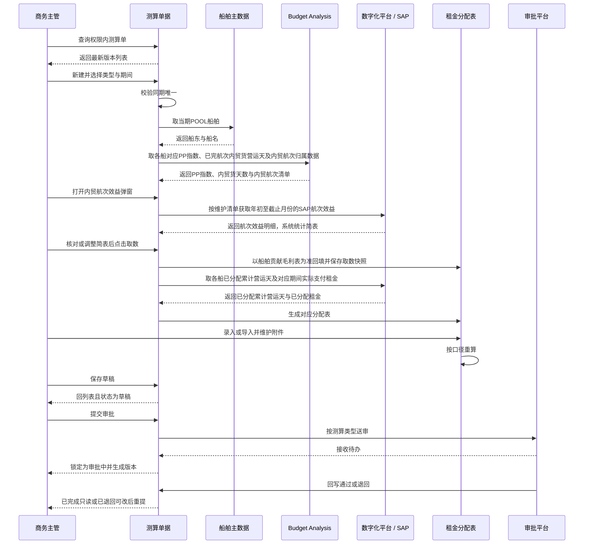
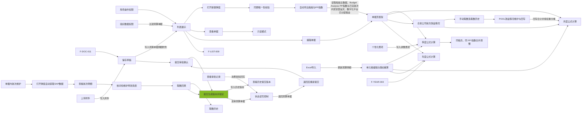

# POOL租金测算及结算模块功能清单

## 文档说明

| 项目   | 内容                                           |
| ---- | -------------------------------------------- |
| 产物类型 | 功能清单                                         |
| 命名   | `PRD-租金测算及结算-功能清单.md`                        |
| 职责   | 第一、二章引言与总体描述；第三章业务需求分析；第四章功能需求（功能列表 + 角色与权限） |
| 适用范围 | 半潜合资公司和本部半潜船经营部                              |
| 模板版本 | v1.6                                         |

## 文档信息

| 项目       | 内容                                                |
| -------- | ------------------------------------------------- |
| 文档名称     | POOL租金测算及结算模块功能清单                                 |
| 微服务 / 模块 | 待确认 / POOL租金测算及结算                                 |
| 版本       | v1.2.1                                            |
| 创建日期     | 2026-08-14                                        |
| 正向来源     | 关于POOL租金测算及结算指标口径-v1.6（内贸取数流程以本次需求为准）；POOL租金测算及结算线上化原型-v1.9.html |
| 关联 PRD   | PRD-租金测算及结算.md                                    |
| 关联用户故事   | PRD-租金测算及结算-UserStory-v1.0.md                     |

---

## 一、引言

### 1.1 目的

本文档给出 POOL 租金测算及结算模块的功能目录、业务主线和页面字段口径，供产品、研发、测试作为正向开发与范围管理的起点。单功能验收标准、异常四元组和数据流细节见关联用户故事，此处不展开。

预期读者：产品经理、技术负责人、开发与测试人员。

### 1.2 范围

**在范围内：**

- 测算单据列表的查询、筛选、分页、置顶、查看与编辑入口
- 新建季度预估日租金、月补充预估租金、年末年结调整租金
- 测算单据页编制（三类分配表切换）、导入导出、附件、历史版本、保存、提交审批
- 向既有审批平台送审，并回写当前节点、通过/退回状态、审批记录和退回原因

**不在范围内：**

- 审批待办页的同意、驳回、传阅、审批历史操作（由既有审批待办承接）
- 物理删除测算单

### 1.3 定义、简写和省略语

| 术语 / 简写  | 全称或含义                                   |
| -------- | --------------------------------------- |
| PP指数     | 船舶参与 POOL 租金分配的比例指数                     |
| 季度预估日租金  | 按所选年度1月至截止月份测算各船预计分配租金和预估日租金                     |
| 月补充预估租金  | 按月测算应分配租金并计算当月补充预估租金；列表展示为「月度补充预估」      |
| 年末年结调整租金 | 年度结算时计算分配租金、未分配租金和预估与实际差异；列表展示为「年度年结调整」 |
| 商务主管     | 本期唯一可新建、编辑、导入、保存和提交的业务角色                |
| 测算单据     | 一张对应「测算类型 + 业务期间」的租金测算及结算单据             |
| 提交版本     | 每次提交审批生成的快照，格式 V1、V2…；普通保存不生成版本         |

---

- 内贸航次效益自动获取、维护、汇总、回填和历史追溯

## 二、总体描述

### 2.1 需求背景

半潜船 POOL 租金测算长期依赖线下 Excel，三类测算表字段多、公式复杂，版本和审批过程难以留痕。需要在集团门户内线上化编制、调整、归档和送审，使相关单位可按统一口径完成季度预估、月度补充预估和年末年结。

### 2.2 建设目标

- 商务主管可在系统内完成三类测算单的编制、导入导出、附件留痕和版本管理
- 同一测算类型 + 同一业务期间仅保留一张有效单据，计算结果按已确认口径自动重算
- 提交后进入既有审批待办；本模块可展示节点、记录和退回原因，退回后可修改并从头重提

### 2.3 软件功能要求

从业务视角，本模块需具备：测算单列表与权限过滤；按类型期间新建并带出船舶与 PP 指数；在同一单据页编制季度/月度/年度分配表；手工或导入金额类指标并自动计算；维护附件与历史版本；保存草稿或提交审批并接收回写。细节见第四章功能表与附录 A。

### 2.5 运行环境

- 部署于集团门户，采用统一认证、菜单权限和数据权限
- 以内网 PC 为主，支持门户当前主推的 Chrome、Edge 近两个版本
- 依赖既有审批平台接收待办并回写结果；依赖船舶主数据带出船东、船名；PP指数从 Budget Analysis 页面带出各船对应值；内贸货天数默认从 Budget Analysis 已完航次的内贸货营运天带出；内贸航次清单从 Budget Analysis 获取，航次效益从 SAP 单户航次盈亏表获取，经核对后按船舶回填三类测算表；季度已分配累计营运天及已分配租金从POOL租金汇总表取测算截止月份以内已支付所属月份数据；年度已分配1—11月营运天从汇总表取数；月度及年度已分配租金仍从数字化平台取数；年度预计应分配租金所用总应分配租金从 SAP 单户航次盈亏表取数
- 无独立登录、无单独 SLA

### 2.6 假定和约束

- 假定审批待办、当期 POOL 船舶主数据、Budget Analysis 中各船 PP 指数、已完航次内贸货营运天及内贸航次归属数据、数字化平台已支付租金天数和对应期间实际支付租金，以及 SAP 单户航次盈亏表中的总应分配租金已可用
- 约束：仅商务主管可编辑类操作；列表按组织/船东数据权限过滤；已退回单据仍占用「类型+期间」唯一性
- 约束：审批人在待办中处理，本模块不实现同意/驳回/传阅

---

## 三、业务需求分析

**必须填写。** 写在模块整体高度，不重复第四章单个功能的目录细节。

### 3.1 主流程（业务主线）

商务主管在权限范围内查询测算单，按类型和期间新建唯一单据，系统带出船舶与 PP 指数后编制对应租金分配表并维护附件，保存草稿或提交至既有审批待办；审批回写通过后只读归档，退回后修改并从头重走流程。（F-LIST-001 / F-NEW-003 / F-NEW-004 / F-QTR-002 / F-MON-002 / F-YEAR-002 / F-DOC-008 / F-SUB-002 / F-SUB-003）

### 3.2 异常流程

| 异常点         | 触发条件                             | 系统响应                          |
| ----------- | -------------------------------- | ----------------------------- |
| 同期重复建单      | 同一测算类型+同一业务期间已存在草稿、审批中、已完成或已退回单据 | 拦截新建并提示，不进入单据页，原单据不变          |
| 导入失败        | Excel 无船东+船名匹配、文件解析失败，或单据已锁定     | 明确失败提示，不覆盖系统计算列，锁定单据拒绝导入      |
| 无编辑权限或状态不允许 | 非商务主管操作编辑类功能，或单据为审批中/已完成         | 无编辑入口，仅允许只读查看和导出              |
| 费项名称非法      | 个性化费项名称为空、超 30 字符，或与已有费项重名       | 阻止新增并提示，不改表结构                 |
| SAP自动获取失败 | 打开内贸航次弹窗时自动获取失败 | 明细和两张简表展示空表，不提示失败；航次维护清单、测算表已回填数据及已有快照保留 |
| 内贸航次重复 | 船舶代码和航次与已有维护记录相同 | 阻止保存并提示 |
| 内贸船舶未匹配 | 船舶贡献毛利表中的船舶不在测算表 | 提示未匹配船舶，未匹配金额不计入测算表及月度POOL效益本次回填 |
| 审批退回        | 审批平台驳回已提交测算单                     | 状态变为已退回，记录退回原因和退回节点，允许修改后从头重提 |

季度预估截止月份校验：新建截止月份须晚于同年度已有同类型单据的最晚截止月份；已有1—8月时仅可新建1—9月至1—12月，已有1—12月时不可再新建。计入最晚月份的单据状态待业务确认。

### 3.3 边界流程

- 本船本期营运天为 0 时，合并调整前日租金显示 `-`。
- 同船东、同 PP 指数组内本期营运天合计为 0 时，合并调整后日租金显示 `-`。
- 已退回单据仍占用「类型+期间」唯一性：不允许再新建同期单据，只能在原单上修改重提
- 无附件时导出：仍导出 `{单据编号}-{版本号}.xlsx`
- 从未提交过：历史版本弹窗提示提交审批后才会生成版本；普通保存不新增版本
- 权重分母 Σ（PP指数×预估营运天）为 0：年度预计应分配租金、已分配转手差价租金按 0 处理；视同分配转手差价租金保持用户填写值

---

## 四、功能需求

### 4.1 功能列表

功能按原型页面顺序排列（列表页 → 新建弹窗 → 测算单据页 → 权限横切）。共45项，编号与用户故事US-001～US-045一一对应。本模块为正向新建，状态取值：待开发 / 开发中 / 测试中 / 已完成。

适用范围统一为：半潜合资公司和本部半潜船经营部。

| 功能编号       | 功能名称          | 功能描述（用户操作→系统响应→预期结果）                                                                                                           | 适用范围            | 优先级 | 引入版本   | 状态  |
| ---------- | ------------- | ------------------------------------------------------------------------------------------------------------------------------ | --------------- | --- | ------ | --- |
| F-LIST-001 | 列表展示          | 进入菜单查看列表 → 按权限加载最新版单据 → 列表展示单据字段 草稿删除入口见 F-LIST-009。 | 半潜合资公司和本部半潜船经营部 | P0  | v1.0   | 待开发 |
| F-LIST-002 | 筛选查询          | 选年度类型状态后查询 → 按条件过滤并回第一页 → 提示条数并展示结果                                                                                            | 半潜合资公司和本部半潜船经营部 | P0  | v1.0   | 待开发 |
| F-LIST-003 | 重置筛选          | 点击重置 → 条件恢复全部并回第一页 → 列表显示全部有效单据                                                                                                | 半潜合资公司和本部半潜船经营部 | P1  | v1.0   | 待开发 |
| F-LIST-004 | 分页浏览          | 改页码或每页条数 → 按置顶和时间分页返回 → 展示区间和总条数                                                                                               | 半潜合资公司和本部半潜船经营部 | P1  | v1.0   | 待开发 |
| F-LIST-005 | 置顶与取消置顶       | 点击置顶或再点取消 → 单据固定前部或恢复排序 → 组内按更新时间倒序                                                                                            | 半潜合资公司和本部半潜船经营部 | P1  | v1.0   | 待开发 |
| F-LIST-006 | 查看单据          | 点击查看 → 只读打开测算单据页 → 隐藏导入保存提交等编辑操作                                                                                               | 半潜合资公司和本部半潜船经营部 | P0  | v1.0   | 待开发 |
| F-LIST-007 | 编辑单据          | 对草稿或已退回点编辑 → 打开可编辑单据页加载数据 → 已退回展示退回原因                                                                                          | 半潜合资公司和本部半潜船经营部 | P0  | v1.0   | 待开发 |
| F-LIST-008 | POOL租金汇总表     | 列表页打开汇总弹窗 → 使用初始为空的起止年月选择组件筛选三个表格，未选边界不限制，起始晚于结束则提示并清空本次修改 → 按船东、船舶和月份展示数据，支持横向滚动和关闭                                           | 半潜合资公司和本部半潜船经营部 | P0  | v1.2   | 待开发 |
| F-LIST-009 | 删除草稿 | 仅有操作权限的草稿行展示垃圾桶。确认后删除该单据并刷新列表，取消则保留。确认时状态已变化则拦截。 | 半潜合资公司和本部半潜船经营部 | P0 | v1.2.0 | 待开发 |
| F-NEW-001  | 打开新建弹窗        | 点击新建 → 打开新建测算单弹窗 → 展示类型年度及期间字段                                                                                                 | 半潜合资公司和本部半潜船经营部 | P0  | v1.0   | 待开发 |
| F-NEW-002  | 期间字段联动        | 选择测算类型 → 季度类型必填测算截止月份（1—12月），月度类型必填月度 → 未填则阻止并提示                                                                               | 半潜合资公司和本部半潜船经营部 | P0  | v1.0   | 待开发 |
| F-NEW-003  | 同期唯一性校验       | 确认新建 → 校验同类型同期唯一性；季度预估还须校验截止月份晚于同年度已有同类型单据的最晚截止月份 → 不通过则拦截并提示                                                                  | 半潜合资公司和本部半潜船经营部 | P0  | v1.0   | 待开发 |
| F-NEW-004  | 自动带出船舶与PP指数   | 进入新建单据页 → 带出当期船东船名和PP指数；季度、年度剔除振华33和华洋1，华瑞龙PP指数为6.5；年度预估1—12月营运天从Budget Analysis带出且只读，已分配1—11月营运天从POOL租金汇总表带出且可修改、导入 → 未保存不入列表 船东名称默认带出，可在单据内逐船修改。 | 半潜合资公司和本部半潜船经营部 | P0  | v1.0   | 待开发 |
| F-DOC-001  | 单据页框架         | 打开测算单 → 按类型展示对应分配表和版本 → 仅含当期有效船舶                                                                                               | 半潜合资公司和本部半潜船经营部 | P0  | v1.0   | 待开发 |
| F-DOC-002  | 字段口径说明        | 悬停表头说明图标 → 展示口径浮层并避让屏幕 → 移开后隐藏 季度已分配租金及两列预估日租金均提供口径提示。 | 半潜合资公司和本部半潜船经营部 | P1  | v1.0   | 待开发 |
| F-DOC-003  | 退回原因展示        | 打开已退回单据 → 页顶展示审批退回原因 → 其他状态不展示                                                                                                 | 半潜合资公司和本部半潜船经营部 | P0  | v1.0   | 待开发 |
| F-DOC-010  | 只读模式          | 查看审批中或已完成单 → 加载提交快照并隐藏编辑操作 → 仅可查看导出和记录 对应版本的备注只读展示。 | 半潜合资公司和本部半潜船经营部 | P0  | v1.0   | 待开发 |
| F-DOC-006  | Excel导入       | 编辑模式导入 Excel，按船名匹配已有船舶行，填充可导入字段并重算。季度及年度预计应分配租金明细、权重等公式列只读。 | 半潜合资公司和本部半潜船经营部 | P0  | v1.0   | 待开发 |
| F-DOC-007  | 导出测算表与附件      | 点击导出 → 导出包含月度及年度新增字段的当前版本Excel并打包附件ZIP → 只读也可导出                                                                                | 半潜合资公司和本部半潜船经营部 | P1  | v1.0   | 待开发 |
| F-QTR-001  | 季度表头动态展示      | 打开季度单据 → 按截止月份及已支付月份动态展示营运天等表头文案 → 表头与所选期间一致 移除合并调整后分配租金及最终分配租金两列，展示合并调整前后两列预估日租金。 | 半潜合资公司和本部半潜船经营部 | P0  | v1.0   | 待开发 |
| F-QTR-002  | 季度公式计算        | 预计应分配租金合计可编辑，各船明细按合计 × 权重重算。保留合并调整前分配租金，调整前日租金＝本船合并调整前分配租金 ÷ 本船本期营运天。两列日租金先计算，再四舍五入到百位。对应分母为 0 时显示 `-`。下游引用时使用取整后的值。 | 半潜合资公司和本部半潜船经营部 | P0  | v1.0   | 待开发 |
| F-QTR-003  | 同船东、同 PP 指数合并调整       | 按船东名称和 PP 指数分组。调整后日租金＝同组合并调整前分配租金之和 ÷ 同组本期营运天之和，同组统一。两列日租金先计算，再四舍五入到百位。对应分母为 0 时显示 `-`。下游引用时使用取整后的值。 | 半潜合资公司和本部半潜船经营部 | P0  | v1.0   | 待开发 |
| F-QTR-004  | 个性化费项         | 新增或删除费项列并填金额 → 纳入合并调整前计算并更新合计 → 名称必填限长且不重名                                                                                     | 半潜合资公司和本部半潜船经营部 | P0  | v1.0   | 待开发 |
| F-MON-001  | 月度表头动态展示      | 打开月度单据 → 按年月展示营运天、权重、POOL效益计算租金和调整表头 → 表头与所选期间一致                                                                               | 半潜合资公司和本部半潜船经营部 | P0  | v1.0   | 待开发 |
| F-MON-002  | 月度公式计算        | 按权重分摊 POOL 效益计算租金。本船应分配租金＝本船 POOL 效益计算租金－本船内贸货贡献毛利＋本船主表新增费项合计。应分配租金变化后联动补充预估租金。 | 半潜合资公司和本部半潜船经营部 | P0  | v1.0   | 待开发 |
| F-MON-003 | 维护月度主表新增费项 | 从内贸货贡献毛利列头的 ＋ 新增费项列，录入各船带符号金额，离开单元格确认。通过列头 ⋮ 删除并重算。主表费项与弹窗扣费项独立维护。 | 半潜合资公司和本部半潜船经营部 | P0 | v1.2.0 | 待开发 |
| F-YEAR-001 | 年度表头动态展示      | 打开年度单据 → 按业务年展示PP指数、三个营运天、权重、截止上年和本年建议字段 → 年份随业务年度变化                                                                           | 半潜合资公司和本部半潜船经营部 | P0  | v1.0   | 待开发 |
| F-YEAR-002 | 年度公式计算        | 自动带出全年预估营运天及汇总表1—11月已分配营运天，后者可手工修改或导入覆盖 → 计算12月单季营运天和权重 → 视同分配转手差价租金无默认值，由用户手填或导入；计算已分配转手差价、分配租金、扣减内贸货后的未分配租金和差异 预计应分配租金合计默认从 SAP 单户航次盈亏表取数，可编辑，各船明细按合计 × 权重重算。 上一年度内贸货未分配租金按需作为新增费项录入。分配租金（未取整）计入本船年度新增费项合计。已分配转手差价租金按正数录入，在分配租金（未取整）中扣减一次。 | 半潜合资公司和本部半潜船经营部 | P0  | v1.0   | 待开发 |
| F-YEAR-003 | 年度新增费项 | 在「上一年度未分配租金」列头点击 ＋，填写名称后在右侧新增费项列。逐船录入带符号金额，空白按 0，离开单元格后确认。列合计为各船金额之和。通过列头 ⋮ 确认删除整列，取消则保留。确认金额或删除后重算分配租金（未取整）、本年度未分配租金、年度结算预估与实际差异及相关合计。只读模式仅可查看。 | 半潜合资公司和本部半潜船经营部 | P0 | v1.2.1 | 待开发 |
| F-DOM-001  | 内贸弹窗与自动获取     | 三类测算页打开内贸航次效益弹窗 → 按本单维护清单及年初至截止月份自动获取SAP数据并重算简表 → 明细和简表展示本次全部获取结果；失败展示空表                                                       | 半潜合资公司和本部半潜船经营部 | P0  | v1.1.4 | 待开发 |
| F-DOM-002  | 内贸航次维护        | 默认获取Budget Analysis中2023年以来航次归属为内贸货的船舶航次 → 单据内新增、行内编辑或删除，船舶代码和船名共用下拉表格选择器 → 按船舶代码与航次校验重复并按单据保存                                 | 半潜合资公司和本部半潜船经营部 | P0  | v1.1.4 | 待开发 |
| F-DOM-003  | 航次效益明细        | 按维护清单的船舶代码和航次匹配SAP单户航次盈亏表 → 展示本次取到的全部明细，字段与合资公司效益弹窗一致并展示合计                                                                     | 半潜合资公司和本部半潜船经营部 | P0  | v1.1.4 | 待开发 |
| F-DOM-004  | 内贸贡献毛利简表      | 自动汇总航次和船舶两张表 → 各表支持新增、行内编辑删除及船舶下拉选择 → 各自在底部展示一行总合计，两表金额允许不同                                                                    | 半潜合资公司和本部半潜船经营部 | P0  | v1.1.4 | 待开发 |
| F-DOM-005  | 内贸取数回填        | 用户核对或调整后点击取数 → 保留当前手工结果，以船舶表按船舶回填并重算月度、季度、年度对应列及月度POOL效益项 → 固化当次快照                                                             | 半潜合资公司和本部半潜船经营部 | P0  | v1.1.4 | 待开发 |
| F-DOM-006  | 内贸取数历史        | 点击取数成功后生成快照 → 查看当次航次效益明细、航次维护清单、两张简表及合计 → 历史只读                                                                                 | 半潜合资公司和本部半潜船经营部 | P0  | v1.1.4 | 待开发 |
| F-MON-003  | 合资公司航次效益情况    | 打开月度航次效益弹窗 → 展示SAP单户航次盈亏表99B1公司明细及适用字段合计 → 为POOL效益提供贡献毛利及振华二船剔除值                                                               | 半潜合资公司和本部半潜船经营部 | P0  | v1.1   | 待开发 |
| F-MON-004  | 手动取数及取数历史     | 点击取数 → 成功后生成包含时间、人员、截止时间、航次数和贡献毛利的快照 → 支持只读查看每次历史结果                                                                            | 半潜合资公司和本部半潜船经营部 | P0  | v1.1   | 待开发 |
| F-MON-005  | POOL效益情况维护与回写 | 内贸取数时回填船舶贡献毛利合计；打开弹窗维护负数扣费项并计算合计 → 保存后按合计×0.98更新POOL效益计算租金合计 → 按权重分摊并联动月度计算                                                    | 半潜合资公司和本部半潜船经营部 | P0  | v1.1   | 待开发 |
| F-DOC-004  | 单元格编辑与联动重算    | 修改可编辑字段后联动重算。月度金额和年度新增费项明细离开单元格后确认，季度及年度预计应分配租金合计可编辑、明细只读。 | 半潜合资公司和本部半潜船经营部 | P0  | v1.0   | 待开发 |
| F-DOC-005  | 合计行           | 适用数值列求和，权重和 POOL 效益计算租金合计按各自规则处理。两列日租金合计均为全船合并调整前分配租金之和 ÷ 全船本期营运天之和。两列日租金先计算，再四舍五入到百位。对应分母为 0 时显示 `-`。下游引用时使用取整后的值。 | 半潜合资公司和本部半潜船经营部 | P0  | v1.0   | 待开发 |
| F-ATT-001  | 上传附件          | 编辑模式选择文件上传 → 写入附件清单及上传人时间 → 随保存提交持久化                                                                                           | 半潜合资公司和本部半潜船经营部 | P1  | v1.0   | 待开发 |
| F-ATT-002  | 编辑附件说明        | 点击编辑说明并保存 → 更新该附件说明 → 只读不可改                                                                                                    | 半潜合资公司和本部半潜船经营部 | P1  | v1.0   | 待开发 |
| F-ATT-003  | 预览下载删除附件      | 点击预览下载或删除 → 分别预览下载或立即移除 → 只读仅预览下载                                                                                              | 半潜合资公司和本部半潜船经营部 | P1  | v1.0   | 待开发 |
| F-VER-001  | 查看历史提交版本      | 打开历史版本弹窗 → 展示版本号时间和创建人 → 无记录则提示提交后才有                                                                                           | 半潜合资公司和本部半潜船经营部 | P1  | v1.0   | 待开发 |
| F-VER-002  | 加载历史版本快照      | 点击某历史版本 → 加载该版表格、附件、内贸最后一次取数、合资航次效益和POOL效益情况快照 → 可编辑单可改只读单仅看 数据范围包含备注、单据内船东名称、季度及年度手工确认的预计应分配租金合计、月度主表费项与弹窗费项、年度新增费项的列名及逐船金额。 | 半潜合资公司和本部半潜船经营部 | P1  | v1.0   | 待开发 |
| F-VER-003  | 查看审批记录        | 打开审批记录 → 展示用户时间状态和退回原因 → 待审无时间非驳回无原因                                                                                           | 半潜合资公司和本部半潜船经营部 | P1  | v1.0   | 待开发 |
| F-DOC-008  | 保存草稿          | 保存当前单据的测算数据及相关内容，重新打开时恢复本次保存的内容。新建单据保存后为「草稿」，已有草稿或已退回单据保存后保持原状态。保存成功后返回列表。 | 半潜合资公司和本部半潜船经营部 | P0  | v1.0   | 待开发 |
| F-DOC-009  | 未保存离开提醒       | 有未保存修改时点返回 → 弹出未保存提醒 → 可选保存退出丢弃或取消                                                                                             | 半潜合资公司和本部半潜船经营部 | P1  | v1.0   | 待开发 |
| F-DOC-011 | 维护单据备注 | 三类测算表与附件之间提供选填备注，初始为空。备注随单据保存及提交，审核和历史查看时只读展示对应版本。 | 半潜合资公司和本部半潜船经营部 | P0 | v1.2.0 | 待开发 |
| F-SUB-001  | 提交审批确认        | 点击提交审批 → 弹出类型期间和审批节点确认窗 → 确认则提交取消回编辑                                                                                           | 半潜合资公司和本部半潜船经营部 | P0  | v1.0   | 待开发 |
| F-SUB-002  | 提交生成版本并锁定     | 确认提交 → 保存测算表、附件、内贸最后一次取数快照、合资航次取数和POOL效益情况并生成版本，送审批待办 → 页面锁定只读 数据范围包含备注、单据内船东名称、季度及年度手工确认的预计应分配租金合计、月度主表费项与弹窗费项、年度新增费项的列名及逐船金额。 | 半潜合资公司和本部半潜船经营部 | P0  | v1.0   | 待开发 |
| F-SUB-003  | 退回后重新提交       | 修改已退回单再提交 → 生成新版本并从首节点重走流程 → 仅保存则仍为已退回                                                                                         | 半潜合资公司和本部半潜船经营部 | P0  | v1.0   | 待开发 |
| F-AUTH-001 | 角色操作权限        | 访问模块 → 按门户角色控制新建编辑提交 → 非商务主管仅只读导出 草稿删除须有对应列表操作权限。 | 半潜合资公司和本部半潜船经营部 | P0  | v1.0   | 待开发 |
| F-AUTH-002 | 组织数据权限        | 打开列表或单据 → 按组织船东过滤可见数据 → 无权限不可见也不可直开                                                                                            | 半潜合资公司和本部半潜船经营部 | P0  | v1.0   | 待开发 |
| F-AUTH-003 | 状态读写控制        | 打开不同状态单据 → 草稿已退回可编审批中已完成只读 → 回写通过完成驳回则退回 仅草稿允许删除。 | 半潜合资公司和本部半潜船经营部 | P0  | v1.0   | 待开发 |

### 4.2 角色与权限

沿用集团门户统一认证与菜单权限，本模块补充角色与数据范围如下。

| 角色         | 可执行功能 / 操作                                                              | 数据范围              | 备注                   |
| ---------- | ----------------------------------------------------------------------- | ----------------- | -------------------- |
| 商务主管       | 第四章全部功能：新建、编辑、导入、费项、附件维护、保存、提交；以及查看、导出、历史版本、审批记录                        | 本人所属组织/船东权限内的测算单据 | 仅草稿、已退回可编辑；审批中、已完成只读 |
| 有菜单权限的其他用户 | F-LIST-001～006 查询查看、F-DOC-007 导出、F-ATT-003 预览下载、F-VER-001～003 查看版本与审批记录 | 授权组织/船东范围内        | 不可新建、编辑、导入、保存、提交     |
| 审批人        | 不在本模块操作同意/驳回/传阅；可在有权限时只读查看测算单                                           | 待办对应单据及授权数据范围     | 处理入口在既有审批待办          |

---

内贸弹窗的取数及航次和简表维护仅限有编辑权限的商务主管在草稿、已退回单据中操作。只读查看历史版本时展示该版本关联的最后一次内贸取数快照；只读查看不覆盖快照或测算表。

## 五、优先级说明

| 优先级 | 说明   |
| --- | ---- |
| P0  | 核心功能 |
| P1  | 重要功能 |
| P2  | 次要功能 |

---

## 六、功能依赖关系图（含数据流依赖）

本期无已核实库表，数据流按业务对象标注，不臆造物理表名。

---

## 附录：字段清单

### 附录 A 指标口径字段表

本附录以《关于POOL租金测算及结算指标口径-v1.6.xlsx》“指标口径”工作表为基础，并同步本次确认的内贸航次自动获取、手工核对、回填和历史快照规则。

页面统一为“POOL租金测算及结算”。

#### A.1 列表页

| 指标名称    | 口径说明                                                                                                                                                                                                       |
| ------- | ---------------------------------------------------------------------------------------------------------------------------------------------------------------------------------------------------------- |
| 通用      | 1. 展示用户权限范围内的POOL租金测算及结算单据，包括季度预估日租金、月补充预估租金和年末年结调整租金 2. 统计已成功创建且未被物理删除的测算单据，根据用户数据权限过滤可见单据，不包含尚未完成创建的临时数据及测试数据 3. 按单据唯一标识去重，同一单据存在多个提交版本时，列表仅展示当前最新版本 4. 数据来源：当前用户权限范围内已创建的POOL租金测算及结算单据，以及单据的最新版本和当前审批信息 |
| 序号      | 1. 展示当前查询结果中的行序号，从 1 开始 2. 筛选、排序或分页后，按当前结果集重新编号                                                                                                                                                            |
| 单据编号    | 1. 系统生成的测算单唯一编号，格式为 POOL-{类型代码}-{年度}-{三位流水号} 2. 类型代码：季度 Q、月度 M、年度 Y 3. 同一类型和年度下按现有最大流水号加 1 生成                                                                                                              |
| 测算类型    | 1. 展示单据所属测算类型 2. 列表展示值为：季度预估日租金、月度补充预估、年度年结调整 3. 新建弹窗中的对应值为：季度预估日租金、月补充预估租金、年末年结调整租金                                                                                                                       |
| 业务期间    | 1. 展示该单据对应的业务期间 2. 季度格式：YYYY年1-X月；月度格式：YYYY年M月；年度格式：YYYY年度                                                                                                                                                 |
| 状态      | 1. 展示单据当前状态 2. 取值：草稿、审批中、已完成、已退回 3. 不同状态使用不同标签样式                                                                                                                                                           |
| 当前审批节点  | 1. 草稿状态下显示“-” 2. 审批中展示当前待审批角色 3. 已完成显示“审批完成” 4. 已退回展示发生退回的审批节点                                                                                                                                             |
| 发起人     | 1. 展示创建或提交该测算单的用户名称 2. 新建单据原型默认写入当前登录用户                                                                                                                                                                    |
| 更新时间    | 展示单据最近一次保存或提交的时间，精确到分钟，格式：YYYY-MM-DD HH:mm                                                                                                                                                                 |
| 版本      | 1. 展示当前提交版本，格式 V1、V2…… 2. 每次提交审批生成一个新版本并同步更新列表                                                                                                                                                             |
| 查看      | 1. 所有状态均提供查看入口，以只读模式打开对应测算表 2. 只读模式隐藏导入、上传附件、新增/删除费项、编辑、保存和提交审批的编辑操作                                                                                                                                       |
| 删除草稿 | 仅有权限的草稿行显示垃圾桶。确认后删除并刷新列表。 |
| 编辑      | 1. 仅状态为“草稿”或“已退回”的单据展示编辑入口 2. 审批中和已完成单据不展示编辑入口 3. 当前仅商务主管有编辑、新增权限                                                                                                                                          |
| 置顶/取消置顶 | 1. 点击后将该单据固定在列表前部 2. 再次点击取消置顶 3. 置顶记录优先于普通记录展示，置顶组和普通组内部均按更新时间倒序排列                                                                                                                                         |
| 新建      | 1. 点击打开“新建测算单”弹窗 2. 新建并保存/提交流程完成前不生成列表记录                                                                                                                                                                   |

#### A.2 列表筛选

| 指标名称 | 口径说明                                                                                                   |
| ---- | ------------------------------------------------------------------------------------------------------ |
| 业务年度 | 1. 下拉单选 2. 选项包括“全部”及系统中存在有效测算单据的业务年度 3. 选择“全部”时不限制业务年度；选择具体年度时，筛选业务期间归属于该年度的单据 4. 年度选项按年份倒序排列，最近年度优先展示 |
| 测算类型 | 1. 下拉单选 2. 选项：全部、季度预估日租金、月度补充预估、年度年结调整 3. 与列表“测算类型”展示值精确匹配                                             |
| 状态   | 1. 下拉单选 2. 选项：全部、草稿、审批中、已完成、已退回 3. 与列表状态精确匹配                                                           |
| 查询   | 1. 按已选择的年度、测算类型和状态组合筛选 2. 各条件之间为同时满足 3. 查询后返回第 1 页，并提示命中记录数                                            |
| 重置   | 将年度、测算类型和状态全部恢复为“全部”，清空筛选结果并返回第 1 页                                                                    |

#### A.3 POOL租金汇总表

| 指标名称   | 口径说明                                                                                                                                                                                                                                                 |
| ------ | ---------------------------------------------------------------------------------------------------------------------------------------------------------------------------------------------------------------------------------------------------- |
| 通用     | 1. 展示纳入 POOL 租金汇总范围的各船舶每月已支付租金、每月营运天和每月日租金，为 POOL 租金测算及结算提供参考 2. 按船东、船舶及租金所属月份展示数据；船舶范围来源于 Budget Analysis 中 Group and Change Amt 弹窗配置的船舶，排除短期租入船 3. 月已支付租金及每月营运天取自商务管理—租入租金核付—分期 SOA 中各船对应月份的数据，每月日租金根据月已支付租金及每月营运天计算 4. 汇总表展示已有数据；无对应数据的月份展示为空或“-” |
| 船东名称   | 1. 展示船舶所属的船东名称 2. 数据取自 Budget Analysis 中 Group and Change Amt 弹窗配置的船舶信息，排除短期租入船                                                                                                                                                                      |
| 船名     | 1. 展示纳入 POOL 租金汇总范围的船舶名称 2. 数据取自 Budget Analysis 中 Group and Change Amt 弹窗配置的船舶信息，排除短期租入船                                                                                                                                                            |
| 月已支付租金 | 1. 展示各船舶对应月份已支付的租金金额，按船舶及租金所属月份归集 2. 数据取自商务管理—租入租金核付—分期 SOA 的费用明细 3. 计算公式：月已支付租金＝租金－停租租金 4. 租金取费用明细中费项为“租金”对应的 Debit 金额；停租租金取费项为“停租租金”对应的 Credit 金额                                                                                                  |
| 每月营运天  | 1. 展示各船舶对应月份的营运天数，按船舶及所属月份归集 2. 数据取自商务管理—租入租金核付—分期 SOA 的费用明细 3. 计算公式：每月营运天＝月天数－非营运天＝租金数量－停租租金÷日租金 4. 租金数量取费项为“租金”对应的数量；停租租金取费项为“停租租金”对应的 Credit 金额；日租金取费项为“租金”对应的单价                                                                                  |
| 每月日租金  | 1. 展示各船舶对应月份的日租金 2. 计算公式：每月日租金＝该船月已支付租金÷该船每月营运天 3. 系统自动计算；每月营运天为零或无数据时，日租金展示为“-”                                                                                                                                                                     |

#### A.4 新建测算单弹窗

| 指标名称   | 口径说明                                                            |
| ------ | --------------------------------------------------------------- |
| 测算类型   | 1. 必填，下拉单选 2. 选项：季度预估日租金、月补充预估租金、年末年结调整租金 3. 选择不同类型后动态显示季度或月度字段 |
| 年度     | 必填，下拉单选                                                         |
| 测算截至月份 | 1. 当测算类型为“季度预估日租金”时显示并必填 2. 选项：1月-12月                           |
| 月度     | 1. 当测算类型为“月补充预估租金”时显示并必填 2. 选项：1月-12月                           |

#### A.5 测算编辑页（通用）

| 指标名称     | 口径说明                                                                                                                                                                                                                                     |
| -------- | ---------------------------------------------------------------------------------------------------------------------------------------------------------------------------------------------------------------------------------------- |
| 通用       | 1. 承载单张POOL租金测算单据的基础信息、船舶明细、计算结果、调整数据及版本信息，是季度、月度和年度测算共同使用的单据编辑与查看页面字段与功能 2. 仅展示当前单据及其当前加载版本的数据 3. 草稿和已退回单据加载当前可编辑数据，审批中和已完成单据加载已提交版本快照 4. 仅统计该单据业务期间内纳入测算范围的有效船舶及有效明细，不包含已删除、作废或不参与当期测算的数据 5. 数据来源：当前测算单据的基础信息、当前版本船舶测算明细、调整费项和相关业务基础数据 |
| 页面标题     | 固定展示“租金测算及结算”，右侧展示当前版本号                                                                                                                                                                                                                  |
| 版本       | 1. 显示格式“版本：Vn” 2. 新建单据为 V1 3. 打开既有单据时取列表当前版本 4. 加载历史版本时展示所选版本                                                                                                                                                                            |
| 字段说明（i）  | 1. 对已配置口径说明的计算表表头展示“i”提示图标 2. 鼠标悬停时展示字段说明浮层，移开或失焦后隐藏 3. 浮层根据屏幕位置自动调整，避免超出可视区域                                                                                                                                                            |
| 退回原因     | 1. 仅已退回单据展示 2. 显示审批记录中的退回原因                                                                                                                                                                                                              |
| 导入       | 1. 编辑模式下可选择 .xlsx 或 .xls 文件 2. 系统读取工作表，按船名匹配表格行并填充对应列，船名以导入文件为准 3. 无匹配数据、文件解析失败或当前单据已锁定时给出提示 4. 只读模式隐藏该按钮 5. 系统仅填充允许导入的字段，表格中的公式计算列不覆盖，由系统根据导入后的数据重新计算                                                                            |
| 备注 | 测算表与附件之间的单据级选填文本。随保存及提交，审核按版本只读展示。 |
| 导出       | 1. 将当前可见测算表导出为 Excel，并将该单据的全部附件一并打包为 ZIP 压缩包下载 2. 输入框以当前值写入，新增费项的操作按钮不导出 3. 导出文件名按照“当前单据编号-版本号”生成，格式为：{单据编号}-{版本号}.xlsx                                                                                                                  |
| 查看历史提交版本 | 1. 打开历史版本弹窗，展示版本号、提交时间和创建人 2. 点击某版本可加载该版本的测算表、附件及其关联的最后一次内贸航次取数快照 3. 草稿/已退回单据加载历史版本后仍可编辑 4. 审批中/已完成单据按只读方式查看                                                                                                                             |
| 审批记录     | 1. 打开审批记录弹窗，展示用户、时间、状态和退回原因 2. 无记录时显示“暂无审批记录”                                                                                                                                                                                            |
| 可手动修改单元格 | 以输入框展示，修改数据后自动更新合计行                                                                                                                                                                                                                      |
| 合计行      | 1. 位于表格底部，对各数值列按当前表格值求和                                                                                                                                                                                                                  |
| 保存 | 保存当前单据的测算数据及相关内容，重新打开时恢复本次保存的内容。新建单据保存后为「草稿」，已有草稿或已退回单据保存后保持原状态。保存成功后返回列表。 |
| 提交审批     | 1. 打开提交审批确认弹窗 2. 确认后保存当前数据，单据状态更新为“审批中”，进入首个审批节点，同时生成新的历史版本 3. 审批期间单据仅支持查看，不允许修改 4. 提交版本保存本单最后一次成功点击“取数”形成的内贸航次效益快照；取数后未再次点击取数的简表调整不替代该快照                                                                                                |
| 返回       | 1. 只读模式点击后直接返回列表 2. 编辑模式无未保存修改时直接返回列表 3. 编辑模式存在未保存修改时打开“未保存提醒”弹窗                                                                                                                                                                         |

#### A.6 季度预估日租金

| 指标名称            | 口径说明                                                                                                                                                                                                                                                                                                                                                                                      |
| --------------- | ----------------------------------------------------------------------------------------------------------------------------------------------------------------------------------------------------------------------------------------------------------------------------------------------------------------------------------------------------------------------------------------- |
| 通用              | 1. 测算纳入 POOL 租金分配范围的各船舶预计应分配租金，并结合船舶营运天数计算预估日租金，为本期租金分配提供依据 2. 测算期间为所选业务年度的1月至测算截止月份。例如选择2026年8月，测算期间为2026年1—8月 3. 同一业务年度内，新建季度预估日租金测算单时，所选截止月份必须晚于该年度已有同类型测算单的最晚截止月份。例如已创建1—8月测算单，新建时截至月份只能选择9—12月 4. 统计本次测算期间内参与 POOL 租金分配的有效船舶，以及相关营运天数、PP指数、上一年度未分配租金、已分配租金、内贸货贡献毛利、预扣税和其他调整费项 5. 各项基础数据取本次测算截止时点的有效数据；数据来源包括船舶基础资料、Budget Analysis、POOL租金汇总表、船舶营运及修船数据、上一年度租金结算结果，以及用户手动录入的数据和相关依据附件 |
| 船东名称            | 展示船舶所属的船东名称，默认带出并支持在当前测算单逐船修改                                                                                                                                                                                                                                                                                                                                                                       |
| 船名              | 展示参与本次 POOL 租金分配的船舶名称，不支持手动修改                                                                                                                                                                                                                                                                                                                                                             |
| PP指数            | 1. 展示船舶的 PP 指数，作为租金分配比例计算的基础数据 2. 数据取自 Budget analysis，不支持手动修改                                                                                                                                                                                                                                                                                                                            |
| 预估累计营运天         | 1. 展示各船舶从业务年度年初至本次测算截止月份预计可营运的累计天数 2. 计算公式：预估累计营运天＝年初至测算截止月份末的自然天数－对应期间修船天数 3. 支持手动修改 4. 表头随业务年度和截止月份变化                                                                                                                                                                                                                                                                                   |
| 已分配累计营运天        | 1. 展示本业务年度内，各船舶已实际支付租金所对应月份的累计营运天数 2. 数据取自 POOL 租金汇总表，根据各船舶已支付租金的所属月份，汇总对应月份的营运天 3. 统计范围不得超过本次测算截止月份 4. 表头根据本次测算范围内的已支付月份动态展示 5. 系统自动带入，支持手动修改                                                                                                                                                                                                                                            |
| 权重              | 1. 展示各船舶参与 POOL 租金分配的权重 2. 计算公式：权重＝本船PP指数×本船预估累计营运天÷Σ（各船PP指数×各船预估累计营运天） 3. 系统自动计算，不支持手动修改                                                                                                                                                                                                                                                                                                 |
| 内贸货天数           | 1. 展示本业务年度年初至本次测算截止月份内，已完内贸货航次对应的营运天数 2. 支持手动修改                                                                                                                                                                                                                                                                                                                                           |
| 本期营运天           | 1. 展示本次测算中用于 POOL 租金分配的营运天数 2. 计算公式：本期营运天＝预估累计营运天－已分配累计营运天－内贸货天数 3. 系统自动计算，不支持手动修改                                                                                                                                                                                                                                                                                                        |
| 上一年度未分配租金       | 1. 展示上一年度年末年结测算单里 POOL 租金结算后尚未分配的尾差金额 2. 作为本期租金分配的调整项，支持手动修改                                                                                                                                                                                                                                                                                                                              |
| 年度新增费项 | 在「上一年度未分配租金」列头点击 ＋，填写名称后在右侧新增费项列。逐船录入带符号金额，空白按 0，离开单元格后确认。列合计为各船金额之和。通过列头 ⋮ 确认删除整列，取消则保留。确认金额或删除后重算分配租金（未取整）、本年度未分配租金、年度结算预估与实际差异及相关合计。只读模式仅可查看。 上一年度内贸货未分配租金按需录入。费项名称和逐船金额随单据保存及提交版本恢复。 |
| 预计应分配租金         | 1. 展示各船本期预计应分配的租金金额 2. 计算公式：预计应分配租金＝总应分配租金×权重 3. 总应分配租金来源于 Budget analysis 中 Pool 弹窗里的可分配租金总额，合计支持手工修改并上传相关依据附件，明细只读，Excel 导入不覆盖                                                                                                                                                                                                                                                                        |
| 建议分配租金          | 1. 展示各船在考虑上一年度未分配尾差后的建议分配金额 2. 计算公式：建议分配租金＝上一年度未分配租金＋预计应分配租金 3. 系统自动计算，不支持手动修改                                                                                                                                                                                                                                                                                                            |
| 已分配租金           | 1. 展示本业务年度年初至本次测算截止月份内，各船舶已实际支付的租金金额 2. 按租金所属月份统计 POOL租金汇总表中各船月已支付租金，统计范围不得超过本次测算截止月份 3. 支持手动修改                                                                                                                                                                                                                                                                                           |
| 内贸货贡献毛利         | 1. 展示本业务年度年初至本次测算截止月份内，各船内贸货航次产生的贡献毛利 2. 数据来源于“内贸航次效益情况”弹窗的“内贸航次效益情况简表”，按船舶汇总后带入对应船舶行 3. 点击弹窗中的“取数”后，系统将船舶贡献毛利情况表中各船金额带入本列，并重新计算合计及相关测算结果 4. 支持手动修改                                                                                                                                                                                                                                       |
| 预扣税金额           | 1. 展示本次测算中需要扣减的预扣税金额 2. 作为本期租金分配的调整项，支持手动修改                                                                                                                                                                                                                                                                                                                                               |
| 新增费项“+”         | 1. 用于补充预扣税以外的其他个性化费项 2. 各费项金额按实际业务情况填写，并作为本期租金分配的调整项参与后续计算 3. 支持新增一列或多列费项，并支持手动修改或删除                                                                                                                                                                                                                                                                                                      |
| 费项名称            | 1. 必填，文本输入，去除首尾空格后保存 2. 最长30个字符 3. 名称不可与当前已存在的个性化费项重复；为空或重复时给出提示 4. 支持按 Enter 或点击“确定”提交                                                                                                                                                                                                                                                                                                   |
| 费项操作“⋮”         | 1. 每个新增费项表头右侧展示“⋮”入口 2. 仅编辑模式可用，点击后展开“删除”菜单                                                                                                                                                                                                                                                                                                                                               |
| 预估本期分配租金（合并调整前） | 1. 展示各船本期预计分配的租金金额 2. 计算公式：合并调整前分配租金＝建议分配租金－已分配租金－内贸货贡献毛利+预扣税金额＋Σ（其他额外费项） 3. 系统自动计算，不支持手动修改                                                                                                                                                                                                                                                                                               |
| 预估日租金（合并调整前） | 明细＝本船合并调整前分配租金 ÷ 本船本期营运天。两列日租金合计均为全船合并调整前分配租金之和 ÷ 全船本期营运天之和。两列日租金先计算，再四舍五入到百位。对应分母为 0 时显示 `-`。下游引用时使用取整后的值。系统计算，只读。 |
| 预估日租金（合并调整后） | 按船东名称和 PP 指数分组，明细＝同组合并调整前分配租金之和 ÷ 同组本期营运天之和。两列日租金合计均为全船合并调整前分配租金之和 ÷ 全船本期营运天之和。两列日租金先计算，再四舍五入到百位。对应分母为 0 时显示 `-`。下游引用时使用取整后的值。系统计算，只读。 |
| 合计              | 一般数值列按各船明细求和，由系统自动计算。预计应分配租金合计可手工修改，明细按权重重算。两列预估日租金合计按全船合并调整前分配租金之和 ÷ 全船本期营运天之和计算，再四舍五入到百位，分母为 0 时显示 `-`。 |

#### A.7 月补充预估租金

| 指标名称         | 口径说明                                                                                                                                                                                                                                                                                                                                                                           |
| ------------ | ------------------------------------------------------------------------------------------------------------------------------------------------------------------------------------------------------------------------------------------------------------------------------------------------------------------------------------------------------------------------------ |
| 通用           | 1. 按月测算纳入POOL租金分配范围的各船舶当月应分配租金，并结合本年度历史已分配租金、内贸货贡献毛利和上一年度暂估年结调整租金，计算当月需要补充预估的租金金额 2. 统计所选业务年度及月份内参与POOL租金分配的有效船舶，以及与本次测算相关的月度营运天数、PP指数、应分配租金、历史已分配租金、内贸货贡献毛利和上一年度暂估年结调整租金 3. 以当前测算单据所选业务年度和月份为准，仅纳入当月参与POOL租金分配的有效船舶；营运天数、PP指数、已分配租金和调整金额取本次测算截止时点的有效数据 4. 数据来源包括船舶基础资料、Budget Analysis中的PP指数和内贸航次归属数据、SAP单户航次盈亏表、船舶月度营运数据、本年度历史租金分配结果及上一年度年结调整结果。内贸货贡献毛利通过“内贸航次效益情况”弹窗核对并取数回填 |
| 船东名称         | 展示船舶所属的船东名称，默认带出并支持在当前测算单逐船修改                                                                                                                                                                                                                                                                                                                                                            |
| 船名           | 展示参与本月 POOL 租金测算的船舶名称，不支持手动修改                                                                                                                                                                                                                                                                                                                                                  |
| PP指数         | 1. 展示船舶的 PP 指数，作为指数比例计算的基础数据 2. 数据取自 Budget analysis，不支持手动修改                                                                                                                                                                                                                                                                                                                   |
| 累计营运天        | 1. 展示所选月度用于 POOL 租金测算的预计营运天数，页面表头根据所选年度和月度动态展示 2. 计算公式：营运天＝对应测算期间天数－停租天数，其中停租天可包含修船天数及内贸货天数 3. 支持手动修改                                                                                                                                                                                                                                                                          |
| 权重           | 1. 展示各船在本月总应分配租金中的分配比例 2. 计算公式：权重＝本船PP指数×本船营运天÷Σ（各参与分配船舶PP指数×各自营运天） 3. 系统自动计算，不支持手动修改                                                                                                                                                                                                                                                                                          |
| 已分配租金        | 展示本年度年初至上月已实际支付给各船的租金金额，支持手动修改                                                                                                                                                                                                                                                                                                                                                 |
| 内贸货贡献毛利      | 1. 展示本业务年度年初至本次测算月份内，各船内贸货航次产生的贡献毛利 2. 数据来源于“内贸航次效益情况”弹窗的“内贸航次效益情况简表”，按船舶汇总后带入对应船舶行 3. 点击弹窗中的“取数”后，系统将船舶贡献毛利情况表中各船金额带入本列，并重新计算合计及相关测算结果 4. 支持手动修改                                                                                                                                                                                                                              |
| 应分配租金        | 1. 展示各船本月应分配的租金金额 2. 计算公式：本船应分配租金＝本船 POOL 效益计算租金－本船内贸货贡献毛利＋本船主表新增费项合计 3. 系统自动计算，不支持手动修改                                                                                                                                                                                                                                                                                                           |
| 主表新增费项 | 在内贸货贡献毛利列头通过 ＋ 增加列，费项名称必填，最多 30 字符且不重名。各船可录入正负金额，离开单元格后确认，列合计为各船金额之和。列头 ⋮ 可确认删除整列。该费项独立保存并计入本船应分配租金。 |
| POOL效益计算租金   | 1. 展示按权重分摊至各船的POOL效益计算租金金额 2. 明细行计算公式：各船POOL效益计算租金＝POOL效益计算租金合计×本船权重 3. 合计行计算公式：POOL效益计算租金合计＝当月POOL效益×0.98 4. 当月POOL效益取“POOL效益情况”弹窗按带符号金额计算的合计。弹窗扣费项与主表新增费项各自维护 5. POOL效益计算租金合计支持手动修改；手动修改后，以修改后的合计金额为基数，按照各船权重重新计算明细金额 6. 各船POOL效益计算租金明细不支持手动修改                                                                                              |
| 上一年度暂估年结调整租金 | 1. 展示上一年度 POOL 租金年结时形成的尾差，作为本月补充预估的调整项 2. 支持手动修改                                                                                                                                                                                                                                                                                                                               |
| 补充预估租金       | 1. 展示本月需要补充预估的租金金额 2. 计算公式：补充预估租金＝应分配租金－已分配租金＋上一年度暂估年结调整租金 3. 系统自动计算，不支持手动修改                                                                                                                                                                                                                                                                                                   |
| 合计           | 一般数值列按各船明细求和，由系统自动计算。POOL 效益计算租金合计按该指标专属规则计算并支持手工修改。 |

#### A.8 内贸航次效益情况

| 指标名称       | 口径说明                                                                                                                                                                                                                                                                                                                    |
| ---------- | ----------------------------------------------------------------------------------------------------------------------------------------------------------------------------------------------------------------------------------------------------------------------------------------------------------------------- |
| 通用         | 1. 弹窗用于维护内贸航次范围、查看航次效益明细和核对船舶贡献毛利，为月度、季度和年度测算提供数据 2. 每次打开弹窗时，根据当前单据的内贸航次维护清单，按船舶代码和航次，从SAP单户航次盈亏表获取业务年度年初至测算截止月份的最新航次效益数据 3. 明细页展示本次取到的全部数据，简表根据本次数据重新统计；自动获取不回填测算表，也不生成取数快照 4. 自动获取失败时，明细和两张简表展示空表，不提示失败；航次维护清单、测算表上一次回填金额及已有取数历史保留 5. 查看已提交版本时展示该版本关联的最后一次内贸取数快照，不改变测算表或快照                                            |
| 内贸航次效益情况明细 | 1. 展示本次从SAP单户航次盈亏表获取的、业务年度年初至测算截止月份内与本单内贸航次维护清单匹配的全部航次效益数据 2. 展示字段及口径与“合资公司航次效益情况”弹窗一致，包括船舶代码、船名、航次、航次起止时间、完成年月、收入、总成本、贡献毛利及其他航次效益字段 3. 按船舶代码和航次匹配，保留SAP来源表的公司代码等字段，不按公司划分或分摊 4. 明细表底部对适用汇总字段分别求和                                                                                                                       |
| 内贸航次维护     | 1. 本单默认获取Budget Analysis中2023年以来“航次归属＝内贸货”的船舶代码、船名和航次 2. 展示船舶代码、船名、航次和操作，支持新增、行内编辑和删除 3. 船舶代码和船名共用一个船舶下拉表格选择器，选择后自动带出对应代码和船名；航次手动填写 4. 船舶代码和航次共同识别一条记录，重复记录不允许保存 5. 航次维护清单按测算单据保存；手工维护的航次在关闭并重新打开弹窗时保留，作为下次自动获取SAP数据的匹配范围                                                                                               |
| 内贸航次效益情况简表 | 1. 弹窗每次打开时，根据当次自动获取的全部航次效益数据，重新统计船舶航次贡献毛利情况表和船舶贡献毛利情况表 2. 月度截止月份为所选月度，季度为所选测算截止月份，年度为所选年度12月 3. 两个表格的船舶字段均通过船舶下拉表格选择器选取，各自在底部展示一行总合计 4. 两表支持手工调整且允许不一致；关闭弹窗后再次打开时，两表按最新自动获取数据重建，之前的简表手工新增和调整不保留                                                                                                                         |
| 船舶航次贡献毛利情况 | 1. 表格展示船舶、航次、贡献毛利和操作 2. 按船舶和航次汇总本次自动取到的全部航次效益明细贡献毛利 3. 支持新增、编辑和删除；船舶通过下拉表格选择器选择，航次和贡献毛利手动填写 4. 表格底部“合计”为所有船舶航次贡献毛利之和                                                                                                                                                                                                    |
| 船舶贡献毛利情况   | 1. 表格展示船舶、贡献毛利和操作；打开弹窗后根据本次获取的航次效益数据按船舶汇总 2. 支持新增、编辑和删除；船舶通过下拉表格选择器选择，贡献毛利手动填写 3. 手工调整后本表金额可与航次表按船舶汇总的金额不同；本表底部“合计”为所有船舶贡献毛利之和 4. 用户核对或调整后点击“取数”，以本表当前金额按船舶回填当前测算表；点击取数时不重新获取SAP，不清除本次手工调整                                                                                                                              |
| 取数         | 1. 用户打开弹窗时，系统自动根据本单航次维护清单获取SAP最新数据并统计两张简表。用户核对并可手工调整 2. 用户点击“取数”时，以当前“船舶贡献毛利情况”表为依据按船舶回填测算表并重新计算；本次手工调整保留，本操作不重新获取SAP 3. 月度回填“内贸货贡献毛利”列，并将纳入月度测算的船舶合计带入POOL效益情况弹窗的“内贸货贡献毛利”项；季度回填“内贸货贡献毛利”列；年度回填“内贸货已分配”列 4. 未匹配测算表的船舶予以提示，其金额不计入测算表及月度POOL效益的本次回填合计 5. 成功回填后生成取数历史快照。关闭并重新打开弹窗后自动获取新数据并重算简表；测算表已回填金额和已有快照保持不变，直至再次点击取数 |
| 取数历史       | 1. 展示当前测算单的取数历史，记录取数时间、测算期间、航次数和贡献毛利合计，并提供查看操作 2. 点击取数成功回填后，保存当次航次效益明细、内贸航次维护清单、船舶航次贡献毛利情况和船舶贡献毛利情况快照 3. 查看历史时展示该次快照和两张贡献毛利表合计；历史快照只读 4. 后续重新打开弹窗获取数据、维护航次或调整简表不改变已有快照；提交审批时保存最后一次成功取数快照                                                                                                                                |

#### A.9 合资公司航次效益情况

| 指标名称        | 口径说明                                                                                                                                                                                                                                                                                                                                                                                                      |
| ----------- | --------------------------------------------------------------------------------------------------------------------------------------------------------------------------------------------------------------------------------------------------------------------------------------------------------------------------------------------------------------------------------------------------------- |
| 通用          | 1. “合资公司航次效益情况”弹窗数据来源于SAP-单户航次盈亏表 2. 弹窗展示SAP-单户航次盈亏表中的【公司代码】【船舶代码】【船名】【航次】【船型】【船舶属性】【营运方式】【营运方式（新）】【航线】【公路航】【营运天】【航行天】【航次天】【航次开始时间】【航次结束时间】【完成年月】【收入】【总成本】【燃油费】【港口费】【货物费】【中转费】【垫料费】【滞期速遣费】【事故损失】【佣金】【其他航次运行费用】【航次运行费用加总】【船舶共同费用分摊】【船舶固定费用分摊】【管理费用分摊】【财务费用分摊】【贷款船利息】【税金及附加】【运输净利润】【贡献毛利】【期租水平（USD）】【是否有船】【是否有船航次】字段，各字段名称、取值及统计口径与SAP源表保持一致 3. 数据按照当前选择的测算期间获取 4. 弹窗底部增加合计行，对金额字段分别进行求和；非金额类及不适用汇总的字段不计算合计 |
| 取数历史-快照编号   | 1. 每次完成取数后由系统自动生成的取数快照唯一编号 2. 格式为“QS-取数日期-当日流水号”，例如“QS-20260620-01”,同一日期内按快照生成顺序依次编号                                                                                                                                                                                                                                                                                                                      |
| 取数历史-取数时间   | 1. 记录本次取数操作实际完成并生成快照的系统时间 2. 格式为“YYYY-MM-DD HH:mm:ss”                                                                                                                                                                                                                                                                                                                                                     |
| 取数历史-取数人    | 记录发起本次取数操作并生成快照的登录用户姓名                                                                                                                                                                                                                                                                                                                                                                                    |
| 取数历史-数据截止时间 | 1. 记录本次快照中SAP航次效益数据的统计截止时间 2. 格式为“YYYY-MM-DD HH:mm:ss”                                                                                                                                                                                                                                                                                                                                                    |
| 取数历史-航次数    | 1. 统计本次取数结果中包含的航次记录数量 2. 以“合资公司航次效益情况”弹窗内本次快照的航次明细行数为准，不包含合计行                                                                                                                                                                                                                                                                                                                                             |
| 取数历史-贡献毛利合计 | 1. 本次取数结果中全部航次“贡献毛利”金额的合计值，即“合资公司航次效益情况”弹窗合计行的贡献毛利金额 2. 该金额作为对应快照下“POOL效益情况”中的“合资公司航次效益贡献毛利”                                                                                                                                                                                                                                                                                                              |
| 取数历史-操作     | 1. 提供“查看”操作 2. 点击后展示对应取数快照的“合资公司航次效益情况”明细及合计数据，用于追溯当次取数结果；历史快照仅供查看，不支持修改                                                                                                                                                                                                                                                                                                                                  |

#### A.10 POOL效益情况

| 指标名称         | 口径说明                                                                                                                                                                                                 |
| ------------ | ---------------------------------------------------------------------------------------------------------------------------------------------------------------------------------------------------- |
| 通用           | 1. “POOL效益情况”弹窗用于展示当月POOL效益的计算明细，包含“POOL效益情况”和“数额”两列 2. 弹窗中的自动取数项根据关联业务数据计算并展示，手动项由用户填写，具体取值及编辑规则以各指标口径说明为准 3. 弹窗底部展示合计行，合计数按照各项既定的加减关系计算，作为当月POOL效益 4. 弹窗合计数用于计算月度测算表中的“POOL效益计算租金”合计，并按照各船权重分摊至明细行 |
| 合资公司航次效益贡献毛利 | 1. 取“合资公司航次效益情况”弹窗中公司代码=99B1航次“贡献毛利”的合计值 2. 系统自动带入，不支持手动修改                                                                                                                                           |
| 剔除振华二船贡献毛利   | 1. 取“合资公司航次效益情况”弹窗中华洋1和振华33对应航次“贡献毛利”的合计值 2. 系统自动带入，不支持手动修改                                                                                                                                          |
| 内贸货贡献毛利      | 1. 点击“内贸航次效益情况”弹窗中的“取数”后，系统将“内贸航次效益情况简表”中纳入当前月度测算的船舶贡献毛利合计带入本项 2. 本项金额与月度测算表“内贸货贡献毛利”列本次取数带入的船舶金额合计保持一致 3. 支持手动修改，修改后以手动填写金额参与 POOL 效益合计计算                                                           |
| 预扣税          | 由用户手动填写预扣税金额，未填写时按0计算                                                                                                                                                                                |
| 其他扣费项        | 1. 由用户手动填写除预扣税以外的其他扣费项目，扣费金额以负数录入。2. 各项按带符号金额直接求和，未添加时按 0 计算。3. 与月度主表新增费项独立维护。                                                                                                                                        |
| 合计           | 1. 展示当月POOL效益，由系统自动计算，不支持手动修改 2. 计算公式：合计＝合资公司航次效益贡献毛利＋剔除振华二船贡献毛利（负数）＋内贸货贡献毛利＋预扣税（负数）＋其他扣费项（按负数求和） 3. 该合计作为月度补充预估租金测算表“POOL效益计算租金”的计算基数                                                                            |

#### A.11 年末年结调整租金

| 指标名称           | 口径说明                                                                                                                                                                                                                                                                                                                                                                                                                            |
| -------------- | ------------------------------------------------------------------------------------------------------------------------------------------------------------------------------------------------------------------------------------------------------------------------------------------------------------------------------------------------------------------------------------------------------------------------------- |
| 通用             | 1. 在年度结算阶段，汇总纳入POOL年度结算范围的各船舶年度应分配租金和已分配租金，并结合上一年度未分配租金、内贸货分配、转手差价租金及12月租金调整，计算年度结算差异和本年度未分配租金 2. 统计所选业务年度内参与POOL年度结算的有效船舶，以及与年度结算相关的预计应分配租金、全年已分配租金、上一年度未分配租金、内贸货已分配金额、转手差价租金和12月租金调整金额 3. 以当前测算单据所选业务年度为准；仅纳入本年度参与POOL结算的有效船舶；年度应分配金额、已分配金额和各项调整取年度结算截止时点的有效数据；跨年度形成的调整金额按照其实际归属年度统计，不按照数据录入日期确定归属 4. 数据来源：船舶基础资料、SAP单户航次盈亏数据、Budget Analysis中的相关年度数据、上一年度租金结算结果、本年度历史租金分配结果、内贸货分配数据、转手差价租金数据，以及12月月度补充预估和后续调整结果 |
| 船东名称           | 展示参与年度年结调整的船舶所属船东名称，默认带出并支持在当前测算单逐船修改                                                                                                                                                                                                                                                                                                                                                                                                     |
| 船名             | 展示参与年度年结调整的船舶名称，不支持手动修改                                                                                                                                                                                                                                                                                                                                                                                                         |
| PP指数           | 1. 展示船舶的 PP 指数，作为指数比例计算的基础数据 2. 数据取自 Budget analysis，不支持手动修改                                                                                                                                                                                                                                                                                                                                                                    |
| 本年预估1-12月累计营运天 | 1. 取Budget Analysis中切割范围为本年1月—12月的“切割营运天”字段值 2. 系统自动带入，不支持手动修改                                                                                                                                                                                                                                                                                                                                                                  |
| 本年已分配累计营运天     | 1. 展示各船舶本年累计营运天数 2. 数据取自 POOL 租金汇总表，按船舶汇总本年的每月营运天 3. 计算公式：本年已分配累计营运天＝Σ（该船本年每月营运天） 4. 系统自动带入，支持手动修改                                                                                                                                                                                                                                                                                                                              |
| 本年12月单季营运天     | 1. 计算公式：本年12月单季营运天＝本年预估1-12月累计营运天－本年已分配1-11月累计营运天 2. 系统自动计算，不支持手动修改                                                                                                                                                                                                                                                                                                                                                             |
| 权重             | 1. 展示各船舶在本次年末年结调整中的租金分配比例 2. 计算公式：本船权重＝本船PP指数×本船预估1-12月累计营运天÷Σ（各参与分配船舶PP指数×各自预估1-12月累计营运天） 3. 以百分比展示，全部参与分配船舶的权重合计为100%，用于分摊年末年结调整金额                                                                                                                                                                                                                                                                                            |
| 上一年度未分配租金      | 1. 展示上一年度 POOL 租金结算后尚未分配的尾差金额，作为本年度年结调整的期初金额 2. 支持手动修改                                                                                                                                                                                                                                                                                                                                                                          |
| 预计应分配租金        | 1. 展示各船本年度预计应分配的租金金额 2. 计算公式：预计应分配租金＝总应分配租金×权重 3. 总应分配租金从sap单户航次盈亏表取到 4. 权重 =〔本船PP指数×本船预估营运天÷Σ（各船PP指数×各船预估营运天）〕 5. 合计支持手工修改并可上传相关依据附件，明细只读，Excel 导入不覆盖                                                                                                                                                                                                                                                                                         |
| 视同分配转手差价租金     | 1. 展示需要视同分配到各船的转手差价租金 2. 计算公式：视同分配转手差价租金＝总视同分配转手差价租金×权重 3. 不展示默认值，支持手动修改                                                                                                                                                                                                                                                                                                                                                        |
| 已分配转手差价租金      | 1. 展示各船已分配的转手差价租金 2. 计算公式：已分配转手差价租金＝总已分配转手差价租金×权重 3. 总已分配转手差价租金可按“海特收入－佣金－半潜合资公司收入”确定，不展示默认值，支持手动修改 已分配转手差价租金按正数录入，在分配租金（未取整）中扣减一次。 |
| 分配租金           | 1. 展示各船年度租金在取整前的计算结果 2. 计算公式：分配租金（未取整）＝上一年度未分配租金＋预计应分配租金＋视同分配转手差价租金－已分配转手差价租金＋本船年度新增费项合计 3. 系统自动计算，不支持手动修改                                                                                                                                                                                                                                                                                                                                 |
| 1—12月已分配租金     | 展示各船本年度1—12月已实际支付的租金金额，支持手动修改                                                                                                                                                                                                                                                                                                                                                                                                   |
| 内贸货已分配         | 1. 展示本业务年度内各船内贸货航次贡献毛利对应的内贸货已分配金额 2. 数据来源于“内贸航次效益情况”弹窗的“内贸航次效益情况简表”，按船舶汇总后带入对应船舶行 3. 点击弹窗中的“取数”后，系统将船舶贡献毛利情况表中各船金额带入本列，并重新计算合计及相关年结结果 4. 支持手动修改                                                                                                                                                                                                                                                                                 |
| 前期预估12月租金调整    | 展示年末12月月补充预估租金形成的最后一期补充预估租金，支持手动修改。                                                                                                                                                                                                                                                                                                                                                                                             |
| 预估12月租金调整      | 展示第二年3月形成的去年12月月补充预估租金，支持手动修改                                                                                                                                                                                                                                                                                                                                                                                                   |
| 年度结算预估与实际差异    | 1. 计算公式：年度结算预估与实际差异＝本年度年未分配租金（年度结算租金调整）- 预估12月租金调整 - 前期预估12月租金调整 2. 系统自动计算，不支持手动修改                                                                                                                                                                                                                                                                                                                                              |
| 本年度未分配租金       | 1. 计算公式：本年度未分配租金＝分配租金（未取整）- 1—12月已分配租金 - 内贸货已分配 2. 系统自动计算，不支持手动修改                                                                                                                                                                                                                                                                                                                                                               |
| 合计             | 一般数值列按各船明细求和，由系统自动计算。预计应分配租金合计可手工修改，明细按权重重算。 |

#### A.12 附件

| 指标名称 | 口径说明                                                     |
| ---- | -------------------------------------------------------- |
| 序号   | 展示附件在当前单据附件列表中的行序号，从1开始。                                 |
| 文件名  | 1. 展示上传文件的原始文件名 2. 点击文件名执行预览操作                           |
| 文件说明 | 展示附件说明信息，点击编辑可手动修改                                       |
| 上传人  | 展示执行上传操作的用户                                              |
| 上传时间 | 展示文件加入附件列表的时间，精确到秒，格式：YYYY-MM-DD HH:mm:ss                |
| 上传附件 | 编辑模式支持选择文件，上传后加入当前单据附件列表                                 |
| 附件操作 | 1. 编辑模式提供编辑说明、下载、删除、查看 2. 只读模式仅提供下载和查看 3. 删除后立即从当前附件列表移除 |

#### A.13 历史版本

| 指标名称   | 口径说明                                                                                |
| ------ | ----------------------------------------------------------------------------------- |
| 版本号    | 1. 展示历史提交版本，格式 V1、V2…… 2. 仅提交审批时生成版本，普通保存不新增版本                                      |
| 时间     | 展示该版本提交时间，格式：YYYY-MM-DD HH:mm                                                       |
| 创建人    | 展示提交该版本的用户                                                                          |
| 加载历史版本 | 1. 点击版本行加载该版本的测算表、附件及其关联的最后一次内贸航次效益取数快照 2. 可编辑单据加载后标记为未保存，可在此基础上继续修改 3. 不可编辑单据按只读查看 |

#### A.14 审批记录

| 指标名称 | 口径说明                              |
| ---- | --------------------------------- |
| 用户   | 展示发起或处理审批的用户/角色                   |
| 时间   | 1. 展示审批动作时间 2. 当前待审批节点无处理时间时显示“-” |
| 状态   | 展示审批动作状态                          |
| 退回原因 | 仅驳回记录展示退回原因，其他状态显示“-”             |

#### A.15 提交审批

| 指标名称   | 口径说明                                                                                                                 |
| ------ | -------------------------------------------------------------------------------------------------------------------- |
| 测算类型   | 自动带入当前单据测算类型，不可修改                                                                                                    |
| 业务期间   | 自动带入当前年度及季度/月度/年度期间，不可修改                                                                                             |
| 季度审批流程 | 依次为：广打经理 → 海特半潜船部经理 → 广打领导 → 海特半潜船部领导                                                                                |
| 月度审批流程 | 依次为：海特半潜船部经理（张文、吴家达）→ 广打经理（丁彦华）                                                                                      |
| 年度审批流程 | 依次为：半潜财务综合部经理 → 半潜调度操作部经理 → 广打领导（丁彦华）→ 海特领导（莫非梁）                                                                     |
| 确认提交   | 1. 将当前单据保存为“审批中”，当前审批节点设置为流程首节点 2. 生成新的历史版本和一条“审批中”记录，并将页面切换为不可编辑 3. 提交版本保存最后一次成功点击取数形成的内贸航次效益快照；取数后未再次取数的简表修改不替代该快照 |

#### A.16 状态及权限

| 指标名称 | 口径说明                                                                    |
| ---- | ----------------------------------------------------------------------- |
| 草稿   | 1. 允许查看和编辑 2. 当前审批节点为“-” 3. 保存仍为草稿，提交后变为审批中                             |
| 审批中  | 仅允许查看，不允许导入、修改、上传或删除附件、维护个性化费项、保存和再次提交                                  |
| 已完成  | 仅允许查看                                                                   |
| 已退回  | 1. 允许查看和编辑 2. 编辑页顶部展示退回原因 3. 保存后单据仍为“已退回”状态，重新提交后状态变更为“审批中”，并重新进入完整审批流程 |

## 变更记录

| 版本     | 日期         | 变更内容                                                                                                              | 变更人 |
| ------ | ---------- | ----------------------------------------------------------------------------------------------------------------- | --- |
| v1.0.0 | 2026-08-14 | 基于已确认 PRD 按 B.0.1 模板生成功能清单；41 项功能编号保留；附录 A 字段口径已与业务确认（数值统一 2 位小数；取数来源含 Budget Analysis、数字化平台、SAP 单户航次盈亏及手工/后续引用项） | 邵艺晨 |
| v1.0.1 | 2026-08-17 | 删除「合计行指数比例固定展示 100%」相关描述；月度指数比例仍按 PP×累计营运天（不除以合计）                                                                 | 邵艺晨 |
| v1.1.0 | 2026-10-10 | 对齐原型v1.7及指标清单v1.3：更新月度、季度、年度公式与字段，新增航次效益取数、取数历史和POOL效益情况功能，扩展版本快照范围                                               | 邵艺晨 |
| v1.1.1 | 2026-10-29 | 新增POOL租金汇总表；季度预估改按截止月份确定业务期间，调整已分配租金及营运天取数与计算口径；年度已分配1—11月营运天改为汇总表取数，支持手动修改及Excel导入覆盖 | 邵艺晨 |
| v1.1.2 | 2026-11-03 | 增加季度预估截止月份递增校验；视同分配转手差价租金改为无默认值、手工或Excel导入；明确所有手填字段支持Excel导入 | 邵艺晨 |
| v1.1.3 | 2026-11-03 | POOL租金汇总表弹窗增加起止年月选择组件，三个表格按所选范围同步筛选 | 邵艺晨 |
| v1.1.4 | 2026-11-10 | 增加内贸航次效益弹窗、自动获取、简表维护、取数回填及历史快照规则；附录按指标口径v1.6及最新内贸规则同步 | 邵艺晨 |
| v1.2.0 | 2026-11-12 | 同步草稿删除、测算单备注、船东编辑和船名导入、季度日租金与季度及年度合计、月度独立费项 | 邵艺晨 |
| v1.2.1 | 2026-11-13 | 同步年度新增费项、转手差价租金扣减规则及保存口径 | 邵艺晨 |
