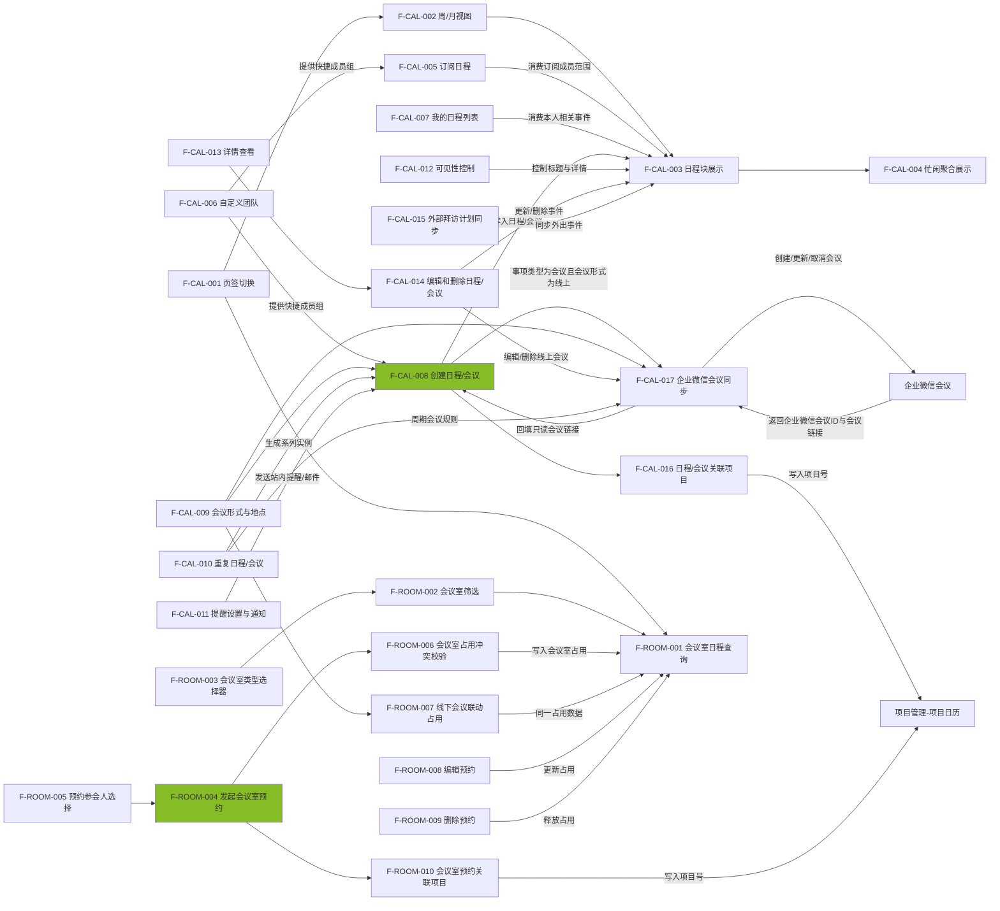
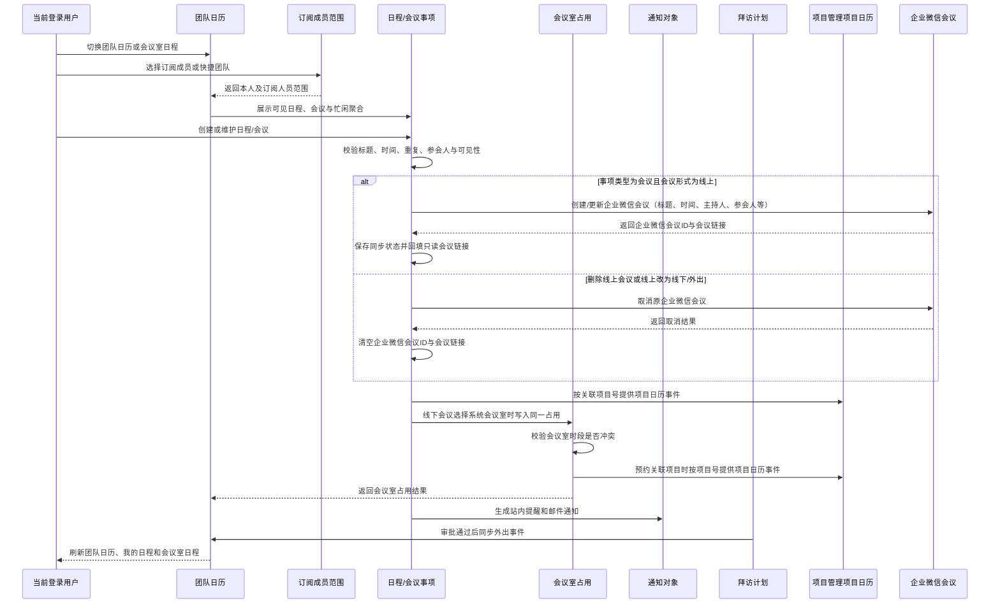

# 半潜首页-团队日历会议室日程模块功能清单

## 文档信息

| 项目       | 内容                                                                                    |
| -------- | ------------------------------------------------------------------------------------- |
| 文档名称     | 半潜首页-团队日历会议室日程模块功能清单                                                                  |
| 微服务 / 模块 | 半潜首页 / 团队日历会议室日程                                                                      |
| 版本       | v1.0.3                                                                                |
| 创建日期     | 2026-07-13                                                                            |
| 来源       | 需求分析文档与 HTML 原型（`需求分析-半潜首页-团队日历会议室日程.md` / `半潜首页-团队日历会议室日程-原型-v1.6-预约时间四列时间选择器.html`） |

---

## 一、功能模块清单

| 功能编号       | 功能名称           | 功能描述（用户操作→系统响应→预期结果）                                                 | 集成/异步标记               | 优先级 | 引入版本   | 状态  |
| ---------- | -------------- | -------------------------------------------------------------------- | --------------------- | --- | ------ | --- |
| F-CAL-001  | 团队日历与会议室日程页签切换 | 点击页签 → 切换视图组件 → 聚焦目标日程                                               | —                     | P0  | v1.0.0 | 已规划 |
| F-CAL-002  | 团队日历周/月视图      | 切换周月 → 重绘日历视图 → 查看不同粒度                                               | —                     | P0  | v1.0.0 | 已规划 |
| F-CAL-003  | 日程块展示          | 查看日历 → 渲染事件块 → 识别忙闲状态                                                | —                     | P0  | v1.0.0 | 已规划 |
| F-CAL-004  | 忙闲聚合展示         | 查看周视图 → 合并重叠日程 → 展开忙闲明细                                              | —                     | P0  | v1.0.0 | 已规划 |
| F-CAL-005  | 订阅日程           | 选择成员 → 更新订阅范围 → 查看团队日程                                               | —                     | P0  | v1.0.0 | 已规划 |
| F-CAL-006  | 自定义团队          | 维护团队 → 保存成员组合 → 快捷复用选人                                               | —                     | P0  | v1.0.0 | 已规划 |
| F-CAL-007  | 我的日程列表         | 选择日期范围 → 筛选本人事项 → 展示个人安排                                             | —                     | P0  | v1.0.0 | 已规划 |
| F-CAL-008  | 创建日程/会议        | 填写表单（不单独填写日期，通过开始时间/结束时间选择日期及小时、分钟） → 校验并保存；线上会议先同步创建企业微信会议 → 刷新相关视图 | [第三方集成][数据同步]         | P0  | v1.0.0 | 已规划 |
| F-CAL-009  | 会议形式与地点        | 选择会议形式 → 展示对应字段；线上会议自动回填企业微信会议链接 → 完成地点配置                            | [跨模块公用表][第三方集成][数据同步] | P0  | v1.0.0 | 已规划 |
| F-CAL-010  | 重复日程/会议        | 设置重复 → 生成系列实例 → 周期展示事项                                               | —                     | P1  | v1.0.0 | 已规划 |
| F-CAL-011  | 提醒设置与通知        | 保存变更 → 生成站内和邮件 → 通知相关人员                                              | [数据同步]                | P1  | v1.0.0 | 已规划 |
| F-CAL-012  | 可见性控制          | 设置范围 → 控制标题详情 → 保护隐私信息                                               | —                     | P0  | v1.0.0 | 已规划 |
| F-CAL-013  | 详情查看           | 点击日程块 → 打开详情弹窗 → 查看可见内容                                              | —                     | P0  | v1.0.0 | 已规划 |
| F-CAL-014  | 编辑和删除日程/会议     | 创建人操作 → 校验权限并变更 → 同步刷新通知                                             | [数据同步]                | P0  | v1.0.0 | 已规划 |
| F-CAL-015  | 外部拜访计划同步       | 审批通过 → 同步外出事件 → 日历只读展示                                               | [数据同步]                | P0  | v1.0.0 | 已规划 |
| F-CAL-016  | 日程/会议关联项目      | 选择项目 → 写入项目号 → 项目日历展示                                                | [跨模块公用表][数据同步]        | P0  | v1.0.1 | 已规划 |
| F-CAL-017  | 企业微信会议同步       | 创建/维护线上会议 → 同步创建、更新或取消企业微信会议 → 回填会议链接并保持两端一致                         | [第三方集成][数据同步]         | P0  | v1.0.2 | 已规划 |
| F-ROOM-001 | 会议室日程查询        | 进入页签 → 展示时间轴 → 查看占用情况                                                | —                     | P0  | v1.0.0 | 已规划 |
| F-ROOM-002 | 会议室筛选          | 设置筛选 → 过滤会议室 → 定位可用资源                                                | —                     | P0  | v1.0.0 | 已规划 |
| F-ROOM-003 | 会议室类型选择器       | 展开选择器 → 勾选类型 → 缩小筛选范围                                                | —                     | P2  | v1.0.0 | 已规划 |
| F-ROOM-004 | 发起会议室预约        | 选择空闲段 → 在单一“预约时间”字段中选择日期、开始时分和结束时分 → 填写其余预约信息并生成占用记录                 | [跨模块公用表]              | P0  | v1.0.0 | 已规划 |
| F-ROOM-005 | 会议室预约参会人选择     | 选择参会人 → 复用组织选人 → 完成预约人员                                              | —                     | P0  | v1.0.0 | 已规划 |
| F-ROOM-006 | 会议室占用冲突校验      | 提交预约 → 按日期及起止时分校验时间区间冲突 → 阻止重复占用                                     | —                     | P0  | v1.0.0 | 已规划 |
| F-ROOM-007 | 线下会议联动会议室占用    | 创建线下会 → 写入同一占用 → 两端一致展示                                              | [跨模块公用表][数据同步]        | P0  | v1.0.0 | 已规划 |
| F-ROOM-008 | 编辑会议室预约        | 创建人编辑 → 更新预约内容 → 发送变更通知                                              | [数据同步]                | P0  | v1.0.0 | 已规划 |
| F-ROOM-009 | 删除会议室预约        | 创建人删除 → 释放会议室资源 → 发送取消通知                                             | [数据同步]                | P0  | v1.0.0 | 已规划 |
| F-ROOM-010 | 会议室预约关联项目      | 选择项目 → 写入项目号 → 项目日历展示                                                | [跨模块公用表][数据同步]        | P0  | v1.0.1 | 已规划 |

---

## 二、优先级说明

| 优先级 | 说明   |
| --- | ---- |
| P0  | 核心功能 |
| P1  | 重要功能 |
| P2  | 次要功能 |

---

## 三、功能依赖关系图（含数据流依赖）

> **必须填写**。节点用功能编号；除调用先后，标注数据流依赖（谁产生/消费哪张表）。

---

## 四、团队日历会议室日程模块流程探测

### 4.1 主流程（业务主线）

用户在首页切换团队日历或会议室日程，先通过订阅/筛选掌握人员与会议室忙闲，再创建或维护日程、会议、会议室预约。创建线上会议时，系统先在企业微信创建会议，成功取得企业微信会议 ID 与会议链接后回填本地会议记录；创建失败则阻止本地会议保存。编辑、删除线上会议或将线上会议改为其他形式时，同步更新或取消企业微信会议。如事项关联项目，系统写入项目号，供项目管理模块的项目日历展示关联日程。系统同步刷新视图并按可见性与通知规则告知相关人员。（关键功能：F-CAL-001、F-CAL-005、F-CAL-008、F-CAL-016、F-CAL-017、F-ROOM-004、F-ROOM-007、F-ROOM-010）

### 4.2 异常流程

| 异常点        | 触发条件                           | 系统响应                      |
| ---------- | ------------------------------ | ------------------------- |
| 会议室占用冲突    | 线下会议或会议室预约提交时，同一会议室同一日期时间段已有占用 | 阻止保存，提示更换会议室或时间，不写入占用记录   |
| 人员时间冲突     | 创建会议时参会人员已有重叠日程或会议             | 展示冲突提示但不阻止保存，由创建人自行确认     |
| 表单关键字段缺失   | 标题、开始时间、结束时间、重复截止日期等必填项缺失      | 阻止提交，提示补齐对应字段             |
| 非创建人维护记录   | 非创建人尝试编辑或删除日程、会议、会议室预约         | 阻止编辑/删除，提示仅创建人可维护         |
| 不可见事件访问    | 非参会人员查看参会人员可见事件                | 仅展示忙碌、时间和涉及人员，不展示标题、地点、备注 |
| 外部同步源变更    | 拜访计划在源页面取消或变更                  | 团队日历同步更新或移除只读外出事件         |
| 企业微信会议创建失败 | 创建线上会议时企业微信接口失败、超时或未返回有效会议链接   | 阻止本地会议保存，保留用户已填写内容并提示稍后重试 |
| 企业微信会议更新失败 | 编辑线上会议的标题、时间、主持人或参会人时同步失败      | 阻止本地会议更新，保持本地及企业微信原会议信息不变 |
| 企业微信会议取消失败 | 删除线上会议或将线上改为线下/外出时取消失败         | 阻止本地删除或会议形式变更，提示稍后重试      |
| 企业微信重复创建   | 用户重复点击保存或接口重试                  | 使用本地业务标识保证幂等，不重复生成企业微信会议  |

### 4.3 边界流程

- 多条同日程重叠：周视图合并为忙闲组，单事件直接进详情，多事件展开并列明细。
- 月视图同开始时间多事件：不合并，按开始时间、结束时间和原始顺序逐条展示。
- 订阅人员为空：仍默认展示当前用户本人日程，订阅人数显示为空或 0。
- 普通日程无参与成员：允许保存为个人日程，不触发参会人必选校验。
- 自定义团队删除：只移除快捷选项，不影响既有订阅关系和已创建事项。
- 会议室筛选无结果：展示无满足条件会议室的空状态，不清空筛选条件。
- 创建日程/会议日期时间输入：不再单独展示“日期”字段；开始时间、结束时间使用日期时间选择器，选择日期、小时、分钟，不展示秒。
- 会议室预约时间输入：预约时间统一为单字段，展开后选择日期，并分别选择开始时间的小时/分钟和结束时间的小时/分钟；预约保存及冲突校验按所选时分处理。
- 重复规则无有效日期：阻止保存，并提示重复规则未生成有效日期。
- 重复线上会议：企业微信支持周期会议时，一个本地会议系列对应一个企业微信周期会议；仅编辑/删除本次时同步维护对应实例，编辑/删除整个系列时同步维护整个周期会议。
- 线上会议链接：仅由企业微信创建成功后回传，用户不可手工录入或修改。
- 会议形式切换：线上改为线下或外出时，企业微信会议取消成功后清空会议 ID 和会议链接；线下或外出改为线上时，按新建线上会议流程创建并回填链接。

---

## 变更记录

| 版本     | 日期         | 变更内容                                                                  | 变更人 |
| ------ | ---------- | --------------------------------------------------------------------- | --- |
| v1.0.0 | 2026-07-13 | 基于需求分析 v1.8 与原型 v1.5 生成初始功能清单                                         | 邵艺晨 |
| v1.0.1 | 2026-07-15 | 增加日程/会议及会议室预约关联项目能力，按项目号向项目管理模块项目日历提供关联日程                             | 邵艺晨 |
| v1.0.2 | 2026-08-12 | 增加线上会议与企业微信会议同步能力：创建成功后回填会议链接，编辑同步更新，删除或切换会议形式时同步取消，并补充周期会议、幂等及失败阻断规则 | 邵艺晨 |
| v1.0.3 | 2026-08-31 | 创建日程/会议删除独立日期字段，开始/结束时间改为日期+时分选择；会议室预约时间合并为单字段，支持开始/结束时分四列选择及分钟级冲突校验  | 邵艺晨 |

