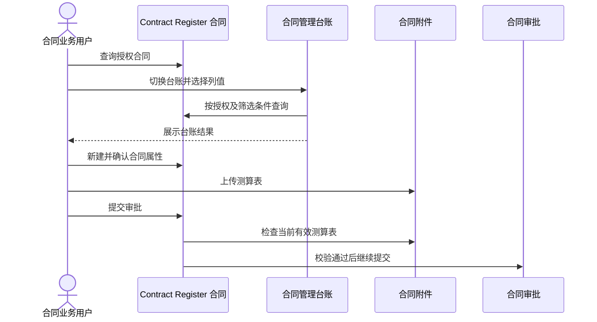
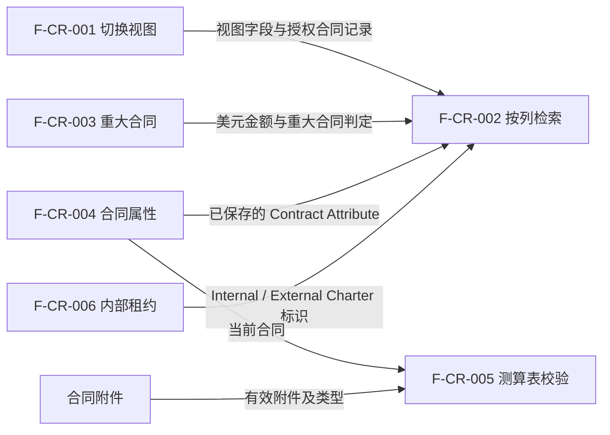

# Contract Register 模块功能清单

## 文档说明

| 项目 | 内容 |
|---|---|
| 产物类型 | 功能清单 |
| 职责 | 记录模块业务流程、功能、权限、依赖与字段口径 |
| 适用范围 | 现有 Contract Register 授权用户，公司适用范围待确认 |
| 模板版本 | v1.6 |

## 文档信息

| 项目 | 内容 |
|---|---|
| 微服务 / 模块 | 待确认 / Contract Register |
| 版本 | v1.0.0 |
| 创建日期 | 2026-11-09 |
| 文档名称 | Contract Register 模块功能清单 |
| 需求来源 | Contract Register-原型-v1.0.html、关于Contract Register指标口径-v1.0.xlsx、业务澄清 |

## 一、引言

### 1.1 目的

本文档将 Contract Register 的原型交互、功能范围和指标口径统一整理为功能清单，作为需求评审、系统设计、开发及验收的依据。指标口径以附录 A 为准，用户故事按第四章的功能编号展开。

### 1.2 范围

覆盖默认列表、台账、两视图检索、重大合同识别、合同属性、测算表提交校验和内部租约标识。

### 1.3 定义、简写和省略语

| 术语 | 含义 |
|---|---|
| Contract Ledger | Contract Register 的合同管理台账视图 |
| PID | 合同关联货盘的业务标识 |
| Laycan | 合同货物的受载日期窗口 |
| Major Contract | 折算金额达到 6,500,000 USD 的合同 |
| Internal Charter | Charterer 为中远海运特种运输股份有限公司的合同 |

## 二、总体描述

### 2.1 需求背景

用户需要在既有 Contract Register 页面集中查阅台账信息、识别重大合同及内部租约，并在提交审批前补齐测算表。

### 2.2 建设目标

两个视图基于同一授权合同范围查询，台账字段按统一口径展示并可按列值筛选，新建合同具备可追溯的合同属性，审批提交具备测算表校验。

### 2.3 软件功能要求

列表提供视图切换、列值筛选与重大合同筛选。新建流程支持合同属性选择和测算表上传。默认列表展示内部互租标识。

### 2.5 运行环境

沿用现有 Contract Register 页面及系统权限。

### 2.6 假定和约束

- Signing Status 根据 Signing date 判断，已知选项为「已签租约」，完整枚举及其他判定规则待确认。
- Execution Status 已知选项为「已取消」「已执行」，完整枚举及取数来源待确认。
- Spot / Forward 取值为 Spot、Forward，取数来源待确认。

## 三、业务需求分析

### 3.1 主流程（业务主线）

用户查询授权合同，可切换台账查看按口径形成的字段。用户新建合同时维护合同属性，上传测算表后提交审批。

### 3.2 异常流程

| 异常点 | 触发条件 | 系统响应 |
|---|---|---|
| 无法折算 | 金额、币种或有效汇率缺失 | 金额及重大合同判定显示 —，不纳入 Yes 或 No |
| 缺少合同属性 | 合同属性未选择且触发必填校验 | 阻止当前操作，提示补填 |
| 缺少测算表 | 提交审批时没有有效测算表 | 阻止提交并提示上传 |

### 3.3 边界流程

- 金额恰好等于 6,500,000 USD 时，判定为重大合同。
- 翻页时 No. 按查询结果连续编号。切换视图时恢复默认筛选和排序，并返回第 1 页。

## 四、功能需求

### 4.1 功能列表

| 功能编号     | 功能名称                  | 功能描述                                                               | 适用范围                   | 优先级 | 引入版本   | 状态  |
| -------- | --------------------- | ------------------------------------------------------------------ | ---------------------- | --- | ------ | --- |
| F-CR-001 | 切换 Contract Ledger 视图 | 点击 Contract Ledger 切换至台账，再次点击返回默认视图，筛选区与列随视图切换。                    | Contract Register 授权用户 | P0  | v1.0.0 | 待开发 |
| F-CR-002 | 按列检索合同                | 在任一视图打开表头筛选，从组件列出的该列可选值勾选并应用。                                      | Contract Register 授权用户 | P0  | v1.0.0 | 待开发 |
| F-CR-003 | 筛选 Major Contract     | 在默认筛选区选择 Major Contract 的 Yes 或 No。台账展示 Y、N 或 —。                   | Contract Register 授权用户 | P0  | v1.0.0 | 待开发 |
| F-CR-004 | 维护 Contract Attribute | 选择 Cargo enquiry/Project/COA 后，现货货盘带出 Spot，项目货盘带出 Project，用户可手动修改。 | Contract Register 授权用户 | P0  | v1.0.0 | 待开发 |
| F-CR-005 | 校验测算表附件               | 点击 Upload，选择 Attachment Type 为测算表并上传文件。附件清单显示对应 Document Type。     | Contract Register 授权用户 | P0  | v1.0.0 | 待开发 |
| F-CR-006 | 标识 Internal Charter   | 在默认列表查看 Internal / External Charter，可在筛选区选择对应标识。                   | Contract Register 授权用户 | P0  | v1.0.0 | 待开发 |

### 4.2 角色与权限

| 角色 | 可执行功能 / 操作 | 数据范围 | 备注 |
|---|---|---|---|
| 项目管理人员及其他获授访问权限的人员 | 切换视图、检索和查看合同 | 现有授权范围内的合同 | 仅查看 |
| 市场营销人员 | 切换视图、检索、查看、新建和编辑合同，维护合同属性、上传附件及提交审批 | 现有授权范围内的合同 | 沿用系统统一权限 |

## 五、优先级说明

| 优先级 | 说明 |
|---|---|
| P0 | 核心功能 |
| P1 | 重要功能 |
| P2 | 次要功能 |

## 六、功能依赖关系图（含数据流依赖）

## 附录：字段清单

### 附录 A 业务口径字段表

| 编号 | 页面字段名称 | 来源 | 格式 | 取值范围 | 业务口径 | 编辑权限 | 失败处理 |
|---|---|---|---|---|---|---|---|
| 1 | 默认视图通用 | 合同主数据、关联货盘、系统生效汇率 | 列表规则 | 当前用户有权查看的合同 | 列表新增 Contract Attribute、Internal / External Charter。筛选区新增这两项及 Major Contract。筛选区与列筛选共享状态，多个条件按“且”组合，结果按 Contract No. 去重 | 按现有授权查看 | 无匹配记录时显示空列表 |
| 2 | Contract Attribute（默认视图） | 合同主数据的 Contract Attribute | 枚举 | Spot、Project | 展示合同最终保存的属性值。新建时按所选货盘类型带出，用户修改后以最终保存值为准。筛选时匹配所选属性 | 列表只读 | 未维护时的显示及筛选处理待确认 |
| 3 | Internal / External Charter | 系统根据合同 Charterer 判定 | 枚举 | Internal Charter、External Charter | Charterer 等于“中远海运特种运输股份有限公司”时判定为 Internal Charter。筛选时展示标识等于所选值的合同 | 列表只读 | Charterer 缺失时的处理待确认 |
| 4 | Major Contract（默认视图筛选） | 合同金额、币种及系统生效汇率 | 枚举 | Yes、No、— | 美元折算金额大于等于 6,500,000 USD 判定为 Yes，低于该金额判定为 No。筛选时仅展示判定结果等于所选值的合同 | 系统计算，用户可选择筛选条件 | 金额、币种或有效汇率缺失导致无法折算时显示 —，不纳入 Yes、No 筛选结果 |
| 5 | Contract Ledger 通用 | 合同主数据、关联货盘、系统生效汇率 | 列表规则 | 与默认列表相同的授权合同范围 | 点击 Contract Ledger 按钮切换视图，再次点击返回。筛选区与列筛选共享状态，条件按“且”组合。切换视图时清空原筛选条件、返回第 1 页，按 Created time 从新到旧排序。结果按 Contract No. 去重 | 按现有授权查看 | 无匹配记录时显示空列表 |
| 6 | No. | 系统根据当前查询结果生成 | 整数 | 从 1 开始连续编号 | 按当前筛选和排序结果编号，翻页后按完整查询结果连续计算 | 列表只读 | 不支持筛选和排序 |
| 7 | PID | 合同与货盘的关联关系 | 文本 | 关联货盘 PID | 展示合同关联货盘的 PID。同一合同在默认视图、台账及查看页面使用同一 PID。同一 PID 对应多份合同时，各合同分别展示 | 列表只读 | 未关联货盘时的显示待确认 |
| 8 | Contract No. | 系统生成，保存于合同主数据 | 文本 | 合同编号 | 唯一识别合同。同一合同在不同视图使用同一编号，列表按 Contract No. 去重 | 列表只读 | 无 |
| 9 | Signing Status | 系统根据合同主数据的 Signing date 判断 | 枚举 | 已明确“已签租约”，完整枚举待确认 | 展示合同当前有效签署状态并支持筛选，同一合同仅展示一次 | 列表只读 | 其他状态判定规则及异常处理待确认 |
| 10 | Contract Category | 合同主数据的 Paradigm contract，系统转换 | 枚举 | Standard、Negotiated、— | Yes 转换为 Standard，No 转换为 Negotiated。筛选时匹配转换后的值 | 列表只读 | Paradigm contract 未维护时显示 —，不纳入 Standard、Negotiated 筛选结果 |
| 11 | Our Role | 合同 Related Party、当前用户所属公司 | 枚举 | Shipowner、Charterer、— | 查找关联方为当前用户所属公司的记录，取其 Type of Related Party 作为角色 | 列表只读 | 未找到所属公司或对应类型未维护时显示 —，不纳入具体角色的筛选结果 |
| 12 | Major Contract (Y/N) | 合同金额、币种及系统生效汇率 | 枚举 | Y、N、— | 美元折算金额大于等于 6,500,000 USD 显示 Y，低于该金额显示 N。筛选时匹配对应判定结果 | 列表只读 | 无法判断时显示 —，不纳入 Yes、No 筛选结果 |
| 13 | Contract Name / Summary | 合同主数据的 Contract name | 文本 | 合同名称或摘要 | 展示当前合同保存的名称或主要内容摘要 | 列表只读 | 未维护时显示 — |
| 14 | Counterparty | 合同 Related Party、当前用户所属公司 | 文本 | 符合条件的关联方名称 | 排除名称等于当前用户所属公司的关联方，取其余关联方名称 | 列表只读 | 未找到符合条件的关联方时显示 — |
| 15 | Performing Vessel | 合同 Planned performing vessel；船舶主数据 | 船舶 | 已维护的计划履约船舶 | 展示合同计划履约船舶。筛选结果匹配所选船舶，按 Contract No. 去重 | 列表只读 | 未维护时显示 — |
| 16 | Currency | 合同主数据的 Currency | 币种代码 | 如 USD、CNY、EUR | 展示合同金额的原始币种，筛选时匹配所选币种 | 列表只读 | 未维护时显示 —，不纳入具体币种筛选结果 |
| 17 | Contract Amount (USD) | 合同金额、币种及系统生效汇率 | 金额，单位 USD | 折算后的合同金额 | 原币种为 USD 时取原金额，其他币种按系统生效汇率折算。结果作为 Major Contract 的判定依据 | 列表只读 | 金额、币种或对应有效汇率缺失时显示 — |
| 18 | Laycan Start Date | 合同 Cargo 区域的 Laycan | 日期 | 有效的 Laycan 起始日期 | 取各条 Cargo 记录中最早的有效 Laycan 起始日期，筛选时匹配计算后的日期 | 列表只读 | 没有有效起始日期时显示 —，不纳入具体日期筛选结果 |
| 19 | Signed Date | 合同主数据的 Signing date | 日期 | 已维护的签署日期 | 展示合同签署日期，筛选时匹配所选日期 | 列表只读 | 未维护时显示 —，不纳入具体日期筛选结果 |
| 20 | Execution Status | 待确认 | 枚举 | 已明确“已取消、已执行”，完整枚举待确认 | 展示合同当前执行状态，支持按状态筛选 | 列表只读 | 取数来源及异常处理待确认 |
| 21 | Spot / Forward | 待确认 | 枚举 | Spot、Forward、— | 标识合同属于现货还是远期合同，筛选时匹配所选值 | 列表只读 | 未维护时显示 —；取数来源待确认 |
| 22 | Salesperson | 合同 Business Supervisor；用户主数据 | 用户 | 已维护的业务员 | 展示负责合同业务管理和跟进的业务员，筛选时匹配所选用户 | 列表只读 | 未维护时显示 — |
| 23 | Contract Attribute（New Contract） | 所选货盘业务类型带出，用户可修改，最终保存至合同主数据 | 必填单选枚举 | Spot、Project | 现货货盘带出 Spot，项目货盘带出 Project。允许手动修改，以最终保存值作为默认列表展示和筛选依据 | 市场营销人员按现有权限维护 | 未选择时必填校验不通过，提示文案待确认 |
| 24 | Attachment Info | 用户上传的当前合同附件 | 附件列表及文件 | 附件类型包含新增的“测算表” | 上传弹窗选择类型并上传文件，附件写入当前合同列表。提交审批时至少存在一份 Document Type 为“测算表”的有效附件。编辑或删除后按当前有效附件重新校验 | 市场营销人员按现有权限维护；其他获授访问人员查看 | 未上传有效测算表时阻止提交审批并提示先上传。已删除附件不计入 |

## 变更记录

| 版本     | 日期         | 变更内容 | 变更人 |
| ------ | ---------- | ---- | --- |
| v1.0.0 | 2026-11-09 | 初始版本 | 邵艺晨 |
