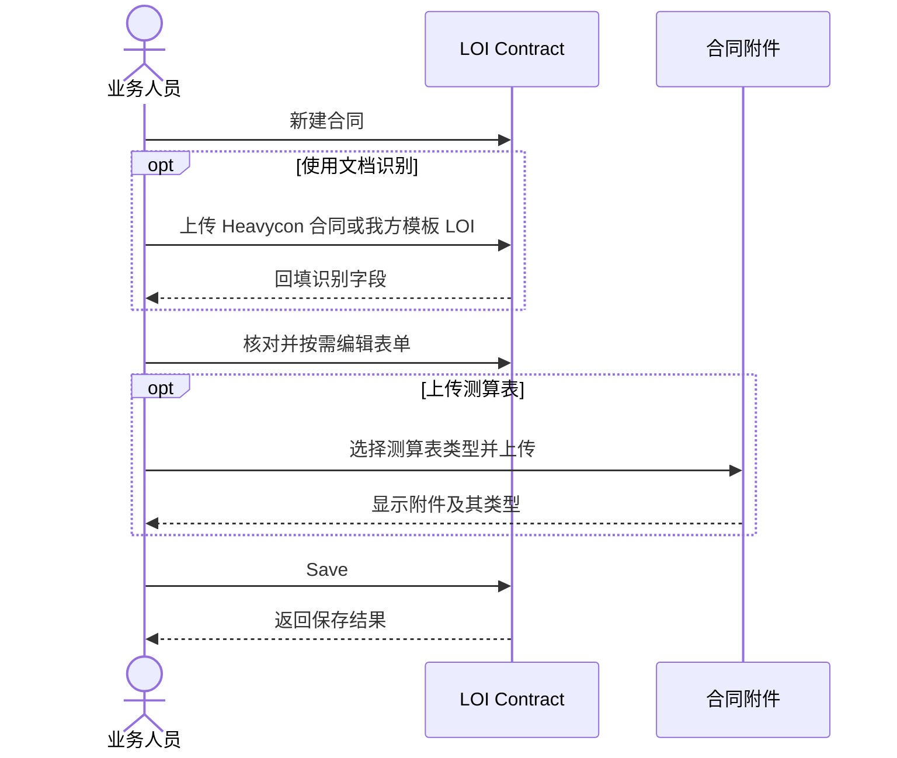
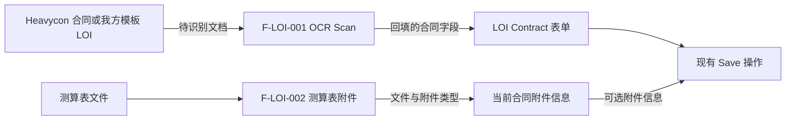

# LOI Register 模块功能清单

## 文档说明

| 项目 | 内容 |
|---|---|
| 产物类型 | 功能清单 |
| 职责 | 记录业务流程、功能范围、权限、依赖与字段口径 |
| 适用范围 | 现有 LOI Register 授权用户，公司适用范围待确认 |
| 模板版本 | v1.6 |

## 文档信息

| 项目 | 内容 |
|---|---|
| 文档名称 | LOI Register 模块功能清单 |
| 微服务 / 模块 | 待确认 / LOI Register |
| 版本 | v1.0.0 |
| 创建日期 | 2026-11-11 |
| 需求来源 | LOI Register-原型-v1.0.html、关于LOIRegister指标口径-v1.0.xlsx、本次业务澄清 |

## 一、引言

### 1.1 目的

业务人员在 LOI Register 登记合同时，需要把 Heavycon 合同或我方模板 LOI 中的信息录入台账，有测算表时也需要随合同归档。本次调整让业务人员可以用手头的文档起填，核对后提交，并在测算表尚未准备好时先完成合同登记。

### 1.2 范围

本次涉及 LOI Register 的新建合同/合同编辑业务，包括从 Heavycon 合同或我方模板 LOI 提取信息、人工核对与修正，以及按需将测算表归入当前合同的附件。

### 1.3 定义、简写和省略语

| 术语 / 简写 | 全称或含义 |
|---|---|
| OCR Scan | 上传文档、识别内容并回填新建合同表单的操作入口 |
| Heavycon | 本次支持识别的一类合同 |
| 我方模板 LOI | 按我方模板编制的意向书 |
| 测算表 | 新建合同时可选上传的一类附件 |

## 二、总体描述

### 2.1 需求背景

业务人员拿到 Heavycon 合同或我方模板 LOI 后，需要将原文中的合同信息逐项录入 LOI Register。同一份信息已经写在文档里，登记时还要再次录入和核对。测算表与合同登记的准备进度也可能不同。已有测算表时，业务人员需要把它归到对应合同下，方便后续查找。测算表尚未准备好时，业务人员仍需要提交满足其他保存条件的合同。

### 2.2 建设目标

减少业务人员从原文逐项录入的工作，让他们直接核对识别结果并修正有出入的字段。让已上传的测算表在合同附件中有明确分类，同时允许业务人员在测算表缺失时按现有条件完成登记。

### 2.3 软件功能要求

新建合同时，业务人员可通过 OCR Scan 上传 Heavycon 合同或我方模板 LOI。系统将识别结果填入对应字段，业务人员可在保存前核对并修改。需要归档测算表时，可在 Attachment Info 中将文件按“测算表”类型上传。测算表按需上传，合同按现有保存条件提交。

### 2.5 运行环境

沿用现有 LOI Register 页面运行环境。

### 2.6 假定和约束

两类文档的解析样本和允许的上传文件格式待确认。

## 三、业务需求分析

### 3.1 主流程（业务主线）

业务人员新建/修改 LOI Contract，可通过 OCR Scan 回填合同信息并复核，也可按需上传测算表，最后按现有保存规则提交。

### 3.2 异常流程

| 异常点      | 触发条件               | 系统响应                       |
| -------- | ------------------ | -------------------------- |
| OCR 处理失败 | 文件无法上传、无法识别或整次识别失败 | 提示失败并保留表单已有内容，用户可重新扫描或手动录入 |
| 附件上传失败   | 测算表文件上传失败          | 沿用现有附件上传失败处理，用户可重新上传       |

### 3.3 边界流程

- 表单已有值时，本次识别取得的有效结果直接覆盖对应字段，未取得有效结果的字段保留原值。

## 四、功能需求

### 4.1 功能列表

| 功能编号      | 功能名称          | 功能描述（用户操作→系统响应→预期结果）                                      | 适用范围                      | 优先级 | 引入版本   | 状态  |
| --------- | ------------- | --------------------------------------------------------- | ------------------------- | --- | ------ | --- |
| F-LOI-001 | OCR Scan 识别回填 | 上传 Heavycon 合同或我方模板 LOI → 识别并回填对应字段 → 用户复核并可手动修改          | 市场营销人员、项目管理人员及其他获授访问权限的人员 | P0  | v1.0.0 | 待开发 |
| F-LOI-002 | 测算表附件         | 在 Attachment Info 选择“测算表”并上传 → 记录并显示附件类型 → 无该附件时仍可按现有条件保存 | 市场营销人员、项目管理人员及其他获授访问权限的人员 | P0  | v1.0.0 | 待开发 |

### 4.2 角色与权限

| 角色             | 可执行功能 / 操作                              | 数据范围      | 备注       |
| -------------- | --------------------------------------- | --------- | -------- |
| 市场营销人员         | F-LOI-001 扫描并编辑当前表单、F-LOI-002 选择附件类型并上传 | 合同及对应附件   | 沿用系统统一权限 |

## 五、优先级说明

| 优先级 | 说明 |
|---|---|
| P0 | 核心功能 |
| P1 | 重要功能 |
| P2 | 次要功能 |

## 六、功能依赖关系图（含数据流依赖）

## 附录：字段清单

### 附录 A 业务口径字段表

| 页面字段名称            | 来源          | 格式       | 取值范围          | 编辑权限      | 失败处理                        |
| ----------------- | ----------- | -------- | ------------- | --------- | --------------------------- |
| LOI Contract 对应字段 | 系统识别回填、用户录入 | 沿用各字段格式  | 依据文档映射与现有字段规则 | 回填后可手动修改  | 整次识别失败时保留已有值并提示             |
| 附件类型              | 用户选择        | 枚举       | 现有选项及新增“测算表”  | 上传时可搜索或选择 | 沿用现有上传校验                    |
| 附件文件              | 用户上传        | 沿用现有上传规则 | 现有允许上传的文件     | 上传时可选择    | 上传失败沿用现有处理，Save 无需校验是否存在测算表 |

## 变更记录

| 版本     | 日期         | 变更内容                 | 变更人 |
| ------ | ---------- | -------------------- | --- |
| v1.0.0 | 2026-11-11 | 新增 OCR Scan 和测算表附件需求 | 邵艺晨 |
