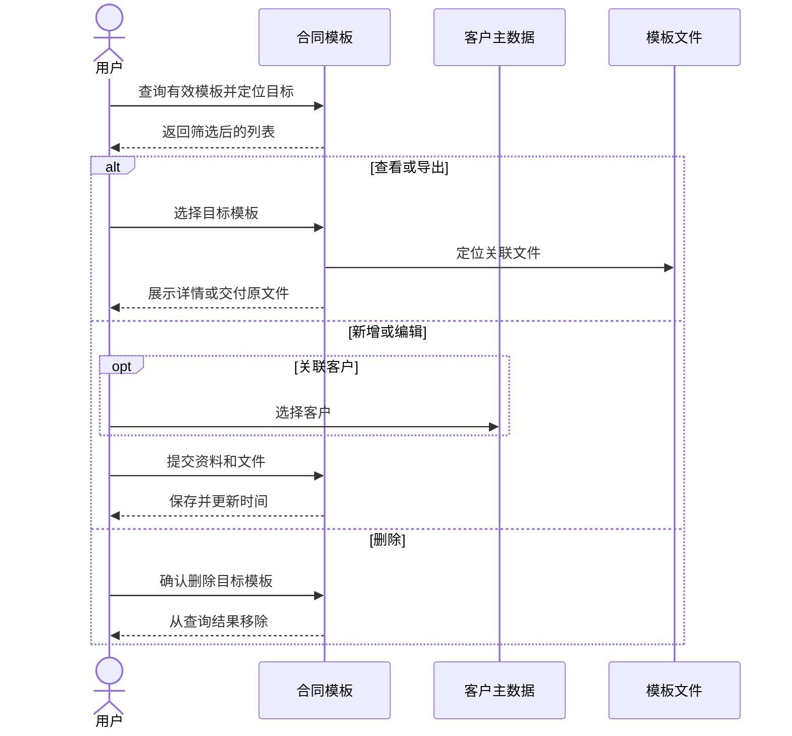
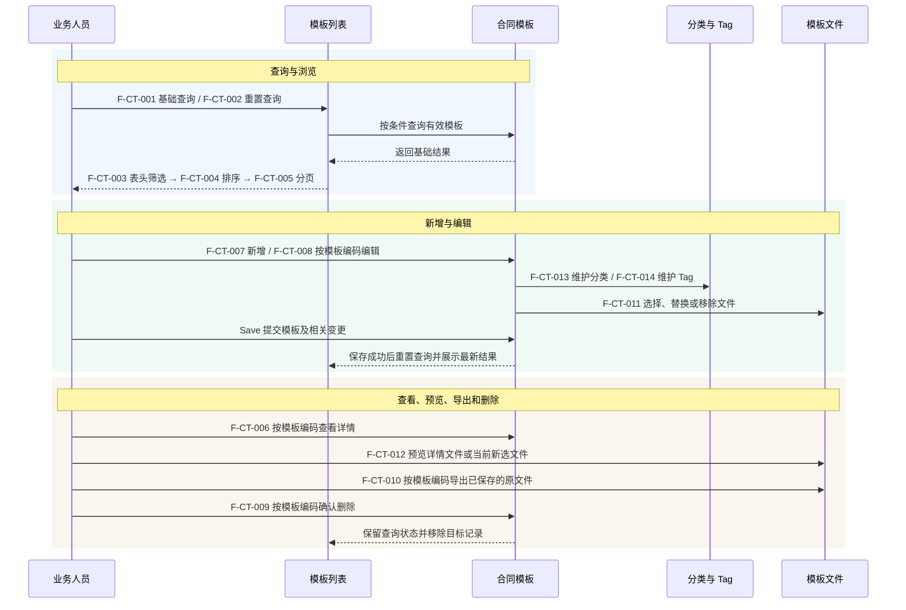

# 合同模板管理模块功能清单

## 文档说明

| 项目 | 内容 |
|---|---|
| 产物类型 | 功能清单 |
| 职责 | 模块业务流程、功能目录、角色权限与字段口径 |
| 适用范围 | 市场营销人员、项目管理人员，统一展示全部模板 |
| 模板版本 | v1.6 |

## 文档信息

| 项目       | 内容                                          |
| -------- | ------------------------------------------- |
| 文档名称     | 合同模板管理模块功能清单                                |
| 微服务 / 模块 | 待确认 / 合同模板管理                                |
| 版本       | v1.0.0                                      |
| 创建日期     | 2026-11-13                                  |
| 需求来源     | 合同模板管理-原型-v1.0.html；关于合同模板管理的指标口径-v1.0.xlsx |

## 一、引言

### 1.1 目的

本文档将合同模板管理的原型交互、功能范围和指标口径整理为功能清单，作为需求评审、系统设计、开发及验收的依据。

### 1.2 范围

覆盖有效模板查询、列表筛选与排序、模板查看与维护、文件预览与导出，以及自定义分类和标签维护。

### 1.3 定义、简写和省略语

| 术语               | 含义               |
| ---------------- | ---------------- |
| Contract Details | 新增、查看和编辑模板共用的详情页 |
| Template Code    | 合同模板唯一业务编码       |
| Tag              | 描述模板用途或业务场景的标签   |

## 二、总体描述

### 2.1 需求背景

业务人员需要集中查找、管理和使用合同模板、适用说明和对应文件。

### 2.2 建设目标

合同模板按统一口径登记和查询，通过唯一编码识别，支持业务人员按合同类别、货物类别、客户及标签定位模板并获取对应原件。

### 2.3 软件功能要求

列表支持条件查询、表头筛选、排序和分页。详情支持查看、新增和编辑模板，维护模板文件、分类和标签。列表提供单条删除和导出。

### 2.5 运行环境

通过合同模板查询页办理。关联客户时使用客户主数据。

### 2.6 假定和约束

- 模板编码由系统生成，全局唯一且不可复用。
- 分类和 Tag 的预置值由业务提供，原型选项仅作示意。新增保存成功后即可查询，无需审批。

## 三、业务需求分析

### 3.1 主流程（业务主线）

用户定位有效模板后查看或取得文件，具备维护权限的用户也可新增、更新或删除模板。

### 3.2 异常流程

| 异常点 | 触发条件 | 系统响应 |
|---|---|---|
| 查询无结果 | 有效范围内没有满足条件的模板 | 展示空态，可调整或重置条件 |
| 保存校验失败 | 缺少必填信息或文件 | 标识缺项并阻止保存 |
| 导出失败 | 目标模板文件不存在 | 提示文件不存在并停止下载 |

### 3.3 边界流程

- 同名模板可以并存，查看、编辑、删除和导出均以 Template Code 定位。
- 删除不可恢复，删除记录的 Template Code 不得再次使用。
- 查询条件变化后从第一页展示。

## 四、功能需求

### 4.1 功能列表

| 功能编号     | 功能名称      | 功能描述                                                | 适用范围          | 优先级 | 引入版本 | 状态  |
| -------- | --------- | --------------------------------------------------- | ------------- | --- | ---- | --- |
| F-CT-001 | 基础查询      | 展开筛选区并填写条件，点击 Query 后生成基础结果，重新应用仍有效的表头筛选和排序，并返回第一页  | 市场营销人员、项目管理人员 | P0  | v1.0 | 待开发 |
| F-CT-002 | 重置查询      | 点击 Reset，清空全部基础条件、表头筛选和排序，从第一页展示全部有效模板              | 市场营销人员、项目管理人员 | P1  | v1.0 | 待开发 |
| F-CT-003 | 表头筛选      | 打开列筛选面板，搜索候选值，使用 (All)、Clear selected 或 Confirm 操作  | 市场营销人员、项目管理人员 | P1  | v1.0 | 待开发 |
| F-CT-004 | 结果排序      | 在表头选择 Ascending 或 Descending，对筛选后的结果应用当前列及方向，并返回第一页 | 市场营销人员、项目管理人员 | P1  | v1.0 | 待开发 |
| F-CT-005 | 分页浏览      | 点击上一页、下一页或页码，或调整每页条数；显示当前区间及总数                      | 市场营销人员、项目管理人员 | P1  | v1.0 | 待开发 |
| F-CT-006 | 查看模板      | 点击 Template Name 或 View，以只读模式打开 Contract Details    | 市场营销人员、项目管理人员 | P0  | v1.0 | 待开发 |
| F-CT-007 | 新增模板      | 点击 New，填写 Contract Details 并 Save；保存成功后清空查询条件、表头筛选和排序，从第一页展示       | 市场营销人员、项目管理人员 | P0  | v1.0 | 待开发 |
| F-CT-008 | 编辑模板      | 点击 Edit，回显当前内容，修改后 Save；保存成功后清空查询条件、表头筛选和排序，从第一页展示               | 市场营销人员、项目管理人员 | P0  | v1.0 | 待开发 |
| F-CT-009 | 删除模板      | 点击 Delete，确认弹窗显示目标名称；确认后保留当前查询状态，并从结果中移除目标模板                | 市场营销人员、项目管理人员 | P0  | v1.0 | 待开发 |
| F-CT-010 | 导出模板      | 点击目标行 Export，下载该模板保存的 Template document             | 市场营销人员、项目管理人员 | P0  | v1.0 | 待开发 |
| F-CT-011 | 维护模板文件    | 选择文件后显示文件名；重新选择替换前一个文件；编辑态可移除                       | 市场营销人员、项目管理人员 | P0  | v1.0 | 待开发 |
| F-CT-012 | 预览模板文件    | 从 Contract Details 点击文件预览入口查看当前模板文件，支持预览新选或替换后尚未保存的文件                 | 市场营销人员、项目管理人员 | P1  | v1.0 | 待开发 |
| F-CT-013 | 维护自定义分类   | 在三个 Category 的下拉框通过 + Add 添加并选择自定义分类；未被模板引用的自定义项可删除，已被引用时禁止删除     | 市场营销人员、项目管理人员 | P1  | v1.0 | 待开发 |
| F-CT-014 | 维护自定义 Tag | 在 Tags 中用 Add 新增并选中标签，或删除未被模板引用的自定义 Tag。预置 Tag 和已被模板引用的自定义 Tag 禁止删除                 | 市场营销人员、项目管理人员 | P1  | v1.0 | 待开发 |

### 4.2 角色与权限

| 角色            | 可执行功能 / 操作            | 数据范围    | 备注             |
| ------------- | --------------------- | ------- | -------------- |
| 市场营销人员、项目管理人员 | 查询、浏览、查看、预览和导出        | 全部模板 | 无需单独授权    |
| 市场营销人员、项目管理人员 | 新增、编辑、删除及分类、Tag 和附件维护 | 全部模板 | 无需单独授权 |

## 五、优先级说明

| 优先级 | 说明 |
|---|---|
| P0 | 核心功能 |
| P1 | 重要功能 |
| P2 | 次要功能 |

## 六、功能依赖关系图（含数据流依赖）

分类和 Tag 的变更随模板保存成功后生效，供详情和查询使用。

## 附录：字段清单

### 附录 A 业务口径字段表

| 页面字段名称 | 来源 | 格式 | 取值范围 | 编辑权限 | 失败处理 |
|---|---|---|---|---|---|
| No. | 按结果顺序和分页位置计算 | 正整数 | 从 1 起 | 只读 | — |
| Template Name / Template name | 用户录入 | 单行文本 | 非空，允许同名；查询可空 | 详情编辑态可改 | 详情为空时阻止保存 |
| Template Code / Template code | 系统生成；查询值由用户录入 | CT-YYYY-NNN；查询支持部分文本 | 全局唯一、不可复用；新增显示 Auto generated | 详情只读 | 编码冲突处理待确认 |
| Contract Category / Contract category | 分类目录选择带出 | 单选 | 预置项或自定义项，正式预置值由业务提供 | 查询可选，详情必选 | 详情未选时阻止保存 |
| Cargo Category / Cargo category | 分类目录选择带出 | 单选 | 可空，正式预置值由业务提供 | 查询及详情编辑态可选 | — |
| Customer Category / Customer category | 分类目录选择带出 | 单选 | 可空，正式预置值由业务提供 | 查询及详情编辑态可选 | — |
| Customer Name / Customer name | 客户主数据选择带出 | 单选，列表显示名称 | 可空，可由多模板引用同一客户 | 从选择器选择 | 不接受自定义录入 |
| Tag / Tags | 标签目录选择带出 | 多选 | 可空，同一模板内去重；正式预置值由业务提供，原型仅作示意 | 查询及详情编辑态可选 | — |
| Description / Template description | 用户录入 | 多行文本 | 非空，最多 500 字 | 详情编辑态可改 | 为空或超过 500 字时阻止保存 |
| Updated Time | 成功保存时系统生成；查询日期由用户选择 | 原型列表 YYYY-MM-DD HH:mm:ss；查询按自然日 | 查询可空，显示和自然日查询均使用北京时间（UTC+8） | 列表只读 | — |
| Template document | 用户上传 | 单文件 | DOC、DOCX、PDF；必填；文件大小沿用当前系统限制 | 编辑态可上传、替换和移除 | 缺失或不合规时阻止保存 |
| Operate | 系统展示 | 行操作入口 | View、Edit、Delete、Export | 受操作权限控制 | 详见关联用户故事 |

## 变更记录

| 版本     | 日期         | 变更内容  | 变更人 |
| ------ | ---------- | ----- | --- |
| v1.0.0 | 2026-11-13 | 初始评审稿 | 邵艺晨 |
