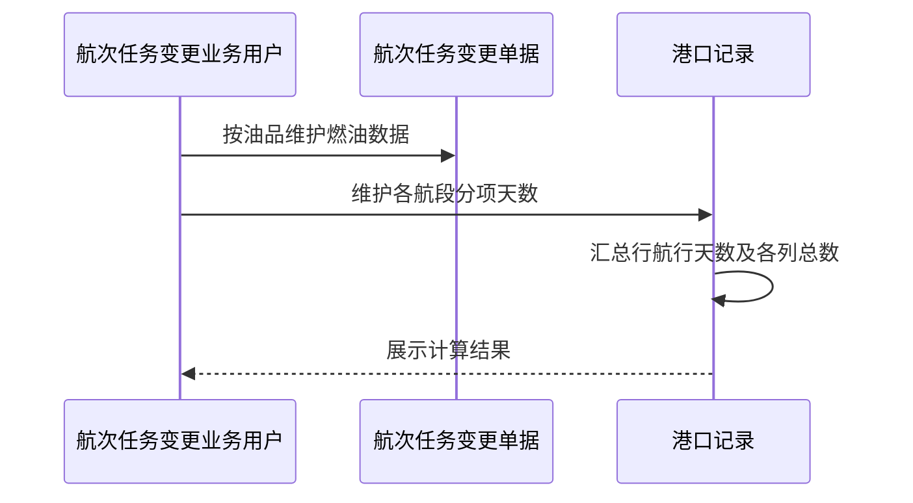

# 航次任务变更模块功能清单

## 文档说明

| 项目 | 内容 |
| -- | -- |
| 产物类型 | 功能清单，本次为增量 |
| 职责 | 界定改动范围、业务流程、功能目录及字段口径 |
| 适用范围 | 沿用航次任务变更原有公司范围和授权 |
| 模板版本 | v1.6 |

## 文档信息

| 项目 | 内容 |
| -- | -- |
| 微服务 / 模块 | 微服务名待确认 / 航次任务变更 |
| 文档版本 | v1.0.0 |
| 创建日期 | 2026-11-11 |
| 编写依据 | 航次任务变更-原型-v1.0.html；关于航次任务变更指标口径-v1.0.xlsx |

## 一、引言

### 1.1 目的

支持业务人员在调整航次任务时，分别考虑正常航行、漂航以及排放控制区内外的燃油消耗差异，并将各航段的时间安排与相应工况对应起来，为航次燃油成本测算和变更后的航次方案评估提供更细致、可核对的基础数据。本文档明确相关业务要求，供业务、产品、开发和测试共同确认。

### 1.2 范围

本次覆盖航次任务变更方案调整时涉及的两类测算基础数据：一是各油品在不同航行工况下的日耗及燃油单价；二是各港口航段在不同工况下的预计天数及汇总天数。保留原有在港日耗和燃油单价，细分原有在航日耗与航行天数。港口行编辑交互、抵港目的、是否待定及变更申请、审批和生效流程不纳入本次调整。

### 1.3 定义、简写和省略语

| 术语 | 含义 |
| -- | -- |
| ECA | 排放控制区 |
| 日耗 | 对应油品在指定工况下每天的燃油消耗量，单位为吨/天 |
| 航行天数 | 当前港口行对应航段的正常航行及漂航总天数，单位为天 |

## 二、总体描述

### 2.1 需求背景

航次任务的航行安排发生变化时，业务人员需要结合船舶油耗、航段时间和燃油价格等基础数据评估航次成本与效益。同一航次可能同时包含正常航行与漂航，也可能经过排放控制区内外，不同工况需要分别维护相应的油品日耗和持续时间。

现有页面以统一的“在航（吨/天）”记录油耗，以“航行天数”汇总航段时间，业务人员无法直接从单据中核对各工况采用的日耗和天数，也不便于解释不同航段时间安排下的测算依据。因此，需要将油耗和天数按一致的工况维度细分，保留总航行天数供业务整体核对。

### 2.2 建设目标

1. 使业务人员能够按油品分别记录正常航行、漂航在 ECA 内外的日耗，明确方案采用的燃油消耗假设。
2. 使各航段的预计天数与上述四种工况逐项对应，便于核对航行安排和时间构成。
3. 由系统统一汇总各航段和全单据的天数，减少人工加总及分项与总数不一致的情况。
4. 为后续航次成本测算和变更后的航次方案比较提供口径一致的输入依据；具体成本公式仍需按原系统及后续明确的业务规则执行。

### 2.3 软件功能要求

业务人员能够按油品维护正常航行、漂航在 ECA 内外的日耗，以及原有在港日耗和单价；能够按港口航段维护相同四种工况的预计天数。系统根据分项天数自动形成各航段航行天数，并汇总全单据各工况天数，供业务人员核对变更后的航次方案的时间构成。

### 2.5 运行环境

沿用现有航次任务变更页面的运行环境。

### 2.6 假定和约束

录入精度以指标口径文档为准：燃油最多三位小数，港口天数最多两位。

## 三、业务需求分析

### 3.1 主流程（业务主线）

业务人员根据拟定的航行安排，在航次任务变更方案中设定各油品的工况日耗和价格，并分解各航段在不同工况下的预计天数；系统汇总航段及全单据天数，业务人员核对时间构成后，按现有流程保存方案，形成后续测算可使用的基础数据。

### 3.2 异常流程

| 异常点 | 触发条件 | 系统响应 |
| -- | -- | -- |
| 数值不合法 | 尝试录入负数、非数字或超过字段允许的小数位数 | 不接受非法值作为有效录入；具体提示待确认 |

### 3.3 边界流程

- 港口未填分项按 0 参与计算；一行四项均未填时，航行天数为 0。

## 四、功能需求

### 4.1 功能列表

| 功能编号      | 功能名称       | 功能描述（用户操作→系统响应→预期结果）                 | 适用范围  | 优先级 | 引入版本   | 状态  |
| --------- | ---------- | ------------------------------------ | ----- | --- | ------ | --- |
| F-VTC-001 | 按工况维护燃油指标  | 维护油品行 → 系统展示六列并校验录入 → 各油品分别记录工况日耗和单价 | 原授权范围 | P0  | v1.0.0 | 待开发 |
| F-VTC-002 | 维护港口分项天数   | 在港口记录维护四项天数 → 系统校验数值 → 按航段记录各工况天数    | 原授权范围 | P0  | v1.0.0 | 待开发 |
| F-VTC-003 | 自动汇总港口航行天数 | 分项天数变化 → 系统自动更新行航行天数及总数行 → 展示可核对的结果  | 原授权范围 | P0  | v1.0.0 | 待开发 |

### 4.2 角色与权限

| 角色                 | 可执行功能 / 操作         | 数据范围  | 备注       |
| ------------------ | ------------------ | ----- | -------- |
| 市场营销人员、调度人员、项目管理人员 | 维护燃油和港口分项天数，查看计算结果 | 已授权单据 | 沿用系统统一权限 |
| 市场营销人员、调度人员、项目管理人员 | 查看指标及计算结果          | 已授权单据 | 沿用系统统一权限 |

## 五、优先级说明

| 优先级 | 说明 |
| -- | -- |
| P0 | 本次改动必须实现 |
| P1 | 重要功能 |
| P2 | 次要功能 |

## 六、功能依赖关系图（含数据流依赖）

## 附录：字段清单

### 附录 A 业务口径字段表

| 页面字段名称 | 来源 | 格式 | 取值范围 | 编辑权限 | 失败处理 |
| -- | -- | -- | -- | -- | -- |
| 正常航行-ECA外（吨/天） | 用户录入，按油品维护 | 数字，最多三位小数，吨/天 | ≥0 | 沿用原燃油维护权限 | 不接受非法值 |
| 正常航行-ECA内（吨/天） | 用户录入，按油品维护 | 数字，最多三位小数，吨/天 | ≥0 | 沿用原燃油维护权限 | 不接受非法值 |
| 漂航-ECA外（吨/天） | 用户录入，按油品维护 | 数字，最多三位小数，吨/天 | ≥0 | 沿用原燃油维护权限 | 不接受非法值 |
| 漂航-ECA内（吨/天） | 用户录入，按油品维护 | 数字，最多三位小数，吨/天 | ≥0 | 沿用原燃油维护权限 | 不接受非法值 |
| 在港（吨/天） | 用户录入，按油品维护 | 数字，最多三位小数，吨/天 | ≥0 | 沿用原燃油维护权限 | 不接受非法值 |
| 单价 | 用户录入，按油品维护 | 数字，最多三位小数，每吨价格 | ≥0 | 沿用原燃油维护权限 | 不接受非法值 |
| 正常航行-ECA外天数 | 用户录入，按港口航段维护 | 数字，最多两位小数，天 | ≥0 | 沿用原港口维护权限 | 不接受非法值 |
| 正常航行-ECA内天数 | 用户录入，按港口航段维护 | 数字，最多两位小数，天 | ≥0 | 沿用原港口维护权限 | 不接受非法值 |
| 漂航-ECA外天数 | 用户录入，按港口航段维护 | 数字，最多两位小数，天 | ≥0 | 沿用原港口维护权限 | 不接受非法值 |
| 漂航-ECA内天数 | 用户录入，按港口航段维护 | 数字，最多两位小数，天 | ≥0 | 沿用原港口维护权限 | 不接受非法值 |
| 航行天数 | 系统计算，同一行四项分项之和 | 数字，最多两位小数，天 | ≥0 | 只读 | 分项空值按 0 计算 |
| 总数行（五项天数） | 系统计算，各列分别按港口行求和 | 数字，最多两位小数，天 | ≥0 | 只读 | — |

## 变更记录

| 版本     | 日期         | 变更内容          | 变更人 |
| ------ | ---------- | ------------- | --- |
| v1.0.0 | 2026-11-11 | 燃油工况与港口航行天数调整 | 邵艺晨 |
